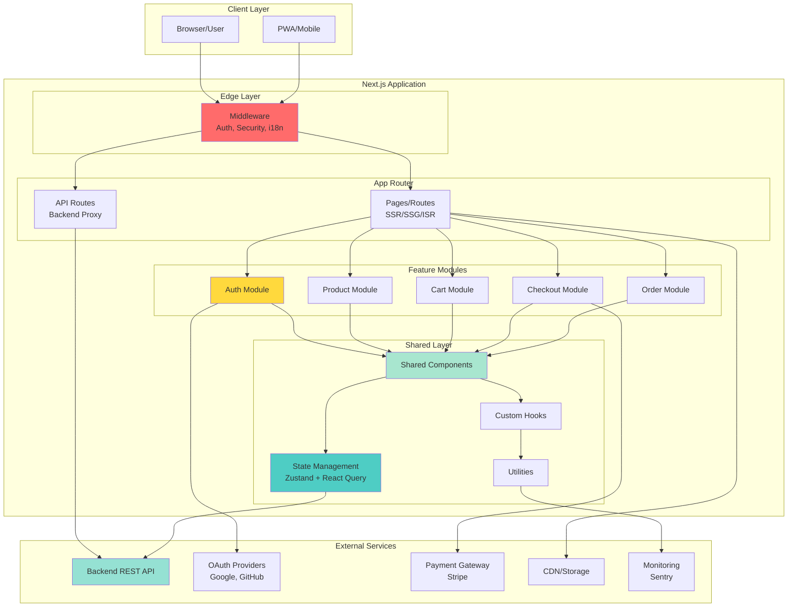
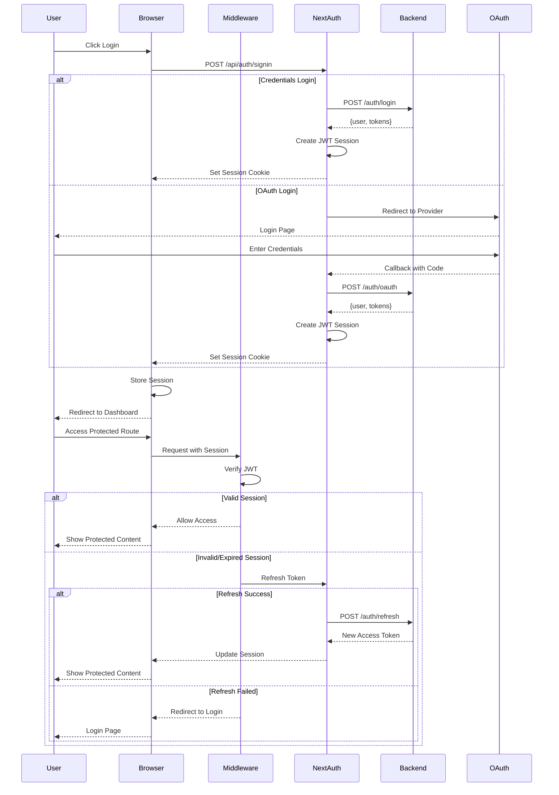
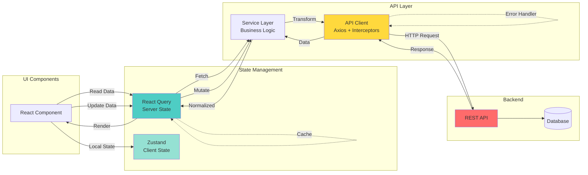
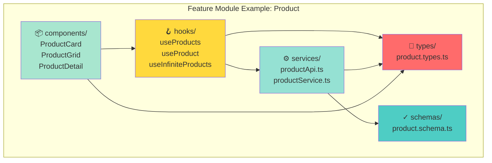
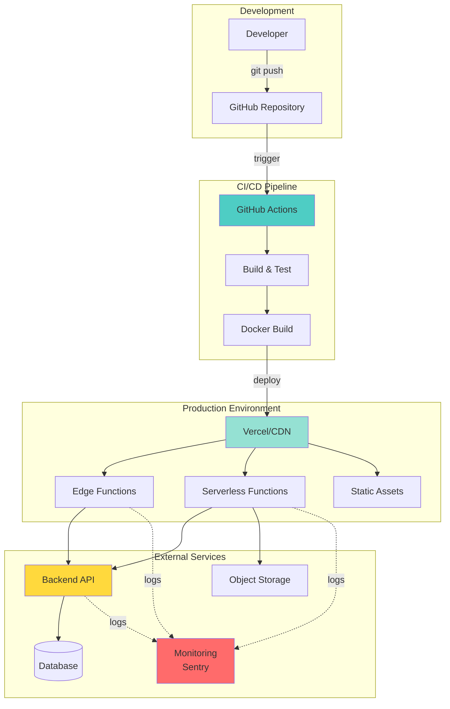
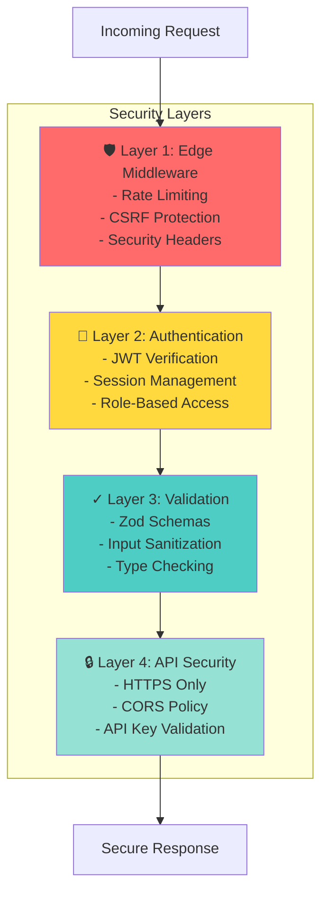

# 🏛️ Architecture Overview

## High-Level Architecture



## Authentication Flow



## Data Flow Architecture



## Feature Module Structure



## Deployment Architecture



## Security Layers



## Key Architectural Decisions

### Why Feature-Based Architecture?

**Benefits:**
- ✅ Better code organization by business domain
- ✅ Easy to locate and modify features
- ✅ Promotes modular, reusable code
- ✅ Scalable for large teams
- ✅ Clear ownership boundaries

**Structure:**
```
features/
  auth/
    ├── components/    # UI specific to auth
    ├── hooks/         # Auth-related hooks
    ├── services/      # Auth API calls
    ├── types/         # Auth types
    └── schemas/       # Auth validation
```

### Why NextAuth v4 over v5?

**Reasons:**
- ✅ Production-stable (v5 still in beta/RC as of 2026)
- ✅ Well-documented and battle-tested
- ✅ Large community support
- ✅ Better TypeScript support
- ✅ Easier migration path

### Why React Query + Zustand?

**React Query for:**
- ✅ Server state management
- ✅ Automatic caching & revalidation
- ✅ Request deduplication
- ✅ Background refetching
- ✅ Optimistic updates

**Zustand for:**
- ✅ Client-side UI state (modals, theme, etc.)
- ✅ Simple API, no boilerplate
- ✅ TypeScript friendly
- ✅ DevTools support

### Why Axios over Fetch?

**Advantages:**
- ✅ Automatic request/response transformation
- ✅ Interceptors for auth & error handling
- ✅ Request cancellation
- ✅ Timeout support
- ✅ Retry logic with axios-retry
- ✅ Better error messages

### Why Vitest over Jest?

**Benefits:**
- ✅ Faster execution (Vite-powered)
- ✅ Better ESM support
- ✅ Native TypeScript support
- ✅ Compatible with Jest API
- ✅ Watch mode with HMR
- ✅ Modern and actively maintained
