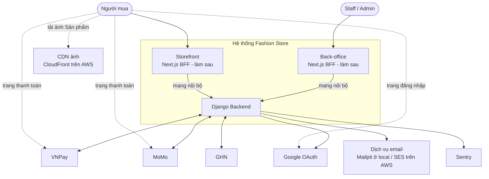
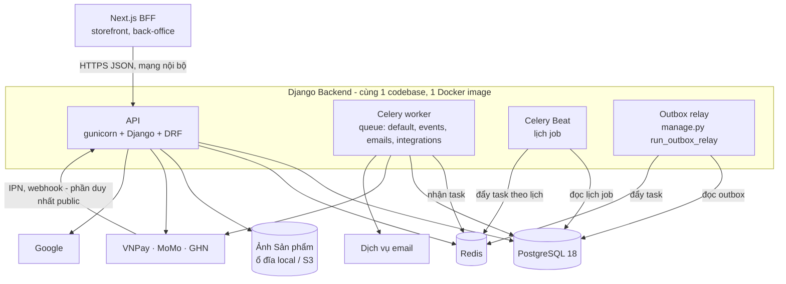
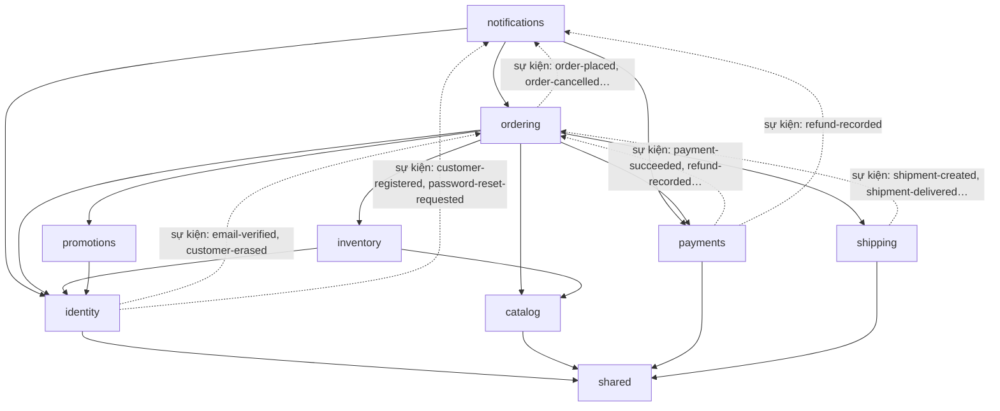
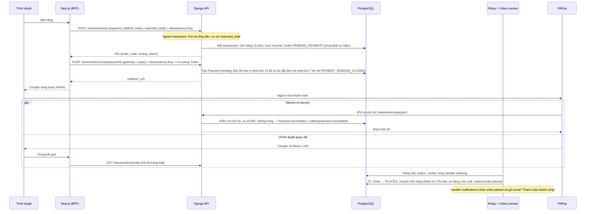

# 01. Bối cảnh hệ thống (C4 mức 1, 2 và 3)

> Trạng thái: **Bản nháp chờ review**. Thuật ngữ dùng theo [GLOSSARY.md](../../GLOSSARY.md).

## 1. Mức 1: hệ thống và các bên liên quan

| Bên ngoài | Backend gọi ra để | Bên ngoài gọi vào Backend để |
|---|---|---|
| VNPay | Truy vấn trạng thái Thanh toán (Đối soát). Link thanh toán do Backend tự ký, không cần gọi VNPay | Báo kết quả thanh toán qua IPN |
| MoMo | Tạo link thanh toán, truy vấn trạng thái Thanh toán (Đối soát) | Báo kết quả thanh toán qua IPN |
| GHN | Báo giá phí ship, tạo và huỷ Vận đơn, truy vấn trạng thái Vận đơn (Đối soát) | Báo trạng thái Vận đơn qua webhook |
| Google | Lấy khoá công khai để xác minh `id_token` | — |
| Email | Gửi email (SMTP / SES) | — |
| Sentry | Gửi lỗi và thông tin hiệu năng | — |

Giai đoạn này **chỉ làm Backend**. Storefront và back-office được thể hiện để rõ ai sẽ gọi API. Mũi tên đứt từ Người mua là các trang trình duyệt mở thẳng, không qua Next.js.

Trình duyệt không bao giờ gọi thẳng Django. Next.js là BFF cho **mọi** request tới Django và chạy cùng mạng nội bộ với Django (VPC trên AWS, [ADR 0009](../adr/0009-nextjs-bff-django-private.md)). Ngoài Next.js, trình duyệt chỉ tới trang thanh toán của VNPay / MoMo, trang đăng nhập Google, và tải ảnh Sản phẩm qua CloudFront trên AWS. Từ internet, chỉ IPN và webhook của VNPay, MoMo, GHN vào được Django mà không qua Next.js (`/api/v1/webhooks/*`). Trên AWS, các request này vẫn đi qua CloudFront, WAF và ALB public ([09](./09-deployment-aws-target.md)).

## 2. Mức 2: các container của Backend

| Container | Vai trò | Số bản chạy |
|---|---|---|
| API | Xử lý request HTTP: storefront, back-office, webhook | ≥ 2 trên AWS, scale theo CPU |
| Celery worker | Chạy handler sự kiện, gửi email, gọi API ngoài, job Đối soát | ≥ 1, scale theo độ dài queue |
| Celery Beat | Đẩy job theo lịch (huỷ đơn hết hạn, Đối soát, chuyển đơn sang Hoàn tất). Lịch lưu trong PostgreSQL (`DatabaseScheduler`) | **Đúng 1** |
| Outbox relay | Đọc bảng `shared_outbox_event` rồi đẩy sự kiện sang Celery | 1. Lúc deploy có thể chồng 2 bản, vẫn an toàn nhờ `FOR UPDATE SKIP LOCKED` |
| PostgreSQL | Dữ liệu nghiệp vụ, outbox, `Idempotency-Key`, lịch job | 1 (Multi-AZ trên AWS) |
| Redis | Broker Celery, cache, throttling, cache `token_version`. Đặt `noeviction`, mọi key cache có TTL. Redis lỗi thì API vẫn chạy, kể cả checkout (fail-open), nhưng xác nhận Thanh toán online dừng tới khi Redis hồi lại (xem [10](./10-nfr.md) mục 2) | 1 |

API, Celery worker, Celery Beat và Outbox relay đều gửi lỗi về Sentry; sơ đồ không vẽ các mũi tên này cho gọn.

## 3. Mức 3: module bên trong Backend

Chi tiết xem [02-backend-structure.md](./02-backend-structure.md).

Cách đọc sơ đồ:

- Mũi tên liền `A --> B`: A phụ thuộc trực tiếp vào B, tức là gọi `B/contracts.py`, nghe sự kiện trong `B/events.py` hoặc có FK tới model của B. Sơ đồ chỉ vẽ các phụ thuộc đang có. Phụ thuộc nào hợp lệ do luật theo lớp quyết định, xem [02-backend-structure.md](./02-backend-structure.md) mục 4.
- Mũi tên đứt: chỉ minh hoạ hướng đi của sự kiện, từ module phát ở lớp dưới tới module nghe ở lớp trên. Đây không phải một loại phụ thuộc riêng: bên nghe đã có mũi tên liền tới bên phát. Tên sự kiện ghi tắt, bỏ tiền tố module. Sơ đồ chỉ nêu ví dụ, danh sách đầy đủ ở [07-async-events-jobs.md](./07-async-events-jobs.md) mục 2.
- `shared` là app hạ tầng dùng chung, không phải module nghiệp vụ ([ADR 0006](../adr/0006-modular-monolith.md)).

## 4. Luồng chính: đặt hàng thanh toán VNPay

Luồng dưới đây là của Khách vãng lai. Với Khách hàng đã đăng nhập, checkout không trả `lookup_token` và Next.js gửi access token thay cho `X-Lookup-Token`. Đường dẫn bỏ tiền tố `/api/v1`. Chi tiết request và response xem [04-api-contract.md](./04-api-contract.md); T3 là mã chuyển trạng thái trong [05-order-lifecycle.md](../business/05-order-lifecycle.md) mục 3.

IPN và Return URL tới theo thứ tự bất kỳ. Người mua có thể về trang kết quả trước khi IPN tới hoặc trước khi handler chuyển đơn sang `PLACED`, và hệ thống không bao giờ dựa vào Return URL để xác nhận Thanh toán (BR-PAY-02). Vì vậy trang kết quả luôn hỏi lại trạng thái Đơn hàng từ Django, và có thể thấy đơn vẫn ở `PENDING_PAYMENT` trong vài giây đầu.

Nếu IPN không tới, job Đối soát `payments.reconcile_pending_payments` (mỗi 5 phút) truy vấn VNPay và xử lý giống hệt như khi nhận IPN.

Tính từ lúc đặt đơn, link thanh toán hết hạn ở phút thứ 10, Giữ hàng hết hạn ở phút thứ 15. Khoảng đệm 5 phút dành cho IPN đến muộn. Đối soát chỉ là lưới an toàn: job chạy theo lịch cố định chứ không canh theo từng đơn, nên không bảo đảm kịp trước phút 15.

Điều kiện của T3 (Giữ hàng còn hiệu lực) và T4 (đơn vẫn ở `PENDING_PAYMENT`) được xét **lúc handler hoặc job chạy**, không phải lúc tiền về. Vì vậy nếu tiền về sát phút 15 và job `ordering.cancel_expired_pending_orders` chạy trước handler T3, đơn vẫn bị huỷ (T4) dù Người mua đã trả trong hạn. Đây là đánh đổi có chủ ý: Giữ hàng quá `expires_at` luôn vô hiệu ([03](./03-data-model.md)), và cửa sổ rủi ro chỉ vài giây trễ của relay. Để cửa sổ này không phình ra khi việc giao sự kiện bị tồn đọng (ví dụ sau khi Redis lỗi), job T4 bỏ qua lượt chạy khi `shared.events.delivery_lag()` quá **60 giây**, tức còn sự kiện chưa lập delivery hoặc delivery `pending` đã tới hạn mà chưa được xử lý ([07](./07-async-events-jobs.md) mục 3.2). Nếu handler T3 chạy khi đơn vẫn `PENDING_PAYMENT` nhưng Giữ hàng đã quá hạn, hệ thống thử giữ lại hàng: còn đủ Số lượng bán được thì đơn vẫn vào `PLACED`, không đủ thì chạy T4 rồi xử lý như đơn đã huỷ. Nếu tiền vẫn về khi Đơn hàng không còn ở `PENDING_PAYMENT` (đã huỷ, hoặc đã được trả bởi một lần Thanh toán khác), hệ thống tự tạo Hoàn tiền và gắn Cờ cần xử lý `unexpected_payment` (BR-PAY-05).
