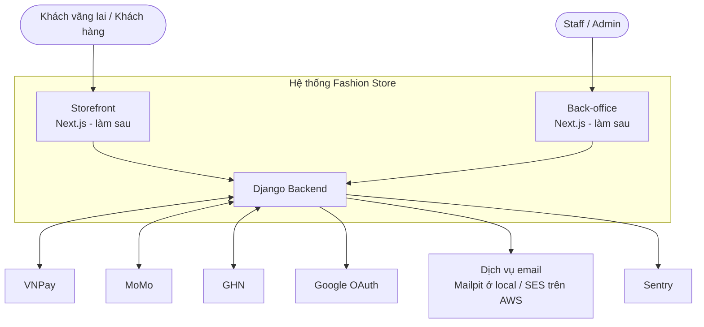
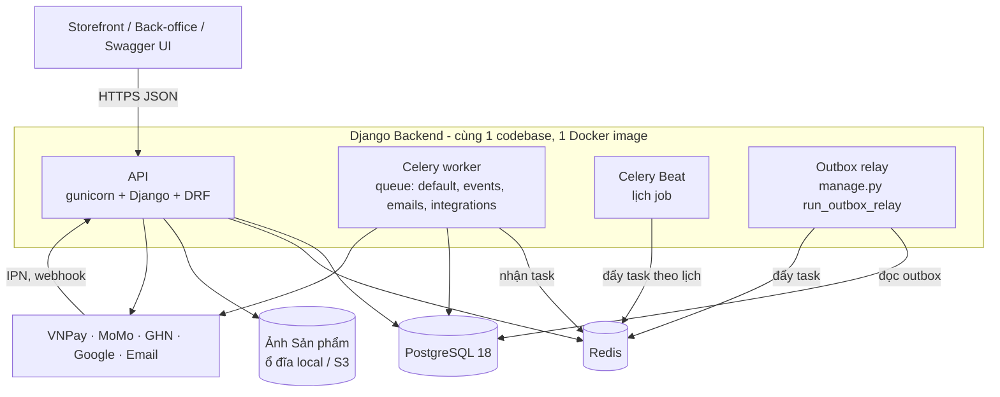
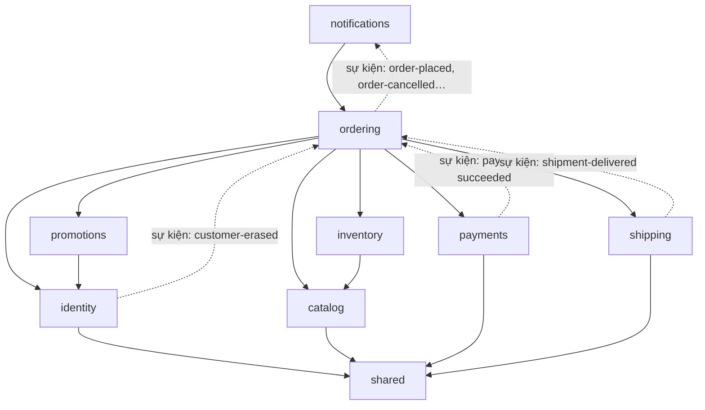
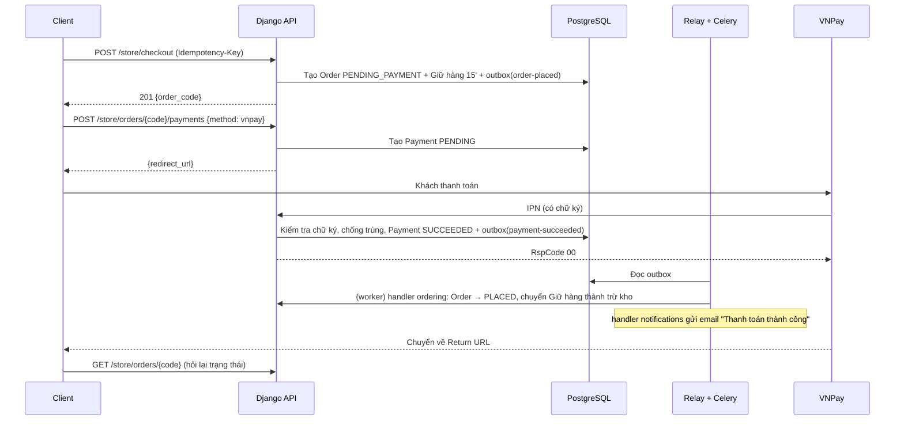

# 01. Bối cảnh hệ thống (C4 mức 1 và 2)

> Trạng thái: **Bản nháp chờ review**. Thuật ngữ dùng theo [GLOSSARY.md](../../GLOSSARY.md).

## 1. Mức 1: hệ thống và các bên liên quan

| Bên ngoài | Hệ thống gọi tới | Gọi vào hệ thống |
|---|---|---|
| VNPay, MoMo | Tạo link thanh toán, truy vấn giao dịch (đối soát) | IPN báo kết quả thanh toán |
| GHN | Báo giá phí ship, tạo vận đơn, truy vấn trạng thái | Webhook báo trạng thái vận đơn |
| Google | Lấy khoá công khai để xác minh `id_token` | — |
| Email | Gửi email (SMTP / SES) | — |
| Sentry | Gửi lỗi và thông tin hiệu năng | — |

Giai đoạn này **chỉ làm Backend**. Storefront và back-office được thể hiện để rõ ai sẽ gọi API.

## 2. Mức 2: các container của Backend

| Container | Vai trò | Số bản chạy |
|---|---|---|
| API | Xử lý request HTTP: storefront, back-office, webhook | ≥ 2 trên AWS, scale theo CPU |
| Celery worker | Chạy handler sự kiện, gửi email, gọi API ngoài, job đối soát | ≥ 1, scale theo độ dài queue |
| Celery Beat | Đẩy job theo lịch (huỷ đơn hết hạn, đối soát, hoàn tất đơn) | **Đúng 1** |
| Outbox relay | Đọc bảng `outbox` rồi đẩy sự kiện sang Celery | **Đúng 1** (có khoá chống chạy trùng) |
| PostgreSQL | Dữ liệu nghiệp vụ, outbox, lịch job | 1 (Multi-AZ trên AWS) |
| Redis | Broker Celery, cache, throttling, idempotency key | 1 |

## 3. Mức 3: module bên trong Backend

Chi tiết xem [02-backend-structure.md](./02-backend-structure.md).

Mũi tên liền: gọi trực tiếp qua `contracts.py`. Mũi tên đứt: thông báo ngược lên bằng sự kiện.

## 4. Luồng chính: đặt hàng thanh toán VNPay

Nếu IPN không tới, job `reconcile_pending_payments` (mỗi 5 phút) truy vấn VNPay và xử lý giống hệt như khi nhận IPN.
