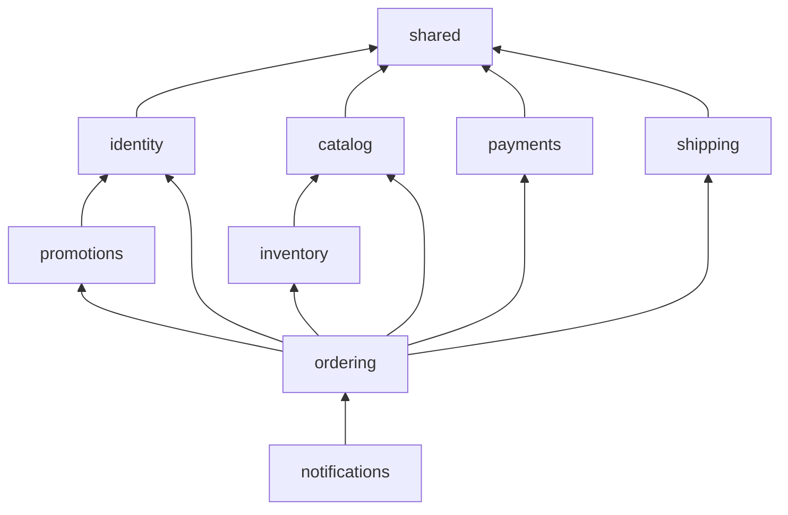

# 02. Cấu trúc Backend: thư mục, công nghệ, package và vai trò từng file

> Trạng thái: **Bản nháp chờ review**. Quyết định nền tảng: [ADR 0006](../adr/0006-modular-monolith.md) (modular monolith), [ADR 0007](../adr/0007-events-outbox-celery-no-kafka.md) (sự kiện), [ADR 0002](../adr/0002-auth-nextauth-session-django-jwt.md) (xác thực).
> Thuật ngữ dùng theo [GLOSSARY.md](../../GLOSSARY.md).

## 1. Tổng quan

- **Một Django project**, deploy một lần, chạy thành nhiều tiến trình: API, Celery worker, Celery Beat, Outbox relay.
- **Hai Django app**:
  - `modules`: toàn bộ nghiệp vụ, chia thành 8 module con.
  - `shared`: hạ tầng dùng chung (sự kiện, dữ liệu địa giới hành chính, các lớp API cơ sở). `shared` **không chứa nghiệp vụ** và **không bao giờ import `modules`**.
- Cách viết code theo **HackSoft Django Styleguide**: model giữ dữ liệu và ràng buộc, `services` lo nghiệp vụ ghi, `selectors` lo truy vấn đọc, view chỉ nhận request và gọi service hoặc selector.

## 2. Công nghệ

| Hạng mục | Lựa chọn | Phiên bản |
|---|---|---|
| Ngôn ngữ | Python | 3.13 |
| Framework | Django | 5.2 LTS (hỗ trợ tới 04/2028; nâng lên 6.2 LTS khoảng Q3/2027) |
| API | Django REST Framework | 3.18 |
| Database | PostgreSQL (extension `unaccent`, `pg_trgm`, `btree_gist`) | 18 |
| Cache, broker | Redis | 7.2 ở local, để khớp với ElastiCache trên AWS (xem [09](./09-deployment-aws-target.md)) |
| Background jobs | Celery + Celery Beat | 5.6 |
| Quản lý package | uv | 0.13 |

## 3. Danh sách package

Phiên bản được kiểm tra trên PyPI ngày **25/10/2026**. Dấu **—** nghĩa là chưa kiểm tra, sẽ pin phiên bản mới nhất tương thích khi khởi tạo dự án. Mọi phiên bản được khoá trong `uv.lock`.

### 3.1. Runtime

| Package | Phiên bản | Dùng để | Vì sao chọn |
|---|---|---|---|
| `django` | 5.2.18 | Framework | Bản LTS, cả hệ sinh thái đều đã tương thích |
| `djangorestframework` | 3.18.3 | REST API | Phổ biến nhất, team đã quen |
| `drf-spectacular` | 0.30.0 | Sinh OpenAPI 3 và Swagger UI | Chuẩn de facto cho DRF; OpenAPI dùng để sinh TS client cho Frontend |
| `django-filter` | 26.2 | Lọc danh sách (size, màu, giá, trạng thái) | Tích hợp sẵn với DRF |
| `psycopg[c,pool]` | — | Driver PostgreSQL | psycopg 3, có connection pool |
| `redis` | 8.1.0 | Client Redis | Dùng cho cache, throttling, Celery |
| `celery` | 5.6.3 | Worker chạy job | Có retry, định tuyến queue, hệ sinh thái lớn |
| `django-celery-beat` | 2.9.0 | Lịch job lưu trong DB | Sửa lịch không cần deploy lại |
| `pydantic` | 2.14.1 | Định nghĩa schema sự kiện, DTO của `contracts.py` | Có type, validate, sinh JSON Schema (chuẩn bị cho Schema Registry) |
| `pydantic-settings` | 2.16.1 | Đọc biến môi trường có kiểu | Sai cấu hình thì báo lỗi ngay khi khởi động |
| `PyJWT[crypto]` | 2.15.1 | Ký và kiểm tra JWT (Ed25519) | Thư viện chuẩn; phần mật mã không tự viết ([ADR 0002](../adr/0002-auth-nextauth-session-django-jwt.md)) |
| `google-auth` | 2.62.0 | Xác minh `id_token` của Google | Thư viện chính thức của Google |
| `argon2-cffi` | 25.1.0 | Hash mật khẩu Argon2 | Thuật toán được OWASP khuyến nghị |
| `django-fsm-2` | 4.2.4 | Máy trạng thái Đơn hàng | `django-fsm` gốc đã chuyển sang viewflow; bản này giữ API cũ, do django-commons duy trì |
| `django-pghistory` | 3.9.2 | Lịch sử thay đổi (Đơn hàng, thanh toán, Tồn kho) | Dùng trigger PostgreSQL nên bắt được cả `bulk_update` |
| `django-cors-headers` | 4.9.0 | CORS cho storefront và back-office | Chuẩn |
| `httpx` | — | Gọi API VNPay, MoMo, GHN | Hỗ trợ timeout và retry rõ ràng; test bằng `respx` |
| `Pillow` | 13.0.0 | Xử lý ảnh Sản phẩm | Bắt buộc cho `ImageField` |
| `django-storages[s3]` + `boto3` | 1.14.6 / — | Lưu ảnh trên S3 (chỉ ở AWS) | Ở local lưu ra ổ đĩa (`FileSystemStorage`) |
| `vietnam-provinces` | 2026.9.0 | Dữ liệu 34 tỉnh/thành và phường/xã (sau 07/2025) | Đã cập nhật theo cấu trúc 2 cấp |
| `structlog` + `django-structlog` | 26.1.0 / 11.0.0 | Log JSON có `request_id` | Dễ tìm kiếm log trên CloudWatch |
| `sentry-sdk[django,celery]` | 2.73.0 | Theo dõi lỗi và hiệu năng | Chuẩn |
| `gunicorn` + `uvicorn-worker` | — | Server chạy production | Chạy ASGI |

### 3.2. Dev và test

| Package | Phiên bản | Dùng để |
|---|---|---|
| `ruff` | 0.17.2 | Lint và format (thay cho flake8, isort, black) |
| `mypy` + `django-stubs` + `djangorestframework-stubs` | 2.4.0 / bản tương thích Django 5.2 / — | Kiểm tra kiểu, có plugin hiểu Django ORM |
| `import-linter` | 2.15 | Kiểm tra ranh giới giữa các module (bắt buộc trong CI) |
| `pytest` + `pytest-django` | — / 4.14.0 | Chạy test |
| `pytest-xdist` | 3.8.0 | Chạy test song song |
| `factory-boy` | 3.3.3 | Tạo dữ liệu test |
| `coverage` | 7.17.0 | Đo độ phủ test |
| `respx` | — | Giả lập API bên ngoài khi test `httpx` |
| `time-machine` | — | Cố định thời gian khi test (Giữ hàng 15 phút, Hoàn tất sau 7 ngày) |
| `django-zeal` | 2.3.0 | Phát hiện lỗi N+1 query khi chạy test |
| `debugpy` | — | Debug từ IDE vào container |
| `pip-audit` | 2.10.1 | Kiểm tra lỗ hổng đã công bố trong dependency (chạy trong CI) |
| `pre-commit` | 4.7.0 | Chạy ruff, mypy, import-linter và các hook `pre-commit-hooks` (`check-yaml`, `check-toml`, `end-of-file-fixer`, `trailing-whitespace`) trước khi commit |
| `commitizen` | — | Kiểm tra commit message theo Conventional Commits, gắn tag phiên bản, sinh CHANGELOG ([11](./11-git-workflow.md)) |

### 3.3. Không dùng (và lý do)

| Package | Lý do |
|---|---|
| `djangorestframework-simplejwt` | Tổ chức Jazzband đang giải thể ([ADR 0002](../adr/0002-auth-nextauth-session-django-jwt.md)) |
| `django-money`, `py-moneyed` | VND không có số lẻ, lưu số nguyên là đủ |
| `django-ratelimit` | Không cập nhật từ 2023; dùng throttling của DRF |
| `django-health-check` 4.x | Yêu cầu Python 3.14 và Django 6; tự viết `/healthz`, `/readyz` |
| MinIO | Ngừng bảo trì từ 04/2026 |
| Kafka, Schema Registry | Chưa cần ở quy mô MVP ([ADR 0007](../adr/0007-events-outbox-celery-no-kafka.md)) |

## 4. Module và thứ tự phụ thuộc

| Module | Sở hữu |
|---|---|
| `identity` | Khách hàng, Staff, Admin, xác thực JWT, sổ địa chỉ, đồng ý xử lý dữ liệu, yêu cầu xoá dữ liệu |
| `catalog` | Danh mục, Sản phẩm, Biến thể, ảnh, giá bán, **Giá khuyến mãi**, trạng thái còn hàng (bản sao để lọc nhanh) |
| `inventory` | Kho, Tồn kho, Giữ hàng, lịch sử thay đổi Tồn kho |
| `promotions` | Voucher, lượt dùng Voucher |
| `payments` | Thanh toán VNPay / MoMo / COD, IPN, Hoàn tiền, đối soát |
| `shipping` | Báo giá phí ship, vận đơn GHN, webhook, đối soát |
| `ordering` | Giỏ hàng, checkout, Đơn hàng, máy trạng thái, Đổi trả |
| `notifications` | Email theo sự kiện |



Đọc sơ đồ: mũi tên `A --> B` nghĩa là **A được phép gọi B** (qua `B/contracts.py`) và có FK tới model của B. Chiều ngược lại bị cấm và `import-linter` sẽ báo lỗi.

**Các lớp, từ dưới lên:**

1. `shared`
2. `identity`, `catalog`, `payments`, `shipping` (độc lập với nhau)
3. `inventory`, `promotions`
4. `ordering`
5. `notifications`

**Module ở lớp dưới báo cho lớp trên bằng sự kiện.** Ví dụ `payments` không biết gì về Đơn hàng. Nó nhận một mã tham chiếu (`reference`, chính là mã đơn) và phát sự kiện `payments.payment-succeeded`. `ordering` lắng nghe sự kiện này để chuyển trạng thái đơn.

## 5. Cây thư mục

```
backend/
├── pyproject.toml                  # dependency, cấu hình ruff, mypy, pytest, import-linter
├── uv.lock                         # khoá phiên bản chính xác của mọi package
├── manage.py
├── .env.example                    # mẫu biến môi trường (file .env thật không commit)
├── .pre-commit-config.yaml
├── .python-version                 # 3.13
├── Dockerfile                      # 1 image dùng chung cho api, worker, beat, relay
├── docker-compose.yml              # api, worker, beat, relay, redis, mailpit
├── Makefile                        # lệnh tắt: make up, make test, make lint, make migrate…
│
├── config/                         # cấu hình project, KHÔNG chứa nghiệp vụ
│   ├── __init__.py                 # nạp Celery app khi Django khởi động
│   ├── env.py                      # class Env (pydantic-settings) đọc và kiểm tra biến môi trường
│   ├── settings/
│   │   ├── __init__.py
│   │   ├── base.py                 # cấu hình chung mọi môi trường
│   │   ├── local.py                # DEBUG, Django Admin read-only, Fake Gateway, Mailpit
│   │   ├── test.py                 # DB test, Celery chạy đồng bộ, hash mật khẩu nhanh
│   │   └── production.py           # bảo mật, S3, SES, Sentry, log JSON
│   ├── urls.py                     # gốc URL: /api/v1/store, /api/v1/backoffice, /api/v1/webhooks, /api/docs, /healthz
│   ├── celery.py                   # khởi tạo Celery, định nghĩa queue
│   ├── asgi.py
│   └── wsgi.py
│
├── shared/                         # Django app "shared": hạ tầng dùng chung
│   ├── __init__.py
│   ├── apps.py
│   ├── models.py                   # BaseModel: id UUID, created_at, updated_at
│   ├── money.py                    # value object Money(amount: int, currency="VND")
│   ├── exceptions.py               # DomainError(code, message, details) và các lỗi chung
│   ├── clock.py                    # now() dùng chung, để test cố định được thời gian
│   ├── events/
│   │   ├── __init__.py             # API công khai: publish(), handles()
│   │   ├── base.py                 # DomainEvent (pydantic): event_id, event_type, schema_version, occurred_at
│   │   ├── models.py               # OutboxEvent, ProcessedEvent
│   │   ├── publisher.py            # EventPublisher: ghi sự kiện vào outbox trong transaction hiện tại
│   │   ├── registry.py             # decorator @handles(...) đăng ký handler cho từng loại sự kiện
│   │   ├── relay.py                # đọc outbox chưa gửi, đẩy thành Celery task, đánh dấu đã gửi
│   │   ├── consumer.py             # chạy handler, chống xử lý trùng bằng ProcessedEvent
│   │   └── tasks.py                # Celery task dispatch_event(event_id, handler_name)
│   ├── geo/
│   │   ├── models.py               # Province, Ward (2 cấp, theo vietnam-provinces)
│   │   ├── selectors.py            # tra cứu tỉnh/thành, phường/xã
│   │   └── api.py                  # GET /api/v1/store/geo/provinces, /wards
│   ├── api/
│   │   ├── exception_handler.py    # chuyển mọi lỗi sang định dạng lỗi chuẩn (xem 04-api-contract)
│   │   ├── pagination.py           # phân trang chuẩn
│   │   ├── permissions.py          # IsCustomer, IsStaff, IsAdmin
│   │   ├── throttling.py           # các mức throttle dùng chung
│   │   ├── idempotency.py          # xử lý header Idempotency-Key cho các POST quan trọng
│   │   └── i18n.py                 # chọn ngôn ngữ theo Accept-Language (vi mặc định)
│   ├── health/
│   │   └── views.py                # /healthz (sống), /readyz (DB, Redis, Celery sẵn sàng)
│   ├── logging.py                  # cấu hình structlog
│   ├── management/commands/
│   │   ├── run_outbox_relay.py     # tiến trình relay chạy liên tục
│   │   └── load_geo.py             # nạp dữ liệu tỉnh/thành, phường/xã
│   ├── migrations/
│   └── testing/
│       ├── factories.py            # factory gốc
│       └── fixtures.py             # fixture pytest dùng chung (api_client, staff_client…)
│
├── modules/                        # Django app "modules": toàn bộ nghiệp vụ
│   ├── __init__.py
│   ├── apps.py                     # ModulesConfig.ready(): nạp handlers.py của mọi module con
│   ├── models.py                   # import model của mọi module con để Django nhận ra
│   ├── admin.py                    # Django Admin read-only, chỉ bật ở local
│   ├── migrations/                 # MỘT chuỗi migrations cho mọi module con
│   ├── management/commands/
│   │   ├── seed_catalog.py         # tạo dữ liệu mẫu cho local
│   │   └── create_staff.py         # tạo tài khoản Staff/Admin
│   ├── templates/
│   │   └── emails/                 # template email theo ngôn ngữ (vi, en)
│   ├── identity/
│   ├── catalog/
│   ├── inventory/
│   ├── promotions/
│   ├── payments/
│   ├── shipping/
│   ├── ordering/
│   └── notifications/
│
├── locale/
│   ├── vi/LC_MESSAGES/django.po    # thông báo lỗi và email tiếng Việt
│   └── en/LC_MESSAGES/django.po
│
└── tests/
    └── flows/                      # test xuyên module: checkout → thanh toán → giao → hoàn tất
```

> **Lưu ý của cách A (một app `modules`)**: Django chỉ tìm `migrations/`, `management/commands/`, `templates/` và `admin.py` ở **gốc app**. Vì vậy các thư mục này nằm ở `modules/` chứ không nằm trong từng module con ([ADR 0006](../adr/0006-modular-monolith.md)).

## 6. Khuôn mẫu của một module con

Mọi module con đều theo cùng một khuôn. Ví dụ với `ordering`:

```
modules/ordering/
├── __init__.py
├── contracts.py          # ⭐ public API của module: hàm + DTO mà module khác được gọi
├── events.py             # sự kiện module này phát ra (class pydantic, có version)
├── constants.py          # enum: OrderStatus, CancelReason…
├── exceptions.py         # lỗi nghiệp vụ: OutOfStock, InvalidTransition, VoucherNotApplicable…
├── models/
│   ├── __init__.py       # export các model
│   ├── cart.py           # Cart, CartItem
│   ├── order.py          # Order (có máy trạng thái), OrderLine, OrderCodeSequence
│   └── returns.py        # ReturnRequest, ReturnLine
├── services/
│   ├── __init__.py
│   ├── cart.py           # add_item, update_quantity, merge_guest_cart
│   ├── checkout.py       # place_order: kiểm tra hàng, Voucher, phí ship, tạo đơn, Giữ hàng hoặc trừ kho
│   ├── transitions.py    # confirm, start_packing, hand_over, cancel, mark_delivered, complete
│   └── returns.py        # record_return, receive_return_items, accept, reject
├── selectors/
│   ├── __init__.py
│   ├── cart.py           # get_cart_with_prices
│   └── orders.py         # list_orders_for_customer, find_order_for_guest, list_orders_backoffice
├── handlers.py           # nghe sự kiện: payment-succeeded, shipment-delivered, customer-erased…
├── tasks.py              # cancel_expired_pending_orders, complete_delivered_orders
├── admin.py              # đăng ký Django Admin read-only (được modules/admin.py nạp)
├── api/
│   ├── store/
│   │   ├── serializers.py    # dữ liệu vào/ra cho storefront
│   │   ├── views.py          # view mỏng: validate → gọi service/selector → trả kết quả
│   │   └── urls.py
│   └── backoffice/
│       ├── serializers.py
│       ├── views.py
│       └── urls.py
└── tests/
    ├── factories.py
    ├── test_services_checkout.py
    ├── test_services_transitions.py
    ├── test_handlers.py
    └── test_api_store.py
```

### 6.1. Vai trò và quy tắc của từng file

| File | Chứa gì | Được import | Cấm |
|---|---|---|---|
| `contracts.py` | Các hàm công khai (ví dụ `reserve_stock(...)`) và DTO pydantic đầu vào/ra. Đây là thứ **duy nhất** module khác được dùng | `services`, `selectors` của chính module; `contracts` của module lớp dưới | Trả về model Django ra ngoài (phải trả DTO) |
| `events.py` | Class sự kiện, ví dụ `OrderPlacedV1(DomainEvent)` có `event_type = "ordering.order-placed"`, `schema_version = 1` | `shared.events.base` | Logic nghiệp vụ |
| `constants.py` | `TextChoices` và hằng số | — | Import model |
| `exceptions.py` | Lỗi nghiệp vụ, kế thừa `shared.exceptions.DomainError`, mỗi lỗi có `code` tiếng Anh, ví dụ `OUT_OF_STOCK` | `shared.exceptions` | — |
| `models/` | Field, ràng buộc DB (`UniqueConstraint`, `CheckConstraint`), index, `Meta.db_table` có tiền tố module (ví dụ `ordering_order`), property đơn giản | `shared.models`, model của module lớp dưới (chỉ để làm FK) | Logic nghiệp vụ, gọi API ngoài, gửi email, override `save()` để làm việc phụ |
| `services/` | Mỗi nghiệp vụ ghi là một hàm có tham số keyword, chạy trong `transaction.atomic`, phát sự kiện qua `shared.events.publish` | Model của chính module, `contracts` của module lớp dưới | Nhận `request`; import `api/` |
| `selectors/` | Hàm truy vấn đọc, tối ưu bằng `select_related`, `prefetch_related` | Model của chính module | Ghi dữ liệu |
| `handlers.py` | Hàm `@handles("payments.payment-succeeded", version=1)`, nhận sự kiện rồi gọi service. Phải idempotent | `services`, `events` của module lớp dưới | Logic nghiệp vụ dài (phải đưa vào service) |
| `tasks.py` | Celery task mỏng, chỉ gọi service | `services` | Logic nghiệp vụ |
| `api/*/serializers.py` | Validate dữ liệu vào, định dạng dữ liệu ra | — | Gọi `.save()` lên model, logic nghiệp vụ |
| `api/*/views.py` | `APIView` hoặc `GenericAPIView`: phân quyền, gọi serializer, gọi service/selector | `services`, `selectors`, `serializers` | `ModelViewSet` tự động CRUD; truy vấn ORM trực tiếp |
| `api/*/urls.py` | Khai báo route | `views` | — |
| `admin.py` | `ModelAdmin` read-only | `models` | Cho phép sửa |
| `tests/` | Test service (nhiều nhất), handler, API | Mọi thứ của module, `shared.testing` | — |

### 6.2. Ví dụ luồng một request

`POST /api/v1/store/checkout`:

```
views.CheckoutView
  → serializers.CheckoutInput.validate()           # kiểm tra dữ liệu vào
  → services.checkout.place_order(...)             # trong transaction.atomic:
       → catalog.contracts.get_variants_for_sale()   # giá áp dụng, snapshot
       → promotions.contracts.redeem_voucher()       # nếu có Voucher
       → shipping.contracts.quote_fee()              # GHN, hoặc phí dự phòng
       → inventory.contracts.reserve_stock()         # online: Giữ hàng 15 phút
         hoặc inventory.contracts.decrement_stock()  # COD
       → Order.objects.create(...) + OrderLine(...)
       → shared.events.publish(OrderPlacedV1(...))   # ghi vào outbox, cùng transaction
  → serializers.OrderOutput(order).data
```

Sau khi commit, relay đẩy `ordering.order-placed` sang Celery, `notifications.handlers` gửi email.

## 7. Nội dung chính của từng module con

Các module con đều theo khuôn ở mục 6. Bảng dưới chỉ liệt kê nội dung đặc thù của từng module.

### 7.1. `identity`

| File | Nội dung |
|---|---|
| `models/user.py` | `User` (custom user, `AUTH_USER_MODEL = "modules.User"`): email, `kind` (`customer` / `staff` / `admin`), `language`, `token_version`, `is_active`, `anonymized_at` |
| `models/address.py` | `Address`: sổ địa chỉ của Khách hàng, FK tới `shared.geo.Ward` |
| `models/auth.py` | `RefreshToken`: `jti`, `family_id`, `token_hash`, `expires_at`, `used_at`, `revoked_at`; `PasswordResetToken` |
| `models/privacy.py` | `Consent` (phiên bản chính sách, kênh, thời điểm), `ErasureRequest`, `CustomerDataAccessLog` |
| `auth/tokens.py` | Phát hành và kiểm tra access/refresh JWT bằng PyJWT (Ed25519, `kid`) |
| `auth/authentication.py` | `JWTAuthentication`, class xác thực của DRF |
| `auth/google.py` | Xác minh `id_token` Google bằng `google-auth` |
| `services/` | `register`, `login`, `refresh`, `logout`, `request_password_reset`, `reset_password`, `login_with_google`, `record_consent`, `erase_customer` |
| `events.py` | `CustomerRegisteredV1`, `CustomerErasedV1`, `PasswordResetRequestedV1` |
| `contracts.py` | `get_customer(id)`, `CustomerDTO` |

### 7.2. `catalog`

| File | Nội dung |
|---|---|
| `models/` | `Category` (cây danh mục), `Product` (`status`, `weight_grams`), `ProductColor` + `ProductImage` (ảnh theo màu), `Variant` (`sku`, `size`, `color`, `price`, `is_available`), `SalePrice` (`variant`, `price`, `starts_at`, `ends_at`) |
| `selectors/` | Danh sách và chi tiết Sản phẩm có lọc, tìm kiếm (`unaccent` + `pg_trgm`), tính giá áp dụng |
| `contracts.py` | `get_variants_for_sale(ids) -> list[VariantForSaleDTO]` (giá áp dụng, mức giảm, snapshot tên/SKU, cân nặng), `set_variant_availability(variant_id, available)` (do `inventory` gọi) |

### 7.3. `inventory`

| File | Nội dung |
|---|---|
| `models/` | `Warehouse`, `StockItem` (`variant`, `warehouse`, `on_hand`), `StockReservation` (`reference`, `variant`, `quantity`, `expires_at`, `status`), `StockMovement` (lịch sử) |
| `services/` | `reserve`, `commit_reservation`, `release_reservation`, `decrement`, `restock`, `adjust`. Đều khoá dòng `StockItem` bằng `select_for_update` và sắp xếp khoá theo `variant_id` để tránh deadlock |
| `contracts.py` | `reserve_stock`, `commit_reservation`, `release_reservation`, `decrement_stock`, `restock`, `get_available(variant_ids)` |

### 7.4. `promotions`

| File | Nội dung |
|---|---|
| `models/` | `Voucher` (`code`, `kind`, `value`, `max_discount`, `min_order_value`, `usage_limit`, `per_customer_limit`, `starts_at`, `ends_at`, `is_active`), `VoucherRedemption` (`voucher`, `reference`, `customer_id` hoặc `phone`, `status`) |
| `contracts.py` | `evaluate_voucher(code, subtotal, customer) -> VoucherQuoteDTO`, `redeem_voucher(...)`, `release_voucher(reference)` |

### 7.5. `payments`

| File | Nội dung |
|---|---|
| `models/` | `Payment` (`reference`, `method`, `amount`, `status`, `provider_txn_ref`), `PaymentEvent` (dữ liệu IPN gốc, `UNIQUE(provider, provider_event_id)`), `Refund` (`payment`, `amount`, `status`, `provider_refund_ref`, `recorded_by`) |
| `providers/base.py` | Interface `PaymentGateway`: `create_payment_url`, `verify_ipn`, `query_transaction` |
| `providers/vnpay.py`, `momo.py` | Adapter thật: ký HMAC-SHA512 (VNPay), HMAC-SHA256 (MoMo) |
| `providers/fake.py` | Fake Gateway cho local và test ([ADR 0005](../adr/0005-provider-adapters-fake-gateways.md)) |
| `api/webhooks/` | `POST /api/v1/webhooks/vnpay/ipn`, `/momo/ipn` |
| `api/dev/` | Trang Fake Gateway, **chỉ đăng ký URL khi `settings.local`** |
| `tasks.py` | `reconcile_pending_payments` (mỗi 5 phút) |
| `events.py` | `PaymentSucceededV1`, `PaymentFailedV1`, `RefundRecordedV1` |
| `contracts.py` | `start_payment(reference, amount, method, return_url) -> PaymentStartDTO`, `request_refund(reference, amount, reason)` |

### 7.6. `shipping`

| File | Nội dung |
|---|---|
| `models/` | `Shipment` (`reference`, `provider_order_code`, `status`, `fee`, `cod_amount`), `ShipmentEvent` (webhook gốc), `GhnLocationMapping` (`shared.geo.Ward` → ID của GHN) |
| `providers/base.py` | Interface `ShippingProvider`: `quote`, `create_shipment`, `get_status` |
| `providers/ghn.py`, `fake.py` | Adapter GHN và Fake |
| `api/webhooks/` | `POST /api/v1/webhooks/ghn` |
| `tasks.py` | `reconcile_shipments` (mỗi 15 phút) |
| `events.py` | `ShipmentCreatedV1`, `ShipmentDeliveredV1`, `ShipmentReturnedV1` |
| `contracts.py` | `quote_fee(ward_id, weight_grams, value) -> ShippingQuoteDTO` (tự dùng phí dự phòng khi GHN lỗi), `create_shipment(ShipmentRequestDTO)` |

### 7.7. `ordering`

Xem ví dụ đầy đủ ở mục 6. Máy trạng thái của `Order.status` dùng `django-fsm-2`, mỗi transition ứng với một dòng T1–T13 trong [05-order-lifecycle.md](../business/05-order-lifecycle.md). Transition chỉ được gọi từ `services/transitions.py`.

### 7.8. `notifications`

| File | Nội dung |
|---|---|
| `models/` | `EmailLog` (`event_id`, `to`, `template`, `language`, `status`, `sent_at`) |
| `handlers.py` | Mỗi sự kiện cần gửi email (BR-NTF-01) có một handler; lấy dữ liệu đơn qua `ordering.contracts` |
| `services/email.py` | Render template theo ngôn ngữ, gửi qua Django email backend (Mailpit ở local, SES trên AWS) |
| `tasks.py` | `send_email` có retry |

## 8. Kiểm tra ranh giới module (`import-linter`)

Cấu hình trong `pyproject.toml`:

```toml
[tool.importlinter]
root_packages = ["shared", "modules", "config"]

[[tool.importlinter.contracts]]
name = "Thứ tự lớp giữa các module"
type = "layers"
layers = [
    "modules.notifications",
    "modules.ordering",
    "modules.inventory | modules.promotions",
    "modules.identity | modules.catalog | modules.payments | modules.shipping",
    "shared",
]

[[tool.importlinter.contracts]]
name = "Module khác chỉ được dùng contracts và events"
type = "forbidden"
# Mỗi module có một contract cấm import vào models/services/selectors/api của module khác.
# Danh sách đầy đủ sinh bằng script scripts/gen_importlinter.py

[[tool.importlinter.contracts]]
name = "Module không được tự đẩy sự kiện, phải qua shared.events.publish"
type = "forbidden"
source_modules = ["modules"]
forbidden_modules = ["shared.events.relay", "shared.events.tasks"]
```

> Các module trong cùng một lớp (ví dụ `payments` và `shipping`) **không** được import lẫn nhau (`|` trong `layers` nghĩa là độc lập).

## 9. Quy ước code

### 9.1. Quy ước chung

| Chủ đề | Quy ước |
|---|---|
| Ngôn ngữ | Tên biến, hàm, bảng, field, enum, error code: **tiếng Anh**. Comment và docstring: **tiếng Việt**, giữ nguyên thuật ngữ kỹ thuật tiếng Anh. Chuỗi hiển thị cho người dùng: bọc `gettext` để dịch vi/en |
| Tiền | `BigIntegerField` lưu số đồng VND; trong code dùng `shared.money.Money`; API trả `{"amount": 250000, "currency": "VND"}` |
| Khoá chính | UUID v7 cho mọi bảng (sắp xếp được theo thời gian) **[Giả định]** |
| Thời gian | Lưu UTC (`USE_TZ = True`); hiển thị theo `Asia/Ho_Chi_Minh` |
| Thời điểm hiện tại | Luôn gọi `shared.clock.now()`, không gọi `timezone.now()` trực tiếp trong service |
| Xoá dữ liệu | Không xoá cứng dữ liệu đã có đơn; dùng `status` / `archived` |
| Transaction | Chỉ mở ở tầng `services`; sự kiện ghi vào outbox trong cùng transaction |
| Kiểu dữ liệu | Mọi hàm trong `services`, `selectors`, `contracts` có type hints đầy đủ; `mypy --strict` cho `modules/*/services`, `modules/*/selectors` và `contracts`. Dùng cú pháp mới: `list[X]`, `X \| None`, không dùng `List`, `Optional` |

### 9.2. Đặt tên

Theo PEP 8 (`snake_case` cho hàm/biến/module, `PascalCase` cho class, `UPPER_CASE` cho hằng số), cộng thêm các quy tắc sau:

| Đối tượng | Quy tắc | Ví dụ |
|---|---|---|
| Hàm service | `<verb>_<noun>`, động từ ghi | `place_order`, `cancel_order`, `reserve_stock`, `merge_guest_cart` |
| Hàm selector | `get_…`: trả 1 đối tượng, ném lỗi nếu không có. `find_…`: trả 1 đối tượng hoặc `None`. `list_…`: trả danh sách | `get_cart_with_prices`, `find_order_for_guest`, `list_orders_backoffice` |
| DTO trong `contracts.py` | Class pydantic, hậu tố `DTO` | `CustomerDTO`, `ShippingQuoteDTO` |
| Class sự kiện | Danh từ + động từ quá khứ + `V<n>` | `OrderPlacedV1`, `PaymentSucceededV1` |
| `event_type` | `<module>.<kebab-case>` | `ordering.order-placed` |
| Lỗi nghiệp vụ | Class `PascalCase` mô tả tình huống, `code` dạng `UPPER_SNAKE_CASE` | `OutOfStock` → `OUT_OF_STOCK` |
| Bảng DB | `Meta.db_table = "<module>_<model>"` | `ordering_order` |
| File service/selector | Theo chủ đề nghiệp vụ, không theo tên model | `services/checkout.py`, `selectors/orders.py` |
| File test trong module | `test_<tầng>_<chủ đề>.py` | `test_services_checkout.py`, `test_api_store.py`, `test_handlers.py` |
| Test xuyên module | Đặt ở `backend/tests/flows/` | `tests/flows/test_cod_checkout_flow.py` |

> **Khác với HackSoft Styleguide**: HackSoft đặt tên hàm theo `<entity>_<action>` (`order_place`, `order_list`). Ta dùng `<verb>_<noun>` vì đọc tự nhiên hơn, khớp với cách đặt tên của PEP 8 và Django (`get_object_or_404`, `send_mail`). Việc gom theo entity đã do tên file (`services/checkout.py`) và tên module (`ordering.contracts.place_order`) đảm nhận. Ngoài điểm này, mọi quy tắc khác vẫn theo HackSoft.

### 9.3. Format và lint

| Chủ đề | Quy ước |
|---|---|
| Format | `ruff format` (tương thích Black): 4 space, tối đa 100 ký tự một dòng, nháy kép, magic trailing comma. Không dùng Black, isort, flake8 riêng |
| Lint | `ruff check` với bộ rule bên dưới. Không bật rule `D` (docstring) |
| Kiểu | `mypy` bật plugin `mypy_django_plugin.main` và `mypy_drf_plugin.main` |
| File không phải Python | Chỉ dựa vào `.editorconfig` và hook `check-yaml`, `check-toml`, `end-of-file-fixer`, `trailing-whitespace` của `pre-commit-hooks`. Không dùng Prettier |
| Chạy | `make fmt` để sửa tự động, `make lint` để kiểm tra; `pre-commit` chạy trước mỗi commit; CI chặn nếu lỗi |

```toml
# backend/pyproject.toml
[tool.ruff]
target-version = "py313"
line-length = 100

[tool.ruff.lint]
select = [
    "E", "W",   # pycodestyle
    "F",        # pyflakes
    "I",        # sắp xếp import: stdlib → third-party → config, shared, modules
    "N",        # pep8-naming
    "UP",       # pyupgrade: cú pháp Python 3.13
    "B",        # flake8-bugbear
    "C4",       # comprehension gọn
    "SIM",      # đơn giản hoá code
    "DJ",       # flake8-django
    "DTZ",      # cấm datetime không có múi giờ
    "PT",       # style pytest
    "RUF",      # rule riêng của ruff
    "S",        # flake8-bandit: code nguy hiểm (eval, pickle, shell=True, SQL ghép chuỗi…)
]

[tool.ruff.lint.per-file-ignores]
# Test được dùng assert và mật khẩu giả viết cứng
"tests/**" = ["S101", "S105", "S106"]

[tool.ruff.lint.isort]
known-first-party = ["config", "shared", "modules"]

[tool.mypy]
python_version = "3.13"
plugins = ["mypy_django_plugin.main", "mypy_drf_plugin.main"]

[tool.django-stubs]
django_settings_module = "config.settings.test"
```

### 9.4. Comment và docstring

| Chủ đề | Quy ước |
|---|---|
| Ngôn ngữ | Tiếng Việt, giữ nguyên thuật ngữ kỹ thuật và tên trong code bằng tiếng Anh |
| Docstring | Google style. **Bắt buộc** cho hàm public trong `contracts.py` và `services/`; các chỗ khác chỉ viết khi cần giải thích |
| Nội dung docstring | Giải thích nghiệp vụ, mã quy tắc `BR-xxx` liên quan và các lỗi có thể ném ra. Không lặp lại kiểu dữ liệu vì type hints đã có |
| Comment | Giải thích **vì sao**, không diễn giải lại code làm gì |

```python
def place_order(*, cart_id: UUID, payment_method: PaymentMethod) -> Order:
    """Tạo Đơn hàng từ Giỏ hàng, Giữ hàng hoặc trừ Tồn kho tuỳ phương thức thanh toán.

    Áp dụng BR-INV-04 (đơn COD trừ Tồn kho ngay) và BR-INV-05 (đơn thanh toán online
    tạo Giữ hàng 15 phút).

    Raises:
        OutOfStock: Một Biến thể trong Giỏ hàng không đủ tồn kho.
        VoucherNotApplicable: Voucher hết hạn hoặc không đạt giá trị tối thiểu.
    """
```
