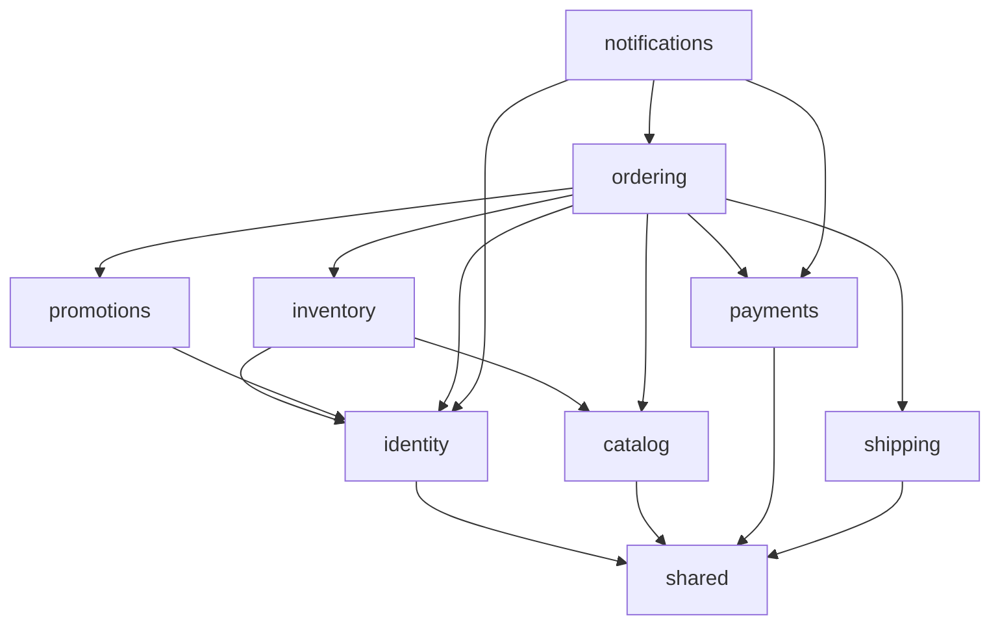

# 02. Cấu trúc Backend: thư mục, công nghệ, package và vai trò từng file

> Trạng thái: **Đã chốt cho MVP** ([quy ước](../../README.md#trạng-thái-tài-liệu)). Quyết định nền tảng: [ADR 0006](../adr/0006-modular-monolith.md) (modular monolith), [ADR 0007](../adr/0007-events-outbox-celery-no-kafka.md) (sự kiện), [ADR 0002](../adr/0002-auth-nextauth-session-django-jwt.md) (xác thực).
> Thuật ngữ dùng theo [GLOSSARY.md](../../GLOSSARY.md).

File này là chuẩn tổ chức code và ranh giới module cho thiết kế mục tiêu. Schema cụ thể theo [03](./03-data-model.md); nghiệp vụ, API, bảo mật và recovery theo các tài liệu được dẫn chiếu. Các phiên bản package bên dưới là đầu vào cho bootstrap, chỉ được coi là đã tương thích khi `uv` resolve thành công, có `uv.lock` và các kiểm tra khởi tạo chạy đạt; danh sách này không thay thế lockfile.

## 1. Tổng quan

- **Một Django project**, deploy một lần, chạy thành nhiều tiến trình: API, Celery worker, Celery Beat, Outbox relay.
- Backend dành riêng cho **Fashion Store**, theo [phạm vi nghiệp vụ](../business/01-vision-scope.md); không đặt mục tiêu xây boilerplate ecommerce tổng quát.
- **Hai Django app**:
  - `modules`: toàn bộ nghiệp vụ, chia thành 8 module con.
  - `shared`: hạ tầng dùng chung (sự kiện, dữ liệu địa giới hành chính, các lớp API cơ sở). `shared` **không chứa nghiệp vụ** và **không bao giờ import `modules`**.
- Cách viết code theo **HackSoft Django Styleguide**: model giữ dữ liệu và ràng buộc, `services` lo nghiệp vụ ghi, `selectors` lo truy vấn đọc, view chỉ nhận request và gọi service hoặc selector.

## 2. Công nghệ

| Hạng mục | Lựa chọn | Phiên bản |
|---|---|---|
| Ngôn ngữ | Python | 3.14 |
| Framework | Django | 5.2 LTS (hỗ trợ tới 04/2028; nâng lên 6.2 LTS khoảng Q3/2027) |
| API | Django REST Framework | 3.18 |
| Database | PostgreSQL (extension `unaccent`, `pg_trgm`, `btree_gist`) | 18 (RDS và CI); local dùng bản major mới nhất ([ADR 0015](../adr/0015-local-postgres-on-host.md)) |
| Cache, broker | Redis (chạy bằng **Valkey**) | Ghim **Valkey 8** cho cả local và ElastiCache for Valkey trên AWS (xem [09](./09-deployment-aws-target.md)). Tài liệu gọi chung là "Redis" vì đó là tên giao thức và thư viện (`redis-py`, broker `redis://`); Valkey tương thích giao thức nên không phải sửa code |
| Background jobs | Celery + Celery Beat | 5.6 |
| Quản lý package | uv | ≥ 0.13 |

## 3. Danh sách package

Phiên bản được kiểm tra trên PyPI ngày **25/10/2026**. Dấu **—** nghĩa là chưa kiểm tra, sẽ pin phiên bản mới nhất tương thích khi khởi tạo dự án. Mọi phiên bản được khoá trong `uv.lock`.

### 3.1. Runtime

| Package | Phiên bản | Dùng để | Vì sao chọn |
|---|---|---|---|
| `django` | 5.2.18 | Framework | Bản LTS, cả hệ sinh thái đều đã tương thích |
| `djangorestframework` | 3.18.3 | REST API | Phổ biến nhất, team đã quen |
| `drf-spectacular` | 0.30.0 | Sinh OpenAPI 3 và Swagger UI | Chuẩn de facto cho DRF; OpenAPI dùng để sinh TS client cho Frontend |
| `django-filter` | 26.2 | Lọc danh sách (size, màu, giá, trạng thái) | Tích hợp sẵn với DRF |
| `psycopg[binary,pool]` | 3.3.6 | Driver PostgreSQL | psycopg 3, wheel binary và connection pool; khớp `uv sync --locked --no-build` (không build C extension lúc cài). Dùng connection pool có sẵn của Django 5.2 (`OPTIONS["pool"]`, `CONN_MAX_AGE = 0`) |
| `redis` | 8.1.0 | Client Redis | Dùng cho cache, throttling, Celery |
| `celery` | 5.6.3 | Worker chạy job | Có retry, định tuyến queue, hệ sinh thái lớn |
| `django-celery-beat` | 2.9.0 | Lịch job lưu trong DB (`DatabaseScheduler`) | Beat trên ECS không cần ổ đĩa để ghi file lịch. Lịch vẫn khai báo trong code (`beat_schedule`) và được đồng bộ vào DB khi beat khởi động, nên muốn đổi lịch thì sửa code |
| `pydantic` | 2.14.1 | Định nghĩa schema sự kiện, DTO của `contracts.py` | Có type, validate, sinh JSON Schema (chuẩn bị cho Schema Registry) |
| `pydantic-settings` | 2.16.1 | Đọc biến môi trường có kiểu | Sai cấu hình thì báo lỗi ngay khi khởi động |
| `PyJWT[crypto]` | 2.15.1 | Ký và kiểm tra JWT (Ed25519) | Thư viện chuẩn; phần mật mã không tự viết ([ADR 0002](../adr/0002-auth-nextauth-session-django-jwt.md)) |
| `cryptography` | — | Mã hoá response refresh trong RefreshReplay (AESGCM, 10 giây) | Dependency trực tiếp; dùng thư viện, không tự viết crypto (05 mục 2.1) |
| `google-auth` | 2.62.0 | Xác minh `id_token` của Google | Thư viện chính thức của Google |
| `argon2-cffi` | 25.1.0 | Hash mật khẩu Argon2 | Thuật toán được OWASP khuyến nghị |
| `django-fsm-2` | 4.3.0 | Máy trạng thái Đơn hàng | `django-fsm` gốc đã chuyển sang viewflow; bản này giữ API cũ, do django-commons duy trì |
| `django-pghistory` | 3.9.2 | Lịch sử thay đổi (Đơn hàng, Thanh toán, Tồn kho, cấu hình vận hành). Chỉ theo dõi danh sách field tường minh, không chụp raw payload hay PII trực tiếp (03 mục 10.1) | Dùng trigger PostgreSQL nên bắt được cả `bulk_update` |
| `httpx` | — | Gọi API VNPay, MoMo, GHN | Hỗ trợ timeout và retry rõ ràng; test bằng `respx` |
| `Pillow` | 13.0.0 | Xử lý ảnh Sản phẩm | Bắt buộc cho `ImageField` |
| `phonenumbers` | 9.0.42 | Parse, validate số Việt Nam và chuẩn hoá E.164 trong `shared.phones` | Dùng chung cho lưu, tra cứu, giới hạn Voucher và xác định đối tượng ẩn danh |
| `django-storages[s3]` + `boto3` | 1.14.6 / — | Lưu ảnh trên S3 (chỉ ở AWS) | Ở local lưu ra ổ đĩa (`FileSystemStorage`) |
| `vietnam-provinces` | 2026.9.0 | Dữ liệu 34 tỉnh/thành và phường/xã (sau 07/2025) | Đã cập nhật theo cấu trúc 2 cấp |
| `structlog` + `django-structlog` | 26.1.0 / 11.0.0 | Log JSON có `request_id` | Dễ tìm kiếm log trên CloudWatch |
| `sentry-sdk[django,celery]` | 2.73.0 | Theo dõi lỗi và hiệu năng | Chuẩn |
| `gunicorn` | 26.2.0 | Server chạy production (WSGI, worker `gthread`) | Code toàn đồng bộ (DRF, ORM), chạy ASGI chỉ thêm chi phí `sync_to_async`. Chỉ chuyển sang ASGI khi thực sự cần async (ví dụ SSE) |

### 3.2. Dev và test

| Package | Phiên bản | Dùng để |
|---|---|---|
| `ruff` | 0.17.2 | Lint và format (thay cho flake8, isort, black) |
| `mypy` + `django-stubs` + `djangorestframework-stubs` | 2.4.1 / 5.2.9 / 3.16.9 | Kiểm tra kiểu, có plugin hiểu Django ORM. Không dùng extra `compatible-mypy`: extra này của `djangorestframework-stubs` giới hạn `mypy<2.4` |
| `import-linter` | 2.15 | Kiểm tra ranh giới giữa các module (bắt buộc trong CI) |
| `pytest` + `pytest-django` | 9.2.0 / 4.14.0 | Chạy test |
| `pytest-xdist` | 3.8.0 | Chạy test song song |
| `factory-boy` | 3.3.3 | Tạo dữ liệu test |
| `coverage` | 7.17.0 | Đo độ phủ test |
| `pytest-cov` | 7.1.0 | Đo coverage khi chạy song song bằng `pytest-xdist` |
| `respx` | 0.23.1 | Giả lập API bên ngoài khi test `httpx` |
| `time-machine` | 3.6.0 | Cố định thời gian khi test (Giữ hàng 15 phút, Hoàn tất sau 7 ngày) |
| `django-zeal` | 2.3.0 | Phát hiện lỗi N+1 query khi chạy test |
| `django-test-migrations` | 1.7.0 | Test data migration có `RunPython` ([12-testing-strategy.md](./12-testing-strategy.md) mục 6) |
| `pip-audit` | 2.10.1 | Kiểm tra lỗ hổng đã công bố trong dependency (chạy trong CI) |
| `pre-commit` | 4.7.0 | Chạy ruff, mypy, import-linter và các hook `pre-commit-hooks` (`check-yaml`, `check-toml`, `end-of-file-fixer`, `trailing-whitespace`) trước khi commit |
| `commitizen` | 4.19.3 | Kiểm tra commit message theo Conventional Commits, gắn tag phiên bản, sinh CHANGELOG ([11](./11-git-workflow.md)) |

### 3.3. Không dùng (và lý do)

| Package | Lý do |
|---|---|
| `djangorestframework-simplejwt` | Tổ chức Jazzband đang giải thể ([ADR 0002](../adr/0002-auth-nextauth-session-django-jwt.md)) |
| `django-cors-headers` | Mọi request đi qua Next.js BFF, trình duyệt không gọi thẳng Django nên không cần CORS ([ADR 0009](../adr/0009-nextjs-bff-django-private.md)) |
| `django-money`, `py-moneyed` | VND không có số lẻ, lưu số nguyên là đủ |
| `django-ratelimit` | Không cập nhật từ 2023; dùng throttling của DRF |
| `django-health-check` 4.x | Yêu cầu Django 6; tự viết `/healthz`, `/readyz` |
| MinIO | Ngừng bảo trì từ 04/2026 |
| Kafka, Schema Registry | Chưa cần ở quy mô MVP ([ADR 0007](../adr/0007-events-outbox-celery-no-kafka.md)) |
| `uvicorn-worker`, chạy ASGI | Mọi view đồng bộ; chạy dưới ASGI chỉ thêm bước chuyển qua thread pool và phải tắt `CONN_MAX_AGE`. Tính lại khi cần websocket hoặc streaming |

## 4. Module và thứ tự phụ thuộc

| Module | Sở hữu |
|---|---|
| `identity` | Tài khoản (Khách hàng, Staff, Admin), xác thực JWT, xác thực email, sổ địa chỉ, đồng ý xử lý dữ liệu, yêu cầu xoá dữ liệu |
| `catalog` | Danh mục, Sản phẩm, Biến thể, ảnh, danh sách size và bảng màu, Giá bán, **Giá khuyến mãi**, trạng thái còn hàng và số liệu bán chạy (bản sao để lọc, sắp xếp nhanh) |
| `inventory` | Kho, Tồn kho, Giữ hàng, Hàng chờ xuất, Kiểm kê, lịch sử thay đổi Tồn kho |
| `promotions` | Voucher, lượt dùng Voucher |
| `payments` | Thanh toán online (VNPay / MoMo) và COD, IPN, Hoàn tiền, Đối soát |
| `shipping` | Báo giá phí ship, Vận đơn GHN, webhook, Đối soát, ánh xạ địa chỉ sang GHN, cấu hình Phí ship dự phòng |
| `ordering` | Giỏ hàng, checkout, Đơn hàng, máy trạng thái, Đổi trả, Cờ cần xử lý, cấu hình ngưỡng miễn phí ship và hạn mức COD |
| `notifications` | Email theo sự kiện |



Đọc sơ đồ: mũi tên `A --> B` nghĩa là A gọi `B/contracts.py`, nghe sự kiện trong `B/events.py` hoặc có FK tới model của B. Sơ đồ chỉ vẽ các phụ thuộc trực tiếp đang có. Quy tắc mà `import-linter` kiểm tra là theo lớp (bên dưới): module được phụ thuộc vào **mọi** module ở lớp thấp hơn, không được phụ thuộc vào module cùng lớp hay lớp cao hơn.

**Các lớp, từ dưới lên:**

1. `shared`
2. `identity`, `catalog`, `payments`, `shipping` (độc lập với nhau)
3. `inventory`, `promotions`
4. `ordering`
5. `notifications`

**Module ở lớp dưới báo cho lớp trên bằng sự kiện.** Ví dụ `payments` không biết gì về Đơn hàng. Nó nhận một mã tham chiếu (`reference`, chính là Mã đơn) và phát sự kiện `payments.payment-succeeded`. `ordering` lắng nghe sự kiện này để chuyển trạng thái đơn.

## 5. Cây thư mục

```
backend/
├── pyproject.toml                  # dependency, cấu hình ruff, mypy, pytest, import-linter
├── uv.lock                         # khoá phiên bản chính xác của mọi package
├── manage.py
├── .env.example                    # mẫu biến môi trường (file .env thật không commit)
├── .python-version                 # 3.14
├── Dockerfile                      # 1 image dùng chung cho worker, beat, relay, migrate (API chạy trên máy, ADR 0017)
├── .dockerignore                   # không đưa .env, .venv vào image
├── docker-compose.yml              # migrate, worker, beat, relay, redis, mailpit (PostgreSQL và API chạy trên máy, xem 08 mục 7)
├── Makefile                        # lệnh tắt: make up, make test, make lint, make migrate…
├── openapi.yaml                    # schema OpenAPI đã commit; CI so với bản sinh lại ([12](./12-testing-strategy.md) mục 5)
├── CHANGELOG.md                    # sinh bằng commitizen ([11](./11-git-workflow.md) mục 7)
├── conftest.py                     # pytest_plugins = ["shared.testing.fixtures"]; fixture cần Tài khoản (customer_client, staff_client, admin_client, dùng factory của identity) thêm ở đây
├── scripts/
│   └── gen_importlinter.py         # sinh các contract "forbidden" của import-linter cho từng module (mục 8)
│
├── config/                         # cấu hình project, KHÔNG chứa nghiệp vụ
│   ├── __init__.py                 # nạp Celery app khi Django khởi động
│   ├── env.py                      # class Env (pydantic-settings) đọc và kiểm tra biến môi trường, gồm APP_ENV (local | test | staging | production) và PG_PORT (chỉ Compose dùng, khai báo để pydantic-settings không báo biến thừa khi đọc .env); PII_HMAC_KEYS được parse một lần thành keyring (secret bọc SecretStr)
│   ├── settings/
│   │   ├── __init__.py
│   │   ├── base.py                 # cấu hình chung mọi môi trường
│   │   ├── local.py                # DEBUG, FAKE_PROVIDERS_ENABLED, Mailpit
│   │   ├── test.py                 # DB test, Celery chạy đồng bộ, hash mật khẩu nhanh, FAKE_PROVIDERS_ENABLED
│   │   └── production.py           # bảo mật, S3, SES, Sentry, log JSON
│   ├── urls.py                     # gốc URL: /api/v1/store, /api/v1/backoffice, /api/v1/webhooks, /api/schema, /api/docs, /healthz, /readyz; chỉ local và test: /dev/fake-gateway. Include api/<nhánh>/urls.py của từng module con
│   ├── celery.py                   # khởi tạo Celery, định nghĩa queue và lịch job (nguồn chuẩn cho sync_beat_schedule, 07 mục 3.2); autodiscover_tasks(["shared", "shared.events", "modules.identity", …]) vì mặc định Celery chỉ tìm <app>.tasks
│   └── wsgi.py                     # gunicorn chạy WSGI, worker gthread
│
├── shared/                         # Django app "shared": hạ tầng dùng chung
│   ├── __init__.py
│   ├── apps.py
│   ├── models.py                   # uuid7(), BaseModel: id UUID v7, created_at, updated_at; IdempotencyKey; import model của events/ và geo/ để Django nhận ra
│   ├── money.py                    # value object Money(amount: int, currency="VND")
│   ├── phones.py                   # normalize_vn_phone: chuẩn hoá số điện thoại dùng chung, không import modules (03 mục 0.6)
│   ├── privacy.py                  # pii_hmac(value) -> "<kid>:<hex>" bằng khoá đầu của keyring PII_HMAC_KEYS; pii_hmac_candidates(value) -> giá trị theo mọi khoá để tra cứu dữ liệu cũ khi xoay khoá; parse_keyring đọc chuỗi `kid2:s2,kid1:s1` (ADR 0016); dùng cho bằng chứng sau ẩn danh, IP trong log, key failure ledger
│   ├── exceptions.py               # DomainError (thuộc tính lớp code, http_status mặc định 422; khởi tạo nhận message, details tuỳ chọn), RetryLater (handler báo consumer thử lại sau, không kế thừa DomainError) và các lỗi chung
│   ├── tasks.py                    # enqueue_on_commit(task_name, **kwargs): đẩy Celery task theo tên sau khi transaction commit (on_commit robust=True: broker lỗi thì chỉ log); purge_old_outbox_events (chỉ xoá sự kiện đã kết thúc mọi delivery, cùng các delivery đó), purge_idempotency_keys
│   ├── events/
│   │   ├── __init__.py             # API công khai: publish(), handles(), get_delivery_outcomes(), delivery_lag() (tuổi của công việc giao sự kiện đã tới hạn mà chưa xử lý, không tính failed hay pending đang chờ retry; job T4 dùng, 07 mục 1.1.1)
│   │   ├── base.py                 # DomainEvent (pydantic): event_id, event_type, schema_version, occurred_at, correlation_id (request_id của request gốc). Payload không chứa secret hay PII
│   │   ├── models.py               # OutboxEvent, EventDelivery (cũng là dấu đã xử lý và nơi lưu lỗi)
│   │   ├── publisher.py            # EventPublisher: ghi sự kiện vào outbox trong transaction hiện tại
│   │   ├── registry.py             # decorator @handles(...) đăng ký handler cho từng loại sự kiện
│   │   ├── relay.py                # tạo delivery từng handler; quét pending tới hạn và giao lại qua Celery, lịch lưu ở DB
│   │   ├── consumer.py             # khoá EventDelivery; handler trong savepoint; commit trạng thái delivery cùng tác động DB; retry lưu trong DB (07 mục 1.3)
│   │   └── tasks.py                # Celery task dispatch_event(event_id, handler_name)
│   ├── geo/
│   │   ├── models.py               # Province, Ward (2 cấp, theo vietnam-provinces)
│   │   ├── selectors.py            # tra cứu tỉnh/thành, phường/xã
│   │   └── api.py                  # GET /api/v1/store/geo/provinces, /geo/provinces/{code}/wards
│   ├── api/
│   │   ├── exception_handler.py    # chuyển mọi lỗi sang định dạng lỗi chuẩn (xem 04-api-contract)
│   │   ├── pagination.py           # phân trang chuẩn
│   │   ├── permissions.py          # IsCustomer, IsStaff, IsAdmin (chỉ dựa vào kind và aud, không chứa nghiệp vụ)
│   │   ├── client_ip.py            # middleware: lấy IP người dùng từ X-Client-IP khi X-BFF-Secret đúng (ADR 0009)
│   │   ├── throttling.py           # các mức throttle dùng chung, theo IP từ client_ip; fail-open khi Redis lỗi
│   │   ├── idempotency.py          # xử lý header Idempotency-Key cho các POST quan trọng, lưu trong IdempotencyKey (PostgreSQL)
│   │   └── views.py                # handler400/403/404/500 của Django trả ErrorDTO cho lỗi ngoài DRF; chọn ngôn ngữ theo Accept-Language không cần file riêng: LocaleMiddleware bật trong settings (vi mặc định)
│   ├── health/
│   │   └── views.py                # /healthz (sống), /readyz (kết nối được PostgreSQL)
│   ├── logging.py                  # configure_logging(json=...) cấu hình structlog, processor redact_pii che PII
│   ├── checks.py                   # system check shared.E001 (--deploy): mỗi secret của PII_HMAC_KEYS dài ít nhất 32 byte
│   ├── management/commands/
│   │   ├── run_outbox_relay.py     # tiến trình relay chạy liên tục
│   │   ├── retry_failed_events.py  # mở lại các delivery failed
│   │   ├── replay_events.py        # phát lại sự kiện trong outbox theo loại và mốc thời gian (07 mục 1.1)
│   │   ├── sync_beat_schedule.py   # ghi lịch job từ config/celery.py vào django-celery-beat, tắt job thừa; chạy sau migrate (07 mục 3.2)
│   │   ├── reset_db.py             # xoá và tạo lại database local cho make db-reset; từ chối khi DEBUG tắt hoặc host không phải localhost
│   │   └── load_geo.py             # nạp dữ liệu tỉnh/thành, phường/xã
│   ├── migrations/                 # 0001_postgres_extensions: unaccent, pg_trgm, btree_gist, hàm public.immutable_unaccent (reverse chỉ xoá hàm, giữ extension)
│   └── testing/
│       ├── factories.py            # factory gốc
│       ├── fixtures.py             # fixture pytest không cần nghiệp vụ (xoá cache trước/sau mỗi test, json_logging, api_client…), nạp qua pytest_plugins của backend/conftest.py; fixture cần Tài khoản nằm ở backend/conftest.py
│       └── events.py               # drain_events(): chạy callback on_commit, relay và handler tới khi không còn delivery tới hạn; không chờ retry tương lai
│
├── modules/                        # Django app "modules": toàn bộ nghiệp vụ
│   ├── __init__.py
│   ├── apps.py                     # ModulesConfig.ready(): nạp handlers.py của mọi module con
│   ├── models.py                   # import model của mọi module con để Django nhận ra
│   ├── migrations/                 # MỘT chuỗi migrations cho mọi module con
│   ├── management/commands/
│   │   ├── seed_catalog.py         # tạo dữ liệu mẫu cho local
│   │   └── create_staff.py         # tạo Tài khoản Staff/Admin
│   ├── templates/
│   │   └── emails/                 # template email theo ngôn ngữ (vi, en)
│   ├── identity/
│   ├── catalog/
│   ├── inventory/
│   ├── promotions/
│   ├── payments/
│   ├── shipping/
│   ├── ordering/
│   └── notifications/
│
├── locale/
│   ├── vi/LC_MESSAGES/django.po    # thông báo lỗi và email tiếng Việt
│   └── en/LC_MESSAGES/django.po
│
└── tests/
    ├── test_event_payloads.py      # payload mọi sự kiện không chứa PII ([12](./12-testing-strategy.md) mục 2.3)
    └── flows/                      # test xuyên module: checkout → thanh toán → giao → hoàn tất
```

> **Lưu ý của cách A (một app `modules`)**: Django chỉ tìm `migrations/`, `management/commands/` và `templates/` ở **gốc app**. Vì vậy các thư mục này nằm ở `modules/` chứ không nằm trong từng module con ([ADR 0006](../adr/0006-modular-monolith.md)). Hai chỗ khác cũng chỉ tìm ở gốc app: Django chỉ nhận model qua `<app>/models.py` (nên `modules/models.py` và `shared/models.py` phải import model của package con), và `autodiscover_tasks()` của Celery chỉ tìm `<app>/tasks.py` (nên `config/celery.py` liệt kê từng package).

> **Gốc repo** (ngoài `backend/`) chứa `docs/`, `.github/`, `.scratch/` và `.pre-commit-config.yaml`. pre-commit chỉ đọc file cấu hình ở gốc repo, nên hook cho backend (ruff, mypy, import-linter) khai báo ở đó với `files: ^backend/`, không có file `.pre-commit-config.yaml` riêng trong `backend/`.

## 6. Khuôn mẫu của một module con

Mọi module con đều theo cùng một khuôn. Ví dụ với `ordering`:

```
modules/ordering/
├── __init__.py
├── contracts.py          # ⭐ public API của module: hàm + DTO mà module khác được gọi (cùng events.py, exceptions.py)
├── events.py             # sự kiện module này phát ra (class pydantic, có version)
├── constants.py          # enum: OrderStatus, PaymentMethod, OrderFlagKind, CancelReason…; RESERVATION_TTL, PAYMENT_LINK_TTL, PAYMENT_START_CUTOFF
├── exceptions.py         # lỗi nghiệp vụ của ordering: InvalidTransition, TransitionNotYetValid, PriceChanged, ShipmentInProgress… (OutOfStock, VoucherNotApplicable thuộc inventory, promotions)
├── models/
│   ├── __init__.py       # export các model
│   ├── cart.py           # Cart, CartItem
│   ├── order.py          # Order (có máy trạng thái), OrderLine
│   ├── flags.py          # OrderFlag (Cờ cần xử lý)
│   ├── settings.py       # OrderingSettings (singleton: ngưỡng miễn phí ship, hạn mức COD)
│   └── returns.py        # ReturnRequest, ReturnLine
├── services/
│   ├── __init__.py
│   ├── cart.py           # add_item, update_quantity, merge_guest_cart
│   ├── checkout.py       # place_order: kiểm quote_token có chữ ký; báo giá ngoài transaction; trong transaction khoá Cart, StockItem, kiểm snapshot dưới khoá Variant rồi Giữ hàng/trừ kho, dùng Voucher, tạo đơn và xoá dòng giỏ đã mua
│   ├── transitions.py    # Staff/Người mua: confirm, start_packing, hand_over, cancel (T5, T7, T9, T14), receive_returned_shipment; do sự kiện (mục 7.7): mark_paid, mark_shipped, mark_delivered, mark_returned; do job: complete
│   ├── flags.py          # raise_flag, resolve_flag
│   ├── accounts.py       # attach_guest_orders (khi email đã xác thực), anonymize_orders, complete_erasure_request (kiểm tra điều kiện và bắt đầu processing, chưa đánh dấu completed)
│   └── returns.py        # record_return, receive_return_items, accept (theo từng dòng), reject, mark_refunded
├── selectors/
│   ├── __init__.py
│   ├── cart.py           # get_cart_with_prices
│   └── orders.py         # list_orders_for_customer, find_order_for_guest, list_orders_backoffice (lọc theo Cờ cần xử lý)
├── handlers.py           # nghe sự kiện: payment-succeeded, payment-failed, refund-recorded, shipment-created, shipment-creation-failed, shipment-delivered, shipment-returned, email-verified, customer-erased
├── tasks.py              # cancel_expired_pending_orders, complete_delivered_orders, purge_expired_guest_carts, compute_best_sellers
├── api/
│   ├── permissions.py    # IsOrderOwner: JWT của Khách hàng chủ đơn, hoặc X-Lookup-Token JWT Ed25519; xác minh qua identity.contracts, kiểm tra sub khớp Mã đơn (05 mục 2)
│   ├── store/
│   │   ├── serializers.py    # dữ liệu vào/ra cho storefront
│   │   ├── views.py          # view mỏng: validate → gọi service/selector → trả kết quả
│   │   └── urls.py
│   └── backoffice/
│       ├── serializers.py
│       ├── views.py
│       └── urls.py
└── tests/
    ├── factories.py
    ├── test_services_checkout.py
    ├── test_services_transitions.py
    ├── test_handlers_payments.py
    └── test_api_store.py
```

### 6.1. Vai trò và quy tắc của từng file

| File | Chứa gì | Được import | Cấm |
|---|---|---|---|
| `contracts.py` | Các hàm công khai (ví dụ `reserve_stock(...)`) và DTO pydantic đầu vào/ra. Đây là thứ **duy nhất** module khác được gọi (module khác chỉ được import thêm `events.py` và `exceptions.py`); chỉ đưa vào những gì module khác thực sự cần. Docstring của các hàm ghi dữ liệu nêu rõ: gọi trong transaction của bên gọi được không, khoá dòng nào, ném lỗi gì | `services`, `selectors` của chính module; `contracts` của module lớp dưới | Trả về model Django ra ngoài (phải trả DTO) |
| `events.py` | Class sự kiện, ví dụ `OrderPlacedV1(DomainEvent)` có `event_type = "ordering.order-placed"`, `schema_version = 1` | `shared.events.base` | Logic nghiệp vụ |
| `constants.py` | `TextChoices` và hằng số | — | Import model |
| `exceptions.py` | Lỗi nghiệp vụ, kế thừa `shared.exceptions.DomainError`. Mỗi lớp lỗi khai báo `code` tiếng Anh (ví dụ `OUT_OF_STOCK`), `http_status` (409 hoặc 422 theo [04](./04-api-contract.md) mục 3, mặc định 422) và `message` mặc định bọc `gettext_lazy`; khi ném có thể truyền `message`, `details` riêng. Riêng lỗi báo consumer thử lại sau (ví dụ `TransitionNotYetValid`) kế thừa `shared.exceptions.RetryLater`. Lỗi thuộc module ném ra nó: `OutOfStock` thuộc `inventory`, module lớp trên import `inventory.exceptions` để bắt, không khai báo lại | `shared.exceptions` | Import model |
| `models/` | Field, ràng buộc DB (`UniqueConstraint`, `CheckConstraint`), index, `Meta.db_table` có tiền tố module (ví dụ `ordering_order`), property đơn giản | `shared.models`, `models/` của module lớp dưới (chỉ để khai báo FK, mục 6.3) | Logic nghiệp vụ, gọi API ngoài, gửi email, override `save()` để làm việc phụ; tự khai báo `id` trên model nghiệp vụ thay vì kế thừa BaseModel. Hai bảng địa giới và model framework/history theo ngoại lệ 03 mục 0.1/0.9 |
| `services/` | Mỗi nghiệp vụ ghi là một hàm có tham số keyword; phần ghi DB chạy trong `transaction.atomic`, phát sự kiện qua `shared.events.publish`. Hàm điều phối tích hợp chia thành các transaction ngắn, không bọc toàn hàm khi có HTTP | Model của chính module, `contracts` của module lớp dưới | Nhận `request`; import `api/`; gọi HTTP ra ngoài bên trong `transaction.atomic`; đẩy Celery task trực tiếp (phải qua `shared.tasks.enqueue_on_commit`); import `tasks.py` (đẩy task theo tên, để không có vòng import `services` ↔ `tasks`); truy vấn đi vào model của module khác (mục 6.3) |
| `selectors/` | Hàm truy vấn đọc, tối ưu bằng `select_related`, `prefetch_related` | Model của chính module; hàm **chỉ đọc** trong `contracts` của module lớp dưới (mục 6.3) | Ghi dữ liệu; gọi hàm ghi trong `contracts`; truy vấn đi vào model của module khác (mục 6.3) |
| `handlers.py` | Hàm `@handles("payments.payment-succeeded", version=1)`, nhận sự kiện rồi gọi **một** service của chính module. Không cần tự chống xử lý trùng: consumer khoá delivery và chuyển `completed` cùng transaction với handler. Sự kiện tới sớm hoặc không áp dụng được thì báo bằng exception ([07-async-events-jobs.md](./07-async-events-jobs.md) mục 1.3) | `services` của chính module, `events` của module lớp dưới | Logic nghiệp vụ (phải đưa vào service); gọi `contracts` của module khác (service làm việc này); gọi HTTP hay đẩy Celery task trực tiếp, vì handler chạy trong transaction của consumer |
| `tasks.py` | Celery task mỏng, chỉ gọi service. Mỗi task khai báo `name="<module>.<task>"` cố định | `services` | Logic nghiệp vụ |
| `api/*/serializers.py` | Validate dữ liệu vào, định dạng dữ liệu ra | — | Gọi `.save()` lên model, logic nghiệp vụ |
| `api/*/views.py` | `APIView` hoặc `GenericAPIView`: phân quyền, gọi serializer, gọi service/selector | `services`, `selectors`, `serializers` | `ModelViewSet` tự động CRUD; truy vấn ORM trực tiếp |
| `api/*/urls.py` | Khai báo route | `views` | — |
| `api/permissions.py` | Permission class gắn với nghiệp vụ của module, ví dụ `IsOrderOwner` (permission chung chỉ dựa vào `kind`/`aud` nằm ở `shared/api/permissions.py`) | `selectors` của chính module; public contract chỉ đọc của module lớp dưới, ví dụ `identity.contracts.verify_order_lookup_token` | Ghi dữ liệu, gọi contract ghi hoặc import auth/model nội bộ module khác |
| `tests/` | Test service (nhiều nhất), handler, API | Mọi thứ của module, `shared.testing`; `tests.factories` và `contracts` của module lớp dưới | `models`, `services`, `selectors`, `api` của module khác ([12-testing-strategy.md](./12-testing-strategy.md) mục 4) |

### 6.2. Ví dụ luồng một request

Mục này là **nơi sở hữu** luồng checkout; thứ tự khoá và quy tắc writer của catalog ở mục 9.1, vòng đời `quote_token` ở [04 mục 5.3](./04-api-contract.md#53-vòng-đời-quote_token). Các tài liệu khác chỉ tóm tắt và dẫn về đây.

`POST /api/v1/store/checkout`:

```
views.CheckoutView
  → serializers.CheckoutInput.validate()                 # payment_method, expected_total (MoneyDTO), quote_token; khớp schema 04 mục 5
  → services.checkout.place_order(...)
       # 1. Replay idempotency completed sau kiểm quyền, trước khi bắt lỗi quote hết hạn; nếu chưa có kết quả thì xác minh token/người mua/input
       # 2. Ngoài transaction: chưa giữ khoá nào khi gọi ra ngoài
       → catalog.contracts.get_variants_for_sale()         # Giá áp dụng, snapshot
       → promotions.contracts.evaluate_voucher()           # nếu có Voucher
       → shipping.contracts.quote_fee()                    # cache báo giá, GHN, hoặc Phí ship dự phòng
       → identity.contracts.find_verified_customer_id()    # Khách vãng lai: email trùng Tài khoản đã xác thực thì gắn luôn (BR-ORD-08)
        → tính tổng, áp ngưỡng miễn phí ship (OrderingSettings), kiểm tra tổng > 0 (BR-ORD-09), so với expected_total
                                                           # lệch → PriceChanged (409 PRICE_CHANGED)
       # 3. Trong transaction.atomic, khoá theo thứ tự cố định ở mục 9.1: Cart → Tồn kho → Biến thể → Voucher
       → khoá Cart, so fingerprint các dòng và hash nội dung đã ký trong quote_token
       → inventory.contracts.lock_stock_items(items)      # khoá tất cả StockItem theo variant_id, chưa ghi availability
       → catalog.contracts.validate_checkout_snapshot(snapshots)  # khoá tất cả Variant theo id, kiểm tra lại giá/điều kiện bán
       → inventory.contracts.reserve_stock(expires_at=…)   # online: Giữ hàng 15 phút
         hoặc inventory.contracts.decrement_stock()        # COD: trừ Tồn kho, ghi Hàng chờ xuất
       → promotions.contracts.redeem_voucher(quote, reference)  # khoá dòng Voucher, kiểm tra lại quote
        → kiểm tra lại tổng > 0 và expected_total với dữ liệu đã xác thực; lỗi thì rollback mọi thay đổi
       → Order.objects.create(...) + OrderLine(..., voucher_discount=…) + xoá dòng giỏ đã mua, lưu kết quả idempotency cùng transaction
       → COD: payments.contracts.start_cod_payment()   # lưu payment_id vào Order
              + shared.events.publish(OrderPlacedV1(...))  # ghi vào outbox, cùng transaction
         online: không phát sự kiện
  → serializers.OrderOutput(order).data                  # Khách vãng lai nhận lookup_token; Khách hàng nhận null
```

Sau khi commit, với đơn COD relay đẩy `ordering.order-placed` sang Celery và `notifications.handlers` gửi email "Đặt đơn thành công". Với đơn online, Người mua gọi tiếp `POST /store/orders/{code}/payments`; `ordering.order-placed` chỉ phát khi Thanh toán thành công và đơn vào `PLACED` (T3).

Giá được chốt trong transaction, dưới khoá Variant. Checkout so với báo giá Người mua đã xác nhận trong `quote_token`, không chỉ với lần đọc ngoài transaction của chính request: phiên bản, đơn giá, snapshot hoặc điều kiện bán khác thì rollback toàn bộ, dựng quote mới ngoài transaction và trả `409 PRICE_CHANGED`, kể cả khi tổng tiền tình cờ không đổi ([ADR 0012](../adr/0012-checkout-price-snapshot.md)). Không gọi GHN khi đang giữ khoá. Người mua xác nhận quote mới bằng token và Idempotency-Key mới; snapshot trong OrderLine giữ nguyên sau commit. Không có bảng Quote.

### 6.3. FK sang module khác

FK tới model của module lớp dưới được phép ([ADR 0006](../adr/0006-modular-monolith.md)), nhưng **chỉ để database giữ toàn vẹn dữ liệu**, không để truy vấn xuyên module:

- Khai báo FK bằng class được import (`models.ForeignKey(Variant, …)`), kể cả FK tới `Account`. Không dùng chuỗi (`"modules.Variant"`, `settings.AUTH_USER_MODEL`): có import thật thì contract `layers` (mục 8) mới kiểm tra được chiều của FK.
- Trong `services/` và `selectors/`, không dùng lookup `__`, `select_related` hay `prefetch_related` để đi vào model của module khác. ORM đi qua FK mà không cần import nên `import-linter` không thấy. Nếu cho phép, schema của module kia (tên field, quan hệ) sẽ ngầm thành một phần interface của nó: đổi tên một field có thể làm hỏng module khác trong khi CI vẫn xanh.
- Đọc cột FK của chính bảng mình (ví dụ `stock_item.variant_id`) thì được, vì không chạm vào bảng của module kia.
- Cần dữ liệu của module khác thì gọi `contracts` của module đó với **danh sách id**, một lần cho cả trang, để không sinh N+1. Ví dụ danh sách Tồn kho ở back-office lấy SKU và tên Sản phẩm từ `catalog.contracts` theo các `variant_id` của trang đó.

Quy tắc truy vấn chỉ kiểm tra được khi review.

## 7. Nội dung chính của từng module con

Các module con đều theo khuôn ở mục 6. Bảng dưới chỉ liệt kê nội dung đặc thù của từng module.

### 7.1. `identity`

| File | Nội dung |
|---|---|
| `models/account.py` | `Account` (custom user, `AUTH_USER_MODEL = "modules.Account"`): email (duy nhất cho mọi `kind`: một email = một Tài khoản), `kind` (`customer` / `staff` / `admin`), `language`, `token_version`, `is_active`, `email_verified`, `anonymized_at`. Model này phải nằm trong migration đầu tiên của chuỗi `modules/migrations/` |
| `models/address.py` | `Address`: sổ địa chỉ của Khách hàng, FK tới `shared.geo.Ward` |
| Token tra cứu đơn | `identity.contracts.issue_order_lookup_token(order_code) -> str` và `verify_order_lookup_token(token) -> OrderLookupDTO` là public API cho `ordering`. Dùng cùng hạ tầng JWT Ed25519, bắt buộc `iss`, `aud = order_lookup`, `token_use = lookup`, `sub`, `iat`, `exp` (30 phút), chỉ chấp nhận thuật toán EdDSA và `kid` đã cấu hình. DTO chỉ trả Mã đơn và hạn token; `ordering` kiểm tra Mã đơn khớp URL. Không truy vấn model Đơn hàng từ identity, không import `identity.auth` từ ordering; validator access/refresh/lookup loại trừ nhau theo 05 |
| `models/auth.py` | `RefreshToken`: `jti`, `family_id`, `token_hash`, `expires_at`, `used_at`, `successor_jti`, `revoked_at`; `RefreshReplay` response mã hoá có hạn 10 giây, không audit; `AccountToken` (đặt lại mật khẩu và xác thực email, phân biệt bằng `purpose`; chỉ lưu hash) |
| `models/privacy.py` | `Consent` (phiên bản chính sách, kênh, thời điểm), `ErasureRequest`, `CustomerDataAccessLog` |
| `auth/tokens.py` | Phát hành và kiểm tra access/refresh JWT bằng PyJWT (Ed25519, `kid`) |
| `auth/authentication.py` | `JWTAuthentication`, class xác thực của DRF |
| `auth/google.py` | Xác minh `id_token` Google bằng `google-auth`. Khớp Tài khoản có `email_verified = false` thì đánh dấu đã xác thực, `set_unusable_password`, tăng `token_version`, thu hồi mọi refresh token. Tạo Tài khoản mới hoặc đánh dấu đã xác thực thì phát `EmailVerifiedV1` |
| `services/` | `register`, `verify_email`, `login`, `refresh`, `logout`, `request_password_reset`, `reset_password`, `login_with_google`, `update_profile` (họ tên, số điện thoại, ngôn ngữ; không đổi email), `record_consent`, `erase_customer`, `apply_erasure_request`, `finalize_erasure_request` |
| `events.py` | `CustomerRegisteredV1`, `VerificationEmailRequestedV1` (gửi lại email xác thực, hoặc đăng ký lại bằng email chưa xác thực), `RegistrationAttemptedV1` (đăng ký bằng email đã có Tài khoản, US-501 AC2), `EmailVerifiedV1`, `CustomerErasedV1`, `PasswordResetRequestedV1`. Payload chỉ mang `account_id` hoặc `erasure_request_id`, không mang token hay PII. `EmailVerifiedV1` phát mỗi khi email chuyển sang đã xác thực, từ `verify_email` hoặc `login_with_google` |
| `contracts.py` | `get_customer(id)`, `CustomerDTO`, `record_consent(...)`, `issue_email_verification_link(account_id) -> str`, `issue_password_reset_link(account_id) -> str` (sinh token lúc gửi email), `get_erasure_subject(erasure_request_id) -> ErasureSubjectDTO`, `apply_erasure_request(erasure_request_id)` (chỉ ordering gọi sau khi kiểm tra CMP-05; ghi processing và sự kiện, chưa ghi completed_at), `find_verified_customer_id(email) -> UUID \| None`, `log_customer_data_access(staff_id, customer_id, subject_phone, order_code, action)` (CMP-07) |

Job `identity.reconcile_erasure_requests` chạy mỗi phút, gọi finalize_erasure_request để đối chiếu delivery bắt buộc qua shared và hoàn tất yêu cầu processing; khi hoàn tất, thay `subject_phone` bằng `subject_phone_hmac` trên ErasureRequest, Consent và CustomerDataAccessLog cùng transaction ([ADR 0016](../adr/0016-erasure-evidence-phone-hmac.md)). Không truy vấn model của module khác. Hàm HMAC dùng chung nằm ở `shared.privacy.pii_hmac(value) -> str`.

### 7.2. `catalog`

| File | Nội dung |
|---|---|
| `models/` | `Category` (cây Danh mục), `Size`, `Color` (danh sách size và bảng màu dùng chung), `Product` (`status`, `weight_grams`, `sold_30d`), `ProductColor` (`color`) + `ProductImage` (ảnh theo màu), `Variant` (`sku`, `size`, `product_color`, `price`, `is_available`, `status`), `SalePrice` (`variant`, `price`, `starts_at`, `ends_at`) |
| `services/` | Đổi Giá bán kiểm tra BR-PRC-05; size và màu đã có Biến thể dùng chỉ ẩn được (BR-CAT-11) |
| `selectors/` | Danh sách và chi tiết Sản phẩm có lọc (theo mã size, mã màu), tìm chuỗi con trong tên không dấu/không phân biệt hoa thường theo BR-CAT-13 (`unaccent` + `pg_trgm`, không tìm gần đúng), sắp xếp bán chạy theo `sold_30d`, tính Giá áp dụng |
| `contracts.py` | `get_variants_for_sale(ids) -> list[VariantForSaleDTO]` (Giá áp dụng, checkout_version, mức giảm, snapshot tên/SKU, cân nặng), `validate_checkout_snapshot(snapshots)` (trong transaction: khoá toàn bộ Variant theo id, kiểm tra lại phiên bản, giá và điều kiện bán; ném CheckoutSnapshotChanged của catalog nếu khác, ordering chuyển thành PriceChanged), `set_variant_availability(variant_id, available)` (do `inventory` gọi, chỉ khi trạng thái còn/hết hàng thực sự đổi, chỉ cập nhật khi cần; checkout đã khoá đủ Variant trước đó, luồng tồn kho khác gom Variant cần cập nhật và khoá theo id), `set_best_seller_counts(counts: dict[UUID, int])` (do job hằng đêm của `ordering` gọi, BR-CAT-12) |

### 7.3. `inventory`

| File | Nội dung |
|---|---|
| `models/` | `Warehouse`, `StockItem` (`variant`, `warehouse`, `on_hand`, `reserved`, `awaiting_dispatch`), `StockReservation` (`reference`, `stock_item`, `quantity`, `expires_at`, `status`), `StockAllocation` (Hàng chờ xuất: `reference`, `stock_item`, `quantity`, `status`), `StockMovement` (lịch sử) |
| `services/` | `receive_stock` (Nhập kho, bắt buộc số phiếu nhập), `reserve_stock`, `commit_reservation`, `release_reservation`, `decrement_stock`, `dispatch_stock`, `release_allocation`, `restock`, `adjust_stock`, `count_stock` (Kiểm kê). Mỗi service đổi `on_hand` ghi một `StockMovement` theo bảng ánh xạ ở [03 mục 4.5](./03-data-model.md#45-inventory_stock_movement-lịch-sử-thay-đổi-tồn-kho-br-inv-09). `decrement_stock` và `commit_reservation` tạo Hàng chờ xuất theo `reference` ([ADR 0010](../adr/0010-stock-decremented-at-order-awaiting-dispatch.md)). `adjust_stock` và `count_stock` từ chối điều chỉnh giảm vượt Số lượng bán được (BR-INV-11). `reserve_stock` và `decrement_stock`, sau khi khoá dòng `StockItem`, tự giải phóng các Giữ hàng đã quá `expires_at` của dòng đó trước khi kiểm tra; `release_reservation` idempotent nên job huỷ đơn gọi lại vẫn an toàn. Đều khoá toàn bộ StockItem của thao tác bằng select_for_update theo variant_id trước khi chạm catalog. Checkout đã khoá đủ Variant để kiểm tra giá; luồng khác gom tất cả Variant cần đổi availability, khoá theo id tăng dần rồi mới cập nhật. Khi Số lượng bán được chuyển giữa 0 và lớn hơn 0 thì gọi `catalog.contracts.set_variant_availability` |
| `contracts.py` | `lock_stock_items(items)` (chỉ khoá toàn bộ StockItem theo variant_id, không cập nhật catalog; gọi trong transaction checkout trước kiểm tra giá), `reserve_stock(reference, items, expires_at)` (`expires_at` lấy từ Đơn hàng), `commit_reservation(reference)` (T3: Giữ hàng còn hạn thì chuyển thẳng; đã quá hạn hoặc đã bị giải phóng thì kiểm tra lại Số lượng bán được trong cùng khoá dòng, đủ thì giữ lại và chuyển, không đủ thì ném `ReservationExpired`), `release_reservation`, `decrement_stock`, `dispatch_stock(reference)` (T10), `release_allocation(reference)` (huỷ trước Bàn giao), `restock`, `get_available(variant_ids)`. Hàm ghi gọi được trong transaction của bên gọi và trở thành một phần của transaction đó; `reserve_stock`, `decrement_stock` ném `OutOfStock` |

### 7.4. `promotions`

| File | Nội dung |
|---|---|
| `models/` | `Voucher` (`code`, `kind`, `value`, `max_discount`, `min_order_value`, `usage_limit`, `per_customer_limit`, `starts_at`, `ends_at`, `is_active`), `VoucherRedemption` (`voucher`, `reference`, `customer_id`, `phone`, `discount`, `status`) |
| `services/` | `per_customer_limit` đếm các lượt trùng `customer_id` **hoặc** trùng số điện thoại liên hệ của đơn đang đặt (BR-VCH-07) |
| `handlers.py` | `identity.customer-erased`: ẩn danh `phone` trong `VoucherRedemption` |
| `contracts.py` | `evaluate_voucher(code, subtotal, customer_id, phone) -> VoucherQuoteDTO`: chạy ngoài transaction, không khoá; DTO mang lại đủ đầu vào của lần tính và mức giảm. `redeem_voucher(quote, reference)`: gọi trong transaction của checkout, khoá dòng Voucher, kiểm tra lại mọi điều kiện của `quote` (hạn dùng, giá trị tối thiểu, `usage_limit`, `per_customer_limit`, mức giảm); còn đúng thì ghi `VoucherRedemption`, sai thì ném `VoucherNotApplicable`. `release_voucher(reference)` |

### 7.5. `payments`

| File | Nội dung |
|---|---|
| `models/` | `Payment` (`reference`, `amount_received`, `method` = `cod`/`online`, `gateway` = `vnpay`/`momo` hoặc null với COD, `amount`, `status`, `provider_txn_ref`, `expires_at`), `PaymentEvent` (dữ liệu IPN gốc, `UNIQUE(provider, provider_event_id)`), `Refund` (`payment`, `request_key`, `amount`, `channel` = `gateway`/`bank_transfer`, `status`, `provider_refund_ref`, `recorded_by`) |
| `providers/base.py` | Interface `PaymentGateway`: `create_payment_url`, `verify_ipn`, `query_transaction` |
| `providers/vnpay.py`, `momo.py` | Adapter thật: ký HMAC-SHA512 (VNPay), HMAC-SHA256 (MoMo). Link hết hạn theo `expires_at` do `ordering` truyền vào (phút thứ 10 kể từ khi đặt đơn, `PAYMENT_LINK_TTL`) |
| `providers/fake.py` | Fake Gateway cho local và test ([ADR 0005](../adr/0005-provider-adapters-fake-gateways.md)) |
| `api/webhooks/` | `GET /api/v1/webhooks/vnpay/ipn`, `POST /momo/ipn` |
| `api/dev/` | Trang Fake Gateway, **chỉ đăng ký URL khi `FAKE_PROVIDERS_ENABLED`** (bật ở local và test) |
| `services/` | `record_refund(refund_id, provider_refund_ref, completed_at, recorded_by)`: Staff ghi nhận đã hoàn tiền thủ công trên trang quản trị của Cổng thanh toán hoặc bằng chuyển khoản (BR-REF-03, BR-REF-04, US-605); Hoàn tiền chuyển `completed` và phát `RefundRecordedV1`. Endpoint back-office nằm ở `payments` |
| `tasks.py` | `recover_payment_initializations` (mỗi phút, khôi phục prepared/unknown bằng cùng mã và lease, 06 mục 3.1); `reconcile_pending_payments` (mỗi 5 phút; Thanh toán online quá `expires_at` mà cổng báo chưa trả thì chuyển `expired`). MVP không có task gọi API hoàn tiền của Cổng thanh toán (BR-REF-03) |
| `events.py` | `PaymentSucceededV1` (`reference`, `payment_id`, `amount`, `gateway`), `PaymentFailedV1` (`reference`, `payment_id`, `reason`, `amount_received`), `RefundRecordedV1` (`reference`, `refund_id`, `amount`). `PaymentSucceededV1` chỉ phát cho Thanh toán online |
| `contracts.py` | `prepare_payment(reference, amount, gateway, expires_at, operation_id) -> UUID` (chỉ ghi DB, dựng return_url từ cấu hình backend và lưu snapshot; gọi trong transaction ordering đã kiểm tra Order; trả payment_id cũ khi operation_id đã có), `start_payment(payment_id, operation_id) -> PaymentStartDTO` (điều phối HTTP **ngoài** transaction bên gọi; kết quả ready/initializing/terminal, lease và khôi phục cùng Payment, 06 mục 3.1), `start_cod_payment(reference, amount) -> UUID` (trả payment_id), `record_cod_collected(reference)`, `cancel_cod_payment(reference)` (ba hàm COD không phát sự kiện, vì `ordering` là bên gọi), `request_refund(payment_id, amount, reason, channel, request_key) -> UUID` (trả `refund_id`; chỉ ghi Hoàn tiền `requested` để Staff xử lý tay, không gọi Cổng thanh toán, nên gọi trong transaction, kể cả trong handler, là an toàn), `has_pending_refunds(references) -> bool`, `redact_provider_payloads(reference)` |

Hoàn tiền luôn gắn đúng Thanh toán: khoá Payment, kiểm tra `request_key` ổn định và tổng tiền hoàn `requested` + `completed` không vượt `amount_received`. Gọi lại cùng key, cùng tham số trả cùng `refund_id`; khác tham số ném `RefundRequestConflict`; vượt tiền thực nhận ném `RefundAmountExceeded`. Quy tắc và constraints chi tiết ở [03 mục 6](./03-data-model.md#6-payments). `record_refund` gọi lại cùng dữ liệu không phát thêm sự kiện, khác dữ liệu hoàn tất đã ghi thì từ chối.

### 7.6. `shipping`

| File | Nội dung |
|---|---|
| `models/` | `Shipment` (`reference`, `provider_order_code`, `status` (có creation_unknown), `fee`, `cod_amount`, creation_input, lease và next_recovery_at), `ShipmentEvent` (webhook gốc), `GhnLocationMapping` (`shared.geo.Ward` → ID của GHN; Admin sửa qua `backoffice/settings/ghn-locations`), `ShippingSettings` (singleton: Phí ship dự phòng) |
| `providers/base.py` | Interface `ShippingProvider`: `quote`, `create_shipment`, `find_by_client_code`, `get_status`, `cancel_shipment` |
| `providers/ghn.py`, `fake.py` | Adapter GHN và Fake (Fake chỉ dùng được khi `FAKE_PROVIDERS_ENABLED`) |
| `api/webhooks/` | `POST /api/v1/webhooks/ghn` |
| `tasks.py` | `create_shipment` (queue integrations, claim lease, query theo mã shop trước retry; kết quả chắc chắn mới phát ShipmentCreatedV1 hoặc ShipmentCreationFailedV1; timeout giữ creation_unknown), `cancel_shipment` (queue `integrations`, có retry; thành công thì Vận đơn `cancelled`; hết retry thì giữ `cancel_requested` và báo Sentry, Staff xử lý tay theo Cờ cần xử lý `shipment_after_cancel`), `reconcile_shipments` (mỗi 15 phút; quét requested/creation_unknown hết lease để query theo mã shop, cancel_requested quá 15 phút để thử huỷ lại (06 mục 4.3)) |
| `events.py` | `ShipmentCreatedV1`, `ShipmentCreationFailedV1`, `ShipmentDeliveredV1`, `ShipmentReturnedV1`, `ShipmentExceptionV1` (`reference`, `provider_status`: GHN báo mất hàng, hư hàng, sự cố, hoặc tự huỷ Vận đơn mà hệ thống không yêu cầu) |
| `contracts.py` | `quote_fee(ward_code, weight_grams, value) -> ShippingQuoteDTO` (cache hash toàn bộ request chuẩn hoá, gồm cấu hình shop/service/kích thước/mapping; không cache fallback chung với GHN thật; `ordering` tự áp ngưỡng miễn phí ship; gọi GHN trực tiếp nên phải gọi **ngoài** transaction), `request_shipment(ShipmentRequestDTO)` (tạo requested với snapshot/mã shop ổn định; dùng lại failed chỉ khi chắc chắn chưa có Vận đơn bên ngoài; creation_unknown không tạo lại; enqueue sau commit), `request_shipment_cancellation(reference)` (ghi Vận đơn `cancel_requested`, đẩy task `cancel_shipment` sau commit), `get_shipment_status(reference) -> ShipmentStatusDTO \| None`, `redact_provider_payloads(reference)`. Trừ `quote_fee`, mọi hàm trong contracts chỉ đọc, ghi DB và đẩy task sau commit, nên gọi trong transaction (kể cả trong handler) là an toàn; HTTP tới GHN chỉ chạy trong task |

### 7.7. `ordering`

Xem ví dụ đầy đủ ở mục 6. Máy trạng thái của `Order.status` dùng `django-fsm-2`, bao phủ các bước T1–T14 trong [05-order-lifecycle.md](../business/05-order-lifecycle.md). Checkout tạo đơn ở T1/T2; các chuyển trạng thái của đơn đã tồn tại chỉ được gọi từ `services/transitions.py`.

| Chủ đề | Nội dung |
|---|---|
| Mã đơn | `FS<YYMM>-` + 6 ký tự Crockford Base32 ngẫu nhiên, `UNIQUE`, trùng thì sinh lại. Không dùng sequence |
| Hạn thanh toán | `Order.expires_at` = lúc đặt + `RESERVATION_TTL` (15 phút), là nguồn duy nhất, truyền xuống `reserve_stock`. Link thanh toán của mọi lần thử hết hạn ở lúc đặt + `PAYMENT_LINK_TTL` (phút thứ 10), sớm hơn Giữ hàng 5 phút. Từ lúc đặt + `PAYMENT_START_CUTOFF` (phút thứ 7) không bắt đầu Thanh toán mới được, vì link còn quá ít thời gian (`PaymentWindowClosed` → `PAYMENT_WINDOW_CLOSED`) |
| Cờ cần xử lý | `OrderFlag` được bật từ handler hoặc service (`raise_flag`), Staff gỡ qua back-office (`resolve_flag`, có ghi lịch sử). `raise_flag` gặp cờ cùng `kind` đang mở thì nối thêm vào `note` chứ không báo lỗi |
| Cấu hình | `OrderingSettings`: ngưỡng miễn phí ship, hạn mức COD |
| Khoá | Mọi transition khoá dòng Đơn hàng bằng `select_for_update` trước khi đọc trạng thái (thứ tự khoá ở mục 9.1). Hai transition cùng lúc trên một đơn, ví dụ T5 và T3, chạy lần lượt; transition sau thấy trạng thái mới và đi theo các nhánh bên dưới |
| Transition do sự kiện | T3, T10, T11, T12 (`mark_paid`, `mark_shipped`, `mark_delivered`, `mark_returned`) tự đối chiếu trạng thái hiện tại với sơ đồ ở [05-order-lifecycle.md](../business/05-order-lifecycle.md) mục 2, nên handler không cần tự kiểm tra thứ tự. Đơn **đã ở hoặc đã qua** trạng thái đích: không làm gì (sự kiện trùng hoặc tới muộn). Đơn **chưa tới** trạng thái nguồn nhưng còn đi tới được: ném `TransitionNotYetValid` (kế thừa `RetryLater`, consumer thử lại sau). Còn lại, ví dụ GHN báo đã giao khi đơn đã `RETURNED_TO_SENDER`: ném `InvalidTransition`, consumer bỏ qua và ghi log. Các tình huống có cách xử lý riêng (05 mục 4.1 và 4.5) được kiểm tra trước ba nhánh này |
| `contracts.py` | Chỉ phục vụ `notifications`: đọc dữ liệu Đơn hàng để gửi email. Checkout và các transition không nằm ở đây vì chỉ API của chính `ordering` gọi chúng |
| `events.py` | `OrderPlacedV1`, `OrderCancelledV1` (có `previous_status`), `OrderShippedV1`, `OrderDeliveredV1`, `UnexpectedPaymentReceivedV1` |
| Đổi trả | `accept` nhận `accepted_quantity` và `restock` cho từng dòng (BR-RET-08), khoá Order để tính số hoàn lũy kế theo BR-RET-07 và gọi `inventory.contracts.restock` cho phần nhập lại. Tổng số hoàn > 0 thì gọi `payments.contracts.request_refund`, lưu `refund_id` và chuyển `accepted`; có hàng được chấp nhận nhưng tổng = 0 thì chuyển thẳng `refunded`, không tạo Refund. Mọi thay đổi commit cùng transaction |
| Bán chạy | Task `compute_best_sellers` chạy hằng đêm, tính BR-CAT-12 rồi gọi `catalog.contracts.set_best_seller_counts` |
| Hoàn hàng | T12 đặt `warehouse_return_required = true`. T14 yêu cầu Staff xác nhận hàng chưa rời Kho hay mất/hư: chỉ trường hợp chưa rời Kho đặt cờ này, không tự cộng tồn khi huỷ. `receive_returned_shipment` khoá Order, chỉ nhận đơn có cờ này và trạng thái `RETURNED_TO_SENDER` hoặc `CANCELLED`; nếu chưa có `returned_to_warehouse_at` thì gọi `inventory.contracts.restock` và ghi mốc cùng transaction. Gọi lại trả kết quả đã có, không nhập kho lần nữa. Không đổi trạng thái đơn (BR-INV-08, US-607) |
| Xoá dữ liệu | `complete_erasure_request` kiểm tra điều kiện của CMP-05 (đơn ở trạng thái cuối, `payments.contracts.has_pending_refunds`) rồi gọi `identity.contracts.apply_erasure_request` để bắt đầu processing. Endpoint complete trả 202 khi chưa xong; job identity đối chiếu delivery của các handler bắt buộc qua shared rồi mới ghi completed_at (03 mục 10). Endpoint back-office `erasure-requests` nằm ở `ordering` |
| Log truy cập | Chi tiết đơn và tìm đơn theo số điện thoại ở back-office gọi `identity.contracts.log_customer_data_access` (CMP-07) |
| `handlers.py` | Mỗi handler gọi một service; việc gọi `contracts` của module khác nằm trong service. `payment-succeeded` → `mark_paid`: T3 và lưu payment_id; đơn còn `PENDING_PAYMENT` nhưng đã quá `expires_at` thì thử giữ lại hàng qua `commit_reservation`, gặp `ReservationExpired` mới chạy T4 rồi xử lý như đơn đã huỷ; cùng payment_id đã dùng cho đơn thì bỏ qua, khoản trả thêm hoặc tới sau huỷ thì Hoàn tiền + cờ `unexpected_payment` + phát `UnexpectedPaymentReceivedV1`. `payment-failed` với `amount_mismatch` → service gọi `payments.contracts.request_refund` đúng `amount_received` + cờ `payment_amount_mismatch` (BR-PAY-04). `refund-recorded` → `mark_refunded`: Đổi trả có `refund_id` khớp → `refunded`, không khớp thì bỏ qua. `shipment-created` → `mark_shipped`: T10 (gọi `inventory.contracts.dispatch_stock`), hoặc `shipping.contracts.request_shipment_cancellation` + cờ `shipment_after_cancel` nếu đơn đã huỷ. `shipment-creation-failed` → `raise_flag` cờ `shipment_failed`. `shipment-delivered` → `mark_delivered`: T11 (COD: gọi `payments.contracts.record_cod_collected`). `shipment-returned` → `mark_returned`: T12. `shipment-exception` → `raise_flag` cờ `shipment_exception`, đơn giữ `SHIPPING` cho tới khi Staff xử lý (T14). `email-verified` → `attach_guest_orders`. `customer-erased` → `anonymize_orders`, service này gọi `redact_provider_payloads` của `shipping`, `payments` |

Order lưu `payment_id` của khoản dùng để thanh toán đơn: COD từ T2, online tại T3 dưới khoá Order. Huỷ, Hoàn hàng và Đổi trả truyền ID này vào `request_refund`; khoản trả thêm hoặc sai số tiền truyền `payment_id` từ sự kiện. `mark_paid` nhận lại chính `payment_id` đã gắn thì không làm gì; khoản khác mới tạo Hoàn tiền theo BR-PAY-05. Mỗi yêu cầu hoàn truyền `request_key` ổn định theo thao tác nguồn (03 mục 6).

### 7.8. `notifications`

| File | Nội dung |
|---|---|
| `models/` | `EmailLog`: sự kiện, ID nguồn để dựng nội dung, template, ngôn ngữ, người nhận; trạng thái `queued/sending/sent/failed/cancelled`, attempts, lịch retry và lease. `UNIQUE(event_id, template)` |
| `handlers.py` | Mỗi sự kiện cần gửi email (BR-NTF-01) có một handler; lấy dữ liệu đơn qua `ordering.contracts`. Email xác thực và đặt lại mật khẩu gọi `identity.contracts.issue_email_verification_link` / `issue_password_reset_link` ngay lúc gửi. `identity.customer-erased`: ẩn danh `to_address`, huỷ email chưa gửi và vô hiệu lease. `ordering.order-cancelled` có `previous_status = PENDING_PAYMENT` thì không gửi email (BR-NTF-01). `ordering.unexpected-payment-received`: email báo tiền sẽ được hoàn. Handler tạo EmailLog `queued` cùng transaction với việc chuyển delivery `completed` rồi đẩy `send_email(email_log_id)` qua `enqueue_on_commit`. Việc cấp link và gửi chỉ chạy trong task, ngoài transaction của consumer |
| `services/email.py` | Tạo EmailLog; claim bằng khoá dòng và lease trong transaction ngắn; lấy dữ liệu, cấp link, render và gửi ngoài transaction; ghi kết quả nếu lease token còn khớp (07 mục 4) |
| `tasks.py` | `send_email(email_log_id)`; `recover_pending_emails` mỗi phút quét queued tới hạn và sending hết lease. Lệnh `retry_failed_emails` mở lại email lỗi được chọn; không gửi lại sent/cancelled (07 mục 4) |

## 8. Kiểm tra ranh giới module (`import-linter`)

Cấu hình trong `pyproject.toml`:

```toml
[tool.importlinter]
root_packages = ["shared", "modules", "config"]

[[tool.importlinter.contracts]]
name = "Thứ tự lớp giữa các module"
type = "layers"
layers = [
    "modules.notifications",
    "modules.ordering",
    "modules.inventory | modules.promotions",
    "modules.identity | modules.catalog | modules.payments | modules.shipping",
    "shared",
]

[[tool.importlinter.contracts]]
name = "Ordering chỉ đọc catalog qua public API, ngoại lệ FK ở model"
type = "forbidden"
source_modules = ["modules.ordering"]
forbidden_modules = [
    "modules.catalog.models",
    "modules.catalog.services",
    "modules.catalog.selectors",
    "modules.catalog.api",
]
ignore_imports = [
    "modules.ordering.models.order -> modules.catalog.models.variant",
]
# Chỉ cấm import trực tiếp. Mặc định import-linter cấm cả chuỗi gián tiếp, mà mọi lời gọi
# hợp lệ qua contracts.py đều đi tiếp xuống models của module kia, nên CI sẽ luôn đỏ.
allow_indirect_imports = true
# Ví dụ hoàn chỉnh cho ordering -> catalog; tên file FK phải khớp cây code thực tế.
# Generator sinh contract cho mọi cặp module và mọi phần nội bộ thực sự tồn tại
# (models/services/selectors/api/tasks/handlers/providers/constants/auth…); không chỉ bốn mục ví dụ.
# Không cấm contracts, events, exceptions: đó là public API của module (mục 6.1).
# Ngoại lệ duy nhất (khai báo bằng ignore_imports): models/ được import models/ của module
# lớp dưới để khai báo FK (mục 6.3); contract "layers" ở trên vẫn kiểm tra chiều của import này.
# Danh sách đầy đủ sinh bằng script scripts/gen_importlinter.py; mọi ignore_imports
# là đường dẫn import cụ thể giữa model để khai báo FK, không bỏ qua cả package.

[[tool.importlinter.contracts]]
name = "Module không được tự đẩy sự kiện, phải qua shared.events.publish"
type = "forbidden"
source_modules = ["modules"]
forbidden_modules = ["shared.events.relay", "shared.events.tasks"]
```

CI phải chạy generator ở chế độ kiểm tra cấu hình không bị cũ, rồi lint-imports. Khi bootstrap, dùng package thử nghiệm tạm để xác nhận: gọi contracts hợp lệ thì qua; services import trực tiếp model khác thì fail; FK trong model đúng chiều thì qua; cùng lớp hoặc đảo chiều thì fail. Package thử nghiệm không nằm trong code production. Xem [cấu hình forbidden chính thức](https://import-linter.readthedocs.io/en/stable/contract_types/forbidden/).

> Các module trong cùng một lớp (ví dụ `payments` và `shipping`) **không** được import lẫn nhau (`|` trong `layers` nghĩa là độc lập).

## 9. Quy ước code

### 9.1. Quy ước chung

| Chủ đề | Quy ước |
|---|---|
| Ngôn ngữ | Tên biến, hàm, bảng, field, enum, error code: **tiếng Anh**. Comment và docstring: **tiếng Việt**, giữ nguyên thuật ngữ kỹ thuật tiếng Anh. Chuỗi hiển thị cho người dùng: bọc `gettext` để dịch vi/en |
| Tiền | `BigIntegerField` lưu số đồng VND; trong code dùng `shared.money.Money`; API trả `{"amount": 250000, "currency": "VND"}` |
| Khoá chính | UUID v7 cho bảng do dự án định nghĩa, trừ `shared_province`, `shared_ward` dùng mã chính thức; không áp lên bảng framework/history sinh tự động (03 mục 0.9). Khoá tự nhiên khác giữ bằng `UNIQUE`. `default` là hàm bọc `shared.models.uuid7` (không trỏ thẳng vào `uuid.uuid7`, để migration không phụ thuộc cách sinh UUID), khai báo trong BaseModel cùng `created_at`, `updated_at`; cách cập nhật bulk và phân biệt default/seed theo 03 mục 0.1/0.3. Model nghiệp vụ không tự khai báo `id` ([ADR 0008](../adr/0008-uuid-v7-primary-keys.md)) |
| Thời gian | Lưu UTC (`USE_TZ = True`); hiển thị theo `Asia/Ho_Chi_Minh`. Lấy thời điểm hiện tại bằng `django.utils.timezone.now()` |
| Xoá dữ liệu | Không xoá cứng dữ liệu đã có đơn; dùng `status` / `archived` |
| Transaction | Chỉ mở ở tầng `services` (và trong consumer của `shared.events`, và management command hạ tầng của `shared` như `sync_beat_schedule`, cần ghi trọn vẹn); sự kiện ghi vào outbox cùng transaction. Checkout tạo Order mới khoá Cart → StockItem theo variant_id → Variant theo id → Voucher, so fingerprint giỏ/token và xoá dòng giỏ đã mua cùng transaction. Mọi cart mutation/merge khoá Cart theo id tăng dần; không lấy Cart sau StockItem. Transition trên Order đã tồn tại khoá Order trước rồi StockItem → Variant cần cập nhật → Voucher, không truy cập Cart. **Writer của catalog**: mọi service sửa dữ liệu ảnh hưởng checkout (Giá bán, SKU, snapshot, cân nặng, trạng thái Product, thêm/sửa/xoá SalePrice) phải khoá các Variant bị ảnh hưởng theo id tăng dần trước khi ghi và tăng `checkout_version`; chỉ khoá SalePrice đã có là không đủ để chặn việc thêm SalePrice mới. Quy tắc auth/refresh Account → Token vẫn theo 05 và không được trộn thứ tự ngược |
| Việc ra ngoài DB | **Không gọi HTTP ra ngoài** (GHN, VNPay, MoMo, gửi email) bên trong `transaction.atomic`: gọi trước khi mở transaction (như `quote_fee` khi checkout), hoặc đưa vào Celery task. Code nghiệp vụ (`services`, `handlers.py`) **không đẩy Celery task trực tiếp** (`.delay()`, `.apply_async()`) mà dùng `shared.tasks.enqueue_on_commit(task_name, …)`, để task chỉ chạy khi dữ liệu đã commit và không chạy khi transaction rollback. Đánh đổi: task có thể mất nếu process dừng ngay sau commit hoặc broker lỗi; `enqueue_on_commit` dùng `transaction.on_commit(..., robust=True)`, nên lỗi enqueue broker chỉ được log mà không làm request đã commit trả lỗi API. Việc bắt buộc phải xảy ra phải có bản ghi DB và job quét lại (EventDelivery được relay giao lại; `recover_pending_emails` quét EmailLog và `reconcile_shipments` quét Vận đơn bị kẹt) |
| Kiểu dữ liệu | Mọi hàm trong `services`, `selectors`, `contracts` có type hints đầy đủ; `mypy --strict` cho `modules/*/services`, `modules/*/selectors` và `contracts`. Dùng cú pháp mới: `list[X]`, `X \| None`, không dùng `List`, `Optional` |

### 9.2. Đặt tên

Theo PEP 8 (`snake_case` cho hàm/biến/module, `PascalCase` cho class, `UPPER_CASE` cho hằng số), cộng thêm các quy tắc sau:

| Đối tượng | Quy tắc | Ví dụ |
|---|---|---|
| Hàm service | `<verb>_<noun>`, động từ ghi | `place_order`, `cancel_order`, `reserve_stock`, `merge_guest_cart` |
| Hàm selector | `get_…`: trả 1 đối tượng, ném lỗi nếu không có. `find_…`: trả 1 đối tượng hoặc `None`. `list_…`: trả danh sách | `get_cart_with_prices`, `find_order_for_guest`, `list_orders_backoffice` |
| Hàm trong `contracts.py` | Trùng tên với hàm service hoặc selector mà nó gọi, để một thao tác chỉ có một tên | `inventory.contracts.reserve_stock` gọi `services.reserve_stock` |
| DTO trong `contracts.py` | Class pydantic, hậu tố `DTO` | `CustomerDTO`, `ShippingQuoteDTO` |
| Class sự kiện | Danh từ + động từ quá khứ + `V<n>` | `OrderPlacedV1`, `PaymentSucceededV1` |
| `event_type` | `<module>.<kebab-case>` | `ordering.order-placed` |
| Lỗi nghiệp vụ | Class `PascalCase` mô tả tình huống, `code` dạng `UPPER_SNAKE_CASE` | `OutOfStock` → `OUT_OF_STOCK` |
| Bảng DB | `Meta.db_table = "<module>_<model>"` | `ordering_order` |
| Tên Celery task | `name="<module>.<snake_case>"`, khai báo cố định trên decorator; đổi tên file không đổi tên task | `shipping.create_shipment` |
| File service/selector | Theo chủ đề nghiệp vụ, không theo tên model | `services/checkout.py`, `selectors/orders.py` |
| File test trong module | `test_<tầng>_<chủ đề>.py` | `test_services_checkout.py`, `test_api_store.py`, `test_handlers_payments.py` |
| Test xuyên module | Đặt ở `backend/tests/flows/` | `tests/flows/test_cod_checkout_flow.py` |

> **Khác với HackSoft Styleguide**: HackSoft đặt tên hàm theo `<entity>_<action>` (`order_place`, `order_list`). Ta dùng `<verb>_<noun>` vì đọc tự nhiên hơn, khớp với cách đặt tên của PEP 8 và Django (`get_object_or_404`, `send_mail`). Việc gom theo entity đã do tên file (`services/checkout.py`) và tên module (`inventory.contracts.reserve_stock`) đảm nhận. Ngoài điểm này, mọi quy tắc khác vẫn theo HackSoft.

### 9.3. Format và lint

| Chủ đề | Quy ước |
|---|---|
| Format | `ruff format` (tương thích Black): 4 space, tối đa 100 ký tự một dòng, nháy kép, magic trailing comma. Không dùng Black, isort, flake8 riêng |
| Lint | `ruff check` với bộ rule bên dưới. Không bật rule `D` (docstring) |
| Kiểu | `mypy` bật plugin `mypy_django_plugin.main` và `mypy_drf_plugin.main` |
| File không phải Python | Chỉ dựa vào `.editorconfig` và hook `check-yaml`, `check-toml`, `end-of-file-fixer`, `trailing-whitespace` của `pre-commit-hooks`. Không dùng Prettier |
| Chạy | `make fmt` để sửa tự động, `make lint` để kiểm tra; `pre-commit` chạy trước mỗi commit; CI chặn nếu lỗi |

```toml
# backend/pyproject.toml
[tool.ruff]
target-version = "py314"
line-length = 100

[tool.ruff.lint]
select = [
    "E", "W",   # pycodestyle
    "F",        # pyflakes
    "I",        # sắp xếp import: stdlib → third-party → config, shared, modules
    "N",        # pep8-naming
    "UP",       # pyupgrade: cú pháp Python 3.14
    "B",        # flake8-bugbear
    "C4",       # comprehension gọn
    "SIM",      # đơn giản hoá code
    "DJ",       # flake8-django
    "DTZ",      # cấm datetime không có múi giờ
    "PT",       # style pytest
    "RUF",      # rule riêng của ruff
    "S",        # flake8-bandit: code nguy hiểm (eval, pickle, shell=True, SQL ghép chuỗi…)
]
# Lỗi đặt tên theo nghiệp vụ (`OutOfStock`, `RetryLater`), không bắt hậu tố Error (02 mục 6.1)
ignore = ["N818"]

[tool.ruff.lint.per-file-ignores]
# Test được dùng assert và mật khẩu giả viết cứng. "**/" để khớp cả modules/<module>/tests/,
# không chỉ backend/tests/
"**/tests/**" = ["S101", "S105", "S106"]
"conftest.py" = ["S105", "S106"]
# Migration theo khuôn Django sinh ra: `dependencies`, `operations` là list ở mức class
"**/migrations/**" = ["RUF012"]

[tool.ruff.lint.isort]
known-first-party = ["config", "shared", "modules"]

[tool.uv]
# Backend là ứng dụng, không build thành package; CI cài bằng `uv sync --locked --no-build`
package = false

[tool.mypy]
python_version = "3.14"
plugins = ["mypy_django_plugin.main", "mypy_drf_plugin.main"]

# `strict` chỉ đặt được ở mục chung, không đặt được theo module, nên liệt kê từng flag
# tương đương --strict cho các phần bắt buộc kiểu chặt (mục 9.1)
[[tool.mypy.overrides]]
module = ["modules.*.services.*", "modules.*.selectors.*", "modules.*.contracts"]
disallow_untyped_defs = true
disallow_incomplete_defs = true
disallow_untyped_calls = true
disallow_untyped_decorators = true
disallow_any_generics = true
disallow_subclassing_any = true
warn_return_any = true
no_implicit_reexport = true
strict_equality = true
check_untyped_defs = true

[tool.django-stubs]
django_settings_module = "config.settings.test"
```

### 9.4. Comment và docstring

| Chủ đề | Quy ước |
|---|---|
| Ngôn ngữ | Tiếng Việt, giữ nguyên thuật ngữ kỹ thuật và tên trong code bằng tiếng Anh |
| Docstring | Google style. **Bắt buộc** cho hàm public trong `contracts.py` và `services/`; các chỗ khác chỉ viết khi cần giải thích |
| Nội dung docstring | Giải thích nghiệp vụ, mã quy tắc `BR-xxx` liên quan và các lỗi có thể ném ra. Không lặp lại kiểu dữ liệu vì type hints đã có |
| Comment | Giải thích **vì sao**, không diễn giải lại code làm gì |

```python
def place_order(*, cart_id: UUID, payment_method: PaymentMethod, expected_total: Money, quote_token: str) -> Order:
    """Tạo Đơn hàng từ Giỏ hàng, Giữ hàng hoặc trừ Tồn kho tuỳ Phương thức thanh toán.

    Áp dụng BR-INV-04 (đơn COD trừ Tồn kho ngay), BR-INV-05 (đơn thanh toán online
    tạo Giữ hàng 15 phút) và BR-ORD-07 (tổng tiền phải khớp tổng Người mua đã xem).

    Raises:
        PriceChanged: Tổng tính lại khác expected_total.
        OutOfStock: Một Biến thể trong Giỏ hàng không đủ Số lượng bán được.
        VoucherNotApplicable: Voucher hết hạn hoặc không đạt giá trị tối thiểu.
    """
```

### 9.5. Test

Các loại test, marker, coverage và cổng chặn trong CI: xem [12-testing-strategy.md](./12-testing-strategy.md). Mục này chỉ ghi quy ước viết code test.

| Chủ đề | Quy ước |
|---|---|
| Dữ liệu test | Tạo bằng `factory-boy`. Không dùng fixture JSON |
| Mock | Không mock ORM, test chạy trên PostgreSQL thật. Chỉ giả lập hệ thống bên ngoài: `respx` cho `httpx`, Fake Gateway cho thanh toán và vận chuyển ([ADR 0005](../adr/0005-provider-adapters-fake-gateways.md)) |
| Độ phủ nghiệp vụ | Mỗi hàm service có ít nhất 1 test cho trường hợp chạy đúng và 1 test cho mỗi lỗi nghiệp vụ nó ném ra |
| Factory | Đặt ở `modules/<module>/tests/factories.py`; chỉ dùng factory của chính module và module lớp dưới ([12-testing-strategy.md](./12-testing-strategy.md) mục 4) |
| Business rule | Test kiểm tra quy tắc `BR-xxx` gắn `@pytest.mark.br("BR-xxx")` |
| Thời gian | Cố định bằng `time-machine` (cố định luôn `timezone.now()`), không tự patch hàm lấy giờ |
| Task đẩy sau commit | Test chạy trong transaction không bao giờ commit, nên callback `on_commit` không tự chạy. Test service cần task chạy thì dùng fixture `django_capture_on_commit_callbacks(execute=True)`; flow test dùng `shared.testing.events.drain_events()` ([12-testing-strategy.md](./12-testing-strategy.md) mục 2.7) |

### 9.6. Logging

| Chủ đề | Quy ước |
|---|---|
| Logger | `logger = structlog.get_logger(__name__)` ở đầu file. Không dùng `print` hay `logging.getLogger` |
| Định dạng | `shared.logging.configure_logging(json=...)` trả setting `LOGGING`: JSON ở test, staging, production; `config.settings.local` in dạng dễ đọc trên terminal |
| Message | Tên sự kiện tiếng Anh dạng `snake_case`, dữ liệu truyền bằng keyword: `logger.info("order_placed", order_code=code)`. Không dùng f-string hay `%` trong message, để lọc được theo field trên CloudWatch |
| Context | `request_id`, `user_id`, `order_code` do `django-structlog` và middleware gắn sẵn ([10-nfr.md](./10-nfr.md)); không truyền lại thủ công. Không gắn IP: `DJANGO_STRUCTLOG_IP_LOGGING_ENABLED = False`, vì log không được chứa IP thô ([05 mục 5](./05-auth-security.md)) |
| PII | Không log email, SĐT, địa chỉ, token, mật khẩu, payload thanh toán thô. Processor `shared.logging.redact_pii` làm lưới an toàn, không thay cho việc tự kiểm tra: che giá trị của key có chứa `email`, `phone`, `address`, `token`, `password`, `card`, `secret` (khớp chuỗi con, không phân biệt hoa thường, kể cả `contact_phone`, `access_token`, và trong dict/list lồng nhau, kể cả `extra` của log stdlib). Key kết thúc bằng `_hmac` không bị che vì đã là HMAC ([ADR 0016](../adr/0016-erasure-evidence-phone-hmac.md)) |
| Mức log | Lỗi nghiệp vụ (`DomainError`) log `INFO`. `WARNING` cho tình huống bất thường nhưng đã xử lý (ví dụ dùng phí ship dự phòng). `ERROR` chỉ cho lỗi ngoài dự kiến; Sentry tự bắt exception chưa xử lý |

```python
logger = structlog.get_logger(__name__)

logger.info("stock_reserved", variant_id=variant.id, quantity=quantity)
logger.warning("shipping_fee_fallback", provider="ghn", reason="timeout")
```
