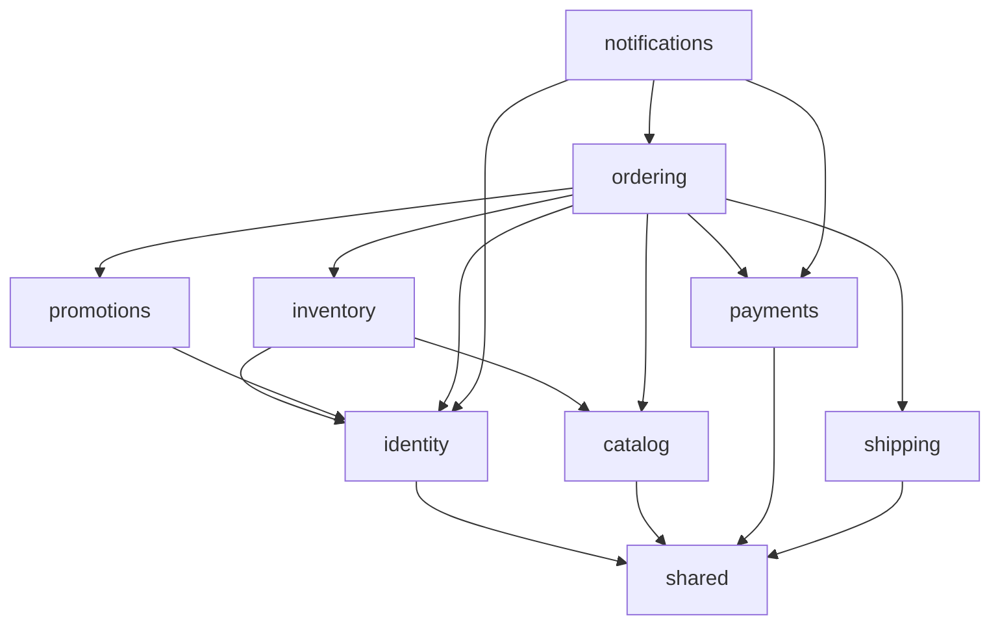

# 02. Cấu trúc Backend: thư mục, công nghệ, package và vai trò từng file

> Trạng thái: **Bản nháp chờ review**. Quyết định nền tảng: [ADR 0006](../adr/0006-modular-monolith.md) (modular monolith), [ADR 0007](../adr/0007-events-outbox-celery-no-kafka.md) (sự kiện), [ADR 0002](../adr/0002-auth-nextauth-session-django-jwt.md) (xác thực).
> Thuật ngữ dùng theo [GLOSSARY.md](../../GLOSSARY.md).

## 1. Tổng quan

- **Một Django project**, deploy một lần, chạy thành nhiều tiến trình: API, Celery worker, Celery Beat, Outbox relay.
- **Hai Django app**:
  - `modules`: toàn bộ nghiệp vụ, chia thành 8 module con.
  - `shared`: hạ tầng dùng chung (sự kiện, dữ liệu địa giới hành chính, các lớp API cơ sở). `shared` **không chứa nghiệp vụ** và **không bao giờ import `modules`**.
- Cách viết code theo **HackSoft Django Styleguide**: model giữ dữ liệu và ràng buộc, `services` lo nghiệp vụ ghi, `selectors` lo truy vấn đọc, view chỉ nhận request và gọi service hoặc selector.

## 2. Công nghệ

| Hạng mục | Lựa chọn | Phiên bản |
|---|---|---|
| Ngôn ngữ | Python | 3.13 |
| Framework | Django | 5.2 LTS (hỗ trợ tới 04/2028; nâng lên 6.2 LTS khoảng Q3/2027) |
| API | Django REST Framework | 3.18 |
| Database | PostgreSQL (extension `unaccent`, `pg_trgm`, `btree_gist`) | 18 |
| Cache, broker | Redis | 7.2 ở local, để khớp với ElastiCache trên AWS (xem [09](./09-deployment-aws-target.md)) |
| Background jobs | Celery + Celery Beat | 5.6 |
| Quản lý package | uv | 0.13 |

## 3. Danh sách package

Phiên bản được kiểm tra trên PyPI ngày **25/10/2026**. Dấu **—** nghĩa là chưa kiểm tra, sẽ pin phiên bản mới nhất tương thích khi khởi tạo dự án. Mọi phiên bản được khoá trong `uv.lock`.

### 3.1. Runtime

| Package | Phiên bản | Dùng để | Vì sao chọn |
|---|---|---|---|
| `django` | 5.2.18 | Framework | Bản LTS, cả hệ sinh thái đều đã tương thích |
| `djangorestframework` | 3.18.3 | REST API | Phổ biến nhất, team đã quen |
| `drf-spectacular` | 0.30.0 | Sinh OpenAPI 3 và Swagger UI | Chuẩn de facto cho DRF; OpenAPI dùng để sinh TS client cho Frontend |
| `django-filter` | 26.2 | Lọc danh sách (size, màu, giá, trạng thái) | Tích hợp sẵn với DRF |
| `psycopg[c,pool]` | — | Driver PostgreSQL | psycopg 3; dùng connection pool có sẵn của Django 5.2 (`OPTIONS["pool"]`, `CONN_MAX_AGE = 0`) |
| `redis` | 8.1.0 | Client Redis | Dùng cho cache, throttling, Celery |
| `celery` | 5.6.3 | Worker chạy job | Có retry, định tuyến queue, hệ sinh thái lớn |
| `django-celery-beat` | 2.9.0 | Lịch job lưu trong DB (`DatabaseScheduler`) | Beat trên ECS không cần ổ đĩa để ghi file lịch. Lịch vẫn khai báo trong code (`beat_schedule`) và được đồng bộ vào DB khi beat khởi động, nên muốn đổi lịch thì sửa code |
| `uuid-utils` | — | Sinh UUID v7 cho khoá chính, chỉ được gọi trong `shared.models.uuid7()` | Python 3.13 chưa có `uuid.uuid7()`; bỏ khi lên Python 3.14 ([ADR 0008](../adr/0008-uuid-v7-primary-keys.md)) |
| `pydantic` | 2.14.1 | Định nghĩa schema sự kiện, DTO của `contracts.py` | Có type, validate, sinh JSON Schema (chuẩn bị cho Schema Registry) |
| `pydantic-settings` | 2.16.1 | Đọc biến môi trường có kiểu | Sai cấu hình thì báo lỗi ngay khi khởi động |
| `PyJWT[crypto]` | 2.15.1 | Ký và kiểm tra JWT (Ed25519) | Thư viện chuẩn; phần mật mã không tự viết ([ADR 0002](../adr/0002-auth-nextauth-session-django-jwt.md)) |
| `google-auth` | 2.62.0 | Xác minh `id_token` của Google | Thư viện chính thức của Google |
| `argon2-cffi` | 25.1.0 | Hash mật khẩu Argon2 | Thuật toán được OWASP khuyến nghị |
| `django-fsm-2` | 4.2.4 | Máy trạng thái Đơn hàng | `django-fsm` gốc đã chuyển sang viewflow; bản này giữ API cũ, do django-commons duy trì |
| `django-pghistory` | 3.9.2 | Lịch sử thay đổi (Đơn hàng, Thanh toán, Tồn kho, cấu hình vận hành). Với Đơn hàng chỉ theo dõi field không phải PII | Dùng trigger PostgreSQL nên bắt được cả `bulk_update` |
| `httpx` | — | Gọi API VNPay, MoMo, GHN | Hỗ trợ timeout và retry rõ ràng; test bằng `respx` |
| `Pillow` | 13.0.0 | Xử lý ảnh Sản phẩm | Bắt buộc cho `ImageField` |
| `django-storages[s3]` + `boto3` | 1.14.6 / — | Lưu ảnh trên S3 (chỉ ở AWS) | Ở local lưu ra ổ đĩa (`FileSystemStorage`) |
| `vietnam-provinces` | 2026.9.0 | Dữ liệu 34 tỉnh/thành và phường/xã (sau 07/2025) | Đã cập nhật theo cấu trúc 2 cấp |
| `structlog` + `django-structlog` | 26.1.0 / 11.0.0 | Log JSON có `request_id` | Dễ tìm kiếm log trên CloudWatch |
| `sentry-sdk[django,celery]` | 2.73.0 | Theo dõi lỗi và hiệu năng | Chuẩn |
| `gunicorn` | — | Server chạy production, WSGI với worker `gthread` | Mọi view là DRF đồng bộ, chưa có tính năng cần async |

### 3.2. Dev và test

| Package | Phiên bản | Dùng để |
|---|---|---|
| `ruff` | 0.17.2 | Lint và format (thay cho flake8, isort, black) |
| `mypy` + `django-stubs` + `djangorestframework-stubs` | 2.4.0 / bản tương thích Django 5.2 / — | Kiểm tra kiểu, có plugin hiểu Django ORM |
| `import-linter` | 2.15 | Kiểm tra ranh giới giữa các module (bắt buộc trong CI) |
| `pytest` + `pytest-django` | — / 4.14.0 | Chạy test |
| `pytest-xdist` | 3.8.0 | Chạy test song song |
| `factory-boy` | 3.3.3 | Tạo dữ liệu test |
| `coverage` | 7.17.0 | Đo độ phủ test |
| `pytest-cov` | — | Đo coverage khi chạy song song bằng `pytest-xdist` |
| `respx` | — | Giả lập API bên ngoài khi test `httpx` |
| `time-machine` | — | Cố định thời gian khi test (Giữ hàng 15 phút, Hoàn tất sau 7 ngày) |
| `django-zeal` | 2.3.0 | Phát hiện lỗi N+1 query khi chạy test |
| `django-test-migrations` | — | Test data migration có `RunPython` ([12-testing-strategy.md](./12-testing-strategy.md) mục 6) |
| `debugpy` | — | Debug từ IDE vào container |
| `pip-audit` | 2.10.1 | Kiểm tra lỗ hổng đã công bố trong dependency (chạy trong CI) |
| `pre-commit` | 4.7.0 | Chạy ruff, mypy, import-linter và các hook `pre-commit-hooks` (`check-yaml`, `check-toml`, `end-of-file-fixer`, `trailing-whitespace`) trước khi commit |
| `commitizen` | — | Kiểm tra commit message theo Conventional Commits, gắn tag phiên bản, sinh CHANGELOG ([11](./11-git-workflow.md)) |

### 3.3. Không dùng (và lý do)

| Package | Lý do |
|---|---|
| `djangorestframework-simplejwt` | Tổ chức Jazzband đang giải thể ([ADR 0002](../adr/0002-auth-nextauth-session-django-jwt.md)) |
| `django-cors-headers` | Mọi request đi qua Next.js BFF, trình duyệt không gọi thẳng Django nên không cần CORS ([ADR 0009](../adr/0009-nextjs-bff-django-private.md)) |
| `django-money`, `py-moneyed` | VND không có số lẻ, lưu số nguyên là đủ |
| `django-ratelimit` | Không cập nhật từ 2023; dùng throttling của DRF |
| `django-health-check` 4.x | Yêu cầu Python 3.14 và Django 6; tự viết `/healthz`, `/readyz` |
| MinIO | Ngừng bảo trì từ 04/2026 |
| Kafka, Schema Registry | Chưa cần ở quy mô MVP ([ADR 0007](../adr/0007-events-outbox-celery-no-kafka.md)) |
| `uvicorn-worker`, chạy ASGI | Mọi view đồng bộ; chạy dưới ASGI chỉ thêm bước chuyển qua thread pool và phải tắt `CONN_MAX_AGE`. Tính lại khi cần websocket hoặc streaming |

## 4. Module và thứ tự phụ thuộc

| Module | Sở hữu |
|---|---|
| `identity` | Tài khoản (Khách hàng, Staff, Admin), xác thực JWT, xác thực email, sổ địa chỉ, đồng ý xử lý dữ liệu, yêu cầu xoá dữ liệu |
| `catalog` | Danh mục, Sản phẩm, Biến thể, ảnh, danh sách size và bảng màu, Giá bán, **Giá khuyến mãi**, trạng thái còn hàng và số liệu bán chạy (bản sao để lọc, sắp xếp nhanh) |
| `inventory` | Kho, Tồn kho, Giữ hàng, Hàng chờ xuất, Kiểm kê, lịch sử thay đổi Tồn kho |
| `promotions` | Voucher, lượt dùng Voucher |
| `payments` | Thanh toán online (VNPay / MoMo) và COD, IPN, Hoàn tiền, Đối soát |
| `shipping` | Báo giá phí ship, Vận đơn GHN, webhook, Đối soát, ánh xạ địa chỉ sang GHN, cấu hình Phí ship dự phòng |
| `ordering` | Giỏ hàng, checkout, Đơn hàng, máy trạng thái, Đổi trả, Cờ cần xử lý, cấu hình ngưỡng miễn phí ship và hạn mức COD |
| `notifications` | Email theo sự kiện |



Đọc sơ đồ: mũi tên `A --> B` nghĩa là A gọi `B/contracts.py`, nghe sự kiện trong `B/events.py` hoặc có FK tới model của B. Sơ đồ chỉ vẽ các phụ thuộc trực tiếp đang có. Quy tắc mà `import-linter` kiểm tra là theo lớp (bên dưới): module được phụ thuộc vào **mọi** module ở lớp thấp hơn, không được phụ thuộc vào module cùng lớp hay lớp cao hơn.

**Các lớp, từ dưới lên:**

1. `shared`
2. `identity`, `catalog`, `payments`, `shipping` (độc lập với nhau)
3. `inventory`, `promotions`
4. `ordering`
5. `notifications`

**Module ở lớp dưới báo cho lớp trên bằng sự kiện.** Ví dụ `payments` không biết gì về Đơn hàng. Nó nhận một mã tham chiếu (`reference`, chính là Mã đơn) và phát sự kiện `payments.payment-succeeded`. `ordering` lắng nghe sự kiện này để chuyển trạng thái đơn.

## 5. Cây thư mục

```
backend/
├── pyproject.toml                  # dependency, cấu hình ruff, mypy, pytest, import-linter
├── uv.lock                         # khoá phiên bản chính xác của mọi package
├── manage.py
├── .env.example                    # mẫu biến môi trường (file .env thật không commit)
├── .python-version                 # 3.13
├── Dockerfile                      # 1 image dùng chung cho api, worker, beat, relay
├── docker-compose.yml              # api, worker, beat, relay, redis, mailpit
├── Makefile                        # lệnh tắt: make up, make test, make lint, make migrate…
├── openapi.yaml                    # schema OpenAPI đã commit; CI so với bản sinh lại ([12](./12-testing-strategy.md) mục 5)
├── CHANGELOG.md                    # sinh bằng commitizen ([11](./11-git-workflow.md) mục 7)
├── conftest.py                     # fixture cần Tài khoản: customer_client, staff_client, admin_client (dùng factory của identity)
│
├── scripts/
│   └── gen_importlinter.py         # sinh các contract forbidden của import-linter (mục 8)
│
├── config/                         # cấu hình project, KHÔNG chứa nghiệp vụ
│   ├── __init__.py                 # nạp Celery app khi Django khởi động
│   ├── env.py                      # class Env (pydantic-settings) đọc và kiểm tra biến môi trường, gồm APP_ENV (local | test | staging | production)
│   ├── settings/
│   │   ├── __init__.py
│   │   ├── base.py                 # cấu hình chung mọi môi trường
│   │   ├── local.py                # DEBUG, Django Admin read-only, FAKE_PROVIDERS_ENABLED, Mailpit
│   │   ├── test.py                 # DB test, Celery chạy đồng bộ, hash mật khẩu nhanh, FAKE_PROVIDERS_ENABLED
│   │   └── production.py           # bảo mật, S3, SES, Sentry, log JSON
│   ├── urls.py                     # gốc URL: /api/v1/store, /api/v1/backoffice, /api/v1/webhooks, /api/schema, /api/docs, /healthz, /readyz; chỉ local và test: /admin, /dev/fake-gateway. Include api/<nhánh>/urls.py của từng module con
│   ├── celery.py                   # khởi tạo Celery, định nghĩa queue; autodiscover_tasks(["shared", "shared.events", "modules.identity", …]) vì mặc định Celery chỉ tìm <app>.tasks
│   └── wsgi.py                     # gunicorn chạy WSGI, worker gthread
│
├── shared/                         # Django app "shared": hạ tầng dùng chung
│   ├── __init__.py
│   ├── apps.py
│   ├── models.py                   # uuid7(), BaseModel: id UUID v7, created_at, updated_at; IdempotencyKey; import model của events/ và geo/ để Django nhận ra
│   ├── money.py                    # value object Money(amount: int, currency="VND")
│   ├── exceptions.py               # DomainError(code, message, details), RetryLater (handler báo consumer thử lại sau, không kế thừa DomainError) và các lỗi chung
│   ├── tasks.py                    # enqueue_on_commit(task_name, **kwargs): đẩy Celery task theo tên sau khi transaction commit (on_commit robust=True: broker lỗi thì chỉ log); purge_old_outbox_events (xoá cả ProcessedEvent cùng tuổi), purge_idempotency_keys
│   ├── events/
│   │   ├── __init__.py             # API công khai: publish(), handles()
│   │   ├── base.py                 # DomainEvent (pydantic): event_id, event_type, schema_version, occurred_at. Payload không chứa secret hay PII
│   │   ├── models.py               # OutboxEvent, ProcessedEvent, FailedEvent
│   │   ├── publisher.py            # EventPublisher: ghi sự kiện vào outbox trong transaction hiện tại
│   │   ├── registry.py             # decorator @handles(...) đăng ký handler cho từng loại sự kiện
│   │   ├── relay.py                # đọc outbox chưa gửi, đẩy thành Celery task, đánh dấu đã gửi
│   │   ├── consumer.py             # ghi ProcessedEvent rồi chạy handler trong savepoint của cùng transaction; xử lý kết quả của handler theo 07 mục 1.3; hết retry thì ghi FailedEvent
│   │   └── tasks.py                # Celery task dispatch_event(event_id, handler_name)
│   ├── geo/
│   │   ├── models.py               # Province, Ward (2 cấp, theo vietnam-provinces)
│   │   ├── selectors.py            # tra cứu tỉnh/thành, phường/xã
│   │   └── api.py                  # GET /api/v1/store/geo/provinces, /geo/provinces/{code}/wards
│   ├── api/
│   │   ├── exception_handler.py    # chuyển mọi lỗi sang định dạng lỗi chuẩn (xem 04-api-contract)
│   │   ├── pagination.py           # phân trang chuẩn
│   │   ├── permissions.py          # IsCustomer, IsStaff, IsAdmin (chỉ dựa vào kind và aud, không chứa nghiệp vụ)
│   │   ├── client_ip.py            # middleware: lấy IP người dùng từ X-Client-IP khi X-BFF-Secret đúng (ADR 0009)
│   │   ├── throttling.py           # các mức throttle dùng chung, theo IP từ client_ip; fail-open khi Redis lỗi
│   │   ├── idempotency.py          # xử lý header Idempotency-Key cho các POST quan trọng, lưu trong IdempotencyKey (PostgreSQL)
│   │   └── i18n.py                 # chọn ngôn ngữ theo Accept-Language (vi mặc định)
│   ├── health/
│   │   └── views.py                # /healthz (sống), /readyz (kết nối được PostgreSQL)
│   ├── logging.py                  # cấu hình structlog, processor redact_pii che PII
│   ├── management/commands/
│   │   ├── run_outbox_relay.py     # tiến trình relay chạy liên tục
│   │   ├── retry_failed_events.py  # chạy lại các cặp (sự kiện, handler) trong FailedEvent
│   │   ├── replay_events.py        # phát lại sự kiện trong outbox theo loại và mốc thời gian (07 mục 1.1)
│   │   └── load_geo.py             # nạp dữ liệu tỉnh/thành, phường/xã
│   ├── migrations/
│   └── testing/
│       ├── factories.py            # factory gốc
│       ├── fixtures.py             # fixture pytest không cần nghiệp vụ (api_client…); fixture cần Tài khoản nằm ở backend/conftest.py
│       └── events.py               # drain_events(): chạy callback on_commit đang chờ, relay và handler, lặp tới khi outbox hết sự kiện chưa gửi (dùng trong flow test)
│
├── modules/                        # Django app "modules": toàn bộ nghiệp vụ
│   ├── __init__.py
│   ├── apps.py                     # ModulesConfig.ready(): nạp handlers.py của mọi module con
│   ├── models.py                   # import model của mọi module con để Django nhận ra
│   ├── admin.py                    # Django Admin read-only, chỉ bật ở local
│   ├── migrations/                 # MỘT chuỗi migrations cho mọi module con
│   ├── management/commands/
│   │   ├── seed_catalog.py         # tạo dữ liệu mẫu cho local
│   │   └── create_staff.py         # tạo Tài khoản Staff/Admin
│   ├── templates/
│   │   └── emails/                 # template email theo ngôn ngữ (vi, en)
│   ├── identity/
│   ├── catalog/
│   ├── inventory/
│   ├── promotions/
│   ├── payments/
│   ├── shipping/
│   ├── ordering/
│   └── notifications/
│
├── locale/
│   ├── vi/LC_MESSAGES/django.po    # thông báo lỗi và email tiếng Việt
│   └── en/LC_MESSAGES/django.po
│
└── tests/
    ├── test_event_payloads.py      # payload mọi sự kiện không chứa PII ([12](./12-testing-strategy.md) mục 2.3)
    └── flows/                      # test xuyên module: checkout → thanh toán → giao → hoàn tất
```

> **Lưu ý của cách A (một app `modules`)**: Django chỉ tìm `migrations/`, `management/commands/`, `templates/` và `admin.py` ở **gốc app**. Vì vậy các thư mục này nằm ở `modules/` chứ không nằm trong từng module con ([ADR 0006](../adr/0006-modular-monolith.md)). Hai chỗ khác cũng chỉ tìm ở gốc app: Django chỉ nhận model qua `<app>/models.py` (nên `modules/models.py` và `shared/models.py` phải import model của package con), và `autodiscover_tasks()` của Celery chỉ tìm `<app>/tasks.py` (nên `config/celery.py` liệt kê từng package).

> **Gốc repo** (ngoài `backend/`) chứa `docs/`, `.github/`, `.scratch/` và `.pre-commit-config.yaml`. pre-commit chỉ đọc file cấu hình ở gốc repo, nên hook cho backend (ruff, mypy, import-linter) khai báo ở đó với `files: ^backend/`, không có file `.pre-commit-config.yaml` riêng trong `backend/`.

## 6. Khuôn mẫu của một module con

Mọi module con đều theo cùng một khuôn. Ví dụ với `ordering`:

```
modules/ordering/
├── __init__.py
├── contracts.py          # ⭐ public API của module: hàm + DTO mà module khác được gọi
├── events.py             # sự kiện module này phát ra (class pydantic, có version)
├── constants.py          # enum: OrderStatus, PaymentMethod, OrderFlagKind, CancelReason…; RESERVATION_TTL, PAYMENT_LINK_TTL
├── exceptions.py         # lỗi nghiệp vụ: OutOfStock, InvalidTransition, TransitionNotYetValid, PriceChanged, ShipmentInProgress…
├── models/
│   ├── __init__.py       # export các model
│   ├── cart.py           # Cart, CartItem
│   ├── order.py          # Order (có máy trạng thái), OrderLine
│   ├── flags.py          # OrderFlag (Cờ cần xử lý)
│   ├── settings.py       # OrderingSettings (singleton: ngưỡng miễn phí ship, hạn mức COD)
│   └── returns.py        # ReturnRequest, ReturnLine
├── services/
│   ├── __init__.py
│   ├── cart.py           # add_item, update_quantity, merge_guest_cart
│   ├── checkout.py       # place_order: tính tổng và so expected_total ngoài transaction; trong transaction Giữ hàng hoặc trừ Tồn kho, dùng Voucher, tạo đơn, gắn Tài khoản nếu email đã xác thực
│   ├── transitions.py    # Staff/Người mua: confirm, start_packing, hand_over, cancel (T5, T7, T9, T14); do sự kiện (mục 7.7): mark_paid, mark_shipped, mark_delivered, mark_returned; do job: complete
│   ├── flags.py          # raise_flag, resolve_flag
│   ├── accounts.py       # attach_guest_orders (khi email đã xác thực), anonymize_orders, complete_erasure_request (kiểm tra điều kiện xoá dữ liệu)
│   └── returns.py        # record_return, receive_return_items, accept (theo từng dòng), reject, mark_refunded
├── selectors/
│   ├── __init__.py
│   ├── cart.py           # get_cart_with_prices
│   └── orders.py         # list_orders_for_customer, find_order_for_guest, list_orders_backoffice (lọc theo Cờ cần xử lý)
├── handlers.py           # nghe sự kiện: payment-succeeded, payment-failed, refund-recorded, shipment-created, shipment-creation-failed, shipment-delivered, shipment-returned, email-verified, customer-erased
├── tasks.py              # cancel_expired_pending_orders, complete_delivered_orders, purge_expired_guest_carts, compute_best_sellers
├── admin.py              # đăng ký Django Admin read-only (được modules/admin.py nạp)
├── api/
│   ├── permissions.py    # IsOrderOwner: JWT của Khách hàng chủ đơn, hoặc X-Lookup-Token hợp lệ cho đúng đơn (token ký bằng TimestampSigner, không lưu DB; 04 mục 4.1)
│   ├── store/
│   │   ├── serializers.py    # dữ liệu vào/ra cho storefront
│   │   ├── views.py          # view mỏng: validate → gọi service/selector → trả kết quả
│   │   └── urls.py
│   └── backoffice/
│       ├── serializers.py
│       ├── views.py
│       └── urls.py
└── tests/
    ├── factories.py
    ├── test_services_checkout.py
    ├── test_services_transitions.py
    ├── test_handlers.py
    └── test_api_store.py
```

### 6.1. Vai trò và quy tắc của từng file

| File | Chứa gì | Được import | Cấm |
|---|---|---|---|
| `contracts.py` | Các hàm công khai (ví dụ `reserve_stock(...)`) và DTO pydantic đầu vào/ra. Đây là thứ **duy nhất** module khác được gọi; chỉ đưa vào những gì module khác thực sự cần. Docstring của các hàm ghi dữ liệu nêu rõ: gọi trong transaction của bên gọi được không, khoá dòng nào, ném lỗi gì | `services`, `selectors` của chính module; `contracts` của module lớp dưới | Trả về model Django ra ngoài (phải trả DTO) |
| `events.py` | Class sự kiện, ví dụ `OrderPlacedV1(DomainEvent)` có `event_type = "ordering.order-placed"`, `schema_version = 1` | `shared.events.base` | Logic nghiệp vụ |
| `constants.py` | `TextChoices` và hằng số | — | Import model |
| `exceptions.py` | Lỗi nghiệp vụ, kế thừa `shared.exceptions.DomainError`, mỗi lỗi có `code` tiếng Anh, ví dụ `OUT_OF_STOCK`. Riêng lỗi báo consumer thử lại sau (ví dụ `TransitionNotYetValid`) kế thừa `shared.exceptions.RetryLater` | `shared.exceptions` | — |
| `models/` | Field, ràng buộc DB (`UniqueConstraint`, `CheckConstraint`), index, `Meta.db_table` có tiền tố module (ví dụ `ordering_order`), property đơn giản | `shared.models`, `models/` của module lớp dưới (chỉ để khai báo FK, mục 6.3) | Logic nghiệp vụ, gọi API ngoài, gửi email, override `save()` để làm việc phụ, tự khai báo `id` (phải kế thừa `shared.models.BaseModel`) |
| `services/` | Mỗi nghiệp vụ ghi là một hàm có tham số keyword, chạy trong `transaction.atomic`, phát sự kiện qua `shared.events.publish` | Model của chính module, `contracts` của module lớp dưới | Nhận `request`; import `api/`; gọi HTTP ra ngoài bên trong `transaction.atomic`; đẩy Celery task trực tiếp (phải qua `shared.tasks.enqueue_on_commit`); import `tasks.py` (đẩy task theo tên, để không có vòng import `services` ↔ `tasks`); truy vấn đi vào model của module khác (mục 6.3) |
| `selectors/` | Hàm truy vấn đọc, tối ưu bằng `select_related`, `prefetch_related` | Model của chính module | Ghi dữ liệu; truy vấn đi vào model của module khác (mục 6.3) |
| `handlers.py` | Hàm `@handles("payments.payment-succeeded", version=1)`, nhận sự kiện rồi gọi service. Không cần tự chống xử lý trùng: consumer ghi `ProcessedEvent` cùng transaction với handler. Sự kiện tới sớm hoặc không áp dụng được thì báo bằng exception ([07-async-events-jobs.md](./07-async-events-jobs.md) mục 1.3). Handler chỉ gọi service của chính module; mọi lời gọi `contracts` của module khác nằm trong service đó, nên các mô tả "handler gọi `x.contracts`" ở mục 7.7 và [07](./07-async-events-jobs.md) mục 2 là việc của service mà handler gọi | `services` của chính module, `events` của module lớp dưới | Logic nghiệp vụ dài (phải đưa vào service); gọi HTTP hay đẩy Celery task trực tiếp, vì handler chạy trong transaction của consumer |
| `tasks.py` | Celery task mỏng, chỉ gọi service. Mỗi task khai báo `name="<module>.<task>"` cố định | `services` | Logic nghiệp vụ |
| `api/*/serializers.py` | Validate dữ liệu vào, định dạng dữ liệu ra | — | Gọi `.save()` lên model, logic nghiệp vụ |
| `api/*/views.py` | `APIView` hoặc `GenericAPIView`: phân quyền, gọi serializer, gọi service/selector | `services`, `selectors`, `serializers` | `ModelViewSet` tự động CRUD; truy vấn ORM trực tiếp |
| `api/*/urls.py` | Khai báo route | `views` | — |
| `api/permissions.py` | Permission class gắn với nghiệp vụ của module, ví dụ `IsOrderOwner` (permission chung chỉ dựa vào `kind`/`aud` nằm ở `shared/api/permissions.py`) | `selectors` của chính module | Ghi dữ liệu |
| `admin.py` | `ModelAdmin` read-only | `models` | Cho phép sửa |
| `tests/` | Test service (nhiều nhất), handler, API | Mọi thứ của module, `shared.testing`; `tests.factories` và `contracts` của module lớp dưới | `models`, `services`, `selectors`, `api` của module khác ([12-testing-strategy.md](./12-testing-strategy.md) mục 4) |

### 6.2. Ví dụ luồng một request

`POST /api/v1/store/checkout`:

```
views.CheckoutView
  → serializers.CheckoutInput.validate()                 # kiểm tra dữ liệu vào, có payment_method và expected_total
  → services.checkout.place_order(...)
       # 1. Ngoài transaction: chưa giữ khoá nào khi gọi ra ngoài
       → catalog.contracts.get_variants_for_sale()         # Giá áp dụng, snapshot
       → promotions.contracts.evaluate_voucher()           # nếu có Voucher
       → shipping.contracts.quote_fee()                    # cache báo giá, GHN, hoặc Phí ship dự phòng
       → identity.contracts.find_verified_customer_id()    # Khách vãng lai: email trùng Tài khoản đã xác thực thì gắn luôn (BR-ORD-08)
       → tính tổng, áp ngưỡng miễn phí ship (OrderingSettings), so với expected_total
                                                           # lệch → PriceChanged (409 PRICE_CHANGED)
       # 2. Trong transaction.atomic, khoá theo thứ tự cố định ở mục 9.1: Tồn kho → Biến thể → Voucher
       → inventory.contracts.reserve_stock(expires_at=…)   # online: Giữ hàng 15 phút
         hoặc inventory.contracts.decrement_stock()        # COD: trừ Tồn kho, ghi Hàng chờ xuất
       → promotions.contracts.redeem_voucher(quote, reference)  # khoá dòng Voucher, kiểm tra lại quote
       → Order.objects.create(...) + OrderLine(..., voucher_discount=…)
       → COD: payments.contracts.start_cod_payment()
              + shared.events.publish(OrderPlacedV1(...))  # ghi vào outbox, cùng transaction
         online: không phát sự kiện
  → serializers.OrderOutput(order).data                  # Khách vãng lai nhận thêm lookup_token
```

Sau khi commit, với đơn COD relay đẩy `ordering.order-placed` sang Celery và `notifications.handlers` gửi email "Đặt đơn thành công". Với đơn online, Người mua gọi tiếp `POST /store/orders/{code}/payments`; `ordering.order-placed` chỉ phát khi Thanh toán thành công và đơn vào `PLACED` (T3).

### 6.3. FK sang module khác

FK tới model của module lớp dưới được phép ([ADR 0006](../adr/0006-modular-monolith.md)), nhưng **chỉ để database giữ toàn vẹn dữ liệu**, không để truy vấn xuyên module:

- Khai báo FK bằng class được import (`models.ForeignKey(Variant, …)`), kể cả FK tới `Account`. Không dùng chuỗi (`"modules.Variant"`, `settings.AUTH_USER_MODEL`): có import thật thì contract `layers` (mục 8) mới kiểm tra được chiều của FK.
- Trong `services/` và `selectors/`, không dùng lookup `__`, `select_related` hay `prefetch_related` để đi vào model của module khác. ORM đi qua FK mà không cần import nên `import-linter` không thấy. Nếu cho phép, schema của module kia (tên field, quan hệ) sẽ ngầm thành một phần interface của nó: đổi tên một field có thể làm hỏng module khác trong khi CI vẫn xanh.
- Đọc cột FK của chính bảng mình (ví dụ `stock_item.variant_id`) thì được, vì không chạm vào bảng của module kia.
- Cần dữ liệu của module khác thì gọi `contracts` của module đó với **danh sách id**, một lần cho cả trang, để không sinh N+1. Ví dụ danh sách Tồn kho ở back-office lấy SKU và tên Sản phẩm từ `catalog.contracts` theo các `variant_id` của trang đó.

Quy tắc truy vấn chỉ kiểm tra được khi review.

## 7. Nội dung chính của từng module con

Các module con đều theo khuôn ở mục 6. Bảng dưới chỉ liệt kê nội dung đặc thù của từng module.

### 7.1. `identity`

| File | Nội dung |
|---|---|
| `models/account.py` | `Account` (custom user, `AUTH_USER_MODEL = "modules.Account"`): email (duy nhất cho mọi `kind`: một email = một Tài khoản), `kind` (`customer` / `staff` / `admin`), `language`, `token_version`, `is_active`, `email_verified`, `anonymized_at` |
| `models/address.py` | `Address`: sổ địa chỉ của Khách hàng, FK tới `shared.geo.Ward` |
| `models/auth.py` | `RefreshToken`: `jti`, `family_id`, `token_hash`, `expires_at`, `used_at`, `revoked_at`; `PasswordResetToken`, `EmailVerificationToken` (chỉ lưu hash) |
| `models/privacy.py` | `Consent` (phiên bản chính sách, kênh, thời điểm), `ErasureRequest`, `CustomerDataAccessLog` |
| `auth/tokens.py` | Phát hành và kiểm tra access/refresh JWT bằng PyJWT (Ed25519, `kid`) |
| `auth/authentication.py` | `JWTAuthentication`, class xác thực của DRF |
| `auth/google.py` | Xác minh `id_token` Google bằng `google-auth`. Khớp Tài khoản có `email_verified = false` thì đánh dấu đã xác thực, `set_unusable_password`, tăng `token_version`, thu hồi mọi refresh token. Tạo Tài khoản mới hoặc đánh dấu đã xác thực thì phát `EmailVerifiedV1` |
| `services/` | `register`, `verify_email`, `login`, `refresh`, `logout`, `request_password_reset`, `reset_password`, `login_with_google`, `update_profile` (họ tên, số điện thoại, ngôn ngữ; không đổi email), `record_consent`, `erase_customer`, `complete_erasure_request` |
| `events.py` | `CustomerRegisteredV1`, `EmailVerifiedV1`, `CustomerErasedV1`, `PasswordResetRequestedV1`. Payload chỉ mang `account_id` hoặc `erasure_request_id`, không mang token hay PII. `EmailVerifiedV1` phát mỗi khi email chuyển sang đã xác thực, từ `verify_email` hoặc `login_with_google` |
| `contracts.py` | `get_customer(id)`, `CustomerDTO`, `record_consent(...)`, `issue_email_verification_link(account_id) -> str`, `issue_password_reset_link(account_id) -> str` (sinh token lúc gửi email), `get_erasure_subject(erasure_request_id) -> ErasureSubjectDTO`, `complete_erasure_request(erasure_request_id)` (do `ordering` gọi sau khi kiểm tra điều kiện), `find_verified_customer_id(email) -> UUID \| None`, `log_customer_data_access(staff_id, customer_id, subject_phone, order_code, action)` (CMP-07) |

### 7.2. `catalog`

| File | Nội dung |
|---|---|
| `models/` | `Category` (cây Danh mục), `Size`, `Color` (danh sách size và bảng màu dùng chung), `Product` (`status`, `weight_grams`, `sold_30d`), `ProductColor` (`color`) + `ProductImage` (ảnh theo màu), `Variant` (`sku`, `size`, `product_color`, `price`, `is_available`, `status`), `SalePrice` (`variant`, `price`, `starts_at`, `ends_at`) |
| `services/` | Đổi Giá bán kiểm tra BR-PRC-05; size và màu đã có Biến thể dùng chỉ ẩn được (BR-CAT-11) |
| `selectors/` | Danh sách và chi tiết Sản phẩm có lọc (theo mã size, mã màu), tìm kiếm (`unaccent` + `pg_trgm`), sắp xếp bán chạy theo `sold_30d`, tính Giá áp dụng |
| `contracts.py` | `get_variants_for_sale(ids) -> list[VariantForSaleDTO]` (Giá áp dụng, mức giảm, snapshot tên/SKU, cân nặng), `set_variant_availability(variant_id, available)` (do `inventory` gọi, chỉ khi trạng thái còn/hết hàng thực sự đổi, để không khoá thêm dòng `catalog_variant` ở mỗi lần Giữ hàng), `set_best_seller_counts(counts: dict[UUID, int])` (do job hằng đêm của `ordering` gọi, BR-CAT-12) |

### 7.3. `inventory`

| File | Nội dung |
|---|---|
| `models/` | `Warehouse`, `StockItem` (`variant`, `warehouse`, `on_hand`, `reserved`, `awaiting_dispatch`), `StockReservation` (`reference`, `stock_item`, `quantity`, `expires_at`, `status`), `StockAllocation` (Hàng chờ xuất: `reference`, `stock_item`, `quantity`, `status`), `StockMovement` (lịch sử) |
| `services/` | `reserve_stock`, `commit_reservation`, `release_reservation`, `decrement_stock`, `dispatch_stock`, `release_allocation`, `restock`, `adjust_stock`, `count_stock` (Kiểm kê). `decrement_stock` và `commit_reservation` tạo Hàng chờ xuất theo `reference` ([ADR 0010](../adr/0010-stock-decremented-at-order-awaiting-dispatch.md)). `adjust_stock` và `count_stock` từ chối điều chỉnh giảm vượt Số lượng bán được (BR-INV-11). `reserve_stock` và `decrement_stock`, sau khi khoá dòng `StockItem`, tự giải phóng các Giữ hàng đã quá `expires_at` của dòng đó trước khi kiểm tra; `release_reservation` idempotent nên job huỷ đơn gọi lại vẫn an toàn. Đều khoá dòng `StockItem` bằng `select_for_update` và sắp xếp khoá theo `variant_id` để tránh deadlock. Khi Số lượng bán được chuyển giữa 0 và lớn hơn 0 thì gọi `catalog.contracts.set_variant_availability` |
| `contracts.py` | `reserve_stock(reference, items, expires_at)` (`expires_at` lấy từ Đơn hàng), `commit_reservation`, `release_reservation`, `decrement_stock`, `dispatch_stock(reference)` (T10), `release_allocation(reference)` (huỷ trước Bàn giao), `restock`, `get_available(variant_ids)`. Hàm ghi gọi được trong transaction của bên gọi và trở thành một phần của transaction đó; `reserve_stock`, `decrement_stock` ném `OutOfStock` |

### 7.4. `promotions`

| File | Nội dung |
|---|---|
| `models/` | `Voucher` (`code`, `kind`, `value`, `max_discount`, `min_order_value`, `usage_limit`, `per_customer_limit`, `starts_at`, `ends_at`, `is_active`), `VoucherRedemption` (`voucher`, `reference`, `customer_id`, `phone`, `discount`, `status`) |
| `services/` | `per_customer_limit` đếm các lượt trùng `customer_id` **hoặc** trùng số điện thoại liên hệ của đơn đang đặt (BR-VCH-07) |
| `handlers.py` | `identity.customer-erased`: ẩn danh `phone` trong `VoucherRedemption` |
| `contracts.py` | `evaluate_voucher(code, subtotal, customer_id, phone) -> VoucherQuoteDTO`: chạy ngoài transaction, không khoá; DTO mang lại đủ đầu vào của lần tính và mức giảm. `redeem_voucher(quote, reference)`: gọi trong transaction của checkout, khoá dòng Voucher, kiểm tra lại mọi điều kiện của `quote` (hạn dùng, giá trị tối thiểu, `usage_limit`, `per_customer_limit`, mức giảm); còn đúng thì ghi `VoucherRedemption`, sai thì ném `VoucherNotApplicable`. `release_voucher(reference)` |

### 7.5. `payments`

| File | Nội dung |
|---|---|
| `models/` | `Payment` (`reference`, `method` = `cod`/`online`, `gateway` = `vnpay`/`momo` hoặc null với COD, `amount`, `status`, `provider_txn_ref`, `expires_at`), `PaymentEvent` (dữ liệu IPN gốc, `UNIQUE(provider, provider_event_id)`), `Refund` (`payment`, `amount`, `channel` = `gateway`/`bank_transfer`, `status`, `provider_refund_ref`, `recorded_by`) |
| `providers/base.py` | Interface `PaymentGateway`: `create_payment_url`, `verify_ipn`, `query_transaction` |
| `providers/vnpay.py`, `momo.py` | Adapter thật: ký HMAC-SHA512 (VNPay), HMAC-SHA256 (MoMo). Link hết hạn theo `expires_at` do `ordering` truyền vào (phút thứ 10 kể từ khi đặt đơn, `PAYMENT_LINK_TTL`) |
| `providers/fake.py` | Fake Gateway cho local và test ([ADR 0005](../adr/0005-provider-adapters-fake-gateways.md)) |
| `api/webhooks/` | `GET /api/v1/webhooks/vnpay/ipn`, `POST /momo/ipn` |
| `api/dev/` | Trang Fake Gateway, **chỉ đăng ký URL khi `FAKE_PROVIDERS_ENABLED`** (bật ở local và test) |
| `tasks.py` | `reconcile_pending_payments` (mỗi 5 phút; Thanh toán online quá `expires_at` mà cổng báo chưa trả thì chuyển `expired`) |
| `events.py` | `PaymentSucceededV1` (`reference`, `payment_id`, `amount`, `gateway`), `PaymentFailedV1` (`reference`, `payment_id`, `reason`, `amount_received`), `RefundRecordedV1` (`reference`, `refund_id`, `amount`). `PaymentSucceededV1` chỉ phát cho Thanh toán online |
| `contracts.py` | `start_payment(reference, amount, gateway, return_url, expires_at) -> PaymentStartDTO` (có thể gọi API của Cổng thanh toán, ví dụ MoMo, nên phải gọi **ngoài** transaction), `start_cod_payment(reference, amount)`, `record_cod_collected(reference)`, `cancel_cod_payment(reference)` (ba hàm COD không phát sự kiện, vì `ordering` là bên gọi), `request_refund(reference, amount, reason, channel) -> UUID` (trả `refund_id`), `has_pending_refunds(references) -> bool`, `redact_provider_payloads(reference)` |

### 7.6. `shipping`

| File | Nội dung |
|---|---|
| `models/` | `Shipment` (`reference`, `provider_order_code`, `status`, `fee`, `cod_amount`), `ShipmentEvent` (webhook gốc), `GhnLocationMapping` (`shared.geo.Ward` → ID của GHN; Admin sửa qua `backoffice/settings/ghn-locations`), `ShippingSettings` (singleton: Phí ship dự phòng) |
| `providers/base.py` | Interface `ShippingProvider`: `quote`, `create_shipment`, `get_status`, `cancel_shipment` |
| `providers/ghn.py`, `fake.py` | Adapter GHN và Fake (Fake chỉ dùng được khi `FAKE_PROVIDERS_ENABLED`) |
| `api/webhooks/` | `POST /api/v1/webhooks/ghn` |
| `tasks.py` | `create_shipment` (queue `integrations`, có retry; thành công phát `ShipmentCreatedV1`, hết retry thì Vận đơn `failed` và phát `ShipmentCreationFailedV1`), `cancel_shipment` (queue `integrations`, có retry; thành công thì Vận đơn `cancelled`; hết retry thì giữ `cancel_requested` và báo Sentry, Staff xử lý tay theo Cờ cần xử lý `shipment_after_cancel`), `reconcile_shipments` (mỗi 15 phút; đẩy lại task cho Vận đơn kẹt ở `requested` hoặc `cancel_requested` quá 15 phút) |
| `events.py` | `ShipmentCreatedV1`, `ShipmentCreationFailedV1`, `ShipmentDeliveredV1`, `ShipmentReturnedV1`, `ShipmentExceptionV1` (`reference`, `provider_status`: GHN báo mất hàng, hư hàng, sự cố, hoặc tự huỷ Vận đơn mà hệ thống không yêu cầu) |
| `contracts.py` | `quote_fee(ward_code, weight_grams, value) -> ShippingQuoteDTO` (phí GHN thật, hoặc Phí ship dự phòng khi GHN lỗi; `ordering` tự áp ngưỡng miễn phí ship; gọi GHN trực tiếp nên phải gọi **ngoài** transaction), `request_shipment(ShipmentRequestDTO)` (tạo Vận đơn `requested`, hoặc dùng lại Vận đơn `failed` của cùng `reference`; đẩy task `create_shipment` sau commit), `request_shipment_cancellation(reference)` (ghi Vận đơn `cancel_requested`, đẩy task `cancel_shipment` sau commit), `get_shipment_status(reference) -> ShipmentStatusDTO \| None`, `redact_provider_payloads(reference)`. Trừ `quote_fee`, mọi hàm trong contracts chỉ đọc, ghi DB và đẩy task sau commit, nên gọi trong transaction (kể cả trong handler) là an toàn; HTTP tới GHN chỉ chạy trong task |

### 7.7. `ordering`

Xem ví dụ đầy đủ ở mục 6. Máy trạng thái của `Order.status` dùng `django-fsm-2`, mỗi transition ứng với một dòng T1–T13 trong [05-order-lifecycle.md](../business/05-order-lifecycle.md). Transition chỉ được gọi từ `services/transitions.py`.

| Chủ đề | Nội dung |
|---|---|
| Mã đơn | `FS<YYMM>-` + 6 ký tự Crockford Base32 ngẫu nhiên, `UNIQUE`, trùng thì sinh lại. Không dùng sequence |
| Hạn thanh toán | `Order.expires_at` = lúc đặt + `RESERVATION_TTL` (15 phút), là nguồn duy nhất, truyền xuống `reserve_stock`. Link thanh toán của mọi lần thử hết hạn ở lúc đặt + `PAYMENT_LINK_TTL` (phút thứ 10), sớm hơn Giữ hàng 5 phút; quá mốc này không bắt đầu Thanh toán mới được (`PaymentWindowClosed` → `PAYMENT_WINDOW_CLOSED`) |
| Cờ cần xử lý | `OrderFlag` được bật từ handler hoặc service (`raise_flag`), Staff gỡ qua back-office (`resolve_flag`, có ghi lịch sử) |
| Cấu hình | `OrderingSettings`: ngưỡng miễn phí ship, hạn mức COD |
| Khoá | Mọi transition khoá dòng Đơn hàng bằng `select_for_update` trước khi đọc trạng thái (thứ tự khoá ở mục 9.1). Hai transition cùng lúc trên một đơn, ví dụ T5 và T3, chạy lần lượt; transition sau thấy trạng thái mới và đi theo các nhánh bên dưới |
| Transition do sự kiện | T3, T10, T11, T12 (`mark_paid`, `mark_shipped`, `mark_delivered`, `mark_returned`) tự đối chiếu trạng thái hiện tại với sơ đồ ở [05-order-lifecycle.md](../business/05-order-lifecycle.md) mục 2, nên handler không cần tự kiểm tra thứ tự. Đơn **đã ở hoặc đã qua** trạng thái đích: không làm gì (sự kiện trùng hoặc tới muộn). Đơn **chưa tới** trạng thái nguồn nhưng còn đi tới được: ném `TransitionNotYetValid` (kế thừa `RetryLater`, consumer thử lại sau). Còn lại, ví dụ GHN báo đã giao khi đơn đã `RETURNED_TO_SENDER`: ném `InvalidTransition`, consumer bỏ qua và ghi log. Các tình huống có cách xử lý riêng (05 mục 4.1 và 4.5) được kiểm tra trước ba nhánh này |
| `contracts.py` | Chỉ phục vụ `notifications`: đọc dữ liệu Đơn hàng để gửi email. Checkout và các transition không nằm ở đây vì chỉ API của chính `ordering` gọi chúng |
| `events.py` | `OrderPlacedV1`, `OrderCancelledV1` (có `previous_status`), `OrderShippedV1`, `OrderDeliveredV1`, `UnexpectedPaymentReceivedV1` |
| Đổi trả | `accept` nhận `accepted_quantity` và `restock` cho từng dòng (BR-RET-08), gọi `inventory.contracts.restock` cho phần nhập lại, gọi `payments.contracts.request_refund` rồi lưu `refund_id` vào yêu cầu |
| Bán chạy | Task `compute_best_sellers` chạy hằng đêm, tính BR-CAT-12 rồi gọi `catalog.contracts.set_best_seller_counts` |
| Xoá dữ liệu | `complete_erasure_request` kiểm tra điều kiện của CMP-05 (đơn ở trạng thái cuối, `payments.contracts.has_pending_refunds`) rồi gọi `identity.contracts.complete_erasure_request`. Endpoint back-office `erasure-requests` nằm ở `ordering` |
| Log truy cập | Chi tiết đơn và tìm đơn theo số điện thoại ở back-office gọi `identity.contracts.log_customer_data_access` (CMP-07) |
| `handlers.py` | `payment-succeeded`: T3, hoặc Hoàn tiền + cờ `unexpected_payment` + phát `UnexpectedPaymentReceivedV1` nếu đơn không ở `PENDING_PAYMENT`; đơn còn `PENDING_PAYMENT` nhưng đã quá `expires_at` thì chạy T4 trước rồi xử lý như đơn đã huỷ. `payment-failed` với `amount_mismatch`: Hoàn tiền đúng `amount_received` + cờ `payment_amount_mismatch` (BR-PAY-04). `refund-recorded`: Đổi trả có `refund_id` khớp → `refunded`, không khớp thì bỏ qua. `shipment-created`: T10 (gọi `inventory.contracts.dispatch_stock`), hoặc `shipping.contracts.request_shipment_cancellation` + cờ `shipment_after_cancel` nếu đơn đã huỷ. `shipment-creation-failed`: cờ `shipment_failed`. `shipment-delivered`: T11. `shipment-returned`: T12. `shipment-exception`: cờ `shipment_exception`, đơn giữ `SHIPPING` cho tới khi Staff xử lý (T14). `email-verified`: `attach_guest_orders`. `customer-erased`: `anonymize_orders` và gọi `redact_provider_payloads` của `shipping`, `payments` |

### 7.8. `notifications`

| File | Nội dung |
|---|---|
| `models/` | `EmailLog` (`event_id`, `to_address`, `template`, `language`, `status`, `sent_at`) |
| `handlers.py` | Mỗi sự kiện cần gửi email (BR-NTF-01) có một handler; lấy dữ liệu đơn qua `ordering.contracts`. Email xác thực và đặt lại mật khẩu gọi `identity.contracts.issue_email_verification_link` / `issue_password_reset_link` ngay lúc gửi. `identity.customer-erased`: ẩn danh `to_address`. `ordering.order-cancelled` có `previous_status = PENDING_PAYMENT` thì không gửi email (BR-NTF-01). `ordering.unexpected-payment-received`: email báo tiền sẽ được hoàn. Handler không gửi email trực tiếp mà đẩy task `send_email` bằng `shared.tasks.enqueue_on_commit` |
| `services/email.py` | Render template theo ngôn ngữ, gửi qua Django email backend (Mailpit ở local, SES trên AWS) |
| `tasks.py` | `send_email` có retry |

## 8. Kiểm tra ranh giới module (`import-linter`)

Cấu hình trong `pyproject.toml`:

```toml
[tool.importlinter]
root_packages = ["shared", "modules", "config"]

[[tool.importlinter.contracts]]
name = "Thứ tự lớp giữa các module"
type = "layers"
layers = [
    "modules.notifications",
    "modules.ordering",
    "modules.inventory | modules.promotions",
    "modules.identity | modules.catalog | modules.payments | modules.shipping",
    "shared",
]

[[tool.importlinter.contracts]]
name = "Module khác chỉ được dùng contracts và events"
type = "forbidden"
# Chỉ cấm import trực tiếp. Mặc định import-linter cấm cả chuỗi gián tiếp, mà mọi lời gọi
# hợp lệ qua contracts.py đều đi tiếp xuống models của module kia, nên CI sẽ luôn đỏ.
allow_indirect_imports = true
# Mỗi module có một contract cấm import vào models/services/selectors/api của module khác.
# Ngoại lệ duy nhất (khai báo bằng ignore_imports): models/ được import models/ của module
# lớp dưới để khai báo FK (mục 6.3); contract "layers" ở trên vẫn kiểm tra chiều của import này.
# Danh sách đầy đủ sinh bằng script scripts/gen_importlinter.py

[[tool.importlinter.contracts]]
name = "Module không được tự đẩy sự kiện, phải qua shared.events.publish"
type = "forbidden"
source_modules = ["modules"]
forbidden_modules = ["shared.events.relay", "shared.events.tasks"]
```

> Các module trong cùng một lớp (ví dụ `payments` và `shipping`) **không** được import lẫn nhau (`|` trong `layers` nghĩa là độc lập).

## 9. Quy ước code

### 9.1. Quy ước chung

| Chủ đề | Quy ước |
|---|---|
| Ngôn ngữ | Tên biến, hàm, bảng, field, enum, error code: **tiếng Anh**. Comment và docstring: **tiếng Việt**, giữ nguyên thuật ngữ kỹ thuật tiếng Anh. Chuỗi hiển thị cho người dùng: bọc `gettext` để dịch vi/en |
| Tiền | `BigIntegerField` lưu số đồng VND; trong code dùng `shared.money.Money`; API trả `{"amount": 250000, "currency": "VND"}` |
| Khoá chính | UUID v7 cho mọi bảng (ngoại lệ duy nhất: `shared_province`, `shared_ward` dùng mã chính thức; khoá tự nhiên khác giữ bằng `UNIQUE`, [03](./03-data-model.md)), `default` là hàm bọc `shared.models.uuid7` (không trỏ thẳng vào `uuid_utils`, để migration không phụ thuộc package ngoài), khai báo trong `shared.models.BaseModel` (cùng `created_at`, `updated_at`). Model không tự khai báo `id` ([ADR 0008](../adr/0008-uuid-v7-primary-keys.md)) |
| Thời gian | Lưu UTC (`USE_TZ = True`); hiển thị theo `Asia/Ho_Chi_Minh`. Lấy thời điểm hiện tại bằng `django.utils.timezone.now()` |
| Xoá dữ liệu | Không xoá cứng dữ liệu đã có đơn; dùng `status` / `archived` |
| Transaction | Chỉ mở ở tầng `services` (và trong consumer của `shared.events`); sự kiện ghi vào outbox trong cùng transaction. Khoá dòng theo thứ tự cố định: dòng Đơn hàng (mọi transition `select_for_update` dòng `ordering_order` trước khi đọc trạng thái), rồi dòng Tồn kho (theo `variant_id`), rồi dòng Biến thể của `catalog` (chỉ khi trạng thái còn hàng đổi, qua `set_variant_availability`), rồi dòng Voucher |
| Việc ra ngoài DB | **Không gọi HTTP ra ngoài** (GHN, VNPay, MoMo, gửi email) bên trong `transaction.atomic`: gọi trước khi mở transaction (như `quote_fee` khi checkout), hoặc đưa vào Celery task. Code nghiệp vụ (`services`, `handlers.py`) **không đẩy Celery task trực tiếp** (`.delay()`, `.apply_async()`) mà dùng `shared.tasks.enqueue_on_commit(task_name, …)`, để task chỉ chạy khi dữ liệu đã commit và không chạy khi transaction rollback. `enqueue_on_commit` dùng `transaction.on_commit(..., robust=True)`: Redis lỗi lúc đẩy thì chỉ log, không làm request trả 500 sau khi dữ liệu đã commit. Đánh đổi: task có thể mất (process dừng ngay sau commit, hoặc Redis lỗi), nên việc bắt buộc phải xảy ra cần có job quét lại (ví dụ `reconcile_shipments` đẩy lại task cho Vận đơn bị kẹt) |
| Kiểu dữ liệu | Mọi hàm trong `services`, `selectors`, `contracts` có type hints đầy đủ; `mypy --strict` cho `modules/*/services`, `modules/*/selectors` và `contracts`. Dùng cú pháp mới: `list[X]`, `X \| None`, không dùng `List`, `Optional` |

### 9.2. Đặt tên

Theo PEP 8 (`snake_case` cho hàm/biến/module, `PascalCase` cho class, `UPPER_CASE` cho hằng số), cộng thêm các quy tắc sau:

| Đối tượng | Quy tắc | Ví dụ |
|---|---|---|
| Hàm service | `<verb>_<noun>`, động từ ghi | `place_order`, `cancel_order`, `reserve_stock`, `merge_guest_cart` |
| Hàm selector | `get_…`: trả 1 đối tượng, ném lỗi nếu không có. `find_…`: trả 1 đối tượng hoặc `None`. `list_…`: trả danh sách | `get_cart_with_prices`, `find_order_for_guest`, `list_orders_backoffice` |
| Hàm trong `contracts.py` | Trùng tên với hàm service hoặc selector mà nó gọi, để một thao tác chỉ có một tên | `inventory.contracts.reserve_stock` gọi `services.reserve_stock` |
| DTO trong `contracts.py` | Class pydantic, hậu tố `DTO` | `CustomerDTO`, `ShippingQuoteDTO` |
| Class sự kiện | Danh từ + động từ quá khứ + `V<n>` | `OrderPlacedV1`, `PaymentSucceededV1` |
| `event_type` | `<module>.<kebab-case>` | `ordering.order-placed` |
| Lỗi nghiệp vụ | Class `PascalCase` mô tả tình huống, `code` dạng `UPPER_SNAKE_CASE` | `OutOfStock` → `OUT_OF_STOCK` |
| Bảng DB | `Meta.db_table = "<module>_<model>"` | `ordering_order` |
| Tên Celery task | `name="<module>.<snake_case>"`, khai báo cố định trên decorator; đổi tên file không đổi tên task | `shipping.create_shipment` |
| File service/selector | Theo chủ đề nghiệp vụ, không theo tên model | `services/checkout.py`, `selectors/orders.py` |
| File test trong module | `test_<tầng>_<chủ đề>.py` | `test_services_checkout.py`, `test_api_store.py`, `test_handlers.py` |
| Test xuyên module | Đặt ở `backend/tests/flows/` | `tests/flows/test_cod_checkout_flow.py` |

> **Khác với HackSoft Styleguide**: HackSoft đặt tên hàm theo `<entity>_<action>` (`order_place`, `order_list`). Ta dùng `<verb>_<noun>` vì đọc tự nhiên hơn, khớp với cách đặt tên của PEP 8 và Django (`get_object_or_404`, `send_mail`). Việc gom theo entity đã do tên file (`services/checkout.py`) và tên module (`inventory.contracts.reserve_stock`) đảm nhận. Ngoài điểm này, mọi quy tắc khác vẫn theo HackSoft.

### 9.3. Format và lint

| Chủ đề | Quy ước |
|---|---|
| Format | `ruff format` (tương thích Black): 4 space, tối đa 100 ký tự một dòng, nháy kép, magic trailing comma. Không dùng Black, isort, flake8 riêng |
| Lint | `ruff check` với bộ rule bên dưới. Không bật rule `D` (docstring) |
| Kiểu | `mypy` bật plugin `mypy_django_plugin.main` và `mypy_drf_plugin.main` |
| File không phải Python | Chỉ dựa vào `.editorconfig` và hook `check-yaml`, `check-toml`, `end-of-file-fixer`, `trailing-whitespace` của `pre-commit-hooks`. Không dùng Prettier |
| Chạy | `make fmt` để sửa tự động, `make lint` để kiểm tra; `pre-commit` chạy trước mỗi commit; CI chặn nếu lỗi |

```toml
# backend/pyproject.toml
[tool.ruff]
target-version = "py313"
line-length = 100

[tool.ruff.lint]
select = [
    "E", "W",   # pycodestyle
    "F",        # pyflakes
    "I",        # sắp xếp import: stdlib → third-party → config, shared, modules
    "N",        # pep8-naming
    "UP",       # pyupgrade: cú pháp Python 3.13
    "B",        # flake8-bugbear
    "C4",       # comprehension gọn
    "SIM",      # đơn giản hoá code
    "DJ",       # flake8-django
    "DTZ",      # cấm datetime không có múi giờ
    "PT",       # style pytest
    "RUF",      # rule riêng của ruff
    "S",        # flake8-bandit: code nguy hiểm (eval, pickle, shell=True, SQL ghép chuỗi…)
]

[tool.ruff.lint.per-file-ignores]
# Test được dùng assert và mật khẩu giả viết cứng
"tests/**" = ["S101", "S105", "S106"]

[tool.ruff.lint.isort]
known-first-party = ["config", "shared", "modules"]

[tool.uv]
# Backend là ứng dụng, không build thành package; CI cài bằng `uv sync --locked --no-build`
package = false

[tool.mypy]
python_version = "3.13"
plugins = ["mypy_django_plugin.main", "mypy_drf_plugin.main"]

[tool.django-stubs]
django_settings_module = "config.settings.test"
```

### 9.4. Comment và docstring

| Chủ đề | Quy ước |
|---|---|
| Ngôn ngữ | Tiếng Việt, giữ nguyên thuật ngữ kỹ thuật và tên trong code bằng tiếng Anh |
| Docstring | Google style. **Bắt buộc** cho hàm public trong `contracts.py` và `services/`; các chỗ khác chỉ viết khi cần giải thích |
| Nội dung docstring | Giải thích nghiệp vụ, mã quy tắc `BR-xxx` liên quan và các lỗi có thể ném ra. Không lặp lại kiểu dữ liệu vì type hints đã có |
| Comment | Giải thích **vì sao**, không diễn giải lại code làm gì |

```python
def place_order(*, cart_id: UUID, payment_method: PaymentMethod, expected_total: Money) -> Order:
    """Tạo Đơn hàng từ Giỏ hàng, Giữ hàng hoặc trừ Tồn kho tuỳ Phương thức thanh toán.

    Áp dụng BR-INV-04 (đơn COD trừ Tồn kho ngay), BR-INV-05 (đơn thanh toán online
    tạo Giữ hàng 15 phút) và BR-ORD-07 (tổng tiền phải khớp tổng Người mua đã xem).

    Raises:
        PriceChanged: Tổng tính lại khác expected_total.
        OutOfStock: Một Biến thể trong Giỏ hàng không đủ Số lượng bán được.
        VoucherNotApplicable: Voucher hết hạn hoặc không đạt giá trị tối thiểu.
    """
```

### 9.5. Test

Các loại test, marker, coverage và cổng chặn trong CI: xem [12-testing-strategy.md](./12-testing-strategy.md). Mục này chỉ ghi quy ước viết code test.

| Chủ đề | Quy ước |
|---|---|
| Dữ liệu test | Tạo bằng `factory-boy`. Không dùng fixture JSON |
| Mock | Không mock ORM, test chạy trên PostgreSQL thật. Chỉ giả lập hệ thống bên ngoài: `respx` cho `httpx`, Fake Gateway cho thanh toán và vận chuyển ([ADR 0005](../adr/0005-provider-adapters-fake-gateways.md)) |
| Độ phủ nghiệp vụ | Mỗi hàm service có ít nhất 1 test cho trường hợp chạy đúng và 1 test cho mỗi lỗi nghiệp vụ nó ném ra |
| Factory | Đặt ở `modules/<module>/tests/factories.py`; chỉ dùng factory của chính module và module lớp dưới ([12-testing-strategy.md](./12-testing-strategy.md) mục 4) |
| Business rule | Test kiểm tra quy tắc `BR-xxx` gắn `@pytest.mark.br("BR-xxx")` |
| Thời gian | Cố định bằng `time-machine` (cố định luôn `timezone.now()`), không tự patch hàm lấy giờ |
| Task đẩy sau commit | Test chạy trong transaction không bao giờ commit, nên callback `on_commit` không tự chạy. Test service cần task chạy thì dùng fixture `django_capture_on_commit_callbacks(execute=True)`; flow test dùng `shared.testing.events.drain_events()` ([12-testing-strategy.md](./12-testing-strategy.md) mục 2.7) |

### 9.6. Logging

| Chủ đề | Quy ước |
|---|---|
| Logger | `logger = structlog.get_logger(__name__)` ở đầu file. Không dùng `print` hay `logging.getLogger` |
| Message | Tên sự kiện tiếng Anh dạng `snake_case`, dữ liệu truyền bằng keyword: `logger.info("order_placed", order_code=code)`. Không dùng f-string hay `%` trong message, để lọc được theo field trên CloudWatch |
| Context | `request_id`, `user_id`, `order_code` do `django-structlog` và middleware gắn sẵn ([10-nfr.md](./10-nfr.md)); không truyền lại thủ công |
| PII | Không log email, SĐT, địa chỉ, token, mật khẩu, payload thanh toán thô. Processor `shared.logging.redact_pii` che các key `email`, `phone`, `address`, `token`, `password`, `card` làm lưới an toàn, không thay cho việc tự kiểm tra |
| Mức log | Lỗi nghiệp vụ (`DomainError`) log `INFO`. `WARNING` cho tình huống bất thường nhưng đã xử lý (ví dụ dùng phí ship dự phòng). `ERROR` chỉ cho lỗi ngoài dự kiến; Sentry tự bắt exception chưa xử lý |

```python
logger = structlog.get_logger(__name__)

logger.info("stock_reserved", variant_id=variant.id, quantity=quantity)
logger.warning("shipping_fee_fallback", provider="ghn", reason="timeout")
```
