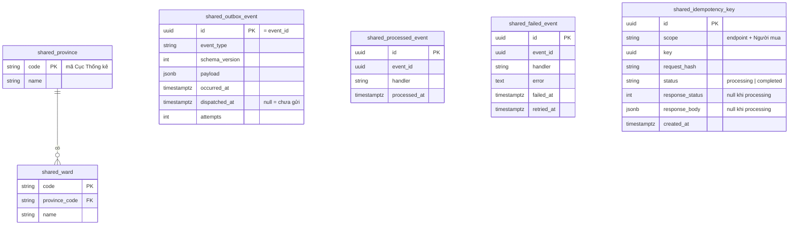
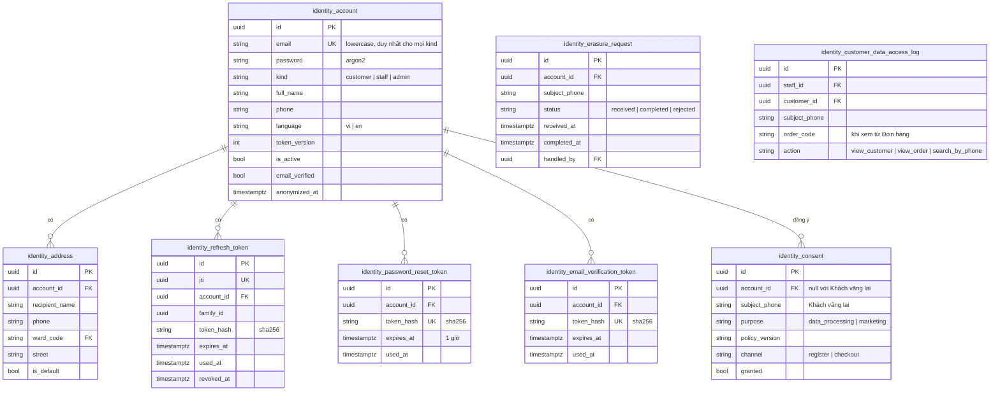
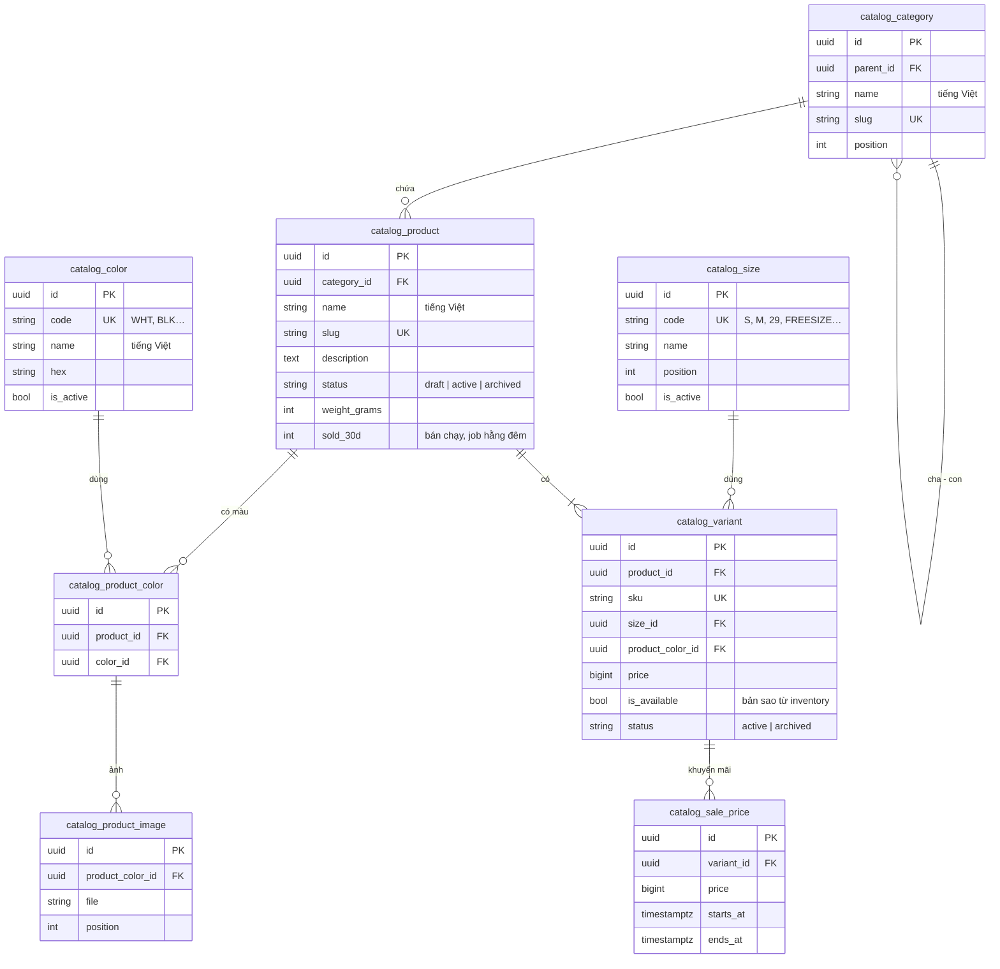
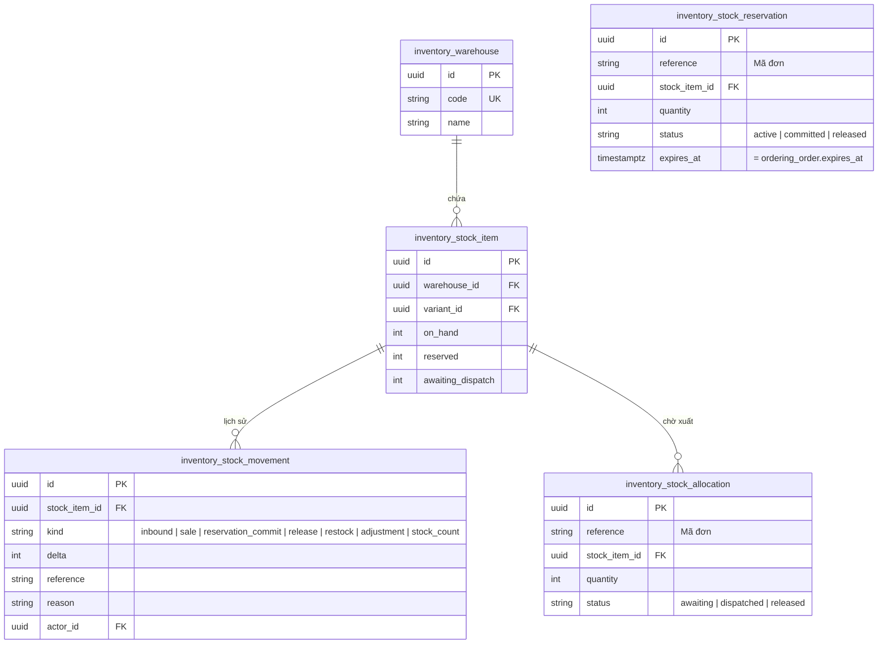
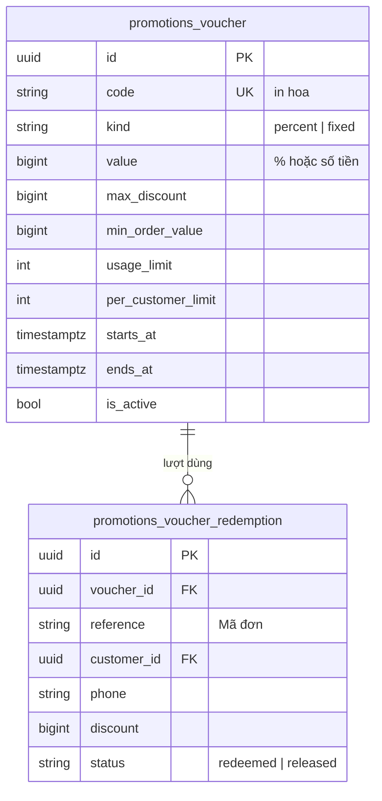
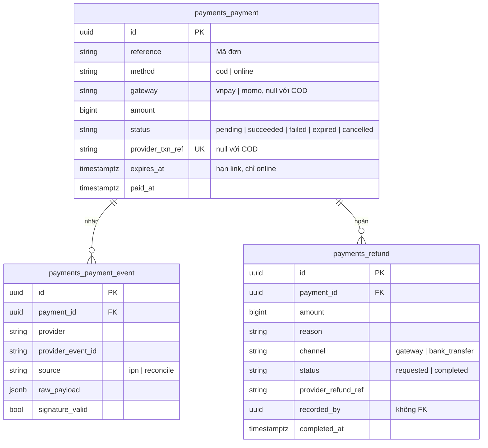
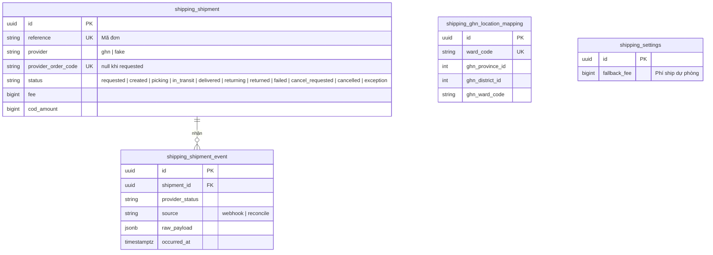
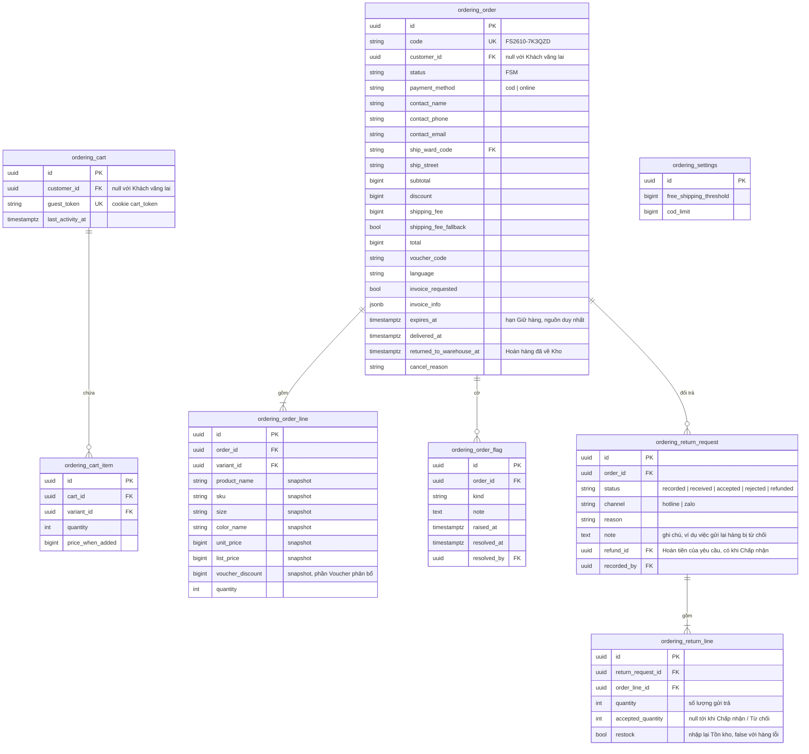
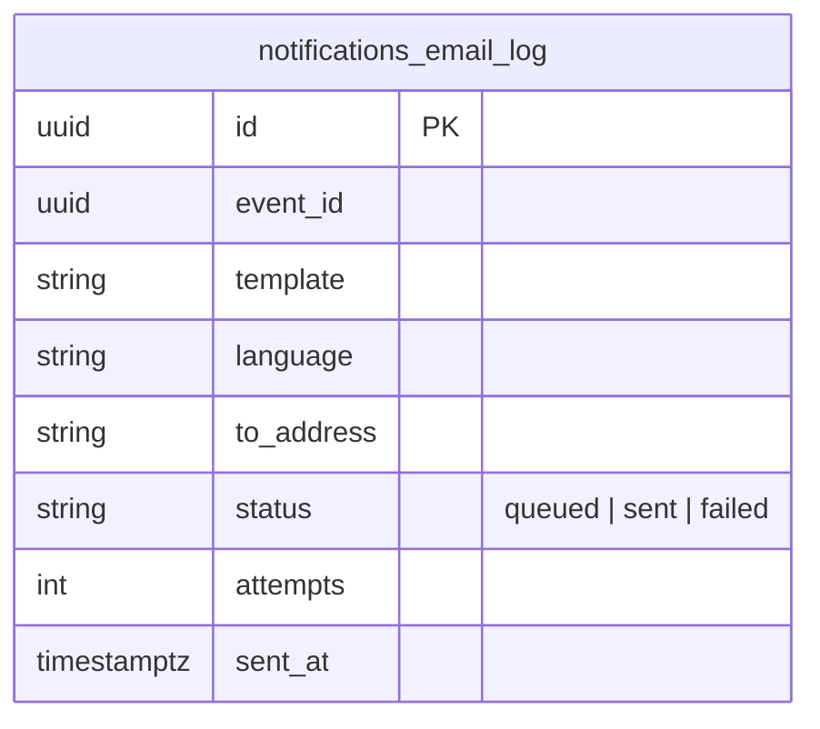

# 03. Mô hình dữ liệu

> Trạng thái: **Bản nháp chờ review**. Tên bảng có tiền tố theo module ([ADR 0006](../adr/0006-modular-monolith.md)).
> Quy ước chung cho mọi bảng: `id` UUID v7, `created_at`, `updated_at` (kế thừa `shared.models.BaseModel`). Ngoại lệ duy nhất là `shared_province` và `shared_ward`, dùng mã chính thức làm khoá chính; các khoá tự nhiên khác (sự kiện đã xử lý, `Idempotency-Key`, `jti`, ánh xạ GHN) giữ bằng ràng buộc `UNIQUE` ([ADR 0008](../adr/0008-uuid-v7-primary-keys.md)). Tiền là `bigint` số đồng VND. Thời gian lưu UTC.
>
> FK: xuyên module dùng `on_delete=PROTECT`. Trong cùng module, bảng con thuần (`ordering_cart_item`, `ordering_order_line`, `ordering_return_line`, `catalog_product_image`…) dùng `CASCADE`, còn lại dùng `PROTECT`.

## 1. `shared`

- `shared_outbox_event`: index một phần (partial index) trên `occurred_at WHERE dispatched_at IS NULL` để relay đọc nhanh. Payload không chứa secret hay PII.
- `shared_processed_event`: `UNIQUE(event_id, handler)`. `shared_failed_event` cũng `UNIQUE(event_id, handler)`, `shared_idempotency_key` thì `UNIQUE(scope, key)`. Một sự kiện có thể được nhiều handler xử lý, và mỗi handler chỉ xử lý một lần.
- `shared_failed_event`: ghi khi một cặp (sự kiện, handler) hết retry; `manage.py retry_failed_events` đọc bảng này.
- `shared_idempotency_key`: lưu kết quả lần đầu của các POST có `Idempotency-Key`. Lưu ở PostgreSQL thay vì Redis vì liên quan tới tiền và không được mất khi Redis bị xoá key. Job `shared.purge_idempotency_keys` xoá bản ghi quá 24 giờ.
  - Trước khi xử lý, ghi dòng `processing` trong một transaction riêng; request trùng key tới lúc đó nhận `409 IDEMPOTENCY_IN_PROGRESS`.
  - Xong thì chuyển `completed` và lưu phản hồi 2xx hoặc 4xx. Phản hồi 5xx không lưu: dòng bị xoá để Người mua gửi lại được.
  - Dòng `processing` quá 2 phút (tiến trình chết giữa chừng) được coi như không có.

## 2. `identity`

Ràng buộc: `UNIQUE(lower(email))` cho mọi `kind`, tức một email chỉ thuộc một Tài khoản (Staff muốn mua hàng phải dùng email khác); mỗi Tài khoản tối đa một `identity_address` có `is_default = true` (unique có điều kiện).

## 3. `catalog`

Ràng buộc và index:

- `UNIQUE(product_id, size_id, product_color_id)` trên `catalog_variant` (BR-CAT-02); `UNIQUE(product_id, color_id)` trên `catalog_product_color`.
- `catalog_size` và `catalog_color` là danh sách size và bảng màu dùng chung (BR-CAT-11). Không xoá dòng đã có Biến thể dùng, chỉ đặt `is_active = false`. Bộ lọc storefront lọc theo `code`.
- `catalog_product.sold_30d`: số lượng bán trong 30 ngày (BR-CAT-12), do job hằng đêm của `ordering` tính rồi ghi qua `catalog.contracts`, vì `catalog` không đọc được Đơn hàng.
- Đổi `catalog_variant.price` bị từ chối khi có `catalog_sale_price` đang hoặc sắp hiệu lực với `price` ≥ giá mới (BR-PRC-05), kiểm tra ở service.
- `CHECK(price > 0)`.
- `catalog_sale_price`: `CHECK(starts_at < ends_at)`. Ràng buộc **không trùng thời gian** cho cùng Biến thể bằng `EXCLUDE USING gist (variant_id WITH =, tstzrange(starts_at, ends_at) WITH &&)` (BR-PRC-02). Ràng buộc "nhỏ hơn giá bán" (BR-PRC-01) được kiểm tra ở service, vì giá bán nằm ở bảng khác.
- Tìm kiếm: index GIN trigram trên `immutable_unaccent(lower(name))` của `catalog_product` (cần tạo một hàm `IMMUTABLE` bọc `unaccent`).

## 4. `inventory`

- `UNIQUE(warehouse_id, variant_id)`; `CHECK(on_hand >= 0)`, `CHECK(reserved >= 0)`, `CHECK(reserved <= on_hand)`, `CHECK(awaiting_dispatch >= 0)`. `UNIQUE(reference, stock_item_id)` trên `inventory_stock_reservation` và `inventory_stock_allocation`.
- `on_hand` là Tồn kho; Số lượng bán được = `on_hand − reserved` (BR-INV-02). Cột `reserved` được cập nhật cùng transaction với `inventory_stock_reservation`, nên không phải cộng dồn khi đọc.
- `awaiting_dispatch` là Hàng chờ xuất (BR-INV-10, [ADR 0010](../adr/0010-stock-decremented-at-order-awaiting-dispatch.md)), cập nhật cùng transaction với `inventory_stock_allocation`. Trừ Tồn kho khi bán (`decrement_stock` với COD, `commit_reservation` với online) tạo allocation `awaiting`; Vận đơn tạo xong (`dispatch_stock`) chuyển `dispatched`; huỷ đơn trước Bàn giao (`release_allocation`) chuyển `released` và trả số lượng về `on_hand`. Hàng trên kệ = `on_hand + awaiting_dispatch`.
- Kiểm kê (`count_stock`, BR-INV-12) ghi một `inventory_stock_movement` loại `stock_count` với `delta` = số đếm − (`on_hand + awaiting_dispatch`). Điều chỉnh giảm làm `on_hand < reserved` thì bị từ chối (BR-INV-11).
- `actor_id` FK tới `identity_account`: `inventory` ở lớp trên `identity` nên được khai báo FK.
- `inventory_stock_reservation.expires_at` được truyền từ `ordering_order.expires_at` (nguồn duy nhất), không tự tính.
- Giữ hàng đã quá `expires_at` bị coi là không hợp lệ ngay cả khi job chưa kịp giải phóng ([ADR 0003](../adr/0003-postgres-redis-celery.md)). Vì Số lượng bán được đọc từ cột `reserved`, `reserve_stock` và `decrement_stock` (sau khi khoá dòng `inventory_stock_item`) tự chuyển các Giữ hàng đã hết hạn của dòng đó sang `released` và giảm `reserved` trước khi kiểm tra. Job huỷ đơn (T4) vẫn gọi `release_reservation` sau đó; thao tác này idempotent.

## 5. `promotions`

- `UNIQUE(voucher_id, reference)`; index trên `reference` cho `release_voucher(reference)`.
- Đếm lượt dùng: khoá dòng `promotions_voucher` bằng `select_for_update` khi redeem để không vượt `usage_limit` lúc nhiều người dùng cùng lúc. Dòng Voucher được khoá **sau** các dòng Tồn kho (thứ tự khoá cố định, xem [02](./02-backend-structure.md) mục 9.1).
- `per_customer_limit` đếm các lượt `redeemed` trùng `customer_id` **hoặc** trùng `phone` với số điện thoại liên hệ của đơn đang đặt (BR-VCH-07). Cần index trên `(voucher_id, customer_id)` và `(voucher_id, phone)`.

## 6. `payments`

- `UNIQUE(provider, provider_event_id)` trên `payments_payment_event` để chống xử lý IPN trùng (BR-PAY-03). Index trên `payments_payment.reference`, vì `ordering` tra Thanh toán và Hoàn tiền theo Mã đơn.
- Mỗi lần thử thanh toán online là một Thanh toán mới, có `provider_txn_ref` mới (mã gửi sang Cổng thanh toán, ví dụ `vnp_TxnRef`) và `gateway` do Người mua chọn ở lần đó. `expires_at` = lúc đặt đơn + `PAYMENT_LINK_TTL` (phút thứ 10 kể từ khi đặt đơn), giống nhau cho mọi lần thử, để link không bao giờ sống quá Giữ hàng.
- Đơn COD có đúng một Thanh toán `method = cod`: tạo ở T2 (`pending`), `succeeded` khi GHN báo đã giao và thu tiền (T11), `cancelled` khi đơn bị huỷ hoặc Hoàn hàng.
- Thanh toán COD (tạo, ghi nhận đã thu, huỷ) **không** phát sự kiện: `ordering` là bên gọi nên đã biết kết quả. `payments.payment-succeeded` chỉ dành cho Thanh toán online.
- Hoàn tiền của đơn online có `channel = gateway`; Hoàn tiền Đổi trả của đơn COD gắn vào Thanh toán COD, `channel = bank_transfer`. Hoàn tiền cho tiền về sai số tiền (BR-PAY-04) gắn vào Thanh toán `failed` đã nhận khoản tiền đó.
- `recorded_by` lưu id của Tài khoản Staff nhưng **không** khai báo FK: `payments` và `identity` cùng lớp nên không được phụ thuộc nhau ([ADR 0006](../adr/0006-modular-monolith.md)).

## 7. `shipping`

- `shipping_ghn_location_mapping` dùng để đổi mã địa chỉ 2 cấp của hệ thống sang ID của GHN, phòng trường hợp GHN vẫn dùng 3 cấp (xem [06-integrations.md](./06-integrations.md)).
- `shipping_shipment.fee` là phí GHN thực tính cho cửa hàng, khác `ordering_order.shipping_fee` là phí Người mua trả (bằng 0 khi được miễn phí ship).
- Vận đơn được tạo ở trạng thái `requested`, task nền gọi GHN rồi chuyển sang `created` hoặc `failed`. Huỷ cũng chạy nền: `cancel_requested`, rồi `cancelled` khi GHN huỷ xong.
- `exception`: GHN báo mất hàng, hư hàng, sự cố, hoặc tự huỷ Vận đơn mà hệ thống không yêu cầu; `shipping` phát `ShipmentExceptionV1`, `ordering` gắn cờ `shipment_exception` (05 mục 4.7).
- Bàn giao lại sau `failed` dùng lại chính dòng Vận đơn đó (`failed` → `requested`), nên `reference` vẫn `UNIQUE`: mỗi Đơn hàng có tối đa một Vận đơn.
- `shipping_ghn_location_mapping` được nạp bằng management command; Admin sửa được qua back-office cho phường/xã chưa có ánh xạ (US-1004). Lịch sử thay đổi ghi bằng `django-pghistory`.
- `shipping_settings` là singleton (một dòng duy nhất), Admin sửa qua back-office, lịch sử thay đổi ghi bằng `django-pghistory`.

## 8. `ordering`

- `CHECK(total = subtotal - discount + shipping_fee)` (BR-ORD-01), `CHECK(quantity > 0)`.
- Giỏ hàng: `UNIQUE(cart_id, variant_id)` trên `ordering_cart_item`; partial `UNIQUE(customer_id) WHERE customer_id IS NOT NULL` trên `ordering_cart` để mỗi Khách hàng có một giỏ.
- `code`: `FS<YYMM>-` + 6 ký tự Crockford Base32 ngẫu nhiên, `UNIQUE`; trùng thì sinh lại. Không dùng sequence, để Mã đơn không lộ thứ tự hay số lượng đơn ([ADR 0008](../adr/0008-uuid-v7-primary-keys.md)).
- `expires_at` = lúc đặt + 15 phút (`RESERVATION_TTL`) với đơn online. Đây là nguồn duy nhất của hạn Giữ hàng, được truyền xuống `inventory_stock_reservation.expires_at`.
- `customer_id` null với đơn của Khách vãng lai; được gắn vào Tài khoản khi Khách hàng xác thực email trùng `contact_email` (không phân biệt hoa thường).
- `ordering_order_line.voucher_discount`: phần Voucher phân bổ cho dòng theo tỷ lệ giá trị dòng, phần lẻ dồn vào dòng cuối; `SUM(voucher_discount) = ordering_order.discount`. Dùng để tính Hoàn tiền khi Đổi trả một phần (BR-RET-07).
- Mức giảm của Giá khuyến mãi trên một dòng tính từ `list_price` và `unit_price` khi cần (BR-PRC-04), không lưu thành cột số nguyên, để không làm tròn sai ở ngưỡng 50% của BR-RET-03.
- `ordering_return_line`: `CHECK(0 <= accepted_quantity <= quantity)`. Yêu cầu chuyển `accepted` khi có ít nhất một dòng `accepted_quantity > 0`, ngược lại `rejected` (BR-RET-08). Chỉ phần `accepted_quantity` của dòng có `restock = true` được cộng lại Tồn kho.
- `ordering_return_request.refund_id` FK tới `payments_refund` (`ordering` ở lớp trên `payments`). Handler `payments.refund-recorded` tìm Đổi trả theo `refund_id` để chuyển sang `refunded`; Hoàn tiền không gắn Đổi trả nào thì bỏ qua. Yêu cầu Đổi trả **đang mở** là yêu cầu có `status` khác `rejected` và `refunded`.
- `returned_to_warehouse_at`: thời điểm Staff xác nhận hàng của đơn Hoàn hàng đã về Kho. Đơn `RETURNED_TO_SENDER` có cột này null là đơn chờ nhập kho (US-607).
- `customer_id` cũng được gắn ngay lúc checkout của Khách vãng lai nếu `contact_email` trùng một Tài khoản đã xác thực (BR-ORD-08).
- `ordering_order_flag` (Cờ cần xử lý): `kind` ∈ `payment_amount_mismatch | unexpected_payment | shipping_fee_fallback | ghn_ward_unmapped | shipment_failed | shipment_after_cancel | shipment_exception`. Partial `UNIQUE(order_id, kind) WHERE resolved_at IS NULL` để một vấn đề chỉ có một cờ đang mở. `resolved_by` FK tới `identity_account`.
- `ordering_settings` là singleton (một dòng duy nhất), Admin sửa qua back-office.
- `django-pghistory` ghi lịch sử của `ordering_order` (chỉ các field không phải PII: `status`, `payment_method`, `subtotal`, `discount`, `shipping_fee`, `total`, `cancel_reason`, `delivered_at`), `ordering_order_flag`, `ordering_settings`, `shipping_settings`, mọi thay đổi `payments_*` và `inventory_stock_item`. Không theo dõi các cột liên hệ của Đơn hàng để lịch sử không giữ lại PII sau khi ẩn danh. Mỗi model sự kiện do `django-pghistory` sinh ra phải khai báo `Meta.db_table` có tiền tố module (ví dụ `ordering_order_event`), vì mặc định chúng mang tiền tố của app chung `modules_`.
- Index: `(contact_phone, code)` cho tra cứu của Khách vãng lai; `(status, created_at)` cho back-office; partial index `expires_at WHERE status = 'PENDING_PAYMENT'` cho job huỷ đơn; partial index `(kind, raised_at) WHERE resolved_at IS NULL` trên `ordering_order_flag` cho bộ lọc theo cờ.

## 9. `notifications`

`UNIQUE(event_id, template)` để một sự kiện không sinh hai email giống nhau.

## 10. Ẩn danh dữ liệu (CMP-05)

Điều kiện: yêu cầu xoá dữ liệu chỉ được hoàn thành khi mọi Đơn hàng của người đó đã ở trạng thái cuối (`COMPLETED`, `CANCELLED`, `RETURNED_TO_SENDER`) và không còn `payments_refund` nào `requested`. Với Khách hàng, "Đơn hàng của người đó" là các đơn đã gắn vào Tài khoản; đơn vãng lai chưa gắn cần một yêu cầu riêng theo số điện thoại (CMP-05). Điều kiện được kiểm tra ở `ordering`, vì `identity` không đọc được Đơn hàng: `ordering` đọc trạng thái đơn của mình, hỏi `payments.contracts` về Hoàn tiền còn chờ, rồi gọi `identity.contracts.complete_erasure_request`. Khi đó `identity` phát `identity.customer-erased` chỉ mang `erasure_request_id`; mỗi module tự ẩn danh dữ liệu của mình, lấy đối tượng (Tài khoản hoặc số điện thoại) qua `identity.contracts.get_erasure_subject`. `shipping` và `payments` cùng lớp với `identity` nên không nghe sự kiện này; `ordering` gọi `redact_provider_payloads(reference)` của hai module đó cho từng Đơn hàng.

| Bảng | Module | Xử lý |
|---|---|---|
| `identity_account` | identity | `email` → `erased+<id>@invalid`, `full_name`, `phone` → rỗng, `is_active = false`, `anonymized_at` |
| `identity_address` | identity | Xoá |
| `ordering_order` | ordering | `contact_name`, `contact_phone`, `contact_email`, `ship_street`, email nhận hoá đơn trong `invoice_info` → giá trị ẩn danh; giữ `ship_ward_code`, số tiền, Dòng đơn hàng, tên công ty, mã số thuế, địa chỉ công ty trong `invoice_info` |
| `ordering_cart` | ordering | Xoá |
| `promotions_voucher_redemption` | promotions | `phone` → giá trị ẩn danh |
| `notifications_email_log` | notifications | `to_address` → giá trị ẩn danh |
| `shipping_shipment_event` | shipping (do `ordering` gọi) | Xoá PII trong `raw_payload` |
| `payments_payment_event` | payments (do `ordering` gọi) | Xoá PII trong `raw_payload` |
| Lịch sử pghistory của `ordering_order` | — | Không cần xử lý: chỉ theo dõi field không phải PII (mục 8) |
| `shared_outbox_event` | — | Không cần xử lý: payload sự kiện không chứa PII |
| `identity_consent`, `identity_erasure_request` | identity | **Giữ** làm bằng chứng tuân thủ |
