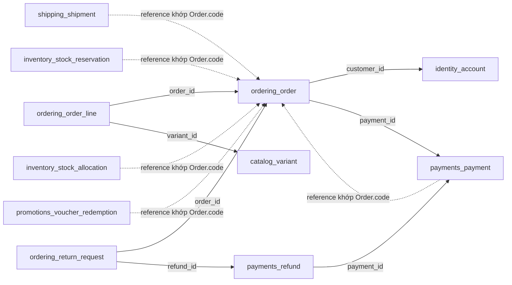
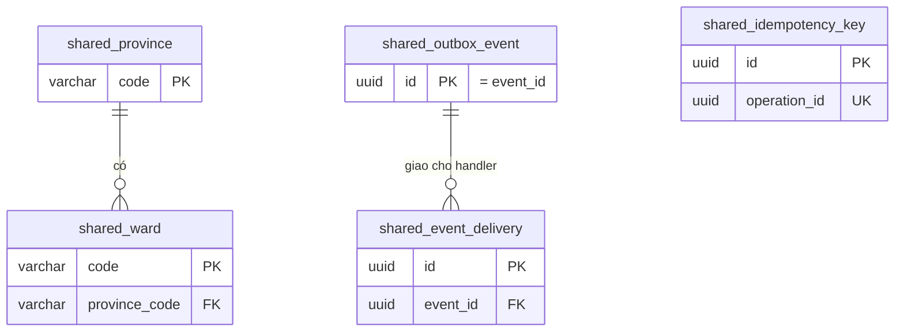
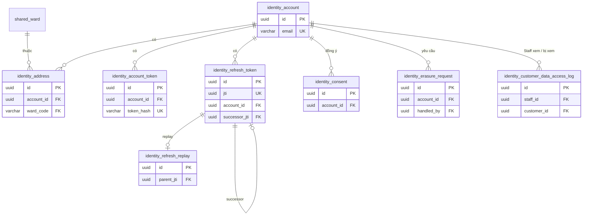
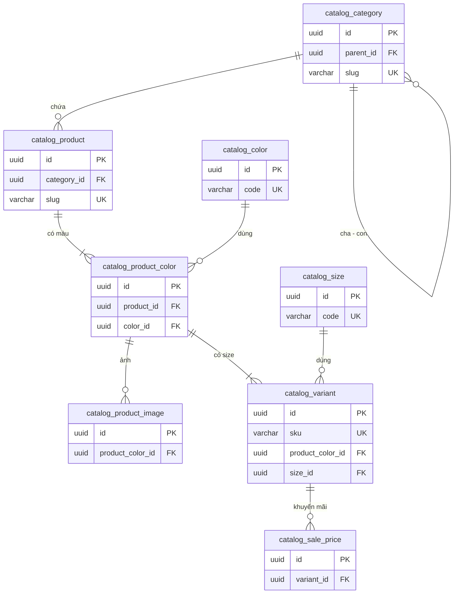
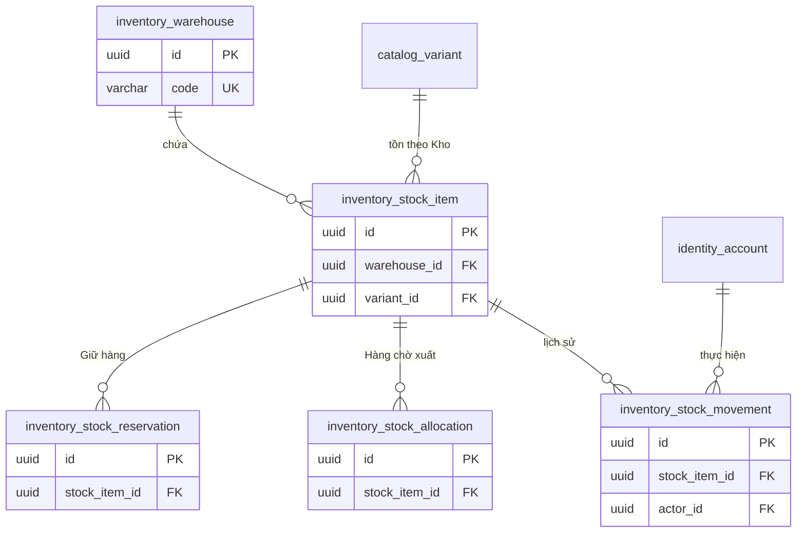
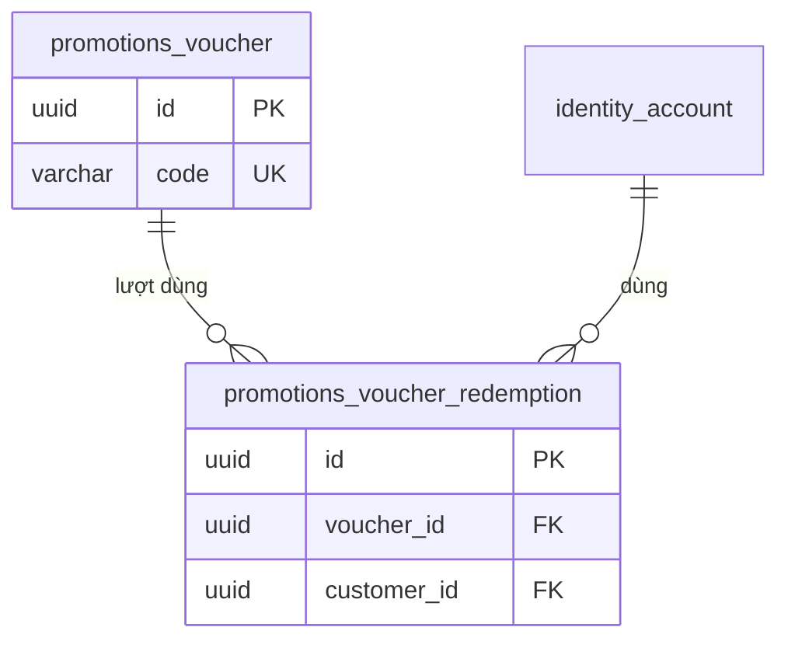
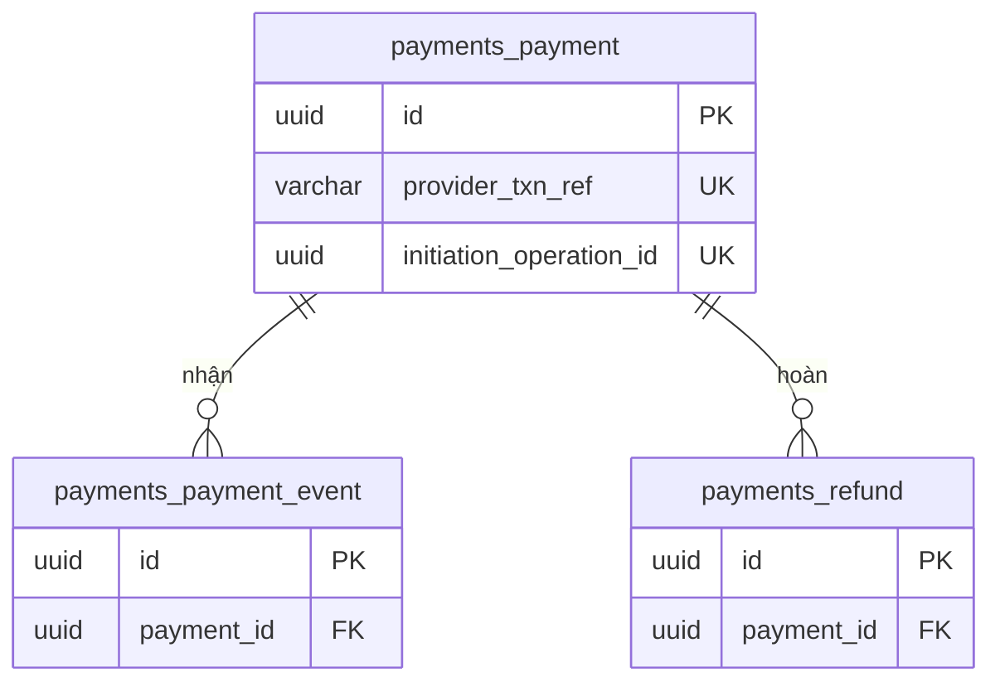
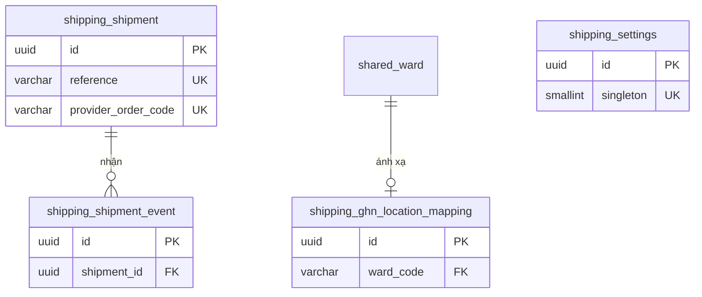
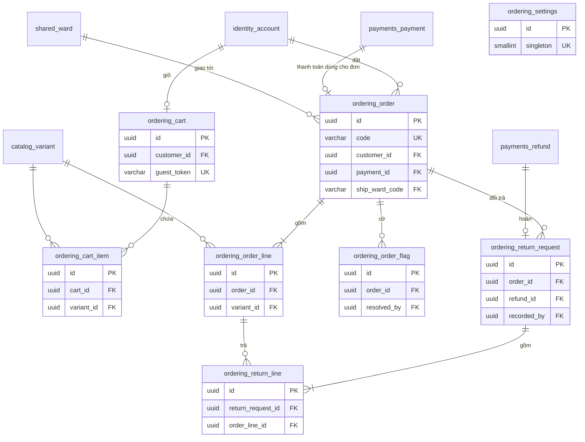
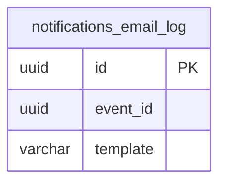

# 03. Mô hình dữ liệu

> Trạng thái: **Đã chốt cho MVP** ([quy ước](../../README.md#trạng-thái-tài-liệu)). Tên bảng có tiền tố theo module ([ADR 0006](../adr/0006-modular-monolith.md)).
> Tài liệu này là đặc tả để viết model và migration: mỗi bảng có danh sách cột đầy đủ, kiểu, NULL, mặc định và ràng buộc. Sơ đồ ER chỉ vẽ khoá (PK, FK, UK) để xem quan hệ; chi tiết cột nằm trong bảng bên dưới sơ đồ.

Phạm vi chính là 44 bảng do dự án định nghĩa. Các bảng framework và history sinh tự động được liệt kê riêng ở mục 0.9; không coi danh sách 44 bảng là toàn bộ physical schema. Tổ chức code theo [02](./02-backend-structure.md); thuật toán nghiệp vụ theo `docs/business/`, tích hợp và recovery theo 06–07. Khi các tài liệu mâu thuẫn phải sửa đồng bộ trước khi triển khai phần liên quan, không tự chọn một mô tả để bỏ qua mô tả kia.

## 0. Quy ước chung

### 0.1. Cột chung và khoá

- Các model của 44 bảng do dự án định nghĩa kế thừa `shared.models.BaseModel`, có 3 cột không ghi lại trong từng bảng: `id uuid` (PK, UUID v7), `created_at timestamptz NOT NULL`, `updated_at timestamptz NOT NULL`. Ngoại lệ trong nhóm này là `shared_province` và `shared_ward`: dùng mã chính thức làm khoá chính và không có 3 cột này ([ADR 0008](../adr/0008-uuid-v7-primary-keys.md)). Quy tắc này không áp lên bảng framework hoặc event model do pghistory sinh (mục 0.9).
- BaseModel là abstract. `id` dùng `default=shared.models.uuid7`, `created_at` dùng `default=timezone.now`, `updated_at` dùng `auto_now=True`; đây là giá trị do Python cấp, không phải default/trigger của DB. `created_at` không sửa sau khi tạo. Mọi đường `QuerySet.update`, `bulk_update` phải gán `updated_at=timezone.now()` tường minh trong cùng lần ghi; `bulk_create` phải cấp đủ hai mốc thời gian. Migration/SQL ghi trực tiếp cũng tuân theo quy tắc này; không dựa vào `auto_now` cho các thao tác bulk. API không cho client đặt hai mốc này.
- Các khoá tự nhiên khác (`Idempotency-Key`, `jti`, ánh xạ GHN, cặp sự kiện–handler) giữ bằng ràng buộc `UNIQUE`.
- Không thêm cột chỉ lặp lại một giá trị đã suy ra được từ bảng khác hoặc từ `created_at`. Ngoại lệ được ghi rõ lý do tại chỗ (ví dụ bản chụp của Dòng đơn hàng, cột `reserved` cập nhật cùng transaction).

### 0.2. Kiểu cột

| Kiểu trong tài liệu | Django field | Ghi chú |
|---|---|---|
| `uuid` | `UUIDField` | |
| `varchar(n)` | `CharField(max_length=n)` | |
| `text` | `TextField` | Văn bản dài, không giới hạn độ dài |
| `bigint` | `BigIntegerField` | Mọi số tiền: số nguyên đồng VND |
| `integer` | `IntegerField` | Số lượng, đếm |
| `smallint` | `SmallIntegerField` | |
| `boolean` | `BooleanField` | Luôn `NOT NULL`; mặc định chỉ khi bảng ghi rõ, còn `—` thì bên ghi phải cung cấp (ví dụ `granted`, `signature_valid`) |
| `timestamptz` | `DateTimeField` | Lưu UTC |
| `jsonb` | `JSONField` | Chỉ dùng khi ghi rõ schema hoặc là payload thô của nhà cung cấp |
| `bytea` | `BinaryField` | |
| `enum(a \| b)` | `CharField(max_length=32, choices=…)` | Kèm `CheckConstraint(... IN (...))` để DB chặn giá trị lạ |

### 0.3. NULL và chuỗi rỗng

- Cột chuỗi mặc định là `NOT NULL`; chỉ dùng `''` làm giá trị "không có" khi bảng ghi rõ. Ký hiệu `—` nghĩa là không khai báo default, bên ghi phải cung cấp giá trị; `NOT NULL` không tự cấm chuỗi rỗng, field bắt buộc có nội dung còn phải validate ở serializer/service.
- Chuỗi có thể `NULL` khi cần nhiều dòng không có giá trị dưới `UNIQUE` (ví dụ `provider_txn_ref` của COD), hoặc khi thuộc thao tác không áp dụng (ví dụ `gateway`, `creation_status`, `redirect_url` của COD). Mọi ngoại lệ đều ghi rõ ở bảng; không tự đổi `NULL` thành `''`.
- Cột "Mặc định" mô tả `Field.default` ở Python, trừ khi ghi rõ `db_default`. Các literal như `0`, `true`, `''` không có nghĩa tự tạo SQL DEFAULT. JSON `{}` dùng callable `dict`, mảng dùng `list`, không dùng object mutable chung. Các giá trị seed ở mục 0.7 độc lập với default của field.
- Cột không phải chuỗi (`uuid`, số, thời gian, `jsonb`) dùng `NULL` cho "chưa có" hoặc "không áp dụng". Cột NULL nào cũng được giải thích ở cột "Ý nghĩa".
- Cột NULL có quan hệ với trạng thái (ví dụ `paid_at` khi `succeeded`) được ràng buộc bằng `CHECK`, không chỉ kiểm tra ở service.

### 0.4. Độ dài chuỗi

| Loại | Độ dài | Ví dụ |
|---|---|---|
| Mã ngắn (code, enum, mã màu/size, Voucher) | 32 | `SALE10`, `FREESIZE` |
| Mã đơn (`code`, `reference`) | 16 | `FS2610-7K3QZD` (13 ký tự) |
| Mã địa giới | 10 | Mã Cục Thống kê |
| SKU | 64 | `TSHIRT-BASIC-WHT-M` |
| Mã giao dịch, mã nhà cung cấp | 64 | `vnp_TxnRef`, mã GHN |
| Tên (người, Sản phẩm, Danh mục), địa chỉ chi tiết, slug | 255 | |
| Email | 254 | Giới hạn của RFC 5321 |
| Số điện thoại | 20 | |
| Hash SHA-256 (hex) | 64 | `token_hash`, `request_hash` |
| Lý do, ghi chú ngắn | 500 | `cancel_reason`, `reason` |
| Tên handler, loại sự kiện, template | 100 | `payments.payment-succeeded` |

### 0.5. Tiền, thời gian, khoá ngoại

- Tiền là `bigint` số đồng VND; mọi cột tiền có `CHECK(>= 0)` trừ khi ghi chặt hơn (`> 0`).
- Thời gian lưu UTC trong `timestamptz`; chuyển giờ Việt Nam khi hiển thị và khi tính "ngày" cho báo cáo.
- FK xuyên module dùng `on_delete=PROTECT`, chỉ theo chiều phụ thuộc của ADR 0006. Trong cùng module, bảng con thuần dùng `CASCADE` (ghi rõ ở từng bảng), còn lại dùng `PROTECT`.
- Cột tham chiếu bản ghi của module **không** được phép phụ thuộc (cùng lớp hoặc lớp trên) lưu `uuid` hoặc mã, **không** khai báo FK, và ghi rõ "không FK".

### 0.6. Chuẩn hoá số điện thoại

- Dùng một hàm `shared.phones.normalize_vn_phone` dựa trên thư viện `phonenumbers`, parse với vùng mặc định `VN`, kiểm tra số hợp lệ thuộc Việt Nam và xuất E.164. Ví dụ `0901234567`, `+84 901 234 567` cùng được lưu thành `+84901234567`. Không tự suy đoán số thiếu mã vùng/đầu số; đầu vào không hợp lệ trả lỗi validate, không lưu nguyên chuỗi.
- Chuẩn hoá ở service trước khi ghi và trước khi so sánh: Account, Address, contact_phone của Order, phone của VoucherRedemption, subject_phone của Consent/ErasureRequest/CustomerDataAccessLog và endpoint tra cứu đơn đều dùng cùng hàm. Chuỗi rỗng chỉ được giữ ở field tuỳ chọn đã cho phép. Không đặt UNIQUE cho phone vì nhiều Tài khoản/Đơn hàng có thể dùng chung số.
- Giá trị đã ẩn danh được xử lý riêng trong service ẩn danh, không đi qua validator số thật. Không log số gốc/số đã chuẩn hoá. Dữ liệu nhập từ nguồn cũ cần management command chuẩn hoá trước khi dùng cho tra cứu, giới hạn Voucher hoặc yêu cầu xoá; không sửa lại dữ liệu đã ẩn danh.

### 0.7. Khởi tạo và seed

1. Migration `shared` tạo các bảng địa giới, outbox và idempotency; BaseModel abstract không tạo bảng. Bật `unaccent`, `pg_trgm`, `btree_gist` trước các index/EXCLUDE cần chúng, tạo hàm `immutable_unaccent` trước GIN index.
2. Migration đầu tiên của app `modules` tạo Account; các migration tiếp theo tạo bảng theo thứ tự FK hợp lệ. Bảng history/trigger được tạo cùng migration model tương ứng. Dùng dependency migration rõ ràng giữa `shared` và `modules`.
3. Data migration tạo một Kho MVP với giá trị khởi tạo kỹ thuật `code = MAIN`, `name = Kho chính`; mọi service lấy Kho từ cấu hình/default warehouse của inventory, không hardcode UUID. Tạo hai singleton theo bảng dưới; dùng historical models trong `RunPython`, không import service hiện hành, không gọi mạng từ migration. Reverse data migration không được tự xoá dữ liệu nghiệp vụ đã sử dụng các dòng này.
4. `load_geo` và command nạp ánh xạ GHN chạy sau migrate, có thể chạy lại theo khoá tự nhiên, không xoá mã còn được FK tham chiếu. Tạo Staff bằng command riêng; dữ liệu mẫu catalog chỉ ở local/test.

| Bảng | Giá trị seed | Nguồn |
|---|---|---|
| `shipping_settings` | `singleton = 1`, `fallback_fee = 35000` | BR-SHP-02 |
| `ordering_settings` | `singleton = 1`, `free_shipping_threshold = 500000`, `cod_limit = 5000000` | BR-SHP-03, BR-PAY-06; Admin sửa qua cấu hình |

Seed không tạo default cho mọi insert và không ghi đè cấu hình đã được Admin sửa. Singleton constraint chỉ bảo đảm tối đa một dòng; data migration và kiểm tra cấu hình khi khởi động bảo đảm dòng cần thiết tồn tại.

### 0.8. Bản đồ quan hệ xuyên module

Đây là bản đồ quan hệ dữ liệu, không phải hướng import code. Mũi tên liền là FK; mũi tên đứt là liên kết logic, DB không kiểm tra tồn tại/khớp mã, service bên sở hữu luồng phải kiểm tra.

Một Order online có nhiều Payment tra theo `reference`; `Order.payment_id` chỉ chọn khoản thanh toán đã dùng cho đơn, không thay thế toàn bộ quan hệ logic này. Chi tiết cardinality/NULL và các quan hệ trong từng module nằm ở mục 1–9.

### 0.9. Bảng framework và bảng sinh tự động

| Nhóm | Mục đích / ai quản lý migration |
|---|---|
| 44 bảng tại mục 1–9 | Dữ liệu tham chiếu, nghiệp vụ, cấu hình, nhật ký và hàng đợi do dự án quản lý qua migrations của `shared`/`modules` |
| Event model pghistory theo allowlist mục 10.1 | Snapshot lịch sử và metadata sự kiện; khai báo tên bảng có tiền tố module, đưa schema/trigger được sinh vào migration dự án; không bắt kế thừa BaseModel |
| Context pghistory | Metadata chỉ chứa `actor_id`; bảng/schema theo cấu hình pghistory, migration thuộc thư viện khi dùng context chuẩn. Không thêm request, IP hay PII |
| `django_celery_beat_*` | Lịch job; migration của django-celery-beat. Lịch chuẩn khai báo trong code theo 02/07 |
| `django_migrations` | Lịch sử migration; Django quản lý, không sửa trực tiếp |
| Bảng Django contrib nếu app được bật | Ví dụ contenttypes hoặc admin log; chỉ có khi cấu hình thực sự cài app tương ứng. Không suy ra có session/group/permission từ việc dùng Django; cấu hình bật app nào thì giữ migration của app đó |

Khi bootstrap, xuất danh sách bảng từ DB sau migrate để đối chiếu cả bảng dự án và framework. Không chép mọi cột thư viện vào tài liệu này hoặc sửa migration bên thứ ba để ép theo quy ước nghiệp vụ.

## 1. `shared`

### 1.1. `shared_province`: Tỉnh/thành phố

Dữ liệu địa giới 2 cấp sau sắp xếp từ 07/2025 (BR-ORD-04), nạp bằng management command. Không có cột của BaseModel.

| Cột | Kiểu | NULL | Mặc định | Ý nghĩa và ràng buộc |
|---|---|---|---|---|
| `code` | `varchar(10)` | không | — | **PK**. Mã Cục Thống kê |
| `name` | `varchar(255)` | không | — | Tên tỉnh/thành phố |

### 1.2. `shared_ward`: Phường/xã

| Cột | Kiểu | NULL | Mặc định | Ý nghĩa và ràng buộc |
|---|---|---|---|---|
| `code` | `varchar(10)` | không | — | **PK**. Mã Cục Thống kê |
| `province_code` | `varchar(10)` | không | — | FK → `shared_province.code`, `PROTECT` |
| `name` | `varchar(255)` | không | — | Tên phường/xã |

Index: `province_code`.

### 1.3. `shared_outbox_event`: Sự kiện chờ phát

| Cột | Kiểu | NULL | Mặc định | Ý nghĩa và ràng buộc |
|---|---|---|---|---|
| `id` | `uuid` | không | — | Chính là `event_id` trong payload, sinh lúc ghi sự kiện |
| `event_type` | `varchar(100)` | không | — | Ví dụ `payments.payment-succeeded` |
| `schema_version` | `smallint` | không | — | `CHECK(schema_version >= 1)` |
| `payload` | `jsonb` | không | — | Nội dung sự kiện theo class Pydantic; **không** chứa secret hay PII |
| `occurred_at` | `timestamptz` | không | — | Thời điểm nghiệp vụ xảy ra |
| `deliveries_created_at` | `timestamptz` | có | `NULL` | NULL = relay chưa lập danh sách delivery cho sự kiện này |

- Partial index trên `occurred_at WHERE deliveries_created_at IS NULL` cho relay.
- Relay tạo toàn bộ `shared_event_delivery` của sự kiện và ghi `deliveries_created_at` trong cùng transaction.

### 1.4. `shared_event_delivery`: Một cặp sự kiện–handler

Mỗi dòng là công việc của một handler với một sự kiện, đồng thời là dấu "đã xử lý" để chống xử lý trùng. Không có bảng riêng cho sự kiện đã xử lý hay sự kiện lỗi: trạng thái và thông tin lỗi nằm ngay trên dòng này.

| Cột | Kiểu | NULL | Mặc định | Ý nghĩa và ràng buộc |
|---|---|---|---|---|
| `event_id` | `uuid` | không | — | FK → `shared_outbox_event.id`, `CASCADE` (bảng con thuần) |
| `handler` | `varchar(100)` | không | — | ID đăng ký ổn định của handler |
| `status` | `enum(pending \| completed \| rejected \| failed)` | không | `pending` | |
| `attempts` | `integer` | không | `0` | Số lần handler lỗi đã lưu; `CHECK(attempts >= 0)` |
| `next_attempt_at` | `timestamptz` | không | — | Thời điểm sớm nhất handler được chạy lại (lịch retry) |
| `next_dispatch_at` | `timestamptz` | không | — | Hạn relay giao lại task nếu chưa có kết quả, kể cả khi Redis đã nhận rồi mất task |
| `last_dispatched_at` | `timestamptz` | có | `NULL` | Chỉ để quan sát |
| `completed_at` | `timestamptz` | có | `NULL` | Lúc kết thúc với `completed` hoặc `rejected` |
| `last_error` | `text` | không | `''` | Lỗi của lần thất bại gần nhất, đã cắt ngắn, không chứa PII |
| `failed_at` | `timestamptz` | có | `NULL` | Lúc chuyển `failed` (hết retry) |
| `retried_at` | `timestamptz` | có | `NULL` | Lần gần nhất `retry_failed_events` mở lại cặp này |

Ràng buộc và index:

- `UNIQUE(event_id, handler)`.
- `CHECK((status IN ('completed', 'rejected')) = (completed_at IS NOT NULL))`.
- `CHECK(status <> 'failed' OR failed_at IS NOT NULL)`.
- Partial index trên `(next_dispatch_at, next_attempt_at) WHERE status = 'pending'` cho relay.
- Partial index trên `failed_at WHERE status = 'failed'` cho cảnh báo và `retry_failed_events`.

Ghi chú:

- Consumer khoá dòng delivery. Gặp `status` khác `pending` thì bỏ qua; nhờ vậy cùng cặp không bao giờ chạy hai lần. Tác động của handler và việc chuyển sang `completed`/`rejected` commit cùng transaction. Xem [07 mục 1.1.1](./07-async-events-jobs.md#111-postgresql-quyết-định-công-việc-còn-chờ).
- Hết retry: chuyển `failed`, ghi `failed_at` và `last_error` cùng transaction. `manage.py retry_failed_events` khoá dòng `failed`, đặt lại `pending`, `attempts = 0`, lịch về hiện tại và ghi `retried_at`.
- Purge chỉ xoá outbox quá 90 ngày đã có `deliveries_created_at` và mọi delivery `completed`/`rejected` (delivery bị xoá theo `CASCADE`). Giữ sự kiện còn delivery `pending`/`failed` để khôi phục.

### 1.5. `shared_idempotency_key`: Khoá chống tạo trùng

| Cột | Kiểu | NULL | Mặc định | Ý nghĩa và ràng buộc |
|---|---|---|---|---|
| `scope` | `varchar(255)` | không | — | Endpoint + danh tính Người mua đã xác thực hoặc guest token ổn định |
| `key` | `uuid` | không | — | Giá trị header `Idempotency-Key` |
| `operation_id` | `uuid` | không | — | **UK**. Sinh một lần khi claim key; Thanh toán lưu lại làm `initiation_operation_id` |
| `request_hash` | `varchar(64)` | không | — | SHA-256 của body đã chuẩn hoá |
| `status` | `enum(in_progress \| completed)` | không | `in_progress` | |
| `completed_at` | `timestamptz` | có | `NULL` | NULL khi `in_progress` |
| `resource_id` | `uuid` | có | `NULL` | Payment hoặc Order đã tạo; NULL trước khi tạo. Không FK (trỏ tới nhiều bảng và được purge) |
| `lease_token` | `uuid` | có | `NULL` | Token của worker đang giữ key; NULL khi đã xong |
| `lease_expires_at` | `timestamptz` | có | `NULL` | |
| `response_status` | `smallint` | có | `NULL` | HTTP status đã lưu |
| `response_body` | `jsonb` | có | `NULL` | Response đã lưu để trả lại |

Ràng buộc và index:

- `UNIQUE(scope, key)`.
- `CHECK((status = 'completed') = (completed_at IS NOT NULL))`; `CHECK(status <> 'completed' OR response_status IS NOT NULL)`.
- Partial index trên `completed_at WHERE status = 'completed'` cho job purge.

Ghi chú: claim bằng transaction ngắn; cùng key khác `request_hash` trả 409, cùng key còn xử lý trả 202, `completed` trả kết quả đã lưu. Không giữ transaction khi gọi gateway. Checkout commit Order và kết quả idempotency cùng transaction; nếu rollback thì không có Order mồ côi. Khởi tạo Payment ghi `resource_id` cùng Payment trước khi gọi gateway, và khôi phục luôn dùng `resource_id` cũ. Lease token ngăn worker cũ ghi đè kết quả; IPN/đối soát vẫn có thể cập nhật Payment dưới khoá dòng. Job purge chỉ xoá bản ghi `completed` có `completed_at` quá 24 giờ; `in_progress` gắn Payment chưa rõ kết quả phải được giữ để khôi phục ([06 mục 3.1](./06-integrations.md)).

## 2. `identity`

### 2.1. `identity_account`: Tài khoản

Custom user model (`AUTH_USER_MODEL = "modules.Account"`), kế thừa `AbstractBaseUser`, **không** kế thừa `PermissionsMixin`: quyền dựa trên `kind` ([05](./05-auth-security.md)), nên không tạo các bảng group/permission của Django.

| Cột | Kiểu | NULL | Mặc định | Ý nghĩa và ràng buộc |
|---|---|---|---|---|
| `email` | `varchar(254)` | không | — | Lưu chữ thường; `UNIQUE(lower(email))` cho mọi `kind` |
| `password` | `varchar(128)` | không | — | Hash argon2 của Django; Tài khoản chỉ đăng nhập Google mang giá trị unusable (`set_unusable_password`) |
| `kind` | `enum(customer \| staff \| admin)` | không | — | |
| `full_name` | `varchar(255)` | không | `''` | |
| `phone` | `varchar(20)` | không | `''` | |
| `language` | `enum(vi \| en)` | không | `vi` | Ngôn ngữ email (BR-NTF-02) |
| `token_version` | `integer` | không | `0` | Tăng để vô hiệu mọi access token ([05](./05-auth-security.md)) |
| `is_active` | `boolean` | không | `true` | Staff bị vô hiệu thì mất mọi phiên |
| `email_verified` | `boolean` | không | `false` | |
| `last_login` | `timestamptz` | có | `NULL` | Cột bắt buộc của `AbstractBaseUser` |
| `anonymized_at` | `timestamptz` | có | `NULL` | Lúc ẩn danh (mục 10) |

Ràng buộc: `UNIQUE(lower(email))`, tức một email chỉ thuộc một Tài khoản (Staff muốn mua hàng phải dùng email khác); `CHECK(anonymized_at IS NULL OR is_active = false)`.

### 2.2. `identity_address`: Sổ địa chỉ của Khách hàng

| Cột | Kiểu | NULL | Mặc định | Ý nghĩa và ràng buộc |
|---|---|---|---|---|
| `account_id` | `uuid` | không | — | FK → `identity_account`, `CASCADE` (bảng con thuần) |
| `recipient_name` | `varchar(255)` | không | — | |
| `phone` | `varchar(20)` | không | — | |
| `ward_code` | `varchar(10)` | không | — | FK → `shared_ward.code`, `PROTECT`; tỉnh suy ra từ phường/xã |
| `street` | `varchar(255)` | không | — | Địa chỉ chi tiết |
| `is_default` | `boolean` | không | `false` | |

Ràng buộc: partial `UNIQUE(account_id) WHERE is_default = true`, mỗi Tài khoản tối đa một địa chỉ mặc định. Index: `account_id`.

### 2.3. `identity_account_token`: Token dùng một lần gửi qua email

Một bảng cho cả đặt lại mật khẩu và xác thực email, vì hai loại có cùng cấu trúc và cách dùng.

| Cột | Kiểu | NULL | Mặc định | Ý nghĩa và ràng buộc |
|---|---|---|---|---|
| `account_id` | `uuid` | không | — | FK → `identity_account`, `CASCADE` |
| `purpose` | `enum(password_reset \| email_verification)` | không | — | |
| `token_hash` | `varchar(64)` | không | — | **UK**. SHA-256 của token; token gốc chỉ nằm trong link email |
| `expires_at` | `timestamptz` | không | — | Hạn theo `purpose` ([05 mục 3](./05-auth-security.md)); đặt lại mật khẩu là 1 giờ |
| `used_at` | `timestamptz` | có | `NULL` | Lúc dùng; đã dùng thì không dùng lại được |

Index: `(account_id, purpose)` để vô hiệu các token cũ cùng loại khi phát token mới.

### 2.4. `identity_refresh_token`: Refresh token

| Cột | Kiểu | NULL | Mặc định | Ý nghĩa và ràng buộc |
|---|---|---|---|---|
| `jti` | `uuid` | không | — | **UK**. ID của token |
| `account_id` | `uuid` | không | — | FK → `identity_account`, `CASCADE` |
| `family_id` | `uuid` | không | — | Chuỗi xoay vòng; phát hiện dùng lại thì thu hồi cả family |
| `token_hash` | `varchar(64)` | không | — | SHA-256, không lưu token gốc |
| `expires_at` | `timestamptz` | không | — | |
| `used_at` | `timestamptz` | có | `NULL` | Lúc đã đổi lấy token kế tiếp |
| `successor_jti` | `uuid` | có | `NULL` | FK → `identity_refresh_token.jti`, `PROTECT`, **UK**; một token chỉ có một token kế tiếp |
| `revoked_at` | `timestamptz` | có | `NULL` | |

Ràng buộc và index: `CHECK(successor_jti IS NULL OR used_at IS NOT NULL)`; index trên `account_id`, `family_id`.

Purge chỉ chọn family không còn token có thể dùng (mọi token hết hạn hoặc đã thu hồi). Trong một transaction, khoá Account rồi các token của family theo `id`, kiểm tra lại điều kiện, xoá RefreshReplay của family, đặt `successor_jti = NULL` cho toàn family (kèm `updated_at`), sau đó mới dùng ORM xoá token. Không trông chờ `PROTECT` cho phép `QuerySet.delete()` một tập có self-FK. Đường ẩn danh xoá mọi token cũng ngắt liên kết successor và xoá replay dưới cùng khoá Account trước khi xoá; mọi đường refresh/revoke tuân cùng thứ tự khoá nên không tạo successor chen giữa.

### 2.5. `identity_refresh_replay`: Response refresh mã hoá, sống 10 giây

Bảng riêng có chủ đích ([ADR 0014](../adr/0014-refresh-single-successor.md)): dữ liệu mã hoá ngắn hạn không nằm trong bảng token, và job dọn chỉ cần xoá dòng.

| Cột | Kiểu | NULL | Mặc định | Ý nghĩa và ràng buộc |
|---|---|---|---|---|
| `parent_jti` | `uuid` | không | — | FK → `identity_refresh_token.jti`, `CASCADE`, **UK** |
| `encryption_key_id` | `varchar(32)` | không | — | Khoá AESGCM đã dùng, để xoay khoá |
| `nonce` | `bytea` | không | — | 12 byte |
| `response_ciphertext` | `bytea` | không | — | Response của lần refresh đầu, đã mã hoá |
| `expires_at` | `timestamptz` | không | — | `used_at` của token cha + 10 giây |

Mọi refresh/revoke khoá Account rồi token; kiểm tra trạng thái từ DB trước khi replay. Purge hoặc thu hồi không được tạo token mới thay thế nếu response cũ không còn trả được. Xem [05 mục 2.1](./05-auth-security.md#21-xoay-vòng-refresh-token-và-phát-hiện-dùng-lại).

### 2.6. `identity_consent`: Đồng ý xử lý dữ liệu

Chỉ thêm dòng, không sửa: mỗi lần đồng ý hoặc rút lại là một dòng mới, thời điểm là `created_at`.

| Cột | Kiểu | NULL | Mặc định | Ý nghĩa và ràng buộc |
|---|---|---|---|---|
| `account_id` | `uuid` | có | `NULL` | FK → `identity_account`, `PROTECT`; NULL với Khách vãng lai |
| `subject_phone` | `varchar(20)` | không | `''` | Số điện thoại của Khách vãng lai; `''` sau khi ẩn danh |
| `subject_phone_hmac` | `varchar(80)` | không | `''` | `<kid>:<hex>` HMAC-SHA256 của số E.164 bằng `PII_HMAC_KEYS`; ghi khi Yêu cầu xoá dữ liệu của đối tượng hoàn tất, cùng lúc xoá `subject_phone` ([ADR 0016](../adr/0016-erasure-evidence-phone-hmac.md)) |
| `purpose` | `enum(data_processing \| marketing)` | không | — | |
| `policy_version` | `varchar(32)` | không | — | Phiên bản chính sách đã hiển thị |
| `channel` | `enum(register \| checkout \| profile)` | không | — | `profile` cho thay đổi lựa chọn marketing qua `PATCH me` |
| `granted` | `boolean` | không | — | `true` = đồng ý, `false` = rút lại |

Ràng buộc: `CHECK(account_id IS NOT NULL OR subject_phone <> '' OR subject_phone_hmac <> '')`. Index: `account_id`, `subject_phone`, `subject_phone_hmac`.

### 2.7. `identity_erasure_request`: Yêu cầu xoá dữ liệu

| Cột | Kiểu | NULL | Mặc định | Ý nghĩa và ràng buộc |
|---|---|---|---|---|
| `account_id` | `uuid` | có | `NULL` | FK → `identity_account`, `PROTECT`; NULL với yêu cầu của Khách vãng lai |
| `subject_phone` | `varchar(20)` | không | `''` | Số điện thoại của Khách vãng lai; xoá về `''` khi `completed` |
| `subject_phone_hmac` | `varchar(80)` | không | `''` | `<kid>:<hex>` HMAC-SHA256 của số E.164 bằng `PII_HMAC_KEYS`; ghi khi Yêu cầu xoá dữ liệu của đối tượng hoàn tất, cùng lúc xoá `subject_phone` ([ADR 0016](../adr/0016-erasure-evidence-phone-hmac.md)) |
| `status` | `enum(received \| processing \| completed \| rejected)` | không | `received` | |
| `received_at` | `timestamptz` | không | — | Lúc cửa hàng nhận yêu cầu (có thể sớm hơn lúc Staff ghi vào hệ thống); hạn xử lý tính từ mốc này |
| `started_at` | `timestamptz` | có | `NULL` | Lúc chuyển `processing` |
| `completed_at` | `timestamptz` | có | `NULL` | Lúc chuyển `completed` |
| `erasure_event_id` | `uuid` | có | `NULL` | **UK**. Sự kiện `identity.customer-erased` khởi động các bước ẩn danh; không FK (outbox được purge) |
| `required_handlers` | `jsonb` | có | `NULL` | NULL trước xử lý; khi bắt đầu là mảng JSON không rỗng gồm string ID handler ≤ 100, không trùng, đủ các handler ordering/promotions/notifications đã đăng ký. Validate Pydantic và snapshot lúc bắt đầu, không tự thay theo registry mới khi retry |
| `handled_by` | `uuid` | có | `NULL` | FK → `identity_account` (Staff), `PROTECT` |

Ràng buộc:

- `CHECK(account_id IS NOT NULL OR subject_phone <> '' OR status = 'completed')`.
- `CHECK(status = 'received' OR (started_at IS NOT NULL AND erasure_event_id IS NOT NULL AND required_handlers IS NOT NULL) OR status = 'rejected')`.
- `CHECK((status = 'completed') = (completed_at IS NOT NULL))`.

Index: partial trên `status WHERE status = 'processing'` cho job đối soát. Vòng đời xem mục 10.

### 2.8. `identity_customer_data_access_log`: Lượt Staff xem dữ liệu cá nhân (CMP-07)

Chỉ thêm dòng, không sửa. Thời điểm là `created_at`.

| Cột | Kiểu | NULL | Mặc định | Ý nghĩa và ràng buộc |
|---|---|---|---|---|
| `staff_id` | `uuid` | không | — | FK → `identity_account`, `PROTECT` |
| `customer_id` | `uuid` | có | `NULL` | FK → `identity_account`, `PROTECT`; NULL khi đối tượng là Khách vãng lai |
| `subject_phone` | `varchar(20)` | không | `''` | Số điện thoại đã tìm hoặc của đơn vãng lai; `''` sau khi ẩn danh |
| `subject_phone_hmac` | `varchar(80)` | không | `''` | `<kid>:<hex>` HMAC-SHA256 của số E.164 bằng `PII_HMAC_KEYS`; ghi khi Yêu cầu xoá dữ liệu của đối tượng hoàn tất, cùng lúc xoá `subject_phone` ([ADR 0016](../adr/0016-erasure-evidence-phone-hmac.md)) |
| `order_code` | `varchar(16)` | không | `''` | Khi xem từ Đơn hàng; không FK (`identity` ở lớp dưới `ordering`) |
| `action` | `enum(view_customer \| view_order \| search_by_phone)` | không | — | |

Index: `(customer_id, created_at)`, `(staff_id, created_at)`, `subject_phone_hmac`.

## 3. `catalog`

Biến thể **không** có cột `product_id`: Sản phẩm của Biến thể là `product_color.product_id`. Như vậy một Biến thể không thể trỏ vào màu của Sản phẩm khác, và tổ hợp size × màu duy nhất trong Sản phẩm (BR-CAT-02) chỉ cần `UNIQUE(product_color_id, size_id)`, vì mỗi `product_color` đã thuộc đúng một Sản phẩm.

### 3.1. `catalog_category`: Danh mục

| Cột | Kiểu | NULL | Mặc định | Ý nghĩa và ràng buộc |
|---|---|---|---|---|
| `parent_id` | `uuid` | có | `NULL` | FK → `catalog_category`, `PROTECT`; NULL = Danh mục gốc |
| `name` | `varchar(255)` | không | — | Tiếng Việt (BR-CAT-10) |
| `slug` | `varchar(255)` | không | — | **UK** |
| `position` | `integer` | không | `0` | Thứ tự hiển thị trong cùng cha |

Ràng buộc: `CHECK(parent_id <> id)`; không tạo vòng thì kiểm tra ở service. Index: `(parent_id, position)`.

### 3.2. `catalog_product`: Sản phẩm

| Cột | Kiểu | NULL | Mặc định | Ý nghĩa và ràng buộc |
|---|---|---|---|---|
| `category_id` | `uuid` | không | — | FK → `catalog_category`, `PROTECT` |
| `name` | `varchar(255)` | không | — | Tiếng Việt |
| `slug` | `varchar(255)` | không | — | **UK** |
| `description` | `text` | không | `''` | Tiếng Việt |
| `status` | `enum(draft \| active \| archived)` | không | `draft` | BR-CAT-07 |
| `weight_grams` | `integer` | không | — | `CHECK(weight_grams > 0)`, bắt buộc để tính phí ship (BR-CAT-06) |
| `sold_30d` | `integer` | không | `0` | Số lượng bán 30 ngày (BR-CAT-12); `CHECK(sold_30d >= 0)` |

Index:

- `(category_id, status)` cho trang danh mục.
- GIN trigram trên `immutable_unaccent(lower(name))` cho tìm kiếm chuỗi con theo BR-CAT-13. Cần tạo hàm `IMMUTABLE` bọc `unaccent` trong migration. Truy vấn dùng cùng biểu thức chuẩn hoá tên và từ khoá đã trim, khớp `LIKE '%<từ khoá đã escape>%'` bằng tham số truy vấn; `%`, `_` và ký tự escape trong từ khoá là ký tự thường, không phải wildcard do Người mua điều khiển. `pg_trgm` hỗ trợ index cho phép khớp này; MVP không dùng ngưỡng similarity hoặc xếp hạng gần đúng. Từ khoá ngắn vẫn giữ cùng quy tắc khớp, dù DB có thể không chọn dùng index.

`sold_30d` do job hằng đêm của `ordering` tính rồi ghi qua `catalog.contracts`, vì `catalog` không đọc được Đơn hàng.

### 3.3. `catalog_size`: Danh sách size dùng chung

| Cột | Kiểu | NULL | Mặc định | Ý nghĩa và ràng buộc |
|---|---|---|---|---|
| `code` | `varchar(32)` | không | — | **UK**. Ví dụ `S`, `M`, `29`, `FREESIZE`; bộ lọc storefront dùng `code` |
| `name` | `varchar(64)` | không | — | Tên hiển thị |
| `position` | `integer` | không | `0` | Thứ tự hiển thị |
| `is_active` | `boolean` | không | `true` | Size đã có Biến thể dùng chỉ được ẩn, không xoá (BR-CAT-11) |

### 3.4. `catalog_color`: Bảng màu dùng chung

| Cột | Kiểu | NULL | Mặc định | Ý nghĩa và ràng buộc |
|---|---|---|---|---|
| `code` | `varchar(32)` | không | — | **UK**. Ví dụ `WHT`, `BLK` |
| `name` | `varchar(64)` | không | — | Tiếng Việt |
| `hex` | `varchar(7)` | không | — | `CHECK(hex ~ '^#[0-9A-F]{6}$')` |
| `is_active` | `boolean` | không | `true` | Như `catalog_size` |

### 3.5. `catalog_product_color`: Màu của một Sản phẩm

| Cột | Kiểu | NULL | Mặc định | Ý nghĩa và ràng buộc |
|---|---|---|---|---|
| `product_id` | `uuid` | không | — | FK → `catalog_product`, `CASCADE` (bảng con thuần) |
| `color_id` | `uuid` | không | — | FK → `catalog_color`, `PROTECT` |

Ràng buộc: `UNIQUE(product_id, color_id)`.

### 3.6. `catalog_product_image`: Ảnh theo màu

Mọi size cùng màu dùng chung bộ ảnh (BR-CAT-05).

| Cột | Kiểu | NULL | Mặc định | Ý nghĩa và ràng buộc |
|---|---|---|---|---|
| `product_color_id` | `uuid` | không | — | FK → `catalog_product_color`, `CASCADE` |
| `file` | `varchar(255)` | không | — | Khoá file trong storage |
| `position` | `integer` | không | `0` | Ảnh đầu tiên là ảnh đại diện |

Index: `(product_color_id, position)`.

### 3.7. `catalog_variant`: Biến thể

| Cột | Kiểu | NULL | Mặc định | Ý nghĩa và ràng buộc |
|---|---|---|---|---|
| `product_color_id` | `uuid` | không | — | FK → `catalog_product_color`, `PROTECT` |
| `size_id` | `uuid` | không | — | FK → `catalog_size`, `PROTECT` |
| `sku` | `varchar(64)` | không | — | **UK**. `CHECK(sku ~ '^[A-Z0-9-]+$')` (BR-CAT-03); không đổi sau khi đã có đơn (service) |
| `price` | `bigint` | không | — | Giá bán; `CHECK(price > 0)` (BR-CAT-04) |
| `checkout_version` | `bigint` | không | `1` | Tăng khi dữ liệu checkout của Biến thể thay đổi |
| `is_available` | `boolean` | không | `false` | Bản sao "còn Số lượng bán được" từ `inventory` |
| `status` | `enum(active \| archived)` | không | `active` | Không xoá cứng Biến thể đã có trong đơn (BR-CAT-09) |

Ràng buộc và index: `UNIQUE(product_color_id, size_id)` (BR-CAT-02); index trên `product_color_id`.

Ghi chú:

- `checkout_version` có mặt trong `VariantForSaleDTO`. Tăng phiên bản khi Giá bán, SKU, dữ liệu snapshot, cân nặng hoặc điều kiện bán thay đổi; thay đổi liên quan ở Product/Size/Color cũng phải tăng phiên bản các Biến thể bị ảnh hưởng. `is_available` là bản sao tồn kho, không làm đổi phiên bản; `inventory` vẫn quyết định đủ hàng hay không.
- `checkout_version` và hash snapshot được đưa vào `quote_token` ([04 mục 5.3](./04-api-contract.md#53-vòng-đời-quote_token)) và được kiểm tra lại dưới khoá Variant khi checkout ([02 mục 6.2](./02-backend-structure.md#62-ví-dụ-luồng-một-request)). Writer của catalog khoá Variant theo [02 mục 9.1](./02-backend-structure.md#91-quy-ước-chung); không gọi inventory khi đang giữ khoá Variant.
- Đổi `price` bị từ chối khi có `catalog_sale_price` đang hoặc sắp hiệu lực với `price` ≥ giá mới (BR-PRC-05), kiểm tra ở service.

### 3.8. `catalog_sale_price`: Giá khuyến mãi

| Cột | Kiểu | NULL | Mặc định | Ý nghĩa và ràng buộc |
|---|---|---|---|---|
| `variant_id` | `uuid` | không | — | FK → `catalog_variant`, `CASCADE` |
| `price` | `bigint` | không | — | `CHECK(price > 0)`; nhỏ hơn Giá bán (BR-PRC-01) kiểm tra ở service, vì Giá bán nằm ở bảng khác |
| `starts_at` | `timestamptz` | không | — | |
| `ends_at` | `timestamptz` | không | — | `CHECK(starts_at < ends_at)` |

Ràng buộc: không trùng thời gian cho cùng Biến thể bằng `EXCLUDE USING gist (variant_id WITH =, tstzrange(starts_at, ends_at) WITH &&)` (BR-PRC-02, cần extension `btree_gist`).

## 4. `inventory`

### 4.1. `inventory_warehouse`: Kho

MVP có một Kho, tạo bằng data migration theo mục 0.7 (`MAIN`, `Kho chính`). Đây là giá trị seed kỹ thuật, không phải UUID cố định hoặc yêu cầu nhiều Kho.

| Cột | Kiểu | NULL | Mặc định | Ý nghĩa và ràng buộc |
|---|---|---|---|---|
| `code` | `varchar(32)` | không | — | **UK** |
| `name` | `varchar(255)` | không | — | |

### 4.2. `inventory_stock_item`: Tồn kho của một Biến thể trong một Kho

| Cột | Kiểu | NULL | Mặc định | Ý nghĩa và ràng buộc |
|---|---|---|---|---|
| `warehouse_id` | `uuid` | không | — | FK → `inventory_warehouse`, `PROTECT` |
| `variant_id` | `uuid` | không | — | FK → `catalog_variant`, `PROTECT` |
| `on_hand` | `integer` | không | `0` | Tồn kho; `CHECK(on_hand >= 0)` |
| `reserved` | `integer` | không | `0` | Tổng Giữ hàng `active`; `CHECK(reserved >= 0)`, `CHECK(reserved <= on_hand)` |
| `awaiting_dispatch` | `integer` | không | `0` | Hàng chờ xuất; `CHECK(awaiting_dispatch >= 0)` |

Ràng buộc: `UNIQUE(warehouse_id, variant_id)`.

Ghi chú:

- Số lượng bán được = `on_hand − reserved` (BR-INV-02). `reserved` là cột tổng được cập nhật cùng transaction với `inventory_stock_reservation`. Đây là ngoại lệ có chủ đích của quy tắc không lặp dữ liệu: nhờ cột này, kiểm tra `CHECK(reserved <= on_hand)` chạy được trong DB, và lúc bán hàng không phải cộng dồn. Những lần đọc không khoá dòng (`get_available`, `catalog_variant.is_available`) có thể vẫn trừ Giữ hàng đã quá hạn cho tới khi T4 chạy hoặc có thao tác khoá dòng đó; lúc bán hàng luôn khoá dòng nên con số luôn đúng.
- `awaiting_dispatch` là Hàng chờ xuất (BR-INV-10, [ADR 0010](../adr/0010-stock-decremented-at-order-awaiting-dispatch.md)), cập nhật cùng transaction với `inventory_stock_allocation`. Hàng trên kệ = `on_hand + awaiting_dispatch`.
- Giữ hàng đã quá `expires_at` bị coi là không hợp lệ ngay cả khi job chưa kịp giải phóng ([ADR 0003](../adr/0003-postgres-redis-celery.md)). `reserve_stock` và `decrement_stock`, sau khi khoá dòng, tự chuyển các Giữ hàng đã hết hạn của dòng đó sang `released` và giảm `reserved` trước khi kiểm tra. Job huỷ đơn (T4) vẫn gọi `release_reservation` sau đó; thao tác này idempotent. Ngoại lệ là T3 tới muộn: `commit_reservation` gặp Giữ hàng đã quá hạn hoặc đã bị giải phóng thì kiểm tra lại Số lượng bán được trong cùng khoá dòng, đủ thì giữ lại hàng ([02](./02-backend-structure.md) mục 7.3).

### 4.3. `inventory_stock_reservation`: Giữ hàng

| Cột | Kiểu | NULL | Mặc định | Ý nghĩa và ràng buộc |
|---|---|---|---|---|
| `reference` | `varchar(16)` | không | — | Mã đơn; không FK (`inventory` ở lớp dưới `ordering`) |
| `stock_item_id` | `uuid` | không | — | FK → `inventory_stock_item`, `PROTECT` |
| `quantity` | `integer` | không | — | `CHECK(quantity > 0)` |
| `status` | `enum(active \| committed \| released)` | không | `active` | |
| `expires_at` | `timestamptz` | không | — | Bằng `ordering_order.expires_at` do bên gọi truyền vào, không tự tính |

Ràng buộc và index: `UNIQUE(reference, stock_item_id)`; partial index trên `(stock_item_id, expires_at) WHERE status = 'active'` để giải phóng Giữ hàng hết hạn khi khoá dòng.

### 4.4. `inventory_stock_allocation`: Hàng chờ xuất của một đơn

| Cột | Kiểu | NULL | Mặc định | Ý nghĩa và ràng buộc |
|---|---|---|---|---|
| `reference` | `varchar(16)` | không | — | Mã đơn; không FK |
| `stock_item_id` | `uuid` | không | — | FK → `inventory_stock_item`, `PROTECT` |
| `quantity` | `integer` | không | — | `CHECK(quantity > 0)` |
| `status` | `enum(awaiting \| dispatched \| released)` | không | `awaiting` | |

Ràng buộc và index: `UNIQUE(reference, stock_item_id)`; index trên `reference`.

Vòng đời: trừ Tồn kho khi bán (`decrement_stock` với COD, `commit_reservation` với online) tạo allocation `awaiting`. Vận đơn tạo xong (`dispatch_stock`) chuyển `dispatched`. Huỷ đơn trước Bàn giao (`release_allocation`) chuyển `released` và trả số lượng về `on_hand`.

### 4.5. `inventory_stock_movement`: Lịch sử thay đổi Tồn kho (BR-INV-09)

Chỉ thêm dòng, không sửa. Chỉ ghi khi `on_hand` thay đổi; Giữ hàng và Bàn giao không đổi `on_hand` nên không ghi.

| Cột | Kiểu | NULL | Mặc định | Ý nghĩa và ràng buộc |
|---|---|---|---|---|
| `stock_item_id` | `uuid` | không | — | FK → `inventory_stock_item`, `PROTECT` |
| `kind` | `enum(inbound \| sale \| reservation_commit \| allocation_release \| restock \| adjustment \| stock_count)` | không | — | Xem bảng ánh xạ bên dưới |
| `delta` | `integer` | không | — | Thay đổi của `on_hand`; `CHECK(delta <> 0)` |
| `reference` | `varchar(64)` | không | `''` | Mã đơn, hoặc số phiếu nhập với `inbound` |
| `reason` | `varchar(500)` | không | `''` | Lý do do Staff nhập |
| `actor_id` | `uuid` | có | `NULL` | FK → `identity_account`, `PROTECT`; NULL khi hệ thống tự thực hiện |

Ràng buộc:

- `CHECK(kind NOT IN ('inbound', 'adjustment', 'stock_count') OR actor_id IS NOT NULL)`.
- `CHECK(kind <> 'adjustment' OR reason <> '')`: điều chỉnh tay bắt buộc có lý do.
- `CHECK(kind <> 'inbound' OR reference <> '')`: nhập kho bắt buộc có số phiếu nhập.
- `CHECK` dấu của `delta`: `inbound`, `allocation_release`, `restock` > 0; `sale`, `reservation_commit` < 0.

Index: `(stock_item_id, created_at)`, `reference`.

Ánh xạ service → `kind`:

| Service | `kind` | `delta` | Ghi chú |
|---|---|---|---|
| `receive_stock` | `inbound` | + | Staff nhập hàng mới về Kho (`POST stock/inbound`) |
| `decrement_stock` | `sale` | − | Đặt đơn COD; tạo allocation |
| `commit_reservation` | `reservation_commit` | − | Thanh toán online thành công (T3); tạo allocation |
| `release_allocation` | `allocation_release` | + | Huỷ đơn trước Bàn giao |
| `restock` | `restock` | + | Hoàn hàng đã về Kho, hoặc Đổi trả được nhập lại |
| `adjust_stock` | `adjustment` | ± | Điều chỉnh tay, bắt buộc lý do |
| `count_stock` | `stock_count` | ± | Kiểm kê: `delta` = số đếm − (`on_hand + awaiting_dispatch`); chênh lệch 0 thì không ghi |
| `reserve_stock`, `release_reservation`, `dispatch_stock` | — | — | Không đổi `on_hand`, không ghi |

Điều chỉnh giảm làm `on_hand < reserved` thì bị từ chối (BR-INV-11).

## 5. `promotions`

### 5.1. `promotions_voucher`: Mã giảm giá

| Cột | Kiểu | NULL | Mặc định | Ý nghĩa và ràng buộc |
|---|---|---|---|---|
| `code` | `varchar(32)` | không | — | **UK**. Chữ in hoa (BR-VCH-09); `CHECK(code = upper(code))` |
| `kind` | `enum(percent \| fixed)` | không | — | BR-VCH-03 |
| `value` | `bigint` | không | — | Với `percent`: số % (1–100); với `fixed`: số tiền |
| `max_discount` | `bigint` | có | `NULL` | Mức giảm tối đa, chỉ dùng với `percent`; NULL = không giới hạn |
| `min_order_value` | `bigint` | có | `NULL` | Tạm tính tối thiểu; NULL = không có điều kiện |
| `usage_limit` | `integer` | có | `NULL` | Tổng lượt dùng; NULL = không giới hạn |
| `per_customer_limit` | `integer` | có | `NULL` | Lượt dùng mỗi Người mua (BR-VCH-07); NULL = không giới hạn |
| `starts_at` | `timestamptz` | không | — | |
| `ends_at` | `timestamptz` | không | — | |
| `is_active` | `boolean` | không | `true` | Admin vô hiệu Voucher |

Ràng buộc:

- `CHECK(kind <> 'percent' OR value BETWEEN 1 AND 100)`.
- `CHECK(kind <> 'fixed' OR (value > 0 AND max_discount IS NULL))`.
- `CHECK(max_discount IS NULL OR max_discount > 0)`, `CHECK(min_order_value IS NULL OR min_order_value > 0)`.
- `CHECK(usage_limit IS NULL OR usage_limit > 0)`, `CHECK(per_customer_limit IS NULL OR per_customer_limit > 0)`.
- `CHECK(starts_at < ends_at)`.

Đếm lượt dùng: khoá dòng Voucher bằng `select_for_update` khi redeem để không vượt `usage_limit` lúc nhiều người dùng cùng lúc. Dòng Voucher được khoá **sau** các dòng Tồn kho (thứ tự khoá cố định, xem [02](./02-backend-structure.md) mục 9.1). Số lượt đã dùng đếm từ `promotions_voucher_redemption`, không lưu cột đếm riêng.

Số tiền giảm tính bằng số nguyên theo BR-VCH-10: giảm theo % làm tròn xuống đến đồng trước khi áp `max_discount` và giới hạn bằng Tạm tính. Kiểm tra Tổng tiền đơn > 0 thuộc `ordering` (BR-ORD-09), không đổi giá trị Voucher để né điều kiện này.

### 5.2. `promotions_voucher_redemption`: Lượt dùng Voucher

| Cột | Kiểu | NULL | Mặc định | Ý nghĩa và ràng buộc |
|---|---|---|---|---|
| `voucher_id` | `uuid` | không | — | FK → `promotions_voucher`, `PROTECT` |
| `reference` | `varchar(16)` | không | — | Mã đơn; không FK |
| `customer_id` | `uuid` | có | `NULL` | FK → `identity_account`, `PROTECT`; NULL với Khách vãng lai |
| `phone` | `varchar(20)` | không | — | Số điện thoại liên hệ của đơn |
| `discount` | `bigint` | không | — | Số tiền đã giảm; `CHECK(discount > 0)` |
| `status` | `enum(redeemed \| released)` | không | `redeemed` | `released` khi đơn huỷ trước Đang giao (BR-VCH-08) |

Ràng buộc và index:

- `UNIQUE(voucher_id, reference)`; index trên `reference` cho `release_voucher(reference)`.
- Index trên `(voucher_id, customer_id)` và `(voucher_id, phone)`: `per_customer_limit` đếm các lượt `redeemed` trùng `customer_id` **hoặc** trùng `phone` với đơn đang đặt (BR-VCH-07).

## 6. `payments`

### 6.1. `payments_payment`: Thanh toán

| Cột | Kiểu | NULL | Mặc định | Ý nghĩa và ràng buộc |
|---|---|---|---|---|
| `reference` | `varchar(16)` | không | — | Mã đơn; không FK (`payments` ở lớp dưới `ordering`) |
| `method` | `enum(cod \| online)` | không | — | |
| `gateway` | `enum(vnpay \| momo)` | có | `NULL` | NULL với COD |
| `amount` | `bigint` | không | — | Số tiền cần thu; `CHECK(amount > 0)` |
| `amount_received` | `bigint` | không | `0` | Tiền thực nhận đã xác minh; `CHECK(amount_received >= 0)` |
| `captured_transaction_id` | `varchar(128)` | có | `NULL` | ID giao dịch provider của khoản capture online đã chấp nhận đầu tiên; NULL khi chưa capture hoặc COD. Lưu cùng amount_received để đối chiếu callback/query sau redaction, không suy lại từ raw_payload |
| `status` | `enum(pending \| succeeded \| failed \| expired \| cancelled)` | không | `pending` | Trạng thái tiền |
| `provider_txn_ref` | `varchar(64)` | có | `NULL` | **UK**. Mã gửi sang Cổng thanh toán (ví dụ `vnp_TxnRef`); NULL với COD |
| `provider_request_id` | `varchar(64)` | có | `NULL` | Ổn định cho thao tác tạo link online; NULL với COD |
| `initiation_operation_id` | `uuid` | có | `NULL` | **UK**. `operation_id` của Idempotency-Key; không FK để key purge được; NULL với COD |
| `creation_status` | `enum(prepared \| unknown \| ready \| failed \| closed)` | có | `NULL` | Trạng thái tạo link; NULL với COD |
| `creation_input` | `jsonb` | có | `NULL` | Payload cho phép gửi gateway, không secret/chữ ký/PII; NULL với COD |
| `redirect_url` | `text` | có | `NULL` | Link thanh toán khi `ready`; không đưa vào log, outbox, audit |
| `creation_lease_token` | `uuid` | có | `NULL` | |
| `creation_lease_expires_at` | `timestamptz` | có | `NULL` | |
| `expires_at` | `timestamptz` | có | `NULL` | Hạn link, chỉ online |
| `paid_at` | `timestamptz` | có | `NULL` | Lúc xác nhận đã thu |

Ràng buộc:

- `CHECK(method <> 'cod' OR (gateway IS NULL AND provider_txn_ref IS NULL AND provider_request_id IS NULL AND initiation_operation_id IS NULL AND creation_status IS NULL AND expires_at IS NULL))`.
- `CHECK(method <> 'online' OR (gateway IS NOT NULL AND provider_txn_ref IS NOT NULL AND provider_request_id IS NOT NULL AND initiation_operation_id IS NOT NULL AND creation_status IS NOT NULL AND expires_at IS NOT NULL))`.
- `CHECK(status <> 'succeeded' OR paid_at IS NOT NULL)`.
- `CHECK(method <> 'online' OR ((amount_received > 0) = (captured_transaction_id IS NOT NULL)))`; `CHECK(method <> 'cod' OR captured_transaction_id IS NULL)`; `CHECK(captured_transaction_id IS NULL OR captured_transaction_id <> '')`.
- `CHECK(creation_status <> 'ready' OR redirect_url IS NOT NULL)`.
- Partial `UNIQUE(reference) WHERE method = 'cod'`: đơn COD có đúng một Thanh toán.
- Partial `UNIQUE(gateway, provider_request_id) WHERE method = 'online'`.

Index: `reference` (`ordering` tra Thanh toán và Hoàn tiền theo Mã đơn); partial trên `creation_lease_expires_at WHERE creation_status IN ('prepared', 'unknown')` cho job khôi phục; partial trên `expires_at WHERE status = 'pending' AND method = 'online'` cho Đối soát.

Ghi chú:

- Mỗi lần thử thanh toán online là một Thanh toán mới, có `provider_txn_ref` mới và `gateway` do Người mua chọn ở lần đó. `expires_at` = lúc đặt đơn + `PAYMENT_LINK_TTL` (phút thứ 10 kể từ khi đặt đơn), giống nhau cho mọi lần thử, để link không bao giờ sống quá Giữ hàng.
- Gửi lại cùng Idempotency-Key là tiếp tục **cùng** lần thử, không tạo Payment hay mã nhà cung cấp mới. `creation_status` tách trạng thái tạo link khỏi trạng thái tiền: `prepared` trước khi gọi gateway; timeout hoặc kết quả chưa biết → `unknown`; có link → `ready`; bị từ chối chắc chắn → `failed`; giao dịch đã trả/hết hạn mà không còn link cần trả → `closed` (lưu kết quả cuối và vô hiệu lease). Không coi timeout là bằng chứng chưa có giao dịch. Recovery không được hạ trạng thái tiền mà IPN đã xác nhận.
- Đơn COD: tạo ở T2 (`pending`), `succeeded` khi GHN báo đã giao và thu tiền (T11, ghi `amount_received = amount`), `cancelled` khi đơn bị huỷ hoặc Hoàn hàng. Thanh toán COD **không** phát sự kiện, vì `ordering` là bên gọi nên đã biết kết quả; `payments.payment-succeeded` chỉ dành cho Thanh toán online.
- Online lưu số thực nhận đã xác minh kể cả khi sai số tiền. Callback IPN/đối soát trùng không cộng tiền thực nhận lần nữa.
- Lần capture online đầu ghi captured_transaction_id và amount_received cùng transaction dưới khoá Payment; cả hai bất biến cho khoản đã chấp nhận. So capture mới với hai cột này theo 06 mục 1.2, không phụ thuộc raw payload đã redaction; kết quả xung đột được lưu observation và cảnh báo, không tự đổi số tiền.

Schema nội bộ `PaymentCreationInputV1` của `creation_input` do `payments` validate bằng Pydantic (`extra = forbid`): `schema_version` = 1; `gateway` = vnpay/momo; `reference` string ≤ 16; `provider_txn_ref`, `provider_request_id` string ≤ 64; `amount` integer > 0; `currency` = VND; `return_url`, `notify_url` là URL do backend dựng từ cấu hình tin cậy; `prepared_at`, `expires_at` là timestamp UTC ISO 8601 với `prepared_at < expires_at`. Các giá trị phải khớp Payment và được chốt lúc prepare; retry không lấy URL/thời điểm chuẩn bị mới. COD dùng NULL, online bắt buộc có snapshot trước khi gọi gateway. Adapter chuyển DTO này thành request riêng từng gateway; đây không phải tuyên bố đã xác minh wire schema. Nếu nghiệm thu cần thêm tham số ổn định, phải bổ sung vào schema có version trước khi lưu; không nhận dict tuỳ ý hoặc chép request người dùng. Secret, chữ ký và PII không thuộc snapshot này. Chi tiết tham số provider vẫn theo 06 mục 2–3.

### 6.2. `payments_payment_event`: Thông báo thô từ Cổng thanh toán

Chỉ ghi khi đã tìm được Payment; IPN không khớp Payment nào thì trả mã "không tìm thấy" và không ghi bảng này ([06](./06-integrations.md)).

| Cột | Kiểu | NULL | Mặc định | Ý nghĩa và ràng buộc |
|---|---|---|---|---|
| `payment_id` | `uuid` | không | — | FK → `payments_payment`, `CASCADE` (bảng con thuần) |
| `provider` | `enum(vnpay \| momo)` | không | — | Lặp lại `payment.gateway` có chủ đích: cần nằm trong cùng bảng để `UNIQUE` chống trùng chạy được |
| `provider_event_id` | `varchar(128)` | không | — | Khoá quan sát nội bộ `obs:v1:` + SHA-256 canonical identity theo 06 mục 1.2; không giả định provider có event ID riêng |
| `source` | `enum(ipn \| reconcile)` | không | — | |
| `raw_payload` | `jsonb` | không | — | Payload gốc; ẩn danh khi có Yêu cầu xoá dữ liệu |
| `signature_valid` | `boolean` | không | — | |

Ràng buộc: `UNIQUE(provider, provider_event_id)` để chống xử lý IPN trùng (BR-PAY-03). Index: `payment_id`.

Chỉ lưu observation đã xác thực, resolve đúng Payment/merchant/currency; `signature_valid = true` cho IPN hoặc query đã xác minh theo protocol. Callback sai chữ ký không ghi PaymentEvent nghiệp vụ và không tác động tiền. Observation key gồm outcome/mã/số tiền/định danh giao dịch, bỏ source và thời gian response để IPN/Đối soát cùng kết quả chống trùng; pending không che success về sau. Khoá Payment và quy tắc gán captured_amount ở 06 mục 1.2 mới quyết định tác động tiền, UNIQUE không tự bảo đảm mọi observation khác key đều được cộng tiền.

### 6.3. `payments_refund`: Hoàn tiền

| Cột | Kiểu | NULL | Mặc định | Ý nghĩa và ràng buộc |
|---|---|---|---|---|
| `payment_id` | `uuid` | không | — | FK → `payments_payment`, `PROTECT` |
| `request_key` | `varchar(100)` | không | — | Định danh thao tác nghiệp vụ nguồn, xem ghi chú |
| `amount` | `bigint` | không | — | `CHECK(amount > 0)` |
| `reason` | `varchar(500)` | không | `''` | Văn bản tự do, không được chứa PII |
| `channel` | `enum(gateway \| bank_transfer)` | không | — | |
| `status` | `enum(requested \| completed)` | không | `requested` | MVP Staff hoàn tay rồi ghi nhận (BR-REF-03), nên không có trạng thái thất bại |
| `provider_refund_ref` | `varchar(64)` | không | `''` | Mã giao dịch hoàn hoặc mã chuyển khoản do Staff nhập |
| `recorded_by` | `uuid` | có | `NULL` | ID Tài khoản Staff ghi nhận; **không FK** (`payments` và `identity` cùng lớp) |
| `completed_at` | `timestamptz` | có | `NULL` | |

Ràng buộc và index:

- `UNIQUE(payment_id, request_key)`.
- `CHECK((status = 'completed') = (completed_at IS NOT NULL))`; `CHECK(status <> 'completed' OR (provider_refund_ref <> '' AND recorded_by IS NOT NULL))`.
- Partial index trên `created_at WHERE status = 'requested'` cho danh sách Hoàn tiền chờ xử lý.

Ghi chú:

- `request_refund(payment_id, amount, reason, channel, request_key)` bắt buộc chỉ đúng Thanh toán. Gọi lại cùng key và tham số thì trả cùng `refund_id`; khác tham số thì từ chối `REFUND_REQUEST_CONFLICT`. Key ổn định theo thao tác nguồn, ví dụ `unexpected-payment`, `amount-mismatch`, `cancel:<order_id>`, `returned-shipment:<order_id>`, `return:<return_request_id>`; không sinh key ngẫu nhiên mỗi lần retry.
- Khoá dòng Payment trước khi tìm/tạo Refund, và kiểm tra tổng `requested` + `completed` cộng yêu cầu mới không vượt `amount_received` (BR-REF-06).
- Hoàn tiền của đơn online có `channel = gateway`, và gateway lấy từ Payment, không nhận từ bên gọi. Hoàn tiền Đổi trả của đơn COD gắn vào Thanh toán COD, `channel = bank_transfer`. Hoàn tiền cho tiền về sai số tiền (BR-PAY-04) gắn vào Thanh toán `failed` đã nhận khoản tiền đó.
- `bank_transfer`: hệ thống **không** lưu số tài khoản ngân hàng của Người mua. Staff lấy thông tin qua hotline hoặc Zalo, chuyển khoản, rồi chỉ ghi mã giao dịch vào `provider_refund_ref`.

## 7. `shipping`

### 7.1. `shipping_shipment`: Vận đơn

| Cột | Kiểu | NULL | Mặc định | Ý nghĩa và ràng buộc |
|---|---|---|---|---|
| `reference` | `varchar(16)` | không | — | **UK**. Mã đơn, cũng là `client_order_code` gửi GHN; không FK |
| `provider` | `enum(ghn \| fake)` | không | — | |
| `provider_order_code` | `varchar(64)` | có | `NULL` | **UK**. Mã GHN; NULL khi `requested`/`creation_unknown` |
| `creation_input` | `jsonb` | không | — | Snapshot request GHN, chứa PII; không log/audit; ẩn danh khi có Yêu cầu xoá dữ liệu |
| `creation_lease_token` | `uuid` | có | `NULL` | |
| `creation_lease_expires_at` | `timestamptz` | có | `NULL` | |
| `next_recovery_at` | `timestamptz` | có | `NULL` | Lần khôi phục kế tiếp khi chưa rõ kết quả tạo |
| `created_event_id` | `uuid` | có | `NULL` | ID của `ShipmentCreatedV1` đã phát; ghi cùng transaction với sự kiện |
| `cancellation_requested_at` | `timestamptz` | có | `NULL` | Ý định huỷ Vận đơn do hệ thống đã ghi trước HTTP; giữ sau cancelled và không đổi khi retry. NULL nghĩa là chưa có yêu cầu huỷ, giúp phân biệt cancel tự phát với callback huỷ theo yêu cầu bị lặp |
| `status` | `enum(requested \| creation_unknown \| created \| picking \| in_transit \| delivered \| returning \| returned \| failed \| cancel_requested \| cancelled \| exception)` | không | `requested` | |
| `fee` | `bigint` | có | `NULL` | Cước vận chuyển GHN tính cho cửa hàng; NULL tới khi biết |
| `cod_amount` | `bigint` | không | `0` | Tiền GHN thu hộ; `CHECK(cod_amount >= 0)` |

Ràng buộc và index:

- `CHECK(status IN ('requested', 'creation_unknown', 'failed') OR provider_order_code IS NOT NULL)`.
- `CHECK(fee IS NULL OR fee >= 0)`.
- `CHECK(status NOT IN ('cancel_requested', 'cancelled') OR cancellation_requested_at IS NOT NULL)`.
- Partial index trên `next_recovery_at WHERE status IN ('requested', 'creation_unknown')`; index trên `(status, updated_at)` cho Đối soát.

Ghi chú:

- `fee` là Cước vận chuyển, khác `ordering_order.shipping_fee` là Phí ship Người mua trả.
- Vận đơn `requested` được task claim bằng lease trước khi gọi GHN ngoài transaction. Kết quả chắc chắn → `created`/`failed`; timeout hoặc crash chưa rõ kết quả → `creation_unknown` (`requested` hết lease cũng được coi là chưa rõ). Giữ `reference` và `creation_input`, truy vấn theo mã shop trước khi retry ([06 mục 4.3](./06-integrations.md)). Huỷ cũng chạy nền: `cancel_requested` rồi `cancelled`.
- Mọi đường phát hiện GHN đã tạo (response, query, webhook) khoá Shipment và ghi `created_event_id` cùng sự kiện outbox nếu chưa có; không phát lại khi đã ghi, không ghi `created` đè `picking`/`in_transit`/`delivered`/`returned`.
- Bàn giao lại chỉ khi `failed` đã xác nhận không có Vận đơn ngoài GHN; dùng lại dòng và mã cũ. `creation_unknown` không được retry tạo bằng mã mới, và Staff không được huỷ Đơn hàng hay bàn giao lại khi chưa đối soát. `UNIQUE(reference)` chỉ chống trùng trong DB, không tự bảo đảm một Vận đơn ngoài GHN.
- `exception`: GHN báo mất hàng, hư hàng, sự cố, hoặc tự huỷ Vận đơn mà hệ thống không yêu cầu; `shipping` phát `ShipmentExceptionV1`, `ordering` gắn cờ `shipment_exception` ([business/05 mục 4.7](../business/05-order-lifecycle.md#47-vận-đơn-gặp-sự-cố)).
- Mọi response/webhook/query áp cùng transition guard của 06 mục 4.1 dưới khoá Shipment. `cancel` với cancellation_requested_at đã lưu là kết quả huỷ theo yêu cầu, kể cả khi đã cancelled; duplicate không biến thành exception. delivered/returned/cancelled không bị callback tới muộn ghi lùi. Mốc cancellation_requested_at là snapshot ý định không thể suy ra từ trạng thái hiện tại nên là ngoại lệ lưu dữ liệu có chủ đích.

Schema nội bộ `ShipmentCreationInputV1` của `creation_input` do `shipping` validate bằng Pydantic (`extra = forbid`), có `schema_version = 1` và các field sau. Đây là DTO nội bộ, adapter ánh xạ sang field GHN đã nghiệm thu theo 06 mục 4.3; không mặc định tên field dưới đây là tên wire API.

| Field | Kiểu / ràng buộc |
|---|---|
| `reference` | string ≤ 16, bằng `Shipment.reference`, dùng làm mã shop khi gọi GHN |
| `shop_id` | integer > 0; snapshot shop đã cấu hình |
| `service_id`, `service_type_id` | integer > 0 hoặc NULL; ít nhất một có giá trị, theo lựa chọn dịch vụ đã nghiệm thu |
| `recipient` | Object bắt buộc: `name` string ≤ 255, `phone` E.164 ≤ 20, `street` string ≤ 255, `ward_code` string ≤ 10; không rỗng trước redaction |
| `location` | Object bắt buộc: `ghn_province_id`, `ghn_district_id` integer > 0, `ghn_ward_code` string ≤ 16; snapshot mapping đã chọn, không dùng ID giả |
| `items` | Mảng không rỗng; mỗi object gồm `sku` string ≤ 64, `name` string ≤ 255, `quantity` integer > 0, `weight_grams` integer > 0 |
| `weight_grams` | integer > 0, bằng tổng `item.weight_grams * item.quantity` |
| `dimensions_cm` | Object gồm `length`, `width`, `height` integer > 0, snapshot cấu hình gói |
| `declared_value` | integer ≥ 0, giá trị hàng khai báo đã chọn cho lần tạo |
| `cod_amount` | integer ≥ 0, bằng `Shipment.cod_amount` |

Mọi field trên bắt buộc có key, kể cả key dịch vụ có giá trị NULL; không tự bổ sung cấu hình/mapping mới khi retry. Tham số adapter bổ sung phải có schema tường minh trước khi lưu, không thêm object tuỳ ý. Sau ẩn danh, service redaction xoá/che phần nhận diện trong `recipient`, `items.name` nếu có PII; bản đã redaction không được dùng tạo/retry Vận đơn. Chỉ ẩn danh khi nghiệp vụ đã kết thúc theo mục 10; không đưa snapshot này vào log/audit/outbox.

### 7.2. `shipping_shipment_event`: Thông báo thô từ GHN

| Cột | Kiểu | NULL | Mặc định | Ý nghĩa và ràng buộc |
|---|---|---|---|---|
| `shipment_id` | `uuid` | không | — | FK → `shipping_shipment`, `CASCADE` (bảng con thuần) |
| `provider_status` | `varchar(64)` | không | — | Trạng thái gốc của GHN |
| `source` | `enum(webhook \| reconcile)` | không | — | |
| `raw_payload` | `jsonb` | không | — | Ẩn danh khi có Yêu cầu xoá dữ liệu |
| `occurred_at` | `timestamptz` | có | `NULL` | Thời điểm GHN ghi nhận; NULL nếu provider không cung cấp, không bịa bằng thời điểm nhận |

Index: `(shipment_id, occurred_at)`.

`created_at` là lúc hệ thống nhận/lưu observation. Khi cần timeline, sắp theo `COALESCE(occurred_at, created_at)`, tie-break `id`; không dùng thời gian này để bỏ qua transition guard. Shipment.updated_at ghi thời điểm nhận observation hợp lệ gần nhất, kể cả query không đổi trạng thái, để job Đối soát đo thời gian không có cập nhật theo 06.

### 7.3. `shipping_ghn_location_mapping`: Ánh xạ phường/xã sang GHN

Đổi mã địa giới 2 cấp của hệ thống sang ID của GHN, phòng trường hợp GHN vẫn dùng 3 cấp ([06](./06-integrations.md)). Nạp bằng management command; Admin sửa qua back-office cho phường/xã chưa có ánh xạ (US-1004).

| Cột | Kiểu | NULL | Mặc định | Ý nghĩa và ràng buộc |
|---|---|---|---|---|
| `ward_code` | `varchar(10)` | không | — | **UK**. FK → `shared_ward.code`, `PROTECT` |
| `ghn_province_id` | `integer` | không | — | |
| `ghn_district_id` | `integer` | không | — | |
| `ghn_ward_code` | `varchar(16)` | không | — | |

### 7.4. `shipping_settings`: Cấu hình vận chuyển (singleton)

| Cột | Kiểu | NULL | Mặc định | Ý nghĩa và ràng buộc |
|---|---|---|---|---|
| `singleton` | `smallint` | không | `1` | **UK**, `CHECK(singleton = 1)`: bảng chỉ có một dòng |
| `fallback_fee` | `bigint` | không | — | Phí ship dự phòng; `CHECK(fallback_fee >= 0)` |

Dòng duy nhất được tạo bằng data migration với `fallback_fee = 35000` theo mục 0.7; Admin sửa qua back-office. Cột không có default vì seed và các thao tác ghi phải cấp giá trị tường minh.

## 8. `ordering`

### 8.1. `ordering_cart`: Giỏ hàng

| Cột | Kiểu | NULL | Mặc định | Ý nghĩa và ràng buộc |
|---|---|---|---|---|
| `customer_id` | `uuid` | có | `NULL` | FK → `identity_account`, `PROTECT`; NULL với giỏ của Khách vãng lai |
| `guest_token` | `varchar(64)` | có | `NULL` | **UK**. Giá trị cookie `cart_token`; NULL với giỏ của Khách hàng |
| `last_activity_at` | `timestamptz` | không | — | Giỏ vãng lai hết hạn sau 30 ngày không hoạt động (BR-CRT-02) |

Ràng buộc và index:

- `CHECK((customer_id IS NULL) <> (guest_token IS NULL))`: giỏ thuộc đúng một trong hai.
- Partial `UNIQUE(customer_id) WHERE customer_id IS NOT NULL`: mỗi Khách hàng một giỏ.
- Partial index trên `last_activity_at WHERE customer_id IS NULL` cho job purge.

Mọi thay đổi cart/item và checkout khoá Cart trước khi đọc/ghi các dòng. Merge khoá các Cart theo id tăng dần. Checkout so fingerprint các dòng hiện tại với quote_token dưới khoá Cart rồi mới khoá StockItem/Variant/Voucher; xoá các dòng đã mua cùng transaction tạo Order. Vì vậy đổi Idempotency-Key không cho dùng lại báo giá để đặt lại một giỏ đã checkout. Không flow nào được giữ StockItem rồi quay lại khoá Cart.

### 8.2. `ordering_cart_item`: Dòng trong Giỏ hàng

| Cột | Kiểu | NULL | Mặc định | Ý nghĩa và ràng buộc |
|---|---|---|---|---|
| `cart_id` | `uuid` | không | — | FK → `ordering_cart`, `CASCADE` |
| `variant_id` | `uuid` | không | — | FK → `catalog_variant`, `PROTECT` |
| `quantity` | `integer` | không | — | `CHECK(quantity > 0)`; tối đa 10 mỗi Biến thể (BR-CRT-05) kiểm tra ở service, vì là giả định có thể đổi |
| `price_when_added` | `bigint` | không | — | Giá áp dụng lúc thêm, chỉ để báo Người mua khi giá đổi (BR-CRT-04); `CHECK(price_when_added > 0)` |

Ràng buộc: `UNIQUE(cart_id, variant_id)`.

### 8.3. `ordering_order`: Đơn hàng

| Cột | Kiểu | NULL | Mặc định | Ý nghĩa và ràng buộc |
|---|---|---|---|---|
| `code` | `varchar(16)` | không | — | **UK**. Mã đơn, xem ghi chú |
| `customer_id` | `uuid` | có | `NULL` | FK → `identity_account`, `PROTECT`; NULL với đơn vãng lai chưa gắn Tài khoản |
| `status` | `enum(PENDING_PAYMENT \| PLACED \| CONFIRMED \| PACKING \| SHIPPING \| DELIVERED \| COMPLETED \| CANCELLED \| RETURNED_TO_SENDER)` | không | — | Máy trạng thái ở [05-order-lifecycle](../business/05-order-lifecycle.md). Đơn online bắt đầu ở `PENDING_PAYMENT`, đơn COD ở `PLACED` |
| `payment_method` | `enum(cod \| online)` | không | — | |
| `payment_id` | `uuid` | có | `NULL` | FK → `payments_payment`, `PROTECT`; Thanh toán dùng cho đơn, NULL với đơn online tới T3 |
| `contact_name` | `varchar(255)` | không | — | |
| `contact_phone` | `varchar(20)` | không | — | Khách vãng lai tra cứu đơn bằng số này |
| `contact_email` | `varchar(254)` | không | `''` | Tuỳ chọn khi checkout (US-301 AC1); lưu chữ thường |
| `ship_ward_code` | `varchar(10)` | không | — | FK → `shared_ward.code`, `PROTECT` |
| `ship_street` | `varchar(255)` | không | — | Địa chỉ chi tiết |
| `subtotal` | `bigint` | không | — | Tạm tính; `CHECK(subtotal > 0)` |
| `discount` | `bigint` | không | `0` | Giảm giá Voucher; `CHECK(discount >= 0 AND discount <= subtotal)` (BR-VCH-06) |
| `shipping_fee` | `bigint` | không | — | Phí ship Người mua trả; `CHECK(shipping_fee >= 0)` |
| `shipping_fee_fallback` | `boolean` | không | `false` | Đã dùng Phí ship dự phòng |
| `total` | `bigint` | không | — | Tổng tiền đơn; `CHECK(total > 0)` (BR-ORD-09) |
| `voucher_code` | `varchar(32)` | không | `''` | `''` = không dùng Voucher |
| `language` | `enum(vi \| en)` | không | `vi` | Ngôn ngữ email của đơn |
| `invoice_requested` | `boolean` | không | `false` | Người mua yêu cầu hoá đơn công ty |
| `invoice_info` | `jsonb` | có | `NULL` | Thông tin xuất hoá đơn, schema bên dưới; NULL khi không yêu cầu |
| `expires_at` | `timestamptz` | có | `NULL` | Hạn Giữ hàng của đơn online, nguồn duy nhất; NULL với COD |
| `placed_at` | `timestamptz` | có | `NULL` | Lúc vào `PLACED` (T2, T3) |
| `cancelled_at` | `timestamptz` | có | `NULL` | |
| `delivered_at` | `timestamptz` | có | `NULL` | Mốc tính hạn Đổi trả 7 ngày (BR-RET-01) |
| `completed_at` | `timestamptz` | có | `NULL` | Ngày ghi Doanh thu (BR-REV-01) |
| `returned_to_warehouse_at` | `timestamptz` | có | `NULL` | Lúc Staff xác nhận nhập lại hàng của T12 hoặc T14; NULL khi chưa nhập lại hoặc không thuộc diện nhập lại |
| `warehouse_return_required` | `boolean` | không | `false` | Bằng chứng cần xác nhận nhập lại: true ở T12, hoặc T14 khi Staff xác nhận hàng chưa rời Kho; giữ true sau khi nhập lại. Không suy ra chỉ từ CANCELLED vì phần lớn đơn huỷ đã trả allocation ngay hoặc hàng bị mất/hư |
| `cancel_reason` | `varchar(500)` | không | `''` | Bắt buộc khi Staff huỷ; Người mua tự huỷ thì để trống |

Ràng buộc:

- `CHECK(total = subtotal - discount + shipping_fee)` (BR-ORD-01).
- `CHECK(total > 0)` (BR-ORD-09). Tính thử và checkout cũng kiểm tra ở service, trả `422 ORDER_TOTAL_NOT_POSITIVE` trước khi tạo đơn hoặc commit các thay đổi nghiệp vụ.
- `CHECK((voucher_code = '') = (discount = 0))`.
- `CHECK((payment_method = 'online') = (expires_at IS NOT NULL))`.
- `CHECK(invoice_requested = (invoice_info IS NOT NULL))`.
- `CHECK((status = 'CANCELLED') = (cancelled_at IS NOT NULL))`; `CHECK((status = 'COMPLETED') = (completed_at IS NOT NULL))`.
- `CHECK(status = 'PENDING_PAYMENT' OR (status = 'CANCELLED' AND placed_at IS NULL) OR placed_at IS NOT NULL)`: mọi đơn đã qua `PLACED` đều có `placed_at`.
- `CHECK(status NOT IN ('DELIVERED', 'COMPLETED') OR delivered_at IS NOT NULL)`.
- `CHECK(NOT warehouse_return_required OR status IN ('RETURNED_TO_SENDER', 'CANCELLED'))`.
- `CHECK(status <> 'RETURNED_TO_SENDER' OR warehouse_return_required)`.
- `CHECK(returned_to_warehouse_at IS NULL OR warehouse_return_required)`.

Schema của `invoice_info` (validate bằng Pydantic trong `ordering`):

| Khoá | Kiểu | Bắt buộc | Ẩn danh khi xoá dữ liệu |
|---|---|---|---|
| `company_name` | string ≤ 255 | có | Giữ |
| `tax_code` | string ≤ 14 | có | Giữ |
| `company_address` | string ≤ 255 | có | Giữ |
| `invoice_email` | string ≤ 254 | có | Ẩn danh |

Index:

- `(contact_phone, code)` cho tra cứu của Khách vãng lai.
- `(status, created_at)` cho back-office; `(customer_id, created_at)` cho lịch sử đơn của Khách hàng.
- `completed_at` cho báo cáo Doanh thu; `placed_at` cho báo cáo đơn theo ngày.
- Partial trên `expires_at WHERE status = 'PENDING_PAYMENT'` cho job huỷ đơn.
- Partial trên `delivered_at WHERE status = 'DELIVERED'` cho job Hoàn tất.
- Partial trên `created_at WHERE warehouse_return_required = true AND returned_to_warehouse_at IS NULL` cho danh sách đơn chờ xác nhận nhập lại, gồm T12 và T14 khi hàng chưa rời Kho (US-607).

Ghi chú:

- `code`: `FS<YYMM>-` + 6 ký tự Crockford Base32 ngẫu nhiên; trùng thì sinh lại. Không dùng sequence, để Mã đơn không lộ thứ tự hay số lượng đơn ([ADR 0008](../adr/0008-uuid-v7-primary-keys.md), BR-ORD-03).
- `expires_at` = lúc đặt + 15 phút (`RESERVATION_TTL`) với đơn online, được truyền xuống `inventory_stock_reservation.expires_at`.
- `customer_id` được gắn vào Tài khoản khi Khách hàng xác thực email trùng `contact_email` (không phân biệt hoa thường), hoặc ngay lúc checkout của Khách vãng lai nếu `contact_email` trùng một Tài khoản đã xác thực (BR-ORD-08).
- `placed_at`, `cancelled_at`, `delivered_at`, `completed_at` được ghi trong cùng transition với trạng thái tương ứng. Báo cáo Doanh thu lọc theo `completed_at`; báo cáo đơn theo ngày dùng `placed_at`, không dùng `created_at`, vì `created_at` của đơn online là lúc vào `PENDING_PAYMENT`.
- `payment_id`: T2 lưu Thanh toán COD vừa tạo; T3 khoá Order rồi lưu đúng Thanh toán online đã đưa đơn vào `PLACED`. Huỷ, Hoàn hàng và Đổi trả dùng ID này; khoản tiền trả thêm dùng `payment_id` từ sự kiện. Sự kiện thành công lặp lại của chính Thanh toán đã gắn thì không tạo Hoàn tiền. Payment được gắn phải có `reference` khớp Mã đơn, kiểm tra ở service.
- Không có cột cho `CONFIRMED`/`PACKING`: thời điểm chuyển các trạng thái này lấy từ lịch sử của `status` (mục 10.1).
- T12 đặt `warehouse_return_required = true` cùng transaction chuyển trạng thái. T14 chỉ đặt true theo xác nhận tường minh của Staff khi hàng chưa rời Kho; không đặt true cho hàng mất/hư hoặc các nhánh huỷ trả allocation ngay. Service nhận lại khoá Order, kiểm tra cờ và `returned_to_warehouse_at`, rồi restock và ghi mốc cùng transaction; gọi lặp không cộng tồn thêm. Cờ là snapshot quyết định nhập lại, không thể suy ra từ `status = CANCELLED`, nên là ngoại lệ có chủ đích của quy tắc không lặp dữ liệu.

### 8.4. `ordering_order_line`: Dòng đơn hàng

Các cột "bản chụp" lặp lại dữ liệu của `catalog` có chủ đích: Dòng đơn hàng phải giữ đúng giá trị lúc đặt kể cả khi Sản phẩm đổi sau đó (BR-ORD-02, [ADR 0012](../adr/0012-checkout-price-snapshot.md)).

| Cột | Kiểu | NULL | Mặc định | Ý nghĩa và ràng buộc |
|---|---|---|---|---|
| `order_id` | `uuid` | không | — | FK → `ordering_order`, `CASCADE` |
| `variant_id` | `uuid` | không | — | FK → `catalog_variant`, `PROTECT` |
| `product_name` | `varchar(255)` | không | — | Bản chụp |
| `sku` | `varchar(64)` | không | — | Bản chụp |
| `size` | `varchar(64)` | không | — | Bản chụp tên size |
| `color_name` | `varchar(64)` | không | — | Bản chụp tên màu |
| `unit_price` | `bigint` | không | — | Giá áp dụng lúc đặt; `CHECK(unit_price > 0)` |
| `list_price` | `bigint` | không | — | Giá bán lúc đặt; `CHECK(list_price >= unit_price)` |
| `quantity` | `integer` | không | — | `CHECK(quantity > 0)` |
| `voucher_discount` | `bigint` | không | `0` | Phần Voucher phân bổ cho dòng; `CHECK(voucher_discount >= 0 AND voucher_discount <= unit_price * quantity)` |

Ràng buộc: `UNIQUE(order_id, variant_id)`, mỗi Biến thể một dòng trong đơn.

Ghi chú:

- `voucher_discount` phân bổ theo thuật toán BR-ORD-02 tại [quy tắc nghiệp vụ](../business/04-business-rules.md#phân-bổ-voucher-về-dòng-đơn-hàng-br-ord-02): sắp theo `variant_id` tăng dần, làm tròn xuống phần tỷ lệ, bù phần dư từ dòng cuối về trước và không vượt giá trị từng dòng. `SUM(voucher_discount) = ordering_order.discount` (kiểm tra ở service). Dùng bản chụp này để tính Hoàn tiền lũy kế theo BR-RET-07, không phân bổ lại khi Đổi trả.
- Mức giảm của Giá khuyến mãi tính từ `list_price` và `unit_price` khi cần (BR-PRC-04), không lưu thành cột, để không làm tròn sai ở ngưỡng 50% của BR-RET-03.

### 8.5. `ordering_order_flag`: Cờ cần xử lý

Thời điểm gắn cờ là `created_at`.

| Cột | Kiểu | NULL | Mặc định | Ý nghĩa và ràng buộc |
|---|---|---|---|---|
| `order_id` | `uuid` | không | — | FK → `ordering_order`, `CASCADE` |
| `kind` | `enum(payment_amount_mismatch \| unexpected_payment \| shipping_fee_fallback \| ghn_ward_unmapped \| shipment_failed \| shipment_after_cancel \| shipment_exception)` | không | — | |
| `note` | `text` | không | `''` | Mô tả cho Staff; không ghi PII |
| `resolved_at` | `timestamptz` | có | `NULL` | NULL = cờ đang mở |
| `resolved_by` | `uuid` | có | `NULL` | FK → `identity_account`, `PROTECT` |

Ràng buộc và index:

- Partial `UNIQUE(order_id, kind) WHERE resolved_at IS NULL`: một vấn đề chỉ có một cờ đang mở. `raise_flag` gặp cờ cùng `kind` đang mở thì nối thêm vào `note` chứ không báo lỗi (ví dụ tiền về lần hai cho đơn đã có cờ `unexpected_payment`).
- `CHECK((resolved_at IS NULL) = (resolved_by IS NULL))`.
- Partial index trên `(kind, created_at) WHERE resolved_at IS NULL` cho bộ lọc theo cờ.

### 8.6. `ordering_return_request`: Đổi trả

| Cột | Kiểu | NULL | Mặc định | Ý nghĩa và ràng buộc |
|---|---|---|---|---|
| `order_id` | `uuid` | không | — | FK → `ordering_order`, `PROTECT` |
| `status` | `enum(recorded \| received \| accepted \| rejected \| refunded)` | không | `recorded` | |
| `channel` | `enum(hotline \| zalo)` | không | — | Kênh Người mua gửi yêu cầu (BR-RET-04) |
| `reason` | `varchar(500)` | không | — | Lý do Người mua nêu |
| `note` | `text` | không | `''` | Ghi chú của Staff, ví dụ việc gửi lại hàng bị từ chối (BR-RET-09) |
| `refund_id` | `uuid` | có | `NULL` | FK → `payments_refund`, `PROTECT`, **UK**; có khi Chấp nhận với số hoàn > 0; NULL khi chưa tạo Hoàn tiền hoặc khép lại với số hoàn bằng 0 (BR-RET-07) |
| `recorded_by` | `uuid` | không | — | FK → `identity_account` (Staff), `PROTECT` |

Ràng buộc và index:

- `CHECK(status <> 'accepted' OR refund_id IS NOT NULL)`; `CHECK(status <> 'rejected' OR refund_id IS NULL)`. `refunded` có thể không có `refund_id` chỉ khi tổng số hoàn tính theo BR-RET-07 bằng 0; điều kiện liên bảng này kiểm tra ở service dưới khoá Order.
- Index trên `order_id`; partial index trên `order_id WHERE status NOT IN ('rejected', 'refunded')` để kiểm tra Đổi trả đang mở.

Ghi chú: handler `payments.refund-recorded` tìm Đổi trả theo `refund_id` để chuyển sang `refunded`; Hoàn tiền không gắn Đổi trả nào thì bỏ qua. Yêu cầu Đổi trả **đang mở** là yêu cầu có `status` khác `rejected` và `refunded`.

Khi chấp nhận, tính số hoàn từng dòng bằng chênh lệch số hoàn lũy kế theo BR-RET-07 dưới khoá Order; cộng cả số lượng đã chấp nhận của các yêu cầu `accepted`/`refunded` trước đó. Tổng > 0 thì tạo Refund và chuyển `accepted`; có ít nhất một sản phẩm được chấp nhận nhưng tổng = 0 thì xử lý nhập kho và chuyển thẳng `refunded` trong cùng transaction, giữ `refund_id = NULL`, không tạo Refund hoặc phát sự kiện Hoàn tiền. Không có sản phẩm được chấp nhận thì chuyển `rejected`. Gọi lại không nhập kho hoặc hoàn tiền thêm.

### 8.7. `ordering_return_line`: Dòng của Đổi trả

| Cột | Kiểu | NULL | Mặc định | Ý nghĩa và ràng buộc |
|---|---|---|---|---|
| `return_request_id` | `uuid` | không | — | FK → `ordering_return_request`, `CASCADE` |
| `order_line_id` | `uuid` | không | — | FK → `ordering_order_line`, `PROTECT` |
| `quantity` | `integer` | không | — | Số lượng gửi trả; `CHECK(quantity > 0)` |
| `accepted_quantity` | `integer` | có | `NULL` | NULL tới khi Chấp nhận/Từ chối; `CHECK(accepted_quantity IS NULL OR accepted_quantity BETWEEN 0 AND quantity)` |
| `restock` | `boolean` | không | `false` | Nhập lại Tồn kho; `false` với hàng lỗi |

Ràng buộc và ghi chú:

- `UNIQUE(return_request_id, order_line_id)`; `CHECK(NOT restock OR (accepted_quantity IS NOT NULL AND accepted_quantity > 0))`.
- Order line phải thuộc cùng Đơn hàng với yêu cầu, và tổng `quantity` của các Đổi trả không bị từ chối trên một dòng không vượt `ordering_order_line.quantity`: kiểm tra ở service dưới khoá Order.
- Yêu cầu chuyển `accepted` khi có ít nhất một dòng `accepted_quantity > 0`, ngược lại `rejected` (BR-RET-08). Chỉ phần `accepted_quantity` của dòng có `restock = true` được cộng lại Tồn kho.

### 8.8. `ordering_settings`: Cấu hình đơn hàng (singleton)

| Cột | Kiểu | NULL | Mặc định | Ý nghĩa và ràng buộc |
|---|---|---|---|---|
| `singleton` | `smallint` | không | `1` | **UK**, `CHECK(singleton = 1)` |
| `free_shipping_threshold` | `bigint` | không | — | Ngưỡng miễn phí ship; `CHECK(free_shipping_threshold >= 0)` |
| `cod_limit` | `bigint` | không | — | Hạn mức COD, seed 5.000.000 (BR-PAY-06, mục 0.7), không phải default của field; `CHECK(cod_limit > 0)` |

Dòng duy nhất được tạo bằng data migration với `free_shipping_threshold = 500000`, `cod_limit = 5000000` theo mục 0.7; Admin sửa qua back-office. Hai cột không có default vì seed và các thao tác ghi phải cấp giá trị tường minh.

## 9. `notifications`

### 9.1. `notifications_email_log`: Hàng đợi email

`notifications` ở lớp trên cùng nhưng chỉ lưu ID nguồn, không khai báo FK: email được dựng lại từ ID và dữ liệu nguồn có thể đã bị purge hoặc ẩn danh.

| Cột | Kiểu | NULL | Mặc định | Ý nghĩa và ràng buộc |
|---|---|---|---|---|
| `event_id` | `uuid` | không | — | Sự kiện gây ra email; không FK (outbox được purge) |
| `account_id` | `uuid` | có | `NULL` | ID nguồn khi template cần; không FK |
| `order_code` | `varchar(16)` | không | `''` | Mã đơn khi template cần |
| `refund_id` | `uuid` | có | `NULL` | ID nguồn khi template cần; không FK |
| `context` | `jsonb` | không | `{}` | Schema chỉ cho phép object rỗng hoặc đúng hai key `amount` (integer > 0), `currency` (= VND) khi template cần số tiền của đúng lần phát sinh; Pydantic cấm key lạ. Python default là callable `dict` |
| `template` | `varchar(100)` | không | — | |
| `language` | `enum(vi \| en)` | không | — | |
| `to_address` | `varchar(254)` | không | — | `''` sau khi ẩn danh hoặc sau khi `purge_old_emails` xoá (90 ngày, [06-compliance.md](../business/06-compliance.md) mục 5) |
| `status` | `enum(queued \| sending \| sent \| failed \| cancelled)` | không | `queued` | |
| `attempts` | `integer` | không | `0` | `CHECK(attempts >= 0)` |
| `next_attempt_at` | `timestamptz` | không | — | |
| `lease_token` | `uuid` | có | `NULL` | |
| `lease_expires_at` | `timestamptz` | có | `NULL` | |
| `sent_at` | `timestamptz` | có | `NULL` | |

Ràng buộc và index:

- `UNIQUE(event_id, template)` để một sự kiện không tạo hai EmailLog giống nhau; không bảo đảm email ra ngoài đúng một lần.
- `CHECK((status = 'sent') = (sent_at IS NOT NULL))`; `CHECK(status <> 'sending' OR lease_token IS NOT NULL)`.
- Partial index trên `next_attempt_at WHERE status = 'queued'` và `lease_expires_at WHERE status = 'sending'` cho quét khôi phục.
- Partial index trên `created_at WHERE status IN ('sent', 'failed', 'cancelled') AND to_address <> ''` cho job `purge_old_emails`.

Ghi chú: tạo EmailLog `queued` cùng transaction với handler; task claim bằng khoá dòng và lease, gửi ngoài transaction, chỉ ghi kết quả khi lease token còn khớp. Không lưu token/link bí mật, nội dung email hay raw payload. Chi tiết retry, huỷ và khả năng gửi trùng: [07 mục 4](./07-async-events-jobs.md#4-email-hàng-đợi-bền-vững-trong-postgresql).

## 10. Ẩn danh dữ liệu (CMP-05)

Điều kiện: yêu cầu xoá dữ liệu chỉ được hoàn thành khi mọi Đơn hàng của người đó đã ở trạng thái cuối (`COMPLETED`, `CANCELLED`, `RETURNED_TO_SENDER`) và không còn `payments_refund` nào `requested`. Với Khách hàng, "Đơn hàng của người đó" là các đơn đã gắn vào Tài khoản; đơn vãng lai chưa gắn cần một yêu cầu riêng theo số điện thoại (CMP-05). Điều kiện được kiểm tra ở `ordering`, vì `identity` không đọc được Đơn hàng: `ordering` đọc trạng thái đơn của mình, hỏi `payments.contracts` về Hoàn tiền còn chờ, rồi gọi `identity.contracts.apply_erasure_request`. Khi đó `identity` phát `identity.customer-erased` chỉ mang `erasure_request_id`; mỗi module tự ẩn danh dữ liệu của mình, lấy đối tượng (Tài khoản hoặc số điện thoại) qua `identity.contracts.get_erasure_subject`. `shipping` và `payments` cùng lớp với `identity` nên không nghe sự kiện này; `ordering` gọi `redact_provider_payloads(reference)` của hai module đó cho từng Đơn hàng.

### Vòng đời yêu cầu

- Staff gọi endpoint complete để **bắt đầu** xử lý: `ordering` kiểm tra điều kiện rồi gọi `apply_erasure_request`. Trong cùng transaction, `identity` khoá yêu cầu, chuyển `received` → `processing`, lưu `started_at`, `erasure_event_id` và `required_handlers`, ẩn danh Tài khoản và ghi sự kiện vào outbox. Không đặt `completed_at` lúc này. Gọi lại khi `processing`/`completed` thì trả trạng thái hiện tại, không phát thêm sự kiện.
- Danh sách handler bắt buộc có ID đăng ký ổn định cho `ordering`, `promotions`, `notifications`. Cấu hình tại project và kiểm tra đủ đăng ký lúc khởi động; snapshot danh sách vào yêu cầu, không suy ra từ các delivery tình cờ tồn tại. Không import module lớp trên vào `identity`. Handler `ordering` hoàn tất cả redaction của `payments` và `shipping` trước khi commit.
- Job `identity.reconcile_erasure_requests` đọc kết quả qua API hạ tầng `shared.events.get_delivery_outcomes(event_id, handler_names)`; API này chỉ truy vấn `shared_event_delivery`, không import modules. Chỉ khi **tất cả handler bắt buộc** có delivery `completed` mới chuyển `processing` → `completed` và đặt `completed_at` dưới khoá yêu cầu. Delivery thiếu, `pending`, `failed` hoặc `rejected` đều không được coi là xong: giữ `processing` và cảnh báo; `retry_failed_events` phục hồi cặp `failed`. Lỗi xử lý ẩn danh cần retry, không cố tình chuyển thành `DomainError` bị bỏ qua.
- Giữ đối tượng cần ẩn danh (`account_id` hoặc `subject_phone` của Khách vãng lai) trong ErasureRequest suốt `processing` để handler còn lấy được sau khi Account/Order đã ẩn danh. Không đưa thông tin này vào sự kiện. Khi hoàn tất, thay `subject_phone` bằng `subject_phone_hmac` trên yêu cầu và các dòng Consent/CustomerDataAccessLog của đối tượng; giữ ID và các mốc thời gian làm bằng chứng ([ADR 0016](../adr/0016-erasure-evidence-phone-hmac.md)). Replay không tự thêm handler mới vào yêu cầu đã hoàn tất; thay đổi phạm vi ẩn danh cần quy trình migration riêng.

| Bảng | Module | Xử lý |
|---|---|---|
| `identity_account` | identity | `email` → `erased+<id>@invalid`, `full_name`, `phone` → rỗng, `is_active = false`, `anonymized_at` |
| `identity_address` | identity | Xoá |
| `identity_account_token`, `identity_refresh_token` | identity | Xoá; Tài khoản đã vô hiệu nên không cần token |
| `ordering_order` | ordering | `contact_name`, `contact_phone`, `contact_email`, `ship_street`, `invoice_info.invoice_email` → giá trị ẩn danh; giữ `ship_ward_code`, số tiền, Dòng đơn hàng, `company_name`, `tax_code`, `company_address` |
| `ordering_cart` | ordering | Xoá (kèm `ordering_cart_item` theo `CASCADE`) |
| `ordering_return_request` | ordering | `note` → rỗng. `note` là văn bản tự do; quy định cho Staff là không ghi PII vào đây, việc xoá trắng chỉ là lưới an toàn |
| `promotions_voucher_redemption` | promotions | `phone` → giá trị ẩn danh |
| `notifications_email_log` | notifications | `to_address` → giá trị ẩn danh; email chưa gửi chuyển `cancelled`, vô hiệu lease |
| `shipping_shipment`, `shipping_shipment_event` | shipping (do `ordering` gọi) | Xoá PII trong `creation_input` và `raw_payload` |
| `payments_payment_event` | payments (do `ordering` gọi) | Xoá PII trong `raw_payload` |
| Lịch sử pghistory | — | Không cần xử lý: chỉ ghi field không phải PII (mục 10.1) |
| `shared_outbox_event` | — | Không cần xử lý: payload sự kiện không chứa PII |
| `identity_consent`, `identity_erasure_request`, `identity_customer_data_access_log` | identity | **Giữ** làm bằng chứng tuân thủ: đã đồng ý gì, đã yêu cầu xoá khi nào, và Staff nào đã xem dữ liệu của ai (CMP-07). Các dòng khớp đối tượng (theo `account_id`, hoặc `subject_phone` với Khách vãng lai): `subject_phone` → `''`, ghi `subject_phone_hmac`, trong cùng transaction chuyển yêu cầu sang `completed` ([ADR 0016](../adr/0016-erasure-evidence-phone-hmac.md)) |

### 10.1. Các field được ghi lịch sử

Nghiệp vụ yêu cầu mọi thao tác ghi trên back-office được ghi lịch sử: ai làm, lúc nào, giá trị trước và sau ([business/02 mục 4](../business/02-actors-permissions.md)). Lịch sử được ghi bằng `django-pghistory` theo danh sách field tường minh, không dùng tracker mặc định chụp toàn bộ model ([ADR 0011](../adr/0011-audit-field-allowlist.md)).

- **Ai làm**: middleware gắn context pghistory chỉ gồm `actor_id` (UUID Tài khoản đang đăng nhập). Không ghi request, header, IP hay giá trị nào khác vào context. Job và handler chạy không có `actor_id`.
- **Lúc nào**: thời điểm của bản ghi lịch sử.
- **Trước và sau**: mỗi bản ghi lịch sử chụp giá trị các field trong danh sách sau thay đổi; giá trị trước là bản ghi liền trước.
- Mỗi model sự kiện do pghistory sinh phải khai báo `Meta.db_table` có tiền tố module (ví dụ `ordering_order_event`), vì mặc định chúng mang tiền tố của app chung `modules_`.

| Model | Field được ghi lịch sử |
|---|---|
| `Account` | `kind`, `is_active` (Admin quản lý Tài khoản Staff); không ghi email, tên, số điện thoại |
| `Category` | `parent_id`, `name`, `slug`, `position` |
| `Size` | `code`, `name`, `position`, `is_active` |
| `Color` | `code`, `name`, `hex`, `is_active` |
| `Product` | `category_id`, `name`, `slug`, `status`, `weight_grams`; không ghi `description` (dài, không phục vụ đối soát) |
| `ProductColor` | `product_id`, `color_id` |
| `ProductImage` | `product_color_id`, `file`, `position` |
| `Variant` | `product_color_id`, `size_id`, `sku`, `price`, `status` |
| `SalePrice` | `variant_id`, `price`, `starts_at`, `ends_at` |
| `StockItem` | `variant_id`, `warehouse_id`, `on_hand`, `reserved`, `awaiting_dispatch` |
| `Voucher` | `code`, `kind`, `value`, `max_discount`, `min_order_value`, `usage_limit`, `per_customer_limit`, `starts_at`, `ends_at`, `is_active` |
| `Payment` | `reference`, `method`, `gateway`, `amount`, `amount_received`, `status`, `expires_at`, `paid_at` |
| `Refund` | `payment_id`, `amount`, `channel`, `status`, `recorded_by`, `completed_at`; không ghi `reason` tự do hay mã tham chiếu nhà cung cấp |
| `GhnLocationMapping` | `ward_code`, `ghn_province_id`, `ghn_district_id`, `ghn_ward_code` |
| `ShippingSettings` | `fallback_fee` |
| `Order` | `status`, `payment_method`, `payment_id`, `subtotal`, `discount`, `shipping_fee`, `total`, `placed_at`, `cancelled_at`, `delivered_at`, `completed_at`, `warehouse_return_required`, `returned_to_warehouse_at`; không ghi lý do huỷ tự do |
| `OrderFlag` | `order_id`, `kind`, `resolved_at`, `resolved_by`; không ghi `note` tự do |
| `ReturnRequest` | `order_id`, `status`, `refund_id`, `recorded_by`; không ghi `reason`, `note` tự do |
| `ReturnLine` | `return_request_id`, `order_line_id`, `quantity`, `accepted_quantity`, `restock` |
| `OrderingSettings` | `free_shipping_threshold`, `cod_limit` |

Không cần lịch sử riêng cho:

- `StockMovement`, `Consent`, `CustomerDataAccessLog`: bản thân đã là nhật ký chỉ thêm dòng.
- `ErasureRequest`: tự lưu các mốc thời gian và người xử lý.
- `PaymentEvent`, `ShipmentEvent`, `EmailLog`, `RefreshReplay`, token, `Cart`, `Address`: không phải thao tác back-office, hoặc chứa payload thô/PII.

Không ghi `Shipment.creation_input`, `raw_payload`, email, số điện thoại, địa chỉ, token/link bí mật hoặc nội dung email vào lịch sử. ID liên kết vẫn là dữ liệu cần kiểm soát truy cập; danh sách này chỉ loại PII trực tiếp và payload thô khỏi bản sao lịch sử. Thêm field audit phải review mục đích, dữ liệu nhạy cảm và quy trình ẩn danh trước khi sửa tracker.

Thiết kế áp dụng ngay từ lúc khởi tạo DB. Nếu thay đổi từ một bản triển khai đã từng ghi PII vào lịch sử, phải có data migration làm sạch lịch sử cũ; sửa tracker không xoá được các bản sao đã tồn tại.

## 11. Kịch bản kiểm thử

Test service của module sở hữu bảng; nguyên tắc chung ở [12-testing-strategy.md](./12-testing-strategy.md).

| Kịch bản | Kỳ vọng |
|---|---|
| Constraint ReturnLine với NULL | Ghi `restock = true`, `accepted_quantity = NULL` trực tiếp bị DB chặn; false/NULL hợp lệ trước quyết định; true chỉ hợp lệ với số chấp nhận > 0 |
| Consent khi đổi lựa chọn marketing ở hồ sơ | `PATCH me` đổi lựa chọn tạo dòng `channel = profile`, giữ lịch sử grant/withdraw; không gán sai thành register/checkout |
| Chuẩn hoá số điện thoại | `0901234567` và `+84 901 234 567` cùng E.164; lưu/lookup/Voucher/erasure dùng cùng hàm. Số không hợp lệ bị từ chối; field tuỳ chọn cho rỗng; ẩn danh không bị validator số thật ngăn cản |
| Thời gian chung và default | Tạo mới có đủ created_at/updated_at; update/bulk_update gán updated_at cùng lần ghi và không đổi created_at; không nhầm Python default với SQL DEFAULT hoặc giá trị seed |

Tracker audit phải đúng danh sách mục 10.1; ghi rồi redaction raw_payload không tạo bản sao PII trong history. Kiểm tra schema history không có field bị cấm, kể cả khi model được thêm field mới.
