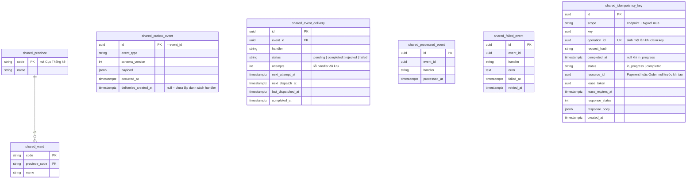
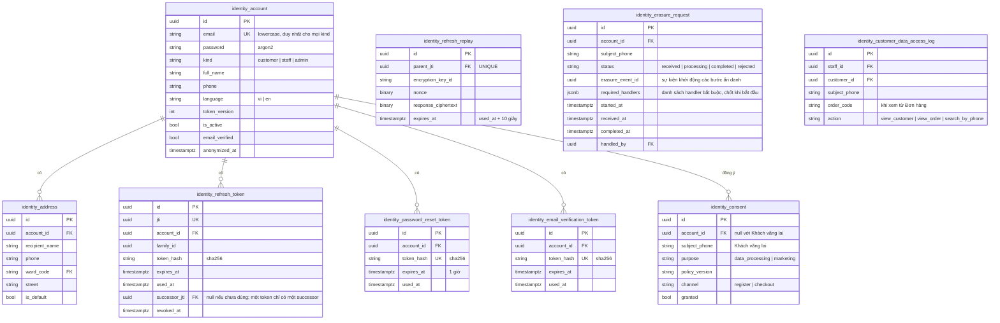
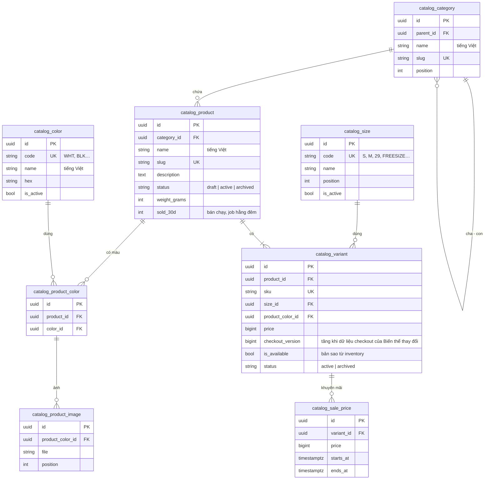
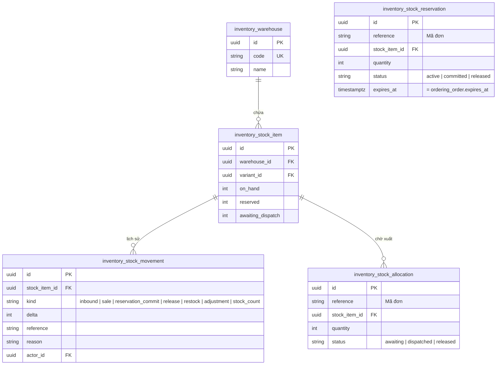
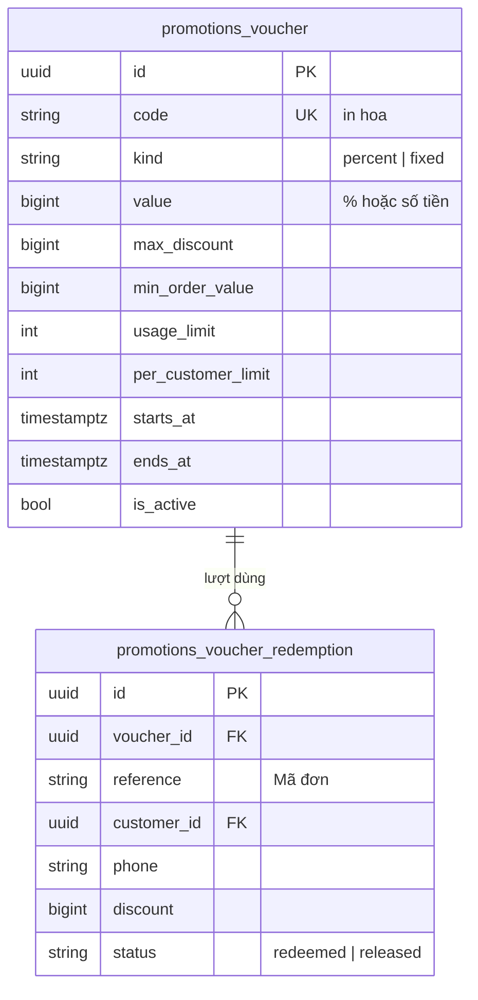
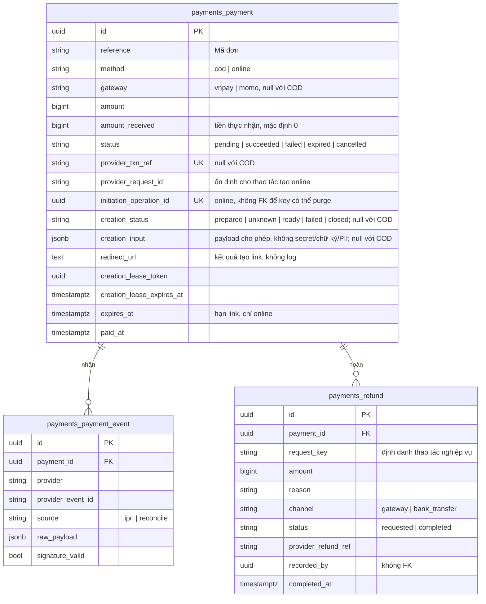
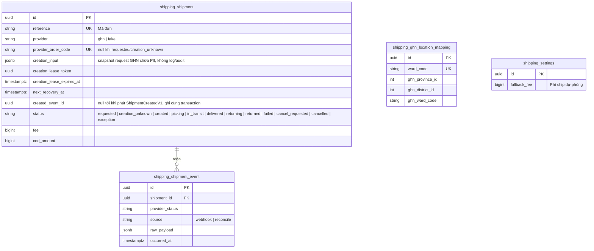
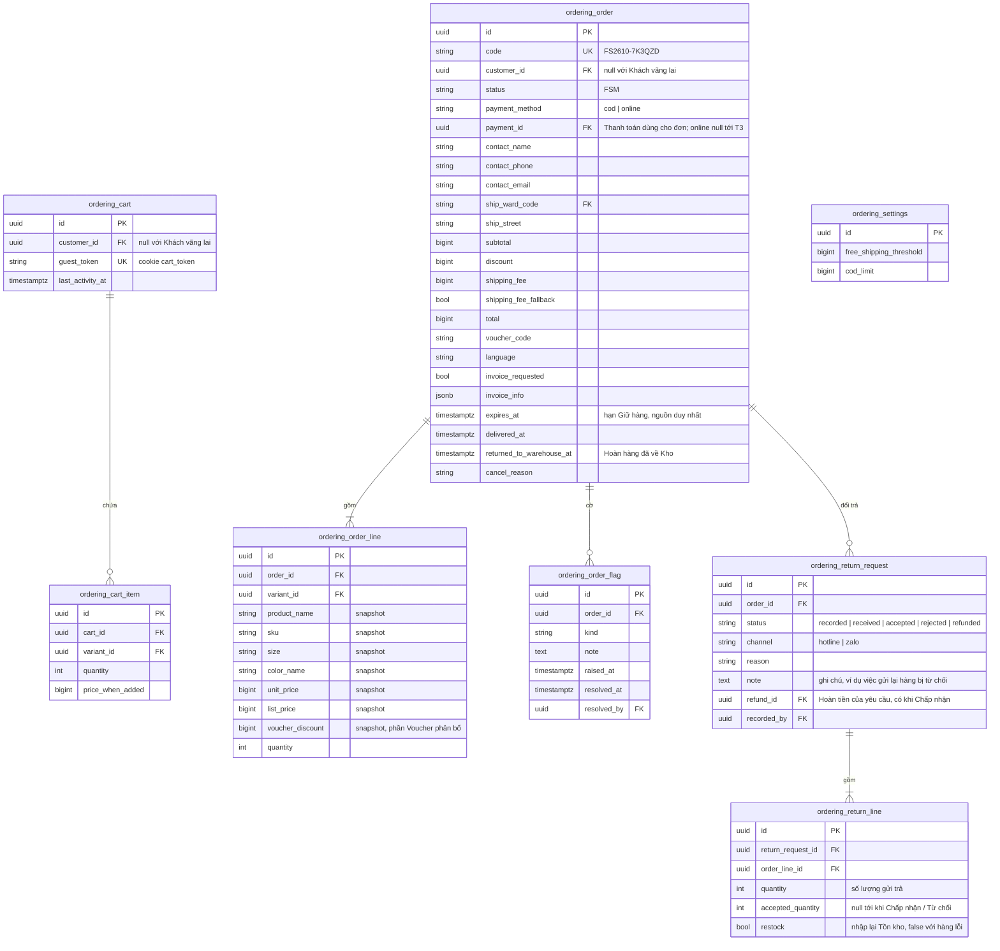
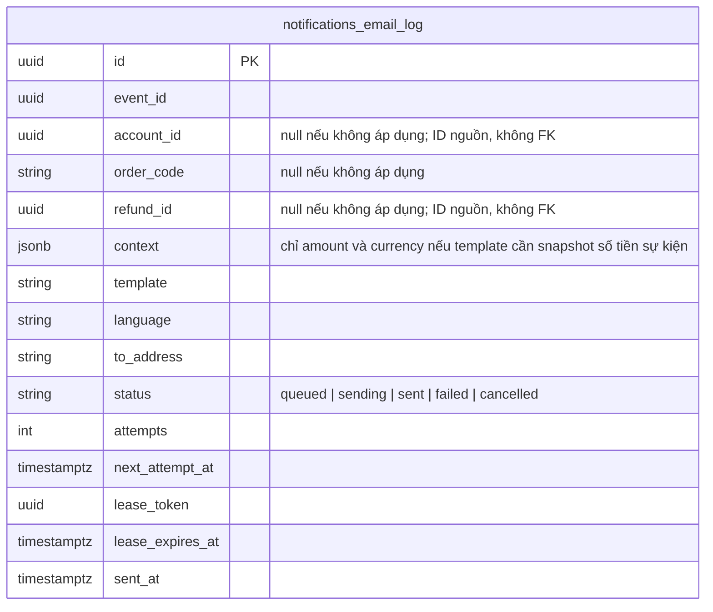

# 03. Mô hình dữ liệu

> Trạng thái: **Bản nháp chờ review**. Tên bảng có tiền tố theo module ([ADR 0006](../adr/0006-modular-monolith.md)).
> Quy ước chung cho mọi bảng: `id` UUID v7, `created_at`, `updated_at` (kế thừa `shared.models.BaseModel`). Ngoại lệ duy nhất là `shared_province` và `shared_ward`, dùng mã chính thức làm khoá chính; các khoá tự nhiên khác (sự kiện đã xử lý, `Idempotency-Key`, `jti`, ánh xạ GHN) giữ bằng ràng buộc `UNIQUE` ([ADR 0008](../adr/0008-uuid-v7-primary-keys.md)). Tiền là `bigint` số đồng VND. Thời gian lưu UTC.
>
> FK: xuyên module dùng `on_delete=PROTECT`. Trong cùng module, bảng con thuần (`ordering_cart_item`, `ordering_order_line`, `ordering_return_line`, `catalog_product_image`…) dùng `CASCADE`, còn lại dùng `PROTECT`.

## 1. `shared`

- `shared_outbox_event`: partial index trên `occurred_at WHERE deliveries_created_at IS NULL`. Relay tạo danh sách delivery và ghi marker cùng transaction. Payload không chứa secret hay PII.
- `shared_event_delivery`: `UNIQUE(event_id, handler)`; partial index trên `(next_dispatch_at, next_attempt_at) WHERE status = 'pending'`. Khoá dòng khi lập lịch giao và khi consumer xử lý; commit `completed`/`rejected` cùng `ProcessedEvent`. DB lưu retry và hạn giao lại, kể cả khi Redis đã nhận rồi mất task. Xem [07 mục 1.1.1](./07-async-events-jobs.md#111-postgresql-quyết-định-công-việc-còn-chờ).
- `shared_processed_event`: `UNIQUE(event_id, handler)`; `shared_failed_event` cũng `UNIQUE(event_id, handler)`. Một sự kiện có thể được nhiều handler xử lý, và mỗi handler chỉ xử lý một lần.
- `shared_failed_event`: ghi khi một cặp (sự kiện, handler) hết retry; `manage.py retry_failed_events` đọc bảng này.
- Purge chỉ xoá outbox quá 90 ngày đã có `deliveries_created_at` và mọi delivery `completed`/`rejected`, cùng delivery, ProcessedEvent và FailedEvent tương ứng; giữ các cặp `pending`/`failed` và sự kiện nguồn để khôi phục.
- `shared_idempotency_key`: `UNIQUE(scope, key)`; scope gồm endpoint và danh tính Người mua đã được xác thực/guest token ổn định. Claim bằng transaction ngắn; cùng key khác request_hash trả 409, cùng key còn xử lý trả 202, completed trả kết quả đã lưu. Không giữ transaction khi gọi gateway. Checkout commit Order và kết quả idempotency cùng transaction; nếu rollback thì không có Order mồ côi. Khởi tạo Payment ghi resource_id cùng Payment trước khi gọi gateway, khôi phục luôn dùng resource_id cũ. Lease token ngăn worker cũ ghi đè kết quả; IPN/đối soát vẫn có thể cập nhật Payment dưới khoá dòng. Job purge chỉ xoá bản ghi completed có completed_at quá 24 giờ; in_progress gắn Payment chưa rõ kết quả phải được giữ để khôi phục (06 mục 3.1).

## 2. `identity`

Ràng buộc: `UNIQUE(lower(email))` cho mọi `kind`, tức một email chỉ thuộc một Tài khoản (Staff muốn mua hàng phải dùng email khác); mỗi Tài khoản tối đa một `identity_address` có `is_default = true` (unique có điều kiện).

RefreshToken chỉ lưu hash; RefreshReplay là ngoại lệ response mã hoá tồn tại ngắn để hai request lặp nhận đúng một successor. Mọi refresh/revoke khoá Account rồi token; kiểm tra trạng thái từ DB trước replay. Purge hoặc thu hồi không được tạo token mới thay thế nếu response cũ không còn trả được. Xem [05 mục 2.1](./05-auth-security.md#21-xoay-vòng-refresh-token-và-phát-hiện-dùng-lại).

## 3. `catalog`

Ràng buộc và index:

- `Variant.checkout_version` có mặt trong `VariantForSaleDTO`. Tăng phiên bản khi Giá bán, SKU, dữ liệu snapshot, cân nặng hoặc điều kiện bán thay đổi; thay đổi liên quan ở Product/Size/Color cũng phải tăng phiên bản các Biến thể bị ảnh hưởng. `is_available` là bản sao tồn kho, không làm đổi phiên bản giá; inventory vẫn quyết định đủ hàng hay không.
- Checkout khoá toàn bộ StockItem theo thứ tự variant_id, rồi gọi catalog kiểm tra snapshot dưới khoá toàn bộ Variant theo id tăng dần, trước khi dùng Voucher/tạo đơn. Catalog tính lại Giá áp dụng tại một thời điểm timezone.now() chung trong transaction; so phiên bản, đơn giá, dữ liệu snapshot và điều kiện bán. Mọi service sửa các dữ liệu này, kể cả thêm/sửa/xoá SalePrice hoặc đổi trạng thái Product, phải khoá các Variant bị ảnh hưởng theo cùng thứ tự trước khi ghi; không gọi inventory khi đang giữ khoá Variant. Quy tắc này bảo vệ cả việc thêm SalePrice mới; chỉ khoá các SalePrice đã tồn tại là không đủ.

- `UNIQUE(product_id, size_id, product_color_id)` trên `catalog_variant` (BR-CAT-02); `UNIQUE(product_id, color_id)` trên `catalog_product_color`.
- `catalog_size` và `catalog_color` là danh sách size và bảng màu dùng chung (BR-CAT-11). Không xoá dòng đã có Biến thể dùng, chỉ đặt `is_active = false`. Bộ lọc storefront lọc theo `code`.
- `catalog_product.sold_30d`: số lượng bán trong 30 ngày (BR-CAT-12), do job hằng đêm của `ordering` tính rồi ghi qua `catalog.contracts`, vì `catalog` không đọc được Đơn hàng.
- Đổi `catalog_variant.price` bị từ chối khi có `catalog_sale_price` đang hoặc sắp hiệu lực với `price` ≥ giá mới (BR-PRC-05), kiểm tra ở service.
- `CHECK(price > 0)`.
- `catalog_sale_price`: `CHECK(starts_at < ends_at)`. Ràng buộc **không trùng thời gian** cho cùng Biến thể bằng `EXCLUDE USING gist (variant_id WITH =, tstzrange(starts_at, ends_at) WITH &&)` (BR-PRC-02). Ràng buộc "nhỏ hơn giá bán" (BR-PRC-01) được kiểm tra ở service, vì giá bán nằm ở bảng khác.
- Tìm kiếm: index GIN trigram trên `immutable_unaccent(lower(name))` của `catalog_product` (cần tạo một hàm `IMMUTABLE` bọc `unaccent`).

## 4. `inventory`

- `UNIQUE(warehouse_id, variant_id)`; `CHECK(on_hand >= 0)`, `CHECK(reserved >= 0)`, `CHECK(reserved <= on_hand)`, `CHECK(awaiting_dispatch >= 0)`. `UNIQUE(reference, stock_item_id)` trên `inventory_stock_reservation` và `inventory_stock_allocation`.
- `on_hand` là Tồn kho; Số lượng bán được = `on_hand − reserved` (BR-INV-02). Cột `reserved` được cập nhật cùng transaction với `inventory_stock_reservation`, nên không phải cộng dồn khi đọc.
- `awaiting_dispatch` là Hàng chờ xuất (BR-INV-10, [ADR 0010](../adr/0010-stock-decremented-at-order-awaiting-dispatch.md)), cập nhật cùng transaction với `inventory_stock_allocation`. Trừ Tồn kho khi bán (`decrement_stock` với COD, `commit_reservation` với online) tạo allocation `awaiting`; Vận đơn tạo xong (`dispatch_stock`) chuyển `dispatched`; huỷ đơn trước Bàn giao (`release_allocation`) chuyển `released` và trả số lượng về `on_hand`. Hàng trên kệ = `on_hand + awaiting_dispatch`.
- Kiểm kê (`count_stock`, BR-INV-12) ghi một `inventory_stock_movement` loại `stock_count` với `delta` = số đếm − (`on_hand + awaiting_dispatch`). Điều chỉnh giảm làm `on_hand < reserved` thì bị từ chối (BR-INV-11).
- `actor_id` FK tới `identity_account`: `inventory` ở lớp trên `identity` nên được khai báo FK.
- `inventory_stock_reservation.expires_at` được truyền từ `ordering_order.expires_at` (nguồn duy nhất), không tự tính.
- Giữ hàng đã quá `expires_at` bị coi là không hợp lệ ngay cả khi job chưa kịp giải phóng ([ADR 0003](../adr/0003-postgres-redis-celery.md)). Vì Số lượng bán được đọc từ cột `reserved`, `reserve_stock` và `decrement_stock` (sau khi khoá dòng `inventory_stock_item`) tự chuyển các Giữ hàng đã hết hạn của dòng đó sang `released` và giảm `reserved` trước khi kiểm tra. Job huỷ đơn (T4) vẫn gọi `release_reservation` sau đó; thao tác này idempotent.

## 5. `promotions`

- `UNIQUE(voucher_id, reference)`; index trên `reference` cho `release_voucher(reference)`.
- Đếm lượt dùng: khoá dòng `promotions_voucher` bằng `select_for_update` khi redeem để không vượt `usage_limit` lúc nhiều người dùng cùng lúc. Dòng Voucher được khoá **sau** các dòng Tồn kho (thứ tự khoá cố định, xem [02](./02-backend-structure.md) mục 9.1).
- `per_customer_limit` đếm các lượt `redeemed` trùng `customer_id` **hoặc** trùng `phone` với số điện thoại liên hệ của đơn đang đặt (BR-VCH-07). Cần index trên `(voucher_id, customer_id)` và `(voucher_id, phone)`.

## 6. `payments`

- `UNIQUE(provider, provider_event_id)` trên `payments_payment_event` để chống xử lý IPN trùng (BR-PAY-03). Index trên `payments_payment.reference`, vì `ordering` tra Thanh toán và Hoàn tiền theo Mã đơn.
- Mỗi lần thử thanh toán online là một Thanh toán mới, có `provider_txn_ref` mới (mã gửi sang Cổng thanh toán, ví dụ `vnp_TxnRef`) và `gateway` do Người mua chọn ở lần đó. `expires_at` = lúc đặt đơn + `PAYMENT_LINK_TTL` (phút thứ 10 kể từ khi đặt đơn), giống nhau cho mọi lần thử, để link không bao giờ sống quá Giữ hàng.
- Gửi lại cùng Idempotency-Key là tiếp tục **cùng** lần thử, không tạo Payment hay mã nhà cung cấp mới. `provider_request_id` tạo một lần, `UNIQUE(gateway, provider_request_id)` khi online. `creation_status` tách trạng thái tạo link khỏi trạng thái tiền: prepared trước gọi gateway; timeout/kết quả chưa biết → unknown; có link → ready; bị từ chối chắc chắn → failed; giao dịch đã trả/hết hạn mà không còn link cần trả → closed (lưu kết quả cuối và vô hiệu lease). Không biến timeout thành bằng chứng chưa có giao dịch. Link được lưu để trả lại cùng kết quả; không đưa vào log, outbox hay audit. Recovery không được hạ trạng thái tiền mà IPN đã xác nhận.
- Đơn COD có đúng một Thanh toán `method = cod`: tạo ở T2 (`pending`), `succeeded` khi GHN báo đã giao và thu tiền (T11), `cancelled` khi đơn bị huỷ hoặc Hoàn hàng.
- Thanh toán COD (tạo, ghi nhận đã thu, huỷ) **không** phát sự kiện: `ordering` là bên gọi nên đã biết kết quả. `payments.payment-succeeded` chỉ dành cho Thanh toán online.
- Hoàn tiền của đơn online có `channel = gateway`; Hoàn tiền Đổi trả của đơn COD gắn vào Thanh toán COD, `channel = bank_transfer`. Hoàn tiền cho tiền về sai số tiền (BR-PAY-04) gắn vào Thanh toán `failed` đã nhận khoản tiền đó.
- `request_refund(payment_id, amount, reason, channel, request_key)` bắt buộc chỉ đúng Thanh toán. `UNIQUE(payment_id, request_key)`; gọi lại cùng key và tham số trả cùng `refund_id`, khác tham số thì từ chối `REFUND_REQUEST_CONFLICT`. Key ổn định theo thao tác nguồn, ví dụ `unexpected-payment`, `amount-mismatch`, `cancel:<order_id>`, `returned-shipment:<order_id>`, `return:<return_request_id>`; không sinh key ngẫu nhiên mỗi lần retry.
- Khoá dòng Payment trước khi tìm/tạo Refund và kiểm tra tổng `requested` + `completed` cộng yêu cầu mới không vượt `amount_received`; `CHECK(amount > 0)` cho Refund và `CHECK(amount_received >= 0)` cho Payment. Callback IPN/đối soát trùng không cộng tiền thực nhận lần nữa. Online lưu số thực nhận đã xác minh kể cả khi sai số tiền; COD ghi `amount_received = amount` khi xác nhận đã thu. Gateway lấy từ Payment, không nhận từ bên gọi yêu cầu hoàn.
- `recorded_by` lưu id của Tài khoản Staff nhưng **không** khai báo FK: `payments` và `identity` cùng lớp nên không được phụ thuộc nhau ([ADR 0006](../adr/0006-modular-monolith.md)).

## 7. `shipping`

- `shipping_ghn_location_mapping` dùng để đổi mã địa chỉ 2 cấp của hệ thống sang ID của GHN, phòng trường hợp GHN vẫn dùng 3 cấp (xem [06-integrations.md](./06-integrations.md)).
- Mọi đường phát hiện GHN đã tạo (response, query, webhook) khoá Shipment và ghi created_event_id cùng sự kiện outbox nếu chưa có; không phát lại khi đã ghi, không ghi trạng thái created đè picking/in_transit/delivered/returned.
- `shipping_shipment.fee` là phí GHN thực tính cho cửa hàng, khác `ordering_order.shipping_fee` là phí Người mua trả (bằng 0 khi được miễn phí ship).
- Vận đơn requested được task claim bằng lease trước khi gọi GHN ngoài transaction. Kết quả chắc chắn → created/failed; timeout hoặc crash chưa rõ kết quả → creation_unknown (hoặc requested hết lease được coi là chưa rõ). Giữ reference/client_order_code và creation_input, query theo mã shop trước retry (06 mục 4.3). Huỷ cũng chạy nền: cancel_requested rồi cancelled.
- Bàn giao lại chỉ khi failed đã xác nhận không có Vận đơn ngoài GHN; dùng lại dòng và mã cũ. creation_unknown không được retry tạo bằng mã mới, không cho Staff huỷ Đơn hàng/bàn giao lại khi chưa đối soát. reference UNIQUE chỉ chống trùng trong DB; không tự bảo đảm một Vận đơn ngoài GHN.
- `exception`: GHN báo mất hàng, hư hàng, sự cố, hoặc tự huỷ Vận đơn mà hệ thống không yêu cầu; `shipping` phát `ShipmentExceptionV1`, `ordering` gắn cờ `shipment_exception` (05 mục 4.7).
- `shipping_ghn_location_mapping` được nạp bằng management command; Admin sửa được qua back-office cho phường/xã chưa có ánh xạ (US-1004). Lịch sử thay đổi ghi bằng `django-pghistory`.
- `shipping_settings` là singleton (một dòng duy nhất), Admin sửa qua back-office, lịch sử thay đổi ghi bằng `django-pghistory`.

## 8. `ordering`

- `CHECK(total = subtotal - discount + shipping_fee)` (BR-ORD-01), `CHECK(quantity > 0)`.
- Giỏ hàng: `UNIQUE(cart_id, variant_id)` trên `ordering_cart_item`; partial `UNIQUE(customer_id) WHERE customer_id IS NOT NULL` trên `ordering_cart` để mỗi Khách hàng có một giỏ.
- `code`: `FS<YYMM>-` + 6 ký tự Crockford Base32 ngẫu nhiên, `UNIQUE`; trùng thì sinh lại. Không dùng sequence, để Mã đơn không lộ thứ tự hay số lượng đơn ([ADR 0008](../adr/0008-uuid-v7-primary-keys.md)).
- `expires_at` = lúc đặt + 15 phút (`RESERVATION_TTL`) với đơn online. Đây là nguồn duy nhất của hạn Giữ hàng, được truyền xuống `inventory_stock_reservation.expires_at`.
- `customer_id` null với đơn của Khách vãng lai; được gắn vào Tài khoản khi Khách hàng xác thực email trùng `contact_email` (không phân biệt hoa thường).
- `ordering_order_line.voucher_discount`: phần Voucher phân bổ cho dòng theo tỷ lệ giá trị dòng, phần lẻ dồn vào dòng cuối; `SUM(voucher_discount) = ordering_order.discount`. Dùng để tính Hoàn tiền khi Đổi trả một phần (BR-RET-07).
- Mức giảm của Giá khuyến mãi trên một dòng tính từ `list_price` và `unit_price` khi cần (BR-PRC-04), không lưu thành cột số nguyên, để không làm tròn sai ở ngưỡng 50% của BR-RET-03.
- `ordering_return_line`: `CHECK(0 <= accepted_quantity <= quantity)`. Yêu cầu chuyển `accepted` khi có ít nhất một dòng `accepted_quantity > 0`, ngược lại `rejected` (BR-RET-08). Chỉ phần `accepted_quantity` của dòng có `restock = true` được cộng lại Tồn kho.
- `ordering_return_request.refund_id` FK tới `payments_refund` (`ordering` ở lớp trên `payments`). Handler `payments.refund-recorded` tìm Đổi trả theo `refund_id` để chuyển sang `refunded`; Hoàn tiền không gắn Đổi trả nào thì bỏ qua. Yêu cầu Đổi trả **đang mở** là yêu cầu có `status` khác `rejected` và `refunded`.
- `returned_to_warehouse_at`: thời điểm Staff xác nhận hàng của đơn Hoàn hàng đã về Kho. Đơn `RETURNED_TO_SENDER` có cột này null là đơn chờ nhập kho (US-607).
- `customer_id` cũng được gắn ngay lúc checkout của Khách vãng lai nếu `contact_email` trùng một Tài khoản đã xác thực (BR-ORD-08).
- `ordering_order.payment_id` tham chiếu `payments_payment`: T2 lưu Thanh toán COD vừa tạo; T3 khoá Order rồi lưu đúng Thanh toán online đã đưa đơn vào `PLACED`. Huỷ, Hoàn hàng và Đổi trả dùng ID này; khoản tiền trả thêm dùng `payment_id` từ sự kiện. Sự kiện thành công lặp lại của chính Thanh toán đã gắn thì không tạo Hoàn tiền. Payment được gắn phải có `reference` khớp Mã đơn, kiểm tra ở service.
- `ordering_order_flag` (Cờ cần xử lý): `kind` ∈ `payment_amount_mismatch | unexpected_payment | shipping_fee_fallback | ghn_ward_unmapped | shipment_failed | shipment_after_cancel | shipment_exception`. Partial `UNIQUE(order_id, kind) WHERE resolved_at IS NULL` để một vấn đề chỉ có một cờ đang mở. `resolved_by` FK tới `identity_account`.
- `ordering_settings` là singleton (một dòng duy nhất), Admin sửa qua back-office.
- `django-pghistory` chỉ ghi các field trong danh sách ở mục 10.1; không cấu hình theo dõi toàn bộ `payments_*`. Không tạo history cho `PaymentEvent.raw_payload` hay các cột liên hệ của Đơn hàng. Mỗi model sự kiện do `django-pghistory` sinh ra phải khai báo `Meta.db_table` có tiền tố module (ví dụ `ordering_order_event`), vì mặc định chúng mang tiền tố của app chung `modules_`.
- Index: `(contact_phone, code)` cho tra cứu của Khách vãng lai; `(status, created_at)` cho back-office; partial index `expires_at WHERE status = 'PENDING_PAYMENT'` cho job huỷ đơn; partial index `(kind, raised_at) WHERE resolved_at IS NULL` trên `ordering_order_flag` cho bộ lọc theo cờ.

## 9. `notifications`

`UNIQUE(event_id, template)` để một sự kiện không tạo hai EmailLog giống nhau; không bảo đảm email ra ngoài đúng một lần. Tạo EmailLog `queued` cùng transaction với handler; task claim bằng khoá dòng và lease, gửi ngoài transaction, ghi kết quả chỉ khi lease token còn khớp. Partial index trên `next_attempt_at WHERE status = 'queued'` và `lease_expires_at WHERE status = 'sending'` phục vụ quét khôi phục. ID nguồn chỉ lưu theo nhu cầu từng template; không lưu token/link bí mật, nội dung email hay raw payload. Chi tiết retry, huỷ và khả năng gửi trùng: [07 mục 4](./07-async-events-jobs.md#4-email-hàng-đợi-bền-vững-trong-postgresql).

## 10. Ẩn danh dữ liệu (CMP-05)

Điều kiện: yêu cầu xoá dữ liệu chỉ được hoàn thành khi mọi Đơn hàng của người đó đã ở trạng thái cuối (`COMPLETED`, `CANCELLED`, `RETURNED_TO_SENDER`) và không còn `payments_refund` nào `requested`. Với Khách hàng, "Đơn hàng của người đó" là các đơn đã gắn vào Tài khoản; đơn vãng lai chưa gắn cần một yêu cầu riêng theo số điện thoại (CMP-05). Điều kiện được kiểm tra ở `ordering`, vì `identity` không đọc được Đơn hàng: `ordering` đọc trạng thái đơn của mình, hỏi `payments.contracts` về Hoàn tiền còn chờ, rồi gọi `identity.contracts.apply_erasure_request`. Khi đó `identity` phát `identity.customer-erased` chỉ mang `erasure_request_id`; mỗi module tự ẩn danh dữ liệu của mình, lấy đối tượng (Tài khoản hoặc số điện thoại) qua `identity.contracts.get_erasure_subject`. `shipping` và `payments` cùng lớp với `identity` nên không nghe sự kiện này; `ordering` gọi `redact_provider_payloads(reference)` của hai module đó cho từng Đơn hàng.

### Vòng đời yêu cầu

- Staff gọi endpoint complete để **bắt đầu** xử lý: ordering kiểm tra điều kiện rồi gọi apply_erasure_request. Trong cùng transaction, identity khoá yêu cầu, chuyển received → processing, lưu started_at, erasure_event_id và danh sách required_handlers, ẩn danh Tài khoản và ghi sự kiện vào outbox. Không đặt completed_at lúc này. Gọi lại khi processing/completed trả trạng thái hiện tại, không phát thêm sự kiện.
- Danh sách handler bắt buộc có ID đăng ký ổn định cho ordering, promotions, notifications. Cấu hình tại project và kiểm tra đủ đăng ký lúc khởi động; snapshot danh sách vào yêu cầu, không suy ra từ các delivery tình cờ tồn tại. Không import module lớp trên vào identity. Handler ordering hoàn tất cả redaction của payments và shipping trước khi commit.
- Job identity.reconcile_erasure_requests đọc kết quả qua API hạ tầng shared.events.get_delivery_outcomes(event_id, handler_names); API này chỉ truy vấn delivery, không import modules. Chỉ khi **tất cả handler bắt buộc** có delivery completed mới chuyển processing → completed và đặt completed_at dưới khoá yêu cầu. Delivery thiếu, pending, failed hoặc rejected đều không được coi là xong; giữ processing và cảnh báo, retry_failed_events phục hồi cặp failed. Lỗi xử lý ẩn danh cần retry, không cố tình chuyển thành DomainError bị bỏ qua.
- Giữ đối tượng cần ẩn danh (account_id hoặc subject_phone của Khách vãng lai) trong ErasureRequest suốt processing để handler còn lấy được sau khi Account/Order đã ẩn danh. Không đưa thông tin này vào sự kiện. Khi hoàn tất, xoá subject_phone nhận diện trực tiếp; giữ ID và các mốc thời gian làm bằng chứng. Replay không tự thêm handler mới vào yêu cầu đã hoàn tất; thay đổi phạm vi ẩn danh cần quy trình migration riêng.

| Bảng | Module | Xử lý |
|---|---|---|
| `identity_account` | identity | `email` → `erased+<id>@invalid`, `full_name`, `phone` → rỗng, `is_active = false`, `anonymized_at` |
| `identity_address` | identity | Xoá |
| `ordering_order` | ordering | `contact_name`, `contact_phone`, `contact_email`, `ship_street`, email nhận hoá đơn trong `invoice_info` → giá trị ẩn danh; giữ `ship_ward_code`, số tiền, Dòng đơn hàng, tên công ty, mã số thuế, địa chỉ công ty trong `invoice_info` |
| `ordering_cart` | ordering | Xoá |
| `promotions_voucher_redemption` | promotions | `phone` → giá trị ẩn danh |
| `notifications_email_log` | notifications | `to_address` → giá trị ẩn danh; email chưa gửi chuyển `cancelled`, vô hiệu lease |
| `shipping_shipment`, `shipping_shipment_event` | shipping (do ordering gọi) | Xoá PII trong creation_input và raw_payload; không giữ các bản sao này trong audit |
| `payments_payment_event` | payments (do `ordering` gọi) | Xoá PII trong `raw_payload` |
| Lịch sử pghistory của `ordering_order` | — | Không cần xử lý: chỉ theo dõi field không phải PII (mục 8) |
| Lịch sử pghistory của Thanh toán và Hoàn tiền | payments | Chỉ chứa các field được liệt kê ở mục 10.1; không có raw payload hay thông tin liên hệ |
| `shared_outbox_event` | — | Không cần xử lý: payload sự kiện không chứa PII |
| `identity_consent`, `identity_erasure_request` | identity | **Giữ** làm bằng chứng tuân thủ |

### 10.1. Các field được ghi lịch sử

Chỉ bật tracker `django-pghistory` với danh sách field tường minh, kèm ID bản ghi nguồn và thời điểm thay đổi. Không dùng tracker mặc định chụp toàn bộ model, không tự chụp request, headers hay context chứa PII ([ADR 0011](../adr/0011-audit-field-allowlist.md)).

| Model | Field được ghi lịch sử |
|---|---|
| `Order` | `status`, `payment_method`, `payment_id`, `subtotal`, `discount`, `shipping_fee`, `total`, `delivered_at`; không ghi lý do huỷ tự do |
| `OrderFlag` | `order_id`, `kind`, `raised_at`, `resolved_at`, `resolved_by`; không ghi `note` tự do |
| `OrderingSettings` | `free_shipping_threshold`, `cod_limit` |
| `ShippingSettings` | `fallback_fee` |
| `GhnLocationMapping` | `ward_code`, `ghn_province_id`, `ghn_district_id`, `ghn_ward_code`; chỉ mã địa giới, không địa chỉ liên hệ |
| `Payment` | `reference`, `method`, `gateway`, `amount`, `amount_received`, `status`, `expires_at`, `paid_at` |
| `Refund` | `payment_id`, `amount`, `channel`, `status`, `recorded_by`, `completed_at`; không ghi `reason` tự do hay mã tham chiếu nhà cung cấp |
| `StockItem` | `variant_id`, `warehouse_id`, `on_hand`, `reserved`, `awaiting_dispatch` |

Không tạo history cho `PaymentEvent`, `ShipmentEvent`, `EmailLog`, `RefreshReplay` và các model token; không ghi Shipment.creation_input; không ghi `raw_payload`, email, số điện thoại, địa chỉ, token/link bí mật hoặc nội dung email vào history. ID liên kết vẫn là dữ liệu cần kiểm soát truy cập; danh sách này chỉ loại PII trực tiếp và payload thô khỏi bản sao lịch sử. Thêm field audit phải review mục đích, dữ liệu nhạy cảm và quy trình ẩn danh trước khi sửa tracker.

Thiết kế áp dụng ngay từ lúc khởi tạo DB. Nếu thay đổi từ một bản triển khai đã từng ghi PII vào history, phải có data migration làm sạch lịch sử cũ; sửa tracker không xoá được các bản sao đã tồn tại.
