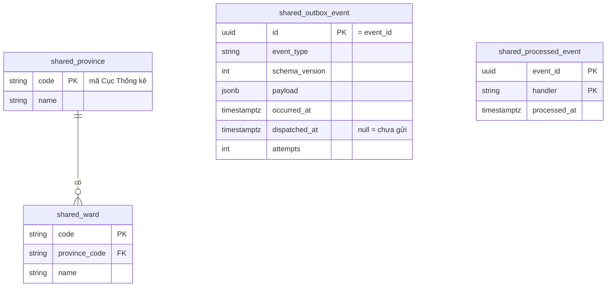
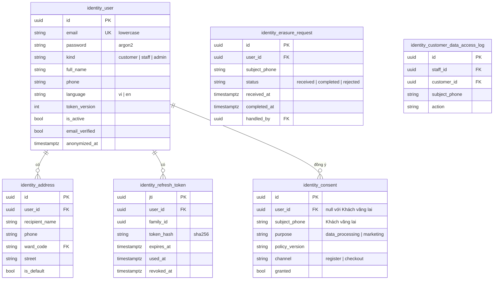
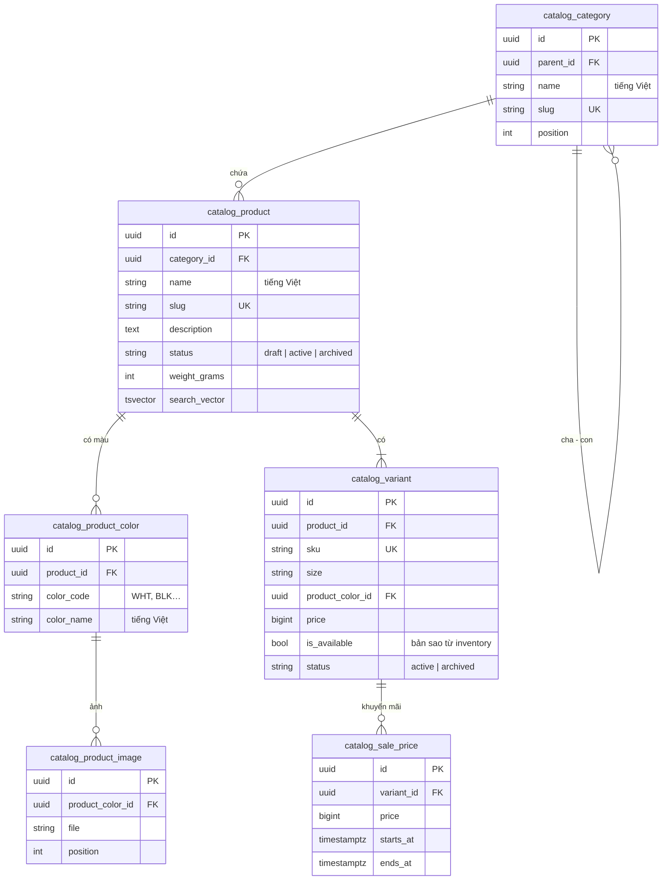
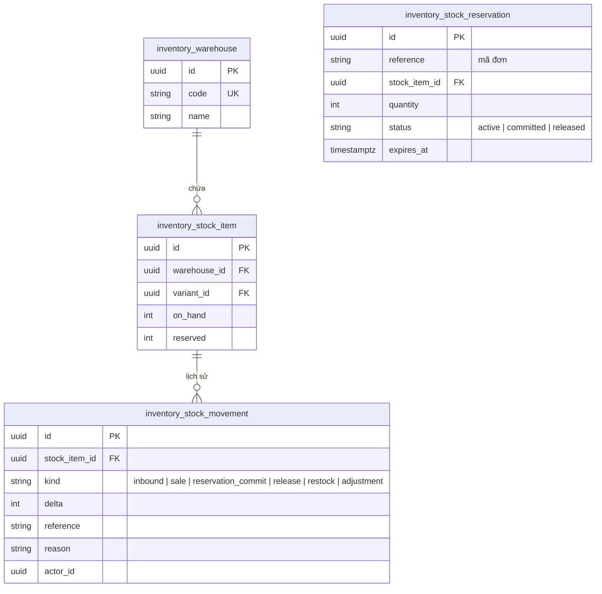
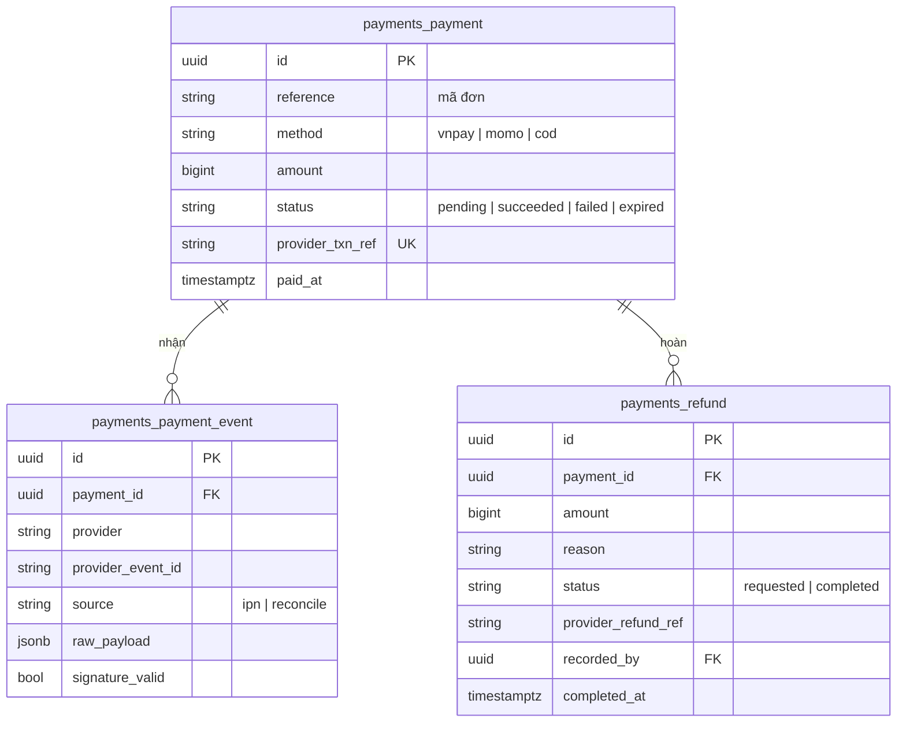
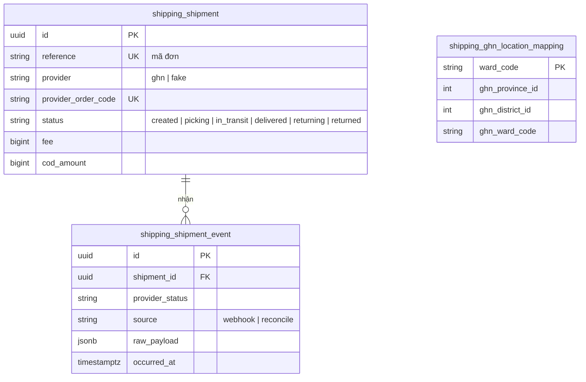
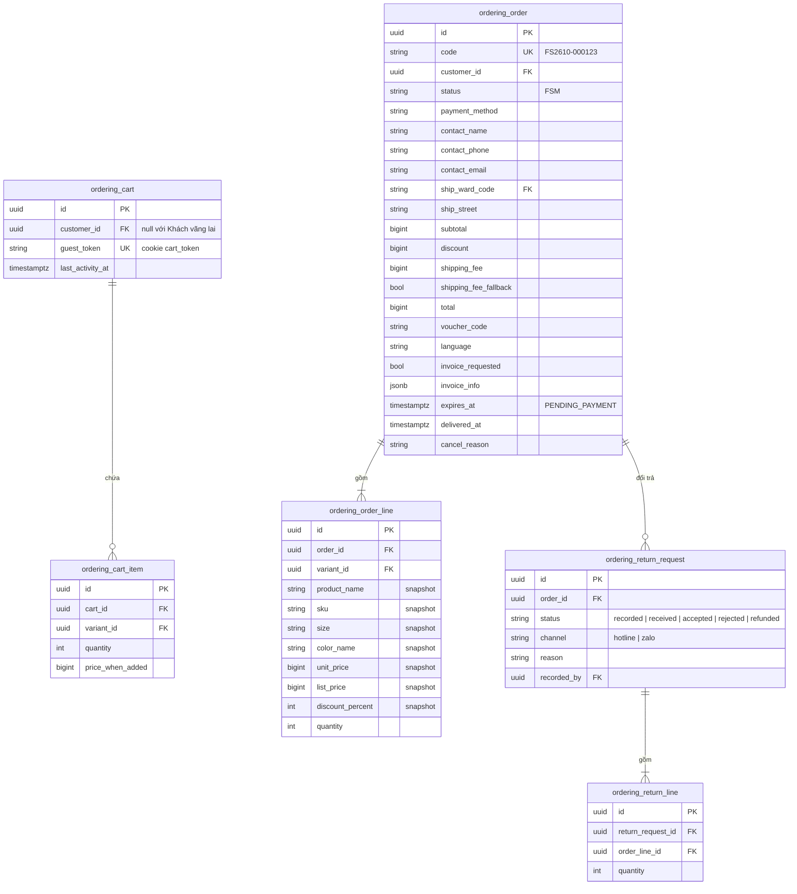
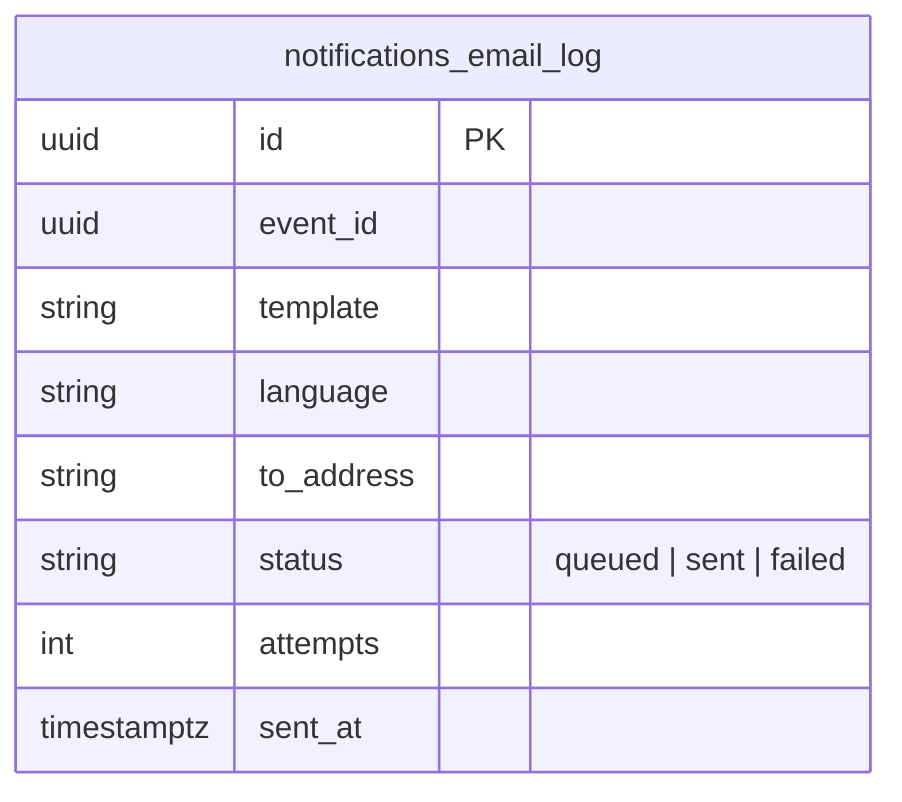

# 03. Mô hình dữ liệu

> Trạng thái: **Bản nháp chờ review**. Tên bảng có tiền tố theo module ([ADR 0006](../adr/0006-modular-monolith.md)).
> Quy ước chung cho mọi bảng: `id` UUID, `created_at`, `updated_at` (kế thừa `shared.models.BaseModel`). Tiền là `bigint` số đồng VND. Thời gian lưu UTC.

## 1. `shared`

- `shared_outbox_event`: index một phần (partial index) trên `occurred_at WHERE dispatched_at IS NULL` để relay đọc nhanh.
- `shared_processed_event`: khoá chính ghép `(event_id, handler)`. Một sự kiện có thể được nhiều handler xử lý, và mỗi handler chỉ xử lý một lần.

## 2. `identity`

Ràng buộc: `UNIQUE(lower(email))`; mỗi user tối đa một `identity_address` có `is_default = true` (unique có điều kiện).

## 3. `catalog`

Ràng buộc và index:

- `UNIQUE(product_id, size, product_color_id)` trên `catalog_variant` (BR-CAT-02).
- `CHECK(price > 0)`.
- `catalog_sale_price`: `CHECK(starts_at < ends_at)`. Ràng buộc **không trùng thời gian** cho cùng Biến thể bằng `EXCLUDE USING gist (variant_id WITH =, tstzrange(starts_at, ends_at) WITH &&)` (BR-PRC-02). Ràng buộc "nhỏ hơn giá bán" (BR-PRC-01) được kiểm tra ở service, vì giá bán nằm ở bảng khác.
- Tìm kiếm: index GIN trigram trên `immutable_unaccent(lower(name))` của `catalog_product` (cần tạo một hàm `IMMUTABLE` bọc `unaccent`).

## 4. `inventory`

- `UNIQUE(warehouse_id, variant_id)`; `CHECK(on_hand >= 0)`, `CHECK(reserved >= 0)`, `CHECK(reserved <= on_hand)`.
- Số bán được = `on_hand − reserved` (BR-INV-02). Cột `reserved` được cập nhật cùng transaction với `inventory_stock_reservation`, nên không phải cộng dồn khi đọc.
- Giữ hàng đã quá `expires_at` bị coi là không hợp lệ ngay cả khi job chưa kịp giải phóng ([ADR 0003](../adr/0003-postgres-redis-celery.md)).

## 5. `promotions`

- `UNIQUE(voucher_id, reference)`.
- Đếm lượt dùng: khoá dòng `promotions_voucher` bằng `select_for_update` khi redeem để không vượt `usage_limit` lúc nhiều người dùng cùng lúc.

## 6. `payments`

- `UNIQUE(provider, provider_event_id)` trên `payments_payment_event` để chống xử lý IPN trùng (BR-PAY-03).
- `provider_txn_ref` là mã gửi sang cổng thanh toán (ví dụ `vnp_TxnRef`), mỗi lần thử thanh toán sinh một mã mới.

## 7. `shipping`

`shipping_ghn_location_mapping` dùng để đổi mã địa chỉ 2 cấp của hệ thống sang ID của GHN, phòng trường hợp GHN vẫn dùng 3 cấp (xem [06-integrations.md](./06-integrations.md)).

## 8. `ordering`

- `CHECK(total = subtotal - discount + shipping_fee)` (BR-ORD-01), `CHECK(quantity > 0)`.
- `ordering_order_code_sequence` (không vẽ): một sequence PostgreSQL theo tháng để sinh mã đơn.
- Lịch sử trạng thái `ordering_order` và mọi thay đổi `payments_*`, `inventory_stock_item` được ghi bằng `django-pghistory`.
- Index: `(contact_phone, code)` cho tra cứu của Khách vãng lai; `(status, created_at)` cho back-office; partial index `expires_at WHERE status = 'PENDING_PAYMENT'` cho job huỷ đơn.

## 9. `notifications`

`UNIQUE(event_id, template)` để một sự kiện không sinh hai email giống nhau.

## 10. Ẩn danh dữ liệu (CMP-05)

Khi xử lý yêu cầu xoá dữ liệu:

| Bảng | Cột bị ẩn danh |
|---|---|
| `identity_user` | `email` → `erased+<id>@invalid`, `full_name`, `phone` → rỗng, `is_active = false`, `anonymized_at` |
| `identity_address` | Xoá |
| `ordering_order` | `contact_name`, `contact_phone`, `contact_email`, `ship_street` → giá trị ẩn danh; giữ `ship_ward_code`, số tiền, Dòng đơn hàng |
| `ordering_cart` | Xoá |
| `identity_consent`, `identity_erasure_request` | **Giữ** làm bằng chứng tuân thủ |
