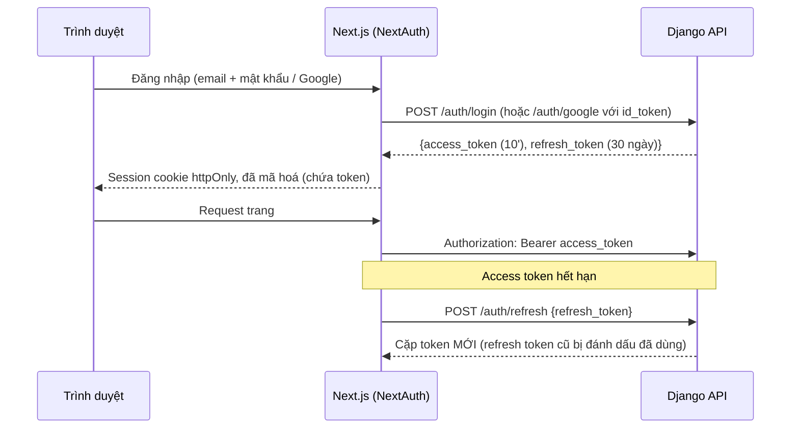

# 05. Xác thực và bảo mật

> Trạng thái: **Bản nháp chờ review**. Quyết định nền tảng: [ADR 0002](../adr/0002-auth-nextauth-session-django-jwt.md), [ADR 0009](../adr/0009-nextjs-bff-django-private.md).

## 1. Mô hình xác thực



Trình duyệt **không bao giờ** thấy token thô; chỉ server Next.js giữ token trong cookie đã mã hoá.

Vì vậy Next.js là BFF cho **mọi** request tới Django, kể cả request không cần đăng nhập (ADR 0009). Django chạy cùng VPC với Next.js và chỉ mở `/api/v1/webhooks/*` ra internet.

## 2. Thiết kế JWT

| Thuộc tính | Giá trị |
|---|---|
| Thuật toán | **EdDSA (Ed25519)**, khai báo cứng khi decode: `jwt.decode(token, key, algorithms=["EdDSA"], …)` |
| Khoá | Khoá bí mật chỉ ở Django (biến môi trường / Secrets Manager). Header có `kid` để thay khoá: giữ song song khoá cũ và mới trong thời gian bằng tuổi thọ refresh token |
| Access token | Sống **10 phút**. Claims: `iss`, `aud` (`store` hoặc `backoffice`), `sub` (account id), `kind`, `tv` (token_version), `jti`, `iat`, `exp` |
| Refresh token | Sống **30 ngày** (storefront) / **12 giờ** (back-office) **[Giả định]**. Là JWT có `jti` và `fam` (family_id); DB chỉ lưu `sha256` của token |
| Kiểm tra bắt buộc | Chữ ký, `exp`, `iat`, `iss`, `aud` đúng nhánh API, `tv` khớp `account.token_version`, Tài khoản `is_active` |
| Lệch giờ cho phép | 30 giây |
| `lookup_token` | JWT ký bằng cùng khoá Ed25519, `aud = order_lookup`, `sub` = Mã đơn, sống **30 phút**, không lưu DB và không thu hồi được (chỉ mở đúng một đơn và sống ngắn). Do `POST store/checkout` (Khách vãng lai) và `POST store/orders/lookup` cấp, gửi qua header `X-Lookup-Token`. `IsOrderOwner` kiểm tra chữ ký, `exp`, `aud` và `sub` khớp Mã đơn trên URL |

### 2.1. Xoay vòng refresh token và phát hiện dùng lại

```
Đăng nhập        → cấp R1 (family F)
Refresh bằng R1  → R1.used_at = now, cấp R2 (family F)
Refresh bằng R2  → R2.used_at = now, cấp R3 (family F)
Refresh bằng R1 lần nữa (R1 đã dùng!)
                 → coi như bị đánh cắp: thu hồi TOÀN BỘ family F
                   → kẻ gian và người dùng thật đều phải đăng nhập lại
```

Refresh đồng thời (ví dụ 2 tab) được xử lý ở hai lớp:

- Next.js gom các lần refresh đồng thời của cùng một session thành một request (single-flight), nên bình thường Django chỉ thấy một request.
- Lưới an toàn ở Django: refresh token đã dùng mà bị dùng lại trong vòng **10 giây** **[Giả định]** kể từ `used_at` thì được cấp một cặp token mới **cùng family**, không thu hồi gì. Django không thể trả lại đúng cặp đã cấp lần trước vì chỉ lưu `sha256`. Quá 10 giây thì coi như bị đánh cắp và thu hồi cả family như trên.

### 2.2. Thu hồi tức thì

| Sự kiện | Cách thu hồi |
|---|---|
| Đổi / đặt lại mật khẩu | Tăng `token_version` → mọi access token cũ sai `tv`; thu hồi mọi refresh token |
| Admin vô hiệu hoá Staff | `is_active = false` + tăng `token_version` |
| Đăng xuất | Thu hồi family của refresh token hiện tại |
| Ẩn danh Tài khoản | Như vô hiệu hoá |
| Đăng nhập Google vào Tài khoản chưa xác thực email | Như đổi mật khẩu (mục 3) |

Kiểm tra `tv` cần đọc Tài khoản ở mỗi request; kết quả được cache trong Redis 60 giây và bị xoá khi `token_version` thay đổi. Khi Redis lỗi, đọc thẳng PostgreSQL. Nếu `token_version` đổi đúng lúc Redis lỗi thì lệnh xoá cache thất bại; khi Redis hồi lại, token cũ có thể còn được chấp nhận tối đa 60 giây (TTL của cache). Rủi ro này được chấp nhận.

### 2.3. Tách storefront và back-office

- `aud = store` và `aud = backoffice` khác nhau; token của storefront **không** dùng được cho back-office và ngược lại.
- Tài khoản `kind = customer` không đăng nhập được back-office; Staff/Admin không đăng nhập được storefront.
- Mỗi email thuộc tối đa một Tài khoản, với mọi `kind` (`UNIQUE(lower(email))`). Staff muốn mua hàng phải đăng ký Tài khoản Khách hàng bằng email khác. Đăng nhập storefront (kể cả Google) bằng email của Staff/Admin trả lỗi chung như sai thông tin đăng nhập.

## 3. Mật khẩu và đăng nhập

| Biện pháp | Chi tiết |
|---|---|
| Hash | Argon2id (`Argon2PasswordHasher` đứng đầu `PASSWORD_HASHERS`) |
| Độ mạnh | Tối thiểu 8 ký tự, kiểm tra bằng các validator có sẵn của Django (giống thông tin cá nhân, mật khẩu phổ biến, toàn số) |
| Chống dò | Đăng nhập: 5 lần sai / 15 phút theo email, 20 lần / 15 phút theo IP → `429`. Thông báo lỗi chung, không tiết lộ email có tồn tại không |
| Đặt lại mật khẩu | Token ngẫu nhiên dùng một lần, lưu dạng hash, hết hạn 1 giờ. Token được sinh lúc gửi email (`identity.contracts.issue_password_reset_link`), không bao giờ nằm trong payload sự kiện. Email xác thực làm tương tự (`issue_email_verification_link`) |
| Google | Xác minh `id_token` bằng `google-auth`: chữ ký, `aud` = client ID của dự án, `iss`, `exp`, `email_verified = true` |
| Liên kết Google | Liên kết theo email. Nếu Tài khoản khớp có `email_verified = false` (có thể do kẻ gian đăng ký trước bằng email của nạn nhân, kèm mật khẩu của kẻ gian): đánh dấu đã xác thực, `set_unusable_password`, tăng `token_version`, thu hồi mọi refresh token |

## 4. Phân quyền

| Permission class | Nằm ở | Điều kiện |
|---|---|---|
| `IsCustomer` | `shared/api/permissions.py` | `kind = customer` và `aud = store` |
| `IsStaff` | `shared/api/permissions.py` | `kind ∈ {staff, admin}` và `aud = backoffice` |
| `IsAdmin` | `shared/api/permissions.py` | `kind = admin` và `aud = backoffice` |
| `IsOrderOwner` | `modules/ordering/api/permissions.py` (là nghiệp vụ của `ordering`, nên không đặt ở `shared`) | Đơn thuộc Khách hàng đang đăng nhập, hoặc header `X-Lookup-Token` hợp lệ cho đúng đơn |

Mặc định của DRF là **từ chối** (`DEFAULT_PERMISSION_CLASSES = [IsAuthenticated]`); endpoint công khai phải khai báo rõ `AllowAny`. Mỗi endpoint back-office có test kiểm tra Staff/Admin/Customer/ẩn danh.

## 5. Giới hạn tần suất (throttling)

Dùng throttling của DRF, lưu đếm trong Redis. Khi Redis lỗi, throttle **fail-open** (bỏ qua) để API vẫn phục vụ; WAF trên CloudFront vẫn chặn thô ở phía trước.

**IP của người dùng.** Mọi request storefront và back-office đi qua Next.js, nên IP nguồn mà Django thấy là IP của Next.js. Nếu throttle theo IP nguồn, mọi Người mua dùng chung một hạn mức. Cách xử lý:

- Next.js gửi IP thật của người dùng trong header `X-Client-IP`, kèm `X-BFF-Secret` có giá trị bằng biến môi trường `BFF_SHARED_SECRET`.
- Middleware của Django chỉ tin `X-Client-IP` khi `X-BFF-Secret` đúng (so bằng `hmac.compare_digest`); sai hoặc thiếu thì dùng IP nguồn.
- `BFF_SHARED_SECRET` nhận tối đa hai giá trị, cách nhau bằng dấu phẩy, để xoay secret mà không gián đoạn: thêm secret mới vào Django trước, đổi Next.js, rồi bỏ secret cũ ([09](./09-deployment-aws-target.md)).
- Mọi throttle "theo IP" bên dưới dùng giá trị này. Log cũng ghi IP này.

| Scope | Giới hạn **[Giả định]** |
|---|---|
| Ẩn danh, mặc định | 120 request / phút / IP |
| Đã đăng nhập, mặc định | 300 request / phút / Tài khoản |
| `auth_login` | Như mục 3 |
| `order_lookup` | 10 lần / 15 phút / IP |
| `checkout` | 10 lần / phút / Tài khoản hoặc cart token, và 30 lần / phút / IP (Khách vãng lai đổi được cart token tuỳ ý) |
| Webhook | Không throttle (đã xác thực bằng chữ ký) |

## 6. Webhook và tích hợp

- Xác thực chữ ký **trước khi** đọc nội dung; so sánh bằng `hmac.compare_digest`.
- Lưu dữ liệu gốc vào `*_event`, chống trùng bằng ràng buộc `UNIQUE`.
- Không tin số tiền trong IPN: so với `payments_payment.amount` (BR-PAY-04).
- Return URL chỉ để hiển thị, không bao giờ đổi trạng thái thanh toán.

## 7. Bảo vệ ứng dụng

| Rủi ro (OWASP) | Biện pháp |
|---|---|
| Truy cập trái phép đối tượng (IDOR) | Selector luôn lọc theo chủ sở hữu; Khách vãng lai dùng `lookup_token` (header `X-Lookup-Token`) gắn với đúng một đơn. Mã đơn ngẫu nhiên nên không đoán được |
| Injection | Chỉ dùng ORM / query có tham số; cấm `raw()` với chuỗi ghép |
| Gán field ngoài ý muốn | Serializer liệt kê field tường minh, không dùng `fields = "__all__"` |
| Bề mặt public | Django chỉ mở `/api/v1/webhooks/*` ra internet; mọi API khác chỉ nhận request từ Next.js trong VPC (ADR 0009). Trình duyệt không gọi thẳng Django nên không cần CORS và không dùng `django-cors-headers` |
| CSRF | API dùng Bearer token, không dùng cookie session của Django → không cần CSRF cho API; Django Admin (local) vẫn bật CSRF |
| Header bảo mật | `SECURE_HSTS_SECONDS`, `SECURE_CONTENT_TYPE_NOSNIFF`, `X_FRAME_OPTIONS = "DENY"`, `SECURE_PROXY_SSL_HEADER` sau ALB |
| Upload ảnh | Chỉ chấp nhận JPEG/PNG/WebP, kiểm tra bằng Pillow, giới hạn 5 MB, đặt `Image.MAX_IMAGE_PIXELS` để chặn decompression bomb, xoá EXIF (có thể chứa GPS), đổi tên file thành UUID |
| Secrets | Không commit `.env`; trên AWS dùng Secrets Manager |
| Phụ thuộc | `uv lock` + kiểm tra lỗ hổng (`pip-audit`) trong CI |

## 8. Dữ liệu cá nhân trong log

- Không log mật khẩu, token, chữ ký, toàn bộ IPN.
- Payload sự kiện trong outbox không chứa secret hay PII, chỉ mang ID, Mã đơn và số tiền ([07-async-events-jobs.md](./07-async-events-jobs.md) mục 2), vì outbox giữ sự kiện 90 ngày và có thể bị phát lại.
- Số điện thoại và email trong log được che (`09******89`, `a***@gmail.com`).
- Sentry: bật `send_default_pii = False`, thêm bộ lọc xoá header `Authorization`.
- Mỗi lần Staff xem chi tiết khách được ghi `identity_customer_data_access_log` (CMP-07).

## 9. Kiểm chứng

- Bộ test cho module JWT bám theo **OWASP JWT Cheat Sheet**: sai thuật toán, `alg: none`, sai `aud`, hết hạn, sai `kid`, dùng lại refresh token, đổi `token_version`.
- Test `lookup_token`: token có `aud` khác (ví dụ access token `store`), token của đơn khác, token hết hạn đều bị từ chối.
- Test liên kết Google: Tài khoản đăng ký bằng email + mật khẩu nhưng chưa xác thực, sau đó đăng nhập Google cùng email → mật khẩu cũ không còn dùng được, refresh token cũ bị thu hồi.
- Test IP người dùng: `X-Client-IP` thiếu hoặc sai `X-BFF-Secret` thì bị bỏ qua, throttle tính theo IP nguồn.
- Rà soát theo **OWASP ASVS** chương xác thực và quản lý phiên trước khi lên production.
- Security review (nội bộ hoặc bên thứ ba) trước go-live.
