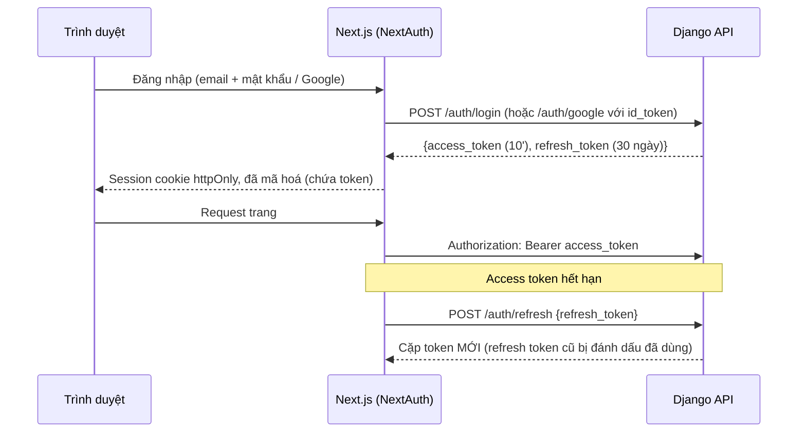

# 05. Xác thực và bảo mật

> Trạng thái: **Bản nháp chờ review**. Quyết định nền tảng: [ADR 0002](../adr/0002-auth-nextauth-session-django-jwt.md), [ADR 0009](../adr/0009-nextjs-bff-django-private.md).

## 1. Mô hình xác thực



Trình duyệt **không bao giờ** thấy token thô; chỉ server Next.js giữ token trong cookie đã mã hoá.

Vì vậy Next.js là BFF cho **mọi** request tới Django, kể cả request không cần đăng nhập (ADR 0009). Django chạy cùng VPC với Next.js và chỉ mở `/api/v1/webhooks/*` ra internet.

### 1.1. Hợp đồng bảo mật của BFF

- Cookie session production là host-only, `Path=/`, `HttpOnly`, `Secure`, `SameSite=Lax`; tên tách biệt `__Host-store-session` và `__Host-backoffice-session`. Không đặt `Domain` dùng chung cho hai ứng dụng. NextAuth và secret mã hoá session được cấu hình riêng từng ứng dụng; không giải mã/chấp nhận cookie của ứng dụng còn lại. Local HTTP dùng tên không có tiền tố `__Host-`, secret và cấu hình local riêng, không hạ cấu hình production để chạy local.
- Callback session chỉ trả hồ sơ tối thiểu và trạng thái đăng nhập; không trả access token, refresh token, lookup token hay quote token qua endpoint session hoặc props/HTML cho JavaScript. BFF chuyển các token mà nó quản lý tới đúng header/endpoint của Django; các response auth từ Django không được proxy nguyên dạng ra trình duyệt. Quote token phục vụ checkout được trả trong API quote theo 04; đây là chứng từ có chữ ký, không phải token đăng nhập.
- Browser → BFF dùng cookie nên mọi lệnh thay đổi dữ liệu, kể cả đăng nhập/đăng xuất, phải qua cơ chế CSRF của framework hoặc token CSRF gắn với session, đồng thời kiểm tra `Origin` khớp danh sách origin tường minh. Request API thay đổi dữ liệu không có Origin hợp lệ hoặc CSRF token hợp lệ bị từ chối. OAuth callback theo cơ chế `state`/PKCE của NextAuth, không bỏ kiểm tra chỉ vì callback là GET. Các GET thông thường không gây thay đổi nghiệp vụ.
- BFF không chuyển tiếp các header `Authorization`, `X-Lookup-Token`, `X-BFF-Secret`, `X-Client-IP` do browser tự gửi làm nguồn tin cậy. BFF dựng lại header auth từ session đã xác minh và header IP theo mục 5. `X-BFF-Secret` là secret giữa hai server, không phải CSRF token và không được gửi ra browser.
- Khi logout, BFF yêu cầu Django thu hồi family, rồi xoá session cookie tương ứng; nếu Django tạm thời không truy cập được thì vẫn xoá cookie local, báo việc thu hồi phía server chưa xác nhận và không khôi phục cookie từ response refresh tới muộn. Không log các token khi xử lý lỗi.

## 2. Thiết kế JWT

| Thuộc tính | Giá trị |
|---|---|
| Thuật toán | **EdDSA (Ed25519)**, khai báo cứng khi decode: `jwt.decode(token, key, algorithms=["EdDSA"], …)` |
| Khoá | Khoá bí mật chỉ ở Django (biến môi trường / Secrets Manager). Header có `kid` để thay khoá: giữ song song khoá cũ và mới trong thời gian bằng tuổi thọ refresh token |
| Access token | Sống **10 phút**. Claims bắt buộc: `iss`, `aud` (`store` hoặc `backoffice`), `sub` (UUID Account), `token_use = access`, `kind`, `tv` (integer không âm), `jti` (UUID), `iat`, `exp` |
| Refresh token | Sống **30 ngày** (storefront) / **12 giờ** (back-office) **[Giả định]**. Claims bắt buộc: `iss`, `aud` (`store` hoặc `backoffice`), `sub` (UUID Account), `token_use = refresh`, `kind`, `tv`, `jti` (UUID), `fam` (UUID family), `iat`, `exp`. Bảng RefreshToken chỉ lưu sha256; ngoại lệ có kiểm soát là response mã hoá trong RefreshReplay để trả lại cùng kết quả trong 10 giây (mục 2.1) |
| Kiểm tra bắt buộc | Header `alg = EdDSA`, `kid` thuộc keyring cấu hình; claims bắt buộc phải tồn tại và đúng kiểu, `iss` bằng issuer cấu hình, `aud` đúng endpoint, `token_use` đúng mục đích, `iat <= exp`, chưa hết hạn/không phát hành trong tương lai quá leeway. Account phải còn active, `tv` và `kind` khớp trạng thái xác thực theo mục 2.2 |
| Lệch giờ cho phép | 30 giây |
| `lookup_token` | JWT ký bằng cùng khoá Ed25519, claims bắt buộc `iss`, `aud = order_lookup`, `sub` = Mã đơn, `token_use = lookup`, `iat`, `exp`; sống **30 phút**, không lưu DB và không thu hồi sớm được. Do `POST store/checkout` (Khách vãng lai) và `POST store/orders/lookup` cấp, gửi qua header `X-Lookup-Token`. `IsOrderOwner` kiểm tra chữ ký, mục đích và Mã đơn khớp URL; không yêu cầu Account/tv/family cho token vãng lai |

Ba validator là riêng biệt và loại trừ nhau: `JWTAuthentication` chỉ nhận `token_use=access`; endpoint refresh chỉ nhận `token_use=refresh` và phải xác minh hash/jti/family từ DB; validator lookup chỉ nhận `token_use=lookup`, `aud=order_lookup`. Cùng audience `store` hoặc `backoffice` không cho phép refresh token dùng làm Bearer access token. Token sai loại bị từ chối, không thử lần lượt các validator tới khi có một validator chấp nhận. `kid` chỉ tra keyring nội bộ, không dùng URL/key do token cung cấp; không chấp nhận thuật toán khác từ header. Xem [RFC 8725 mục 3.12](https://www.rfc-editor.org/rfc/rfc8725.html#section-3.12).

Lookup token dùng public API `identity.contracts.issue_order_lookup_token` / `verify_order_lookup_token`; ordering không import nội bộ auth của identity. DTO sau xác minh chỉ mang Mã đơn/hạn token; selector của ordering kiểm tra đơn tồn tại và các quyền/thao tác còn hợp lệ. Không có đường fallback sang `TimestampSigner` cho lookup token.

`quote_token` thuộc ordering, là payload có chữ ký HMAC-SHA256 qua Django signing, keyring `QUOTE_SIGNING_KEYS` độc lập với JWT/session và salt cố định `ordering.checkout-quote.v1`. Chỉ backend giữ key; chọn key hiện hành để ký, chỉ thử các key còn hiệu lực đã cấu hình để xác minh, giữ key cũ đủ tuổi thọ quote. Hạn mặc định `QUOTE_TTL = 5 phút` **[Giả định cấu hình]**; kiểm tra hạn tường minh, không gia hạn khi retry. Token chứa binding/hash và snapshot kiểm chứng theo 04, không chứa PII hoặc secret, không dùng làm auth token. Sai binding/chữ ký trả `400 INVALID_QUOTE`, hết hạn trả `409 QUOTE_EXPIRED`. Chữ ký không thay việc xác minh giá/tồn kho hiện tại; checkout vẫn kiểm tra dưới khoá theo 02/03.

### 2.1. Xoay vòng refresh token và phát hiện dùng lại

```
Đăng nhập        → cấp R1 (family F)
Refresh bằng R1  → R1.used_at = now, cấp R2 (family F)
Refresh bằng R2  → R2.used_at = now, cấp R3 (family F)
Refresh bằng R1 lần nữa ngoài cửa sổ 10 giây (R1 đã dùng!)
                 → coi như bị đánh cắp: thu hồi TOÀN BỘ family F
                   → kẻ gian và người dùng thật đều phải đăng nhập lại
```

Trong cửa sổ **10 giây** từ used_at **[Giả định]**, request lặp bằng R1 chỉ nhận lại **chính cặp token đã cấp**, không tạo R2 thứ hai và không kéo dài cửa sổ ([ADR 0014](../adr/0014-refresh-single-successor.md)).

- Trong transaction, khoá Account trước, rồi RefreshToken của R1. Kiểm tra chữ ký/claims/hash, account.is_active, token_version và family chưa thu hồi từ DB, không dựa vào cache tv. Lần đầu tạo R2 và access token, đánh dấu R1.used_at, lưu successor_jti và RefreshReplay cùng transaction; mọi token mới của một family phải đi qua đường này.
- RefreshReplay lưu response đã mã hoá bằng thư viện cryptography AESGCM, có expires_at=used_at+10 giây, encryption_key_id và nonce ngẫu nhiên 12 byte mới cho mỗi lần encrypt. Key 32 byte độc lập khoá ký JWT; associated data gắn parent_jti, family_id và aud. Không tự viết thuật toán mật mã, không log response/nonce cùng secret. Tham khảo [API AEAD của cryptography](https://cryptography.io/en/latest/hazmat/primitives/aead/).
- Request lặp trong cửa sổ, R2 chưa dùng và chưa thu hồi: kiểm tra lại các điều kiện trên rồi giải mã trả đúng response cũ. Không được làm mới hạn replay. Nếu R2 đã dùng để cấp R3, trả 409 REFRESH_SUPERSEDED, không trả token cũ và không thu hồi nhầm family trong cửa sổ. BFF không ghi đè cặp token mới hơn bằng response cũ.
- Request dùng lại R1 ngoài cửa sổ: thu hồi family. Logout, đổi mật khẩu, vô hiệu hoá và ẩn danh đều khoá Account trước rồi token, đồng thời xoá/vô hiệu mọi replay liên quan; replay không được khôi phục phiên đã thu hồi. Mất/hỏng ciphertext hoặc thiếu key trong cửa sổ thì trả lỗi tạm thời, không cấp nhánh token khác.
- Job purge_refresh_replays mỗi phút xoá bản ghi hết hạn; kiểm tra expires_at luôn áp dụng trước decrypt dù job chưa chạy. Không audit ciphertext; không đưa token vào sự kiện. Backup có thể còn ciphertext cũ, nhưng hạn replay và trạng thái thu hồi vẫn bắt buộc được kiểm tra.
- BFF điều phối một lần refresh đang chạy cho mỗi phiên/aud (single-flight); nhiều replica phải dùng bộ điều phối chung, không chỉ biến trong bộ nhớ. Dùng ID phiên hoặc hash token cho khoá điều phối, không token thô. Backend vẫn là nơi bảo đảm một successor khi Redis/BFF coordinator lỗi; BFF phải xử lý retry/REFRESH_SUPERSEDED, không tự sinh cặp token hoặc ghi đè phiên mới bằng kết quả cũ.

### 2.2. Thu hồi và độ trễ hiệu lực

| Sự kiện | Cách thu hồi |
|---|---|
| Đổi / đặt lại mật khẩu | Tăng `token_version` → mọi access token cũ sai `tv`; thu hồi mọi refresh token |
| Admin vô hiệu hoá Staff | `is_active = false` + tăng `token_version` |
| Đăng xuất | Thu hồi family của refresh token hiện tại, vô hiệu replay và xoá cookie ở BFF. Không tăng tv toàn Tài khoản và không đăng xuất các family khác |
| Ẩn danh Tài khoản | Như vô hiệu hoá |
| Đăng nhập Google vào Tài khoản chưa xác thực email | Như đổi mật khẩu (mục 3) |

Trạng thái auth gồm đúng `is_active`, `kind`, `token_version`. Claims không được tự quyết định quyền nếu không khớp trạng thái này. Chọn nguồn kiểm tra như sau:

| Nhóm request | Nguồn trạng thái auth |
|---|---|
| Mọi endpoint back-office đã xác thực, kể cả GET | Đọc PostgreSQL mỗi request, không dùng cache auth |
| Storefront đã xác thực: mọi lệnh ghi và mọi đọc dữ liệu riêng (`me`, địa chỉ, Đơn hàng), checkout/quote, bắt đầu Thanh toán, huỷ, yêu cầu xoá, refresh/logout | Đọc PostgreSQL mỗi request; refresh/revoke dùng khoá Account → Token theo mục 2.1 |
| Đọc storefront không nhạy cảm, chỉ trả catalog công khai và không thay đổi dữ liệu | Có thể dùng snapshot auth cache tối đa 60 giây nếu cần xác minh phiên tuỳ chọn; không cần token để đọc dữ liệu công khai. Không mở rộng ngoại lệ này sang dữ liệu cá nhân |
| Khách vãng lai dùng lookup token | Xác minh chữ ký/type/audience/hạn và quyền của đúng Đơn hàng; không suy ra một Account từ lookup token |

Cache auth, nếu dùng, lưu đủ ba field cùng `observed_at`, `expires_at = observed_at + 60 giây`; `observed_at` lấy ngay trước khi đọc DB. TTL còn lại tính từ mốc đó, không tính lại 60 giây từ lúc ghi cache, không gia hạn khi đọc và không làm mới một snapshot cũ. Snapshot quá hạn trước lúc ghi thì bỏ, đọc DB lại. Sau commit thay đổi trạng thái, xoá cache; xóa thất bại hoặc race reader ghi lại snapshot cũ vẫn chỉ cho phép giá trị cũ sống tới hạn gốc. Redis lỗi/miss thì đọc DB. DB không đọc được thì các request cần xác thực phải fail-closed (`503 AUTH_STATE_UNAVAILABLE`); đọc catalog công khai vẫn có thể chạy nếu các dependency của nó còn phục vụ.

Cam kết vô hiệu Staff và thu hồi do đổi/reset mật khẩu/ẩn danh có hiệu lực với các lần kiểm tra auth từ DB bắt đầu sau commit; request đã xác thực trước commit có thể đang chạy và không được hứa rollback từ xa. Thao tác đặc biệt cần ngăn race (refresh, thay đổi danh tính) kiểm tra lại dưới khoá Account. Với nhóm đọc không nhạy cảm được phép cache, chấp nhận độ trễ tối đa 60 giây kể cả Redis vẫn hoạt động bình thường; không gọi đó là thu hồi tức thì.

Đăng xuất một family ngăn cấp access token mới từ family đó, nhưng access token đã cấp có thể còn hợp lệ tới hết 10 phút nếu tv/is_active/kind không đổi. BFF đã xoá cookie nên không tiếp tục dùng token đó. Hệ thống không tuyên bố logout một phiên thu hồi mọi access token đã sao chép; muốn vô hiệu toàn Tài khoản phải dùng thao tác tăng tv và thu hồi mọi family nêu trong bảng.

### 2.3. Tách storefront và back-office

- `aud = store` và `aud = backoffice` khác nhau; token của storefront **không** dùng được cho back-office và ngược lại.
- Tài khoản `kind = customer` không đăng nhập được back-office; Staff/Admin không đăng nhập được storefront.
- Mỗi email thuộc tối đa một Tài khoản, với mọi `kind` (`UNIQUE(lower(email))`). Staff muốn mua hàng phải đăng ký Tài khoản Khách hàng bằng email khác. Đăng nhập storefront (kể cả Google) bằng email của Staff/Admin trả lỗi chung như sai thông tin đăng nhập.

## 3. Mật khẩu và đăng nhập

| Biện pháp | Chi tiết |
|---|---|
| Hash | Argon2id (`Argon2PasswordHasher` đứng đầu `PASSWORD_HASHERS`) |
| Độ mạnh | Tối thiểu 8 ký tự, kiểm tra bằng các validator có sẵn của Django (giống thông tin cá nhân, mật khẩu phổ biến, toàn số) |
| Chống dò | Đăng nhập: tối đa 5 lần sai / cửa sổ trượt 15 phút theo email chuẩn hoá và 20 lần sai / 15 phút theo IP tin cậy; chạm một trong hai ngưỡng thì lần thử tiếp theo trả `429` với `Retry-After`. Ghi nhận cả email không tồn tại và sai kênh/kind như thất bại, thông báo lỗi chung; cách đếm và concurrency theo mục 5 |
| Đặt lại mật khẩu | Token ngẫu nhiên dùng một lần, lưu dạng hash, hết hạn 1 giờ. Token được sinh lúc gửi email (`identity.contracts.issue_password_reset_link`), không bao giờ nằm trong payload sự kiện. Email xác thực làm tương tự (`issue_email_verification_link`) |
| Google | Xác minh `id_token` bằng `google-auth`: chữ ký, `aud` = client ID của dự án, `iss`, `exp`, `email_verified = true` |
| Liên kết Google | Liên kết theo email. Nếu Tài khoản khớp có `email_verified = false` (có thể do kẻ gian đăng ký trước bằng email của nạn nhân, kèm mật khẩu của kẻ gian): đánh dấu đã xác thực, `set_unusable_password`, tăng `token_version`, thu hồi mọi refresh token |

Đăng nhập Google lần đầu có tạo Account mới vẫn là đăng ký theo CMP-01: GoogleInput có thể mang consents, service bắt buộc data_processing granted=true và phiên bản chính sách hiện hành trước khi tạo Account/cấp token, ghi Consent `channel = register` cùng transaction. Thiếu trả `422 DATA_PROCESSING_CONSENT_REQUIRED`; không tự suy sự đồng ý với cửa hàng từ việc đồng ý đăng nhập Google. Account đã tồn tại không phải đăng ký lại; liên kết/takeover vẫn theo bảng trên.

## 4. Phân quyền

| Permission class | Nằm ở | Điều kiện |
|---|---|---|
| `IsCustomer` | `shared/api/permissions.py` | `kind = customer` và `aud = store` |
| `IsStaff` | `shared/api/permissions.py` | `kind ∈ {staff, admin}` và `aud = backoffice` |
| `IsAdmin` | `shared/api/permissions.py` | `kind = admin` và `aud = backoffice` |
| `IsOrderOwner` | `modules/ordering/api/permissions.py` (là nghiệp vụ của `ordering`, nên không đặt ở `shared`) | Đơn thuộc Khách hàng đang đăng nhập, hoặc header `X-Lookup-Token` hợp lệ cho đúng đơn |

Mặc định của DRF là **từ chối** (`DEFAULT_PERMISSION_CLASSES = [IsAuthenticated]`); endpoint công khai phải khai báo rõ `AllowAny`. Mỗi endpoint back-office có test kiểm tra Staff/Admin/Customer/ẩn danh.

## 5. Giới hạn tần suất (throttling)

Dùng throttling của DRF cho hạn mức request chung, lưu trong Redis. Built-in throttle dùng thao tác cache không atomic nên là giới hạn gần đúng, không phải bảo đảm chống brute force tuyệt đối ([tài liệu DRF](https://www.django-rest-framework.org/api-guide/throttling/)). Hạn mức đăng nhập sai ở mục 3 có failure ledger Redis riêng, check/reserve/ghi kết quả atomic bằng Lua/script được kiểm thử; không diễn đạt một `ScopedRateThrottle` đếm mọi request là bộ đếm chỉ các lần sai.

Failure ledger dùng timestamp của cửa sổ trượt 15 phút, request ID để hoàn tất một lần, và key HMAC của email sau trim/lowercase hoặc IP đã chuẩn hoá; không đưa email/IP thô vào tên key/log. Kiểm tra và giữ suất trước khi thử mật khẩu để các request đồng thời không cùng vượt ngưỡng; kết quả sai chuyển suất thành một failure, thành công trả suất và xoá các failure email đã xảy ra trước lần thành công đó, không xoá lịch sử IP. Suất còn chờ có hạn theo ngân sách timeout đăng nhập và được thu hồi khi worker chết; không ghi nhiều failure cho cùng request. `Retry-After` tính từ failure/suất chặn sớm nhất hết cửa sổ/hết lease. Redis lỗi thì cả throttle và failure ledger **fail-open** (bỏ qua), vẫn dùng lỗi đăng nhập chung và phát metric cảnh báo không chứa định danh; WAF trên CloudFront vẫn chặn thô. Đây là đánh đổi tính sẵn sàng đã chọn, không hứa giữ hạn mức chính xác khi Redis không hoạt động.

**IP của người dùng.** Mọi request storefront và back-office đi qua Next.js, nên IP nguồn mà Django thấy là IP của Next.js. Nếu throttle theo IP nguồn, mọi Người mua dùng chung một hạn mức. Cách xử lý:

- Next.js loại bỏ header `X-Client-IP`, `X-BFF-Secret` và mọi Authorization/lookup header do browser tự gửi; dựng lại header từ session và IP lấy từ chuỗi proxy tin cậy. Chỉ tin header nguồn do CloudFront/ALB đã cấu hình ghi đè, xác định số hop/địa chỉ proxy tin cậy theo môi trường, không lấy phần tử trái nhất của `X-Forwarded-For` tuỳ ý. Kiểm tra định dạng IPv4/IPv6; không có nguồn IP tin cậy thì dùng peer của BFF hoặc từ chối trường IP, không truyền chuỗi client khai báo.
- Next.js gửi IP đã xác định trong header `X-Client-IP`, kèm `X-BFF-Secret` có giá trị bằng biến môi trường `BFF_SHARED_SECRET`. Trước khi go-live cần test toàn đường browser → edge → BFF → Django với header giả, không chỉ unit test Django so secret.
- Middleware của Django chỉ tin `X-Client-IP` khi `X-BFF-Secret` đúng (so bằng `hmac.compare_digest`); sai hoặc thiếu thì dùng IP nguồn.
- `BFF_SHARED_SECRET` nhận tối đa hai giá trị, cách nhau bằng dấu phẩy, để xoay secret mà không gián đoạn: thêm secret mới vào Django trước, đổi Next.js, rồi bỏ secret cũ ([09](./09-deployment-aws-target.md)).
- Mọi throttle "theo IP" bên dưới dùng giá trị đã xác minh này. Log ứng dụng dùng định danh IP có HMAC khi cần tương quan, không ghi nguyên IP hoặc toàn bộ proxy headers vào log nghiệp vụ.

| Scope | Giới hạn **[Giả định]** |
|---|---|
| Ẩn danh, mặc định | 120 request / phút / IP |
| Đã đăng nhập, mặc định | 300 request / phút / Tài khoản |
| `auth_login` | Như mục 3 |
| `auth_google` | 20 request / 15 phút / IP; đếm mọi lần gọi |
| Quên mật khẩu, gửi lại email xác thực | 3 request / giờ / email đã chuẩn hoá và 10 request / giờ / IP; đếm mọi lần gọi, phản hồi `202` không tiết lộ email tồn tại; khi bị throttle trả `429` cùng định dạng cho mọi email |
| Xác thực email, đặt lại mật khẩu | 20 request / 15 phút / IP; đếm mọi lần gọi, token sai/hết hạn có lỗi chung |
| `order_lookup` | 10 lần / 15 phút / IP |
| `checkout` | 10 lần / phút / Tài khoản hoặc cart token, và 30 lần / phút / IP (Khách vãng lai đổi được cart token tuỳ ý) |
| Webhook | Không throttle (đã xác thực bằng chữ ký) |

## 6. Webhook và tích hợp

- Giới hạn kích thước body/query và parse đúng cấu trúc tối thiểu để dựng chuỗi ký của provider; chữ ký được xác minh bằng `hmac.compare_digest` **trước khi tin nội dung, ghi nghiệp vụ hoặc phát sự kiện**. Không thể xác minh chữ ký trên field chưa parse; không nhầm parse kỹ thuật với tin dữ liệu. Từ chối field trùng/định dạng mơ hồ theo adapter, không tự sửa chuỗi ký bằng chuẩn hoá đầu vào nghiệp vụ.
- Với quan sát hợp lệ, lưu dữ liệu gốc vào `*_event`, tạo khoá chống trùng theo provider/quan sát và cập nhật Payment/Shipment cùng outbox trong transaction. Chỉ ACK quan sát đã commit hoặc xác nhận trùng đã commit; không trả ACK thành công khi DB rollback/chưa biết đã lưu. Chữ ký sai, không tìm thấy, dữ liệu lỗi và retry tạm thời có phản hồi riêng theo provider tại 06; webhook không dùng chung error envelope REST nếu provider đòi định dạng khác.
- `amount` của callback có chữ ký không tự chứng minh đã thu tiền. Adapter phải phân biệt success/captured, authorized, pending, failed và unknown theo sản phẩm tích hợp. Chỉ ghi `amount_received` và phát yêu cầu xử lý sai số tiền khi có bằng chứng tiền thực nhận đã được xác minh; so với `payments_payment.amount` theo BR-PAY-04. Không tạo Hoàn tiền chỉ vì amount khác trên một thông báo thất bại/chưa capture. DTO và bảng chuyển trạng thái theo 06.
- Return URL chỉ để hiển thị, không bao giờ đổi trạng thái thanh toán. Client không gửi return_url tuỳ ý: backend dựng từ STOREFRONT_ORIGIN đã cấu hình và path cố định /payment/return. Origin production phải là HTTPS, host/port được phép tường minh; local dùng origin localhost cấu hình riêng. Không lấy origin từ Host/X-Forwarded-Host/request body. Query phục vụ định tuyến chỉ chứa payment_id/order_code, không token hay PII; trang return đọc trạng thái đã xác thực qua API.
- Giá trị return_url còn sót trong body bị từ chối 400 INVALID_RETURN_URL, không âm thầm dùng. redirect_url của gateway cũng phải qua parser và allowlist scheme/host cho đúng môi trường/adapter trước khi trả client; Fake Gateway có allowlist local riêng. Không kiểm tra host bằng startswith/endswith. Tham khảo [OWASP về redirect](https://cheatsheetseries.owasp.org/cheatsheets/Unvalidated_Redirects_and_Forwards_Cheat_Sheet.html).

## 7. Bảo vệ ứng dụng

| Rủi ro (OWASP) | Biện pháp |
|---|---|
| Truy cập trái phép đối tượng (IDOR) | Selector luôn lọc theo chủ sở hữu; Khách vãng lai dùng `lookup_token` (header `X-Lookup-Token`) gắn với đúng một đơn. Mã đơn ngẫu nhiên nên không đoán được |
| Injection | Chỉ dùng ORM / query có tham số; cấm `raw()` với chuỗi ghép |
| Gán field ngoài ý muốn | Serializer liệt kê field tường minh, không dùng `fields = "__all__"` |
| Bề mặt public | Django chỉ mở `/api/v1/webhooks/*` ra internet; mọi API khác chỉ nhận request từ Next.js trong VPC (ADR 0009). Trình duyệt không gọi thẳng Django nên không cần CORS và không dùng `django-cors-headers` |
| CSRF | Đoạn BFF → Django chỉ dùng Bearer/lookup token, không dùng cookie session Django nên không yêu cầu Django CSRF cho API đó. Browser → BFF dùng cookie phải kiểm CSRF/Origin theo mục 1.1; Django Admin (local) vẫn bật CSRF |
| Header bảo mật | `SECURE_HSTS_SECONDS`, `SECURE_CONTENT_TYPE_NOSNIFF`, `X_FRAME_OPTIONS = "DENY"`, `SECURE_PROXY_SSL_HEADER` sau ALB |
| Upload ảnh | Chỉ chấp nhận JPEG/PNG/WebP, kiểm tra bằng Pillow, giới hạn 5 MB, đặt `Image.MAX_IMAGE_PIXELS` để chặn decompression bomb, xoá EXIF (có thể chứa GPS), đổi tên file thành UUID |
| Secrets | Không commit `.env`; trên AWS dùng Secrets Manager |
| Phụ thuộc | `uv lock` + kiểm tra lỗ hổng (`pip-audit`) trong CI |

## 8. Dữ liệu cá nhân trong log

- Không log mật khẩu, token, chữ ký, toàn bộ IPN. Bộ lọc áp lên log ứng dụng, reverse proxy/edge và Sentry: loại `Authorization`, `Cookie`, `Set-Cookie`, `X-Lookup-Token`, `X-Cart-Token`, `X-BFF-Secret` và các body auth/quote chứa token. VNPay IPN là GET nên phải bỏ query string hoặc redact toàn bộ tham số nhạy cảm ở access log, không chỉ lọc JSON body.
- Payload sự kiện trong outbox không chứa secret hay PII, chỉ mang ID, Mã đơn và số tiền ([07-async-events-jobs.md](./07-async-events-jobs.md) mục 2), vì outbox giữ sự kiện 90 ngày và có thể bị phát lại.
- Không chủ động log email, số điện thoại, địa chỉ hoặc IP thô. Processor che key nhạy cảm chỉ là lưới an toàn; sự kiện hỗ trợ vận hành dùng ID, mã lỗi và định danh HMAC khi thật sự cần, không dùng chuỗi che một phần như nguồn dữ liệu nghiệp vụ.
- Sentry: bật `send_default_pii = False`, lọc toàn bộ header/token/body/query nhạy cảm nêu trên trước khi gửi, kể cả breadcrumbs và URL lỗi; không chỉ xoá header `Authorization`.
- Mỗi lần Staff xem chi tiết khách được ghi `identity_customer_data_access_log` (CMP-07).

## 9. Kiểm chứng

- Bộ test cho module JWT bám theo **OWASP JWT Cheat Sheet**: sai thuật toán, `alg: none`, sai `aud`, hết hạn, sai `kid`, dùng lại refresh token, đổi `token_version`.
- Test `lookup_token`: token có `aud` khác (ví dụ access token `store`), token của đơn khác, token hết hạn đều bị từ chối.
- Test token sai mục đích: refresh-as-Bearer, access-as-refresh, lookup-as-access và quote-as-auth đều bị từ chối; thiếu token_use/claim bắt buộc, sai issuer, kid hoặc alg không được fallback sang cơ chế khác.
- Test thu hồi: mọi request back-office và thao tác storefront nhạy cảm xác thực từ DB, token cũ bị từ chối sau commit đổi tv/vô hiệu; request trước commit được mô tả riêng. Race reader đọc auth cũ rồi ghi cache sau invalidation không vượt hạn `observed_at + 60 giây` và không ảnh hưởng nhóm đọc DB; Redis hồi lại không làm cache sống thêm. DB lỗi fail-closed auth, Redis lỗi fallback DB.
- Test BFF contract: header IP/auth giả từ browser bị ghi đè, Origin/CSRF sai không gọi lệnh Django, cookie store/back-office không dùng chéo, endpoint session không lộ token và logout không bị refresh tới muộn khôi phục cookie.
- Test hạn mức: cửa sổ trượt và boundary, email khác hoa thường vào cùng key, success chỉ xoá failures email cũ, IP còn giữ, request song song không vượt suất khi Redis hoạt động; timeout giải phóng suất và fail-open lúc Redis lỗi có metric. Không dùng test đơn luồng để khẳng định DRF throttle atomic.
- Test webhook: payload/query lớn hoặc trùng field bị chặn, xác thực trước mutation, failed/authorized IPN không ghi tiền thực nhận; DB rollback không ACK đã lưu; log/Sentry không giữ GET IPN query, token hoặc secret.
- Test IP người dùng: `X-Client-IP` thiếu hoặc sai `X-BFF-Secret` thì bị bỏ qua, throttle tính theo IP nguồn.
- Bổ sung cho OWASP: thu hồi qua `jti`; token storefront không dùng được cho back-office.
- **Purge/ẩn danh refresh-token family**: ORM purge ngắt successor và xoá replay rồi mới xoá token dưới khoá Account; family còn token hợp lệ không bị purge. Chạy đồng thời refresh/revoke không tạo successor hoặc replay mồ côi
- **JWT tra cứu đơn**: thiếu một claim bắt buộc, sai iss/aud, sai thuật toán, kid không có trong keyring hoặc dùng token kiểu TimestampSigner đều bị từ chối. Access/refresh token không được thay lookup token và lookup token không đăng nhập được vào API tài khoản. Xác minh đi qua public contracts của identity, không import auth nội bộ từ ordering.
- **Loại JWT**: bắt buộc token_use đúng access/refresh/lookup; refresh-as-Bearer, access-as-refresh và thiếu/sai loại bị từ chối kể cả đúng chữ ký/audience. DB auth state is_active/kind/tv quyết định mọi back-office/private storefront; DB lỗi trả 503 AUTH_STATE_UNAVAILABLE, không fail-open bằng cache.
- **Google đăng ký**: email Google mới thiếu consent xử lý dữ liệu trả 422 DATA_PROCESSING_CONSENT_REQUIRED và chưa tạo Account/token; có consent hiện hành thì tạo Account và Consent register cùng transaction. Email đã có Account không bị bắt đồng ý đăng ký lại hoặc ghi consent marketing ngoài ý muốn.
- **Cache auth**: mô phỏng A đọc phiên bản cũ → B commit đổi tv và invalidate → A ghi cache. TTL cứng tính từ observed_at không trượt; private/sensitive request vẫn đọc DB và bị từ chối sau disable. Test không được khẳng định logout một family thu hồi ngay mọi access token đã sao chép: access token cũ vẫn dùng được tới khi bị kiểm tra từ DB hoặc hết hạn (mục 2.2).
- **BFF boundary**: kiểm cookie hai ứng dụng tách biệt; session JSON không chứa token; mutation bị từ chối khi Origin/CSRF sai; browser giả X-Client-IP/X-BFF-Secret/Authorization không vượt được BFF dựng lại header. Failure counters theo email/IP tuân cửa sổ và cách reset ở mục 5; DRF throttle chung không được test như hạn mức atomic tuyệt đối.
- **Đăng nhập Google vào Tài khoản chưa xác thực email** (chiếm tài khoản trước): Tài khoản được đánh dấu đã xác thực, mật khẩu cũ không còn đăng nhập được, mọi refresh token cũ bị thu hồi và access token cũ sai `tv`.
- **Một email một Tài khoản**: đăng ký Khách hàng bằng email của một Tài khoản Staff bị từ chối; đăng nhập storefront bằng Tài khoản Staff (mật khẩu hoặc Google) bị từ chối với lỗi chung.
- **Một successor:** hai request đồng thời dùng R1 chỉ tạo R2 một lần. R1.used_at, successor_jti và ciphertext response commit cùng transaction. Mất response rồi retry trong 10 giây nhận đúng cặp cũ, không gia hạn replay; Redis tắt vẫn không tạo nhánh mới.
- **Replay sau thu hồi:** logout/reset/Google takeover/ẩn danh/vô hiệu hoá giữa hai request → không trả lại token từ ciphertext. Kiểm tra trực tiếp account/tv/family từ DB dưới thứ tự khoá Account → Token; ciphertext liên quan được vô hiệu/xoá.
- **R2 đã dùng:** R1 lặp trong cửa sổ trả REFRESH_SUPERSEDED, không thu hồi nhầm family hoặc trả token cũ. R1 lặp ngoài cửa sổ thu hồi family. Mất ciphertext hoặc thiếu key không được cấp successor thay thế.
- **Mã hoá:** key khác, AAD sai, ciphertext bị sửa đều không decrypt được. Endpoint từ chối replay hết hạn dù job purge chưa chạy; purge/revoke xoá ciphertext. BFF multi-replica single-flight không dựa vào bộ nhớ một process; response cũ không ghi đè cặp mới hơn.
- **Redirect:** body gửi return_url bị từ chối; Host/Forwarded/Origin giả không đổi callback server dựng. Production chỉ HTTPS origin/path cố định; local có origin riêng. redirect_url giả host, userinfo, scheme lạ hoặc host giống tiền tố bị chặn. Return page không xác nhận thanh toán từ query string. Cấu hình origin đổi giữa các retry không làm đổi URL trong creation_input đã lưu.
- Rà soát theo **OWASP ASVS** chương xác thực và quản lý phiên trước khi lên production.
- Security review (nội bộ hoặc bên thứ ba) trước go-live.
