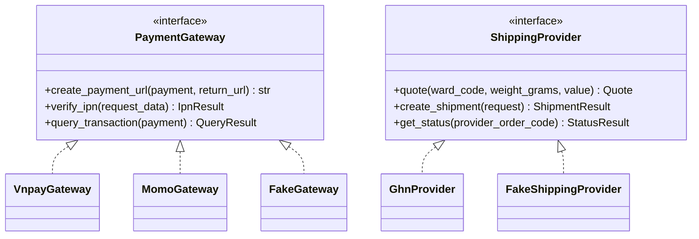

# 06. Tích hợp bên ngoài

> Trạng thái: **Bản nháp chờ review**. Quyết định nền tảng: [ADR 0005](../adr/0005-provider-adapters-fake-gateways.md).
> Không có SDK Python nào được duy trì cho VNPay, MoMo, GHN, nên ta tự viết adapter mỏng bằng `httpx`.

## 1. Mô hình adapter



Chọn adapter bằng cấu hình:

| Biến môi trường | Local (mặc định) | Nghiệm thu với sandbox | AWS |
|---|---|---|---|
| `PAYMENT_PROVIDER_VNPAY` | `fake` | `vnpay` (sandbox) | `vnpay` |
| `PAYMENT_PROVIDER_MOMO` | `fake` | `momo` (sandbox) | `momo` |
| `SHIPPING_PROVIDER` | `fake` hoặc `ghn` (sandbox, gọi ra được từ local) | `ghn` (sandbox) | `ghn` |

Mọi adapter thật đều có: timeout (kết nối 3 giây, đọc 10 giây), retry có giới hạn cho lỗi mạng (không retry thao tác tạo giao dịch nếu không chắc là idempotent), log có `request_id`, và che dữ liệu nhạy cảm.

## 2. VNPay

| Việc | Cách làm |
|---|---|
| Tạo thanh toán | Dựng URL có các tham số `vnp_*`, ký **HMAC-SHA512** bằng `vnp_HashSecret`; `vnp_TxnRef` = `payments_payment.provider_txn_ref` (mỗi lần thử sinh mã mới); `vnp_Amount` = số tiền × 100 theo đặc tả VNPay |
| Hết hạn | `vnp_ExpireDate` = thời điểm hết Giữ hàng (15 phút) |
| IPN | `GET /api/v1/webhooks/vnpay/ipn`: kiểm tra chữ ký → tìm Payment → so số tiền → chống trùng → cập nhật → trả `RspCode` theo đặc tả (`00` thành công, `01` không tìm thấy, `02` đã xử lý, `04` sai số tiền, `97` sai chữ ký) |
| Đối soát | API truy vấn giao dịch (`querydr`) cho Payment `pending` quá 2 phút |
| Hoàn tiền | MVP: Staff thao tác thủ công trên trang quản trị VNPay (BR-REF-03) |

## 3. MoMo

| Việc | Cách làm |
|---|---|
| Tạo thanh toán | Gọi API tạo giao dịch, ký **HMAC-SHA256** bằng `secretKey`, nhận `payUrl` |
| IPN | `POST /api/v1/webhooks/momo/ipn`: kiểm tra chữ ký, xử lý như VNPay, trả HTTP 204 |
| Đối soát | API truy vấn trạng thái giao dịch |
| Hoàn tiền | MVP: thủ công |

> Tham số chính xác, mã kết quả và định dạng chữ ký phải lấy theo **tài liệu chính thức mới nhất** của VNPay và MoMo khi bắt đầu code. Unit test kiểm tra chữ ký dùng dữ liệu mẫu từ chính tài liệu đó.

## 4. GHN

| Việc | Cách làm |
|---|---|
| Báo giá | API tính phí theo địa chỉ giao, cân nặng, kích thước mặc định, giá trị hàng. Timeout **3 giây**; lỗi hoặc quá thời gian thì trả phí dự phòng (BR-SHP-02) |
| Cache báo giá | Cache trong Redis 10 phút theo `(ward_code, weight_bucket)` để giảm số lần gọi khi khách sửa giỏ |
| Tạo vận đơn | Khi Staff bàn giao (T10): gửi thông tin người nhận, hàng hoá, `cod_amount` (đơn COD) |
| Webhook | `POST /api/v1/webhooks/ghn`: lưu `shipping_shipment_event`, đổi trạng thái GHN sang trạng thái nội bộ, phát sự kiện |
| Đối soát | Mỗi 15 phút truy vấn các vận đơn chưa ở trạng thái cuối |

### 4.1. Ánh xạ trạng thái GHN

| Nhóm trạng thái GHN (ví dụ) | Trạng thái `shipping_shipment` | Sự kiện phát ra |
|---|---|---|
| `ready_to_pick`, `picking` | `picking` | — |
| `delivering`, `transporting` | `in_transit` | — |
| `delivered` | `delivered` | `ShipmentDeliveredV1` |
| `return`, `returning` | `returning` | — |
| `returned` | `returned` | `ShipmentReturnedV1` |

Danh sách mã trạng thái đầy đủ lấy theo tài liệu GHN khi code.

### 4.2. ⚠️ Rủi ro mở: địa chỉ 2 cấp và 3 cấp

Hệ thống dùng địa chỉ **2 cấp** (tỉnh/thành → phường/xã) theo đợt sắp xếp hành chính 07/2025. **Chưa xác minh** được API của GHN đã chuyển sang 2 cấp hay vẫn cần `district_id`. Cách xử lý:

- Bảng `shipping_ghn_location_mapping` ánh xạ `ward_code` của hệ thống sang ID của GHN.
- Dữ liệu ánh xạ được nạp bằng một management command từ API danh mục địa chỉ của GHN.
- Phường/xã chưa có ánh xạ: dùng phí ship dự phòng và đánh dấu đơn để Staff xử lý thủ công.
- **Việc cần làm đầu tiên khi bắt đầu tích hợp GHN**: kiểm tra tài liệu GHN hiện hành và cập nhật mục này.

## 5. Google OAuth

- Frontend (NextAuth) lấy `id_token` từ Google rồi gửi sang `POST /api/v1/store/auth/google`.
- Django xác minh bằng `google.oauth2.id_token.verify_oauth2_token` (xem [05-auth-security.md](./05-auth-security.md)).
- Liên kết tài khoản theo email đã xác minh (US-502).
- Ở local dùng redirect URI `http://localhost:3000/…`; Google cho phép `localhost`.

## 6. Email

| Môi trường | Backend gửi | Ghi chú |
|---|---|---|
| Local | SMTP tới **Mailpit** (`localhost:1025`, giao diện xem mail `http://localhost:8025`) | Không email nào ra ngoài |
| Test | `locmem` | Kiểm tra nội dung email trong test |
| AWS | **Amazon SES** | Cần xác minh domain (SPF, DKIM, DMARC) và xin thoát sandbox SES |

## 7. Fake Gateway (local)

```
1. Client gọi POST /store/orders/{code}/payments {method: "vnpay"}
2. FakeGateway trả redirect_url = http://localhost:8000/dev/fake-gateway/{provider_txn_ref}
3. Trang giả lập hiện: số tiền, mã đơn, các nút
     [Thanh toán thành công] [Thất bại] [Thành công nhưng sai số tiền] [Không gửi IPN]
4. Bấm nút → Fake gọi nội bộ vào đúng luồng xử lý IPN (có chữ ký giả hợp lệ)
5. Chuyển về return_url như cổng thật
```

Nút "Không gửi IPN" dùng để thử job đối soát: `FakeGateway.query_transaction` trả về kết quả đã chọn.

`FakeShippingProvider` tương tự: báo giá cố định theo cân nặng, có lệnh `manage.py fake_shipment_status <code> delivered` để giả lập GHN báo trạng thái.

## 8. Nghiệm thu với sandbox thật (trước khi lên AWS)

Dùng **Cloudflare Tunnel** để VNPay, MoMo, GHN gọi được vào máy local:

1. `cloudflared tunnel --url http://localhost:8000` (hoặc tunnel có tên miền cố định).
2. Khai báo URL IPN và webhook với sandbox của VNPay, MoMo, GHN.
3. Đổi adapter sang bản thật (mục 1).
4. Chạy kịch bản nghiệm thu: thanh toán thành công, thất bại, hết hạn, IPN đến muộn, tạo vận đơn, giao thành công, hoàn hàng.
5. Ghi kết quả vào biên bản nghiệm thu.
