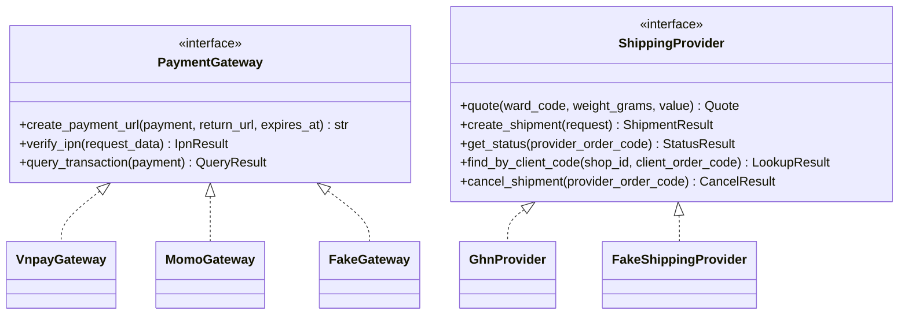

# 06. Tích hợp bên ngoài

> Trạng thái: **Bản nháp chờ review**. Quyết định nền tảng: [ADR 0005](../adr/0005-provider-adapters-fake-gateways.md).
> Không có SDK Python nào được duy trì cho VNPay, MoMo, GHN, nên ta tự viết adapter mỏng bằng `httpx`.

## 1. Mô hình adapter



Chọn adapter bằng cấu hình:

| Biến môi trường | Local (mặc định) | Nghiệm thu với sandbox | AWS |
|---|---|---|---|
| `PAYMENT_PROVIDER_VNPAY` | `fake` | `vnpay` (sandbox) | `vnpay` |
| `PAYMENT_PROVIDER_MOMO` | `fake` | `momo` (sandbox) | `momo` |
| `SHIPPING_PROVIDER` | `fake` hoặc `ghn` (sandbox, gọi ra được từ local) | `ghn` (sandbox) | `ghn` |
| `FAKE_PROVIDERS_ENABLED` | `true` | `false` | `false` |

`FAKE_PROVIDERS_ENABLED` quyết định có đăng ký trang Fake Gateway và lệnh giả lập GHN hay không. Cờ này bật ở local và trong `settings/test.py` (flow test gọi IPN qua Fake Gateway), không phụ thuộc vào việc đang dùng `settings.local`. Chọn adapter `fake` khi cờ tắt thì Django báo lỗi ngay lúc khởi động.

Mọi adapter thật đều có: timeout (kết nối 3 giây, đọc 10 giây), retry có giới hạn cho lỗi mạng (không retry thao tác tạo giao dịch nếu không chắc là idempotent), log có `request_id`, và che dữ liệu nhạy cảm.

Return URL do backend dựng từ STOREFRONT_ORIGIN cấu hình và path /payment/return; API công khai không nhận URL này. Lưu URL đã dựng trong Payment.creation_input để retry cùng payload ngay cả khi cấu hình domain thay đổi. Adapter vẫn nhận return_url nội bộ tin cậy; callback/IPN URL là cấu hình riêng. Trang return chỉ đọc trạng thái qua BFF, không xác nhận tiền từ query string (05 mục 6).

## 2. VNPay

| Việc | Cách làm |
|---|---|
| Tạo thanh toán | Dựng URL có các tham số `vnp_*`, ký **HMAC-SHA512** bằng `vnp_HashSecret`; `vnp_TxnRef` = `payments_payment.provider_txn_ref` (mỗi lần thử sinh mã mới); `vnp_Amount` = số tiền × 100 theo đặc tả VNPay |
| Hết hạn | `vnp_ExpireDate` = `payments_payment.expires_at` do `ordering` truyền vào: lúc đặt đơn + `PAYMENT_LINK_TTL` (phút thứ 10), giống nhau cho mọi lần thử. Link hết hạn sớm hơn Giữ hàng (phút thứ 15) 5 phút, để IPN đến muộn và một vòng Đối soát vẫn kịp trước khi Giữ hàng hết hạn |
| IPN | `GET /api/v1/webhooks/vnpay/ipn`: kiểm tra chữ ký → tìm Payment → so số tiền → chống trùng → cập nhật → trả `RspCode` theo đặc tả (`00` thành công, `01` không tìm thấy, `02` đã xử lý, `04` sai số tiền, `97` sai chữ ký). Sai số tiền thì Payment `failed` và phát `payments.payment-failed` với `reason = amount_mismatch` và `amount_received` (`ordering` tự tạo Hoàn tiền cho số tiền đã nhận và gắn cờ `payment_amount_mismatch`, BR-PAY-04) |
| Đối soát | API truy vấn giao dịch (`querydr`) cho Payment `pending` quá 2 phút. Payment đã quá `expires_at` mà cổng báo chưa thanh toán thì chuyển `expired` |
| Hoàn tiền | MVP: Staff thao tác thủ công trên trang quản trị VNPay (BR-REF-03) |

## 3. MoMo

| Việc | Cách làm |
|---|---|
| Tạo thanh toán | Gọi API tạo giao dịch, ký **HMAC-SHA256** bằng `secretKey`, nhận `payUrl` |
| Hết hạn | Đặt hạn link theo cùng `expires_at` (phút thứ 10 kể từ khi đặt đơn) nếu API MoMo cho phép **[Cần xác minh tham số hạn link của MoMo]**. Nếu không, Đối soát chuyển Payment sang `expired` khi quá `expires_at`; tiền về muộn xử lý theo BR-PAY-05 |
| IPN | `POST /api/v1/webhooks/momo/ipn`: kiểm tra chữ ký, xử lý như VNPay, trả HTTP 204 |
| Đối soát | API truy vấn trạng thái giao dịch, cùng quy tắc `expired` như VNPay |
| Hoàn tiền | MVP: thủ công |

> Tham số chính xác, mã kết quả và định dạng chữ ký phải lấy theo **tài liệu chính thức mới nhất** của VNPay và MoMo khi bắt đầu code. Unit test kiểm tra chữ ký dùng dữ liệu mẫu từ chính tài liệu đó.

### 3.1. Khởi tạo thanh toán có thể khôi phục

Quy trình chung cho endpoint bắt đầu Thanh toán online:

1. Trong transaction ngắn, claim Idempotency-Key theo scope và request_hash, khoá Order để kiểm tra quyền, trạng thái và hạn thanh toán. ordering gọi payments.contracts.prepare_payment để ghi Payment prepared với provider_txn_ref, provider_request_id ổn định trong cùng transaction; gắn resource_id vào key rồi commit trước khi gọi gateway. ordering sở hữu việc kiểm tra Order; payments sở hữu Payment và dữ liệu tạo giao dịch. Cùng key dùng lại Payment cũ; key khác biểu diễn lần thử mới.
2. Sau commit, gọi payments.contracts.start_payment(payment_id, operation_id); claim lease của thao tác tạo trong DB rồi commit. Mọi đường xử lý, kể cả request HTTP và job khôi phục, dùng cùng lease. Gọi gateway ngoài transaction. Với VNPay, ký lại cùng bộ tham số đã lưu; với MoMo, lưu payload chuẩn hoá của thao tác tạo (amount, return_url do backend dựng từ origin/path đã cấu hình, expires_at và các ID ổn định) để retry không thay đổi dữ liệu. Không lưu secret hay chữ ký trong payload này; adapter ký tại lúc gọi. Có thể lưu cấu trúc này trong trường creation_input của Payment; chỉ chứa field được adapter cho phép, không sao chép request thô.
3. Có kết quả tạo link chắc chắn thì khoá Payment/key, kiểm tra lease token và lưu redirect_url, creation_status=ready cùng response idempotency. Kết quả tạo tới sau IPN không được ghi đè status/amount_received đã xác nhận. Bị từ chối chắc chắn thì lưu creation_status=failed và kết quả lỗi cuối; timeout, mất kết nối hoặc crash trước lưu kết quả để lại prepared/unknown, không tạo Payment mới.
4. Gọi lại cùng key khi chưa xong trả 202 PAYMENT_INITIALIZING với Retry-After; client thử lại cùng body/key. Job recover_payment_initializations quét prepared/unknown có lease hết hạn, truy vấn cùng mã giao dịch trước. Chỉ gọi lại thao tác tạo với cùng ID và payload khi adapter xác nhận thao tác đó idempotent theo đặc tả nhà cung cấp. Nếu chưa phân biệt được giao dịch không tồn tại hay kết quả chưa cập nhật, tiếp tục truy vấn và cảnh báo thay vì sinh ID mới.
5. Lease khởi tạo 3 phút, quét mỗi phút là **[Giả định]**; ngân sách timeout tổng của một lần gọi phải ngắn hơn lease, không retry HTTP vô hạn. Quá hạn link không tạo/gia hạn link, nhưng vẫn đối soát tiền đã nhận bằng mã cũ. Nếu gateway báo đã trả hoặc đã hết hạn mà không có link để trả, đặt creation_status=closed, vô hiệu lease và lưu kết quả cuối cho key để client xem trạng thái Đơn hàng; response tạo cũ không được mở lại closed. Key in_progress chưa xác định kết quả không bị purge theo mốc 24 giờ.

MoMo mô tả requestId dùng cho idempotency và API query tra theo orderId: [idempotency](https://developers.momo.vn/v3/vi/docs/payment/api/result-handling/idempotency/), [query](https://developers.momo.vn/v3/vi/docs/payment/api/payment-api/query/). Adapter phải xác minh thời hạn giữ key, mã lỗi trùng, cách lấy lại payUrl và khả năng truy vấn cho đúng sản phẩm tích hợp trong sandbox; query biết giao dịch tồn tại không mặc nhiên có nghĩa lấy lại được link. Nếu không có đường lấy lại link an toàn thì trả trạng thái cuối/đang xử lý, không tự hứa khôi phục payUrl bằng mọi giá.

## 4. GHN

| Việc | Cách làm |
|---|---|
| Báo giá | API tính phí theo địa chỉ giao, cân nặng, kích thước mặc định, giá trị hàng. Timeout **3 giây**; lỗi hoặc quá thời gian thì trả Phí ship dự phòng (BR-SHP-02). `quote_fee` luôn trả phí GHN thật (hoặc Phí ship dự phòng); việc miễn phí ship theo ngưỡng do `ordering` áp khi tính tổng đơn |
| Cache báo giá | Cache kết quả GHN thật 10 phút bằng hash request báo giá chuẩn hoá đầy đủ: môi trường/provider, ShopID và nơi gửi, service/service_type, địa chỉ GHN đích sau mapping, cân nặng và kích thước chính xác, giá trị khai báo/bảo hiểm, COD nếu gửi, mọi tham số tác động phí, config_revision và mapping_revision. Bỏ secret/header xác thực khỏi hash; không dùng thông tin liên hệ/địa chỉ đường phố trong cache key. Không gom weight_bucket trừ khi đã chứng minh tương đương phí. Không cache kết quả fallback chung với phí GHN thật; lỗi thì trả fallback có reason/source, lần sau vẫn thử GHN |
| Tạo vận đơn | request_shipment ghi requested cùng snapshot creation_input và reference/client_order_code ổn định, enqueue sau commit. Task claim lease trong DB rồi gọi GHN ngoài transaction. Thành công chắc chắn thì ghi mã GHN và phát ShipmentCreatedV1 một lần; bị từ chối chắc chắn thì failed. Timeout/mất kết nối/crash chưa rõ kết quả không chuyển failed, giữ creation_unknown để query theo mã shop trước retry (mục 4.3) |
| Huỷ vận đơn | Dùng khi Vận đơn được tạo xong cho một đơn đã bị huỷ (cờ `shipment_after_cancel`). `ordering` gọi `shipping.contracts.request_shipment_cancellation`: ghi Vận đơn `cancel_requested` rồi đẩy task lên queue `integrations` sau khi transaction commit. Task gọi `cancel_shipment` của adapter (API huỷ đơn của GHN). Thành công: Vận đơn `cancelled`. Lỗi sau khi hết retry: giữ `cancel_requested`, báo Sentry; Staff xử lý tay theo Cờ cần xử lý đã gắn **[Cần xác minh API huỷ của GHN và trạng thái nào còn huỷ được]** |
| Webhook | `POST /api/v1/webhooks/ghn`: lưu `shipping_shipment_event`, đổi trạng thái GHN sang trạng thái nội bộ, phát sự kiện |
| Đối soát | Mỗi 15 phút truy vấn Vận đơn chưa cuối theo mã GHN; requested/creation_unknown hết lease phải query bằng mã shop trước khi quyết định tạo lại. cancel_requested vẫn được thử huỷ lại qua cùng mã; không tạo Vận đơn thay thế |

### 4.1. Ánh xạ trạng thái GHN

| Nhóm trạng thái GHN (ví dụ) | Trạng thái `shipping_shipment` | Sự kiện phát ra |
|---|---|---|
| (nội bộ: đã nhận yêu cầu, task chưa gọi GHN xong) | `requested` | — |
| (nội bộ: GHN tạo vận đơn thành công) | `created` | `ShipmentCreatedV1` |
| (nội bộ: timeout/kết quả tạo chưa rõ) | `creation_unknown` | — |
| (nội bộ: GHN từ chối chắc chắn, chưa tạo) | `failed` | `ShipmentCreationFailedV1` |
| (nội bộ: đã nhận yêu cầu huỷ, task chưa gọi GHN xong) | `cancel_requested` | — |
| `ready_to_pick`, `picking` | `picking` | — |
| `delivering`, `transporting` | `in_transit` | — |
| `delivered` | `delivered` | `ShipmentDeliveredV1` |
| `return`, `returning` | `returning` | — |
| `returned` | `returned` | `ShipmentReturnedV1` |
| `cancel` | `cancelled` | — |

Danh sách mã trạng thái đầy đủ lấy theo tài liệu GHN khi code.

### 4.2. ⚠️ Rủi ro mở: địa chỉ 2 cấp và 3 cấp

Hệ thống dùng địa chỉ **2 cấp** (tỉnh/thành → phường/xã). [Tài liệu tạo đơn GHN](https://developer.ghn.vn/vi/docs/order/create) hiện mô tả is_new_to_address và bộ danh mục mới 2 cấp; đây là xác minh tài liệu, chưa phải kết quả nghiệm thu sandbox. Adapter phải xác định chế độ địa chỉ, mapping và tham số tương ứng của API báo giá/tạo đơn; đưa chế độ và mapping revision vào cache key. Cách xử lý mapping:

- Bảng `shipping_ghn_location_mapping` ánh xạ `ward_code` của hệ thống sang ID của GHN.
- Dữ liệu ánh xạ được nạp bằng một management command từ API danh mục địa chỉ của GHN.
- Phường/xã chưa có ánh xạ: dùng Phí ship dự phòng và gắn Cờ cần xử lý `ghn_ward_unmapped`. Admin chọn ID tỉnh, quận, phường của GHN cho phường/xã đó trên back-office (`settings/ghn-locations`, US-1004), rồi Staff bàn giao như bình thường và gỡ cờ. Màn này có thể bỏ nếu kiểm tra cho thấy GHN đã dùng địa chỉ 2 cấp.
- **Việc cần làm khi tích hợp GHN**: nghiệm thu sandbox đầy đủ một tuyến địa chỉ 2 cấp qua báo giá, tạo đơn và callback; cập nhật mapping theo kết quả. Không dùng district_id giả để vượt validation.

### 4.3. Khôi phục tạo Vận đơn chưa rõ kết quả

- request_shipment tạo một Shipment và client_order_code=reference duy nhất theo shop, lưu creation_input chính xác cho lần tạo (địa chỉ nhận, hàng, COD, dịch vụ và mapping đã chọn). Payload có PII nên không log/audit/outbox; redaction xoá PII trong cả creation_input khi yêu cầu xoá dữ liệu đủ điều kiện. Retry cùng mã không tự thay payload theo cấu hình hay dữ liệu Đơn hàng mới hơn.
- Mọi task create/recovery dùng cùng lease token trên Shipment, 3 phút **[Giả định]**, với timeout tổng nhỏ hơn lease. Snapshot và lease commit trước HTTP. requested hết lease được xử lý như chưa rõ kết quả dù process chưa kịp ghi creation_unknown. Kết quả cũ chỉ được ghi nếu lease còn khớp; webhook đã đưa trạng thái xa hơn thì không ghi created đè lại, nhưng vẫn cần bảo đảm sự kiện ShipmentCreatedV1 đã được ghi một lần để ordering áp dụng T10.
- Adapter có find_by_client_code(shop_id, client_order_code) trả found/not_found/unknown; timeout hoặc response không hợp lệ là unknown. Found thì gắn đúng mã GHN, không gọi create thêm. Not_found chỉ cho phép create lại với cùng mã và payload khi đã xác minh cơ chế chống trùng và độ nhất quán truy vấn của GHN; query một lần chưa thấy không phải bằng chứng chắc chắn chưa tạo.
- Giữ creation_unknown, next_recovery_at và cảnh báo khi chưa thể xác định; hết retry lỗi mạng không biến thành failed. Staff không được huỷ Đơn hàng hoặc bấm bàn giao lại khi requested/creation_unknown. Chỉ retry failed khi biết chắc chưa có Vận đơn ngoài GHN; không sinh client_order_code mới để né lỗi trùng.
- Tài liệu GHN có [tra theo mã shop](https://developer.ghn.vn/vi/docs/order/info-by-client-code) và mô tả client_order_code duy nhất theo shop trong [API tạo](https://developer.ghn.vn/vi/docs/order/create). Phải nghiệm thu sandbox với đúng ShopID/môi trường: tạo thành công nhưng mất response, query ngay/lặp lại, create trùng và response tới muộn. Chưa xác minh các trường hợp này thì không bật retry tạo tự động sau timeout. FakeShippingProvider cần mô phỏng chúng.

## 5. Google OAuth

- Frontend (NextAuth) lấy `id_token` từ Google rồi server Next.js gửi sang `POST /api/v1/store/auth/google`.
- Django xác minh bằng `google.oauth2.id_token.verify_oauth2_token` (xem [05-auth-security.md](./05-auth-security.md)).
- Liên kết Tài khoản theo email đã xác minh (US-502). Nếu Tài khoản khớp chưa xác thực email thì xoá mật khẩu cũ, tăng `token_version` và thu hồi mọi refresh token ([05-auth-security.md](./05-auth-security.md) mục 3), để chặn việc kẻ gian đăng ký trước bằng email của nạn nhân.
- Ở local dùng redirect URI `http://localhost:3000/…`; Google cho phép `localhost`.

## 6. Email

| Môi trường | Backend gửi | Ghi chú |
|---|---|---|
| Local | SMTP tới **Mailpit** (`localhost:1025`, giao diện xem mail `http://localhost:8025`) | Không email nào ra ngoài |
| Test | `locmem` | Kiểm tra nội dung email trong test |
| AWS | **Amazon SES** | Cần xác minh domain (SPF, DKIM, DMARC) và xin thoát sandbox SES |

EmailLog được tạo trong PostgreSQL cùng transaction với handler. Task nhận ID log, claim bằng lease rồi gửi ngoài transaction; job mỗi phút khôi phục email chờ gửi hoặc lease hết hạn. Retry không cần phát lại sự kiện. Email có thể trùng nếu nhà cung cấp đã nhận nhưng worker chưa ghi `sent`; không bảo đảm gửi ra ngoài đúng một lần. Token xác thực/reset chỉ được cấp lúc gửi, không lưu trong outbox hay EmailLog. Xem [07 mục 4](./07-async-events-jobs.md#4-email-hàng-đợi-bền-vững-trong-postgresql).

## 7. Fake Gateway (local và test)

Chỉ có khi `FAKE_PROVIDERS_ENABLED = true` (mục 1).

```
1. Client gọi POST /store/orders/{code}/payments {gateway: "vnpay"}
2. FakeGateway trả redirect_url = http://localhost:8000/dev/fake-gateway/{provider_txn_ref}
3. Trang giả lập hiện: số tiền, mã đơn, các nút
     [Thanh toán thành công] [Thất bại] [Thành công nhưng sai số tiền] [Không gửi IPN]
4. Bấm nút → Fake gọi nội bộ vào đúng luồng xử lý IPN (có chữ ký giả hợp lệ)
5. Chuyển về return_url như cổng thật
```

Nút "Không gửi IPN" dùng để thử job Đối soát: `FakeGateway.query_transaction` trả về kết quả đã chọn.

`FakeShippingProvider` tương tự: báo giá cố định theo cân nặng, tạo và huỷ Vận đơn luôn thành công, có lệnh `manage.py fake_shipment_status <code> delivered` để giả lập GHN báo trạng thái.

## 8. Nghiệm thu với sandbox thật (trước khi lên AWS)

Dùng **Cloudflare Tunnel** để VNPay, MoMo, GHN gọi được vào máy local:

1. `cloudflared tunnel --url http://localhost:8000` (hoặc tunnel có tên miền cố định).
2. Khai báo URL IPN và webhook với sandbox của VNPay, MoMo, GHN.
3. Đổi adapter sang bản thật (mục 1).
4. Chạy kịch bản nghiệm thu: thanh toán thành công, thất bại, link hết hạn sau 10 phút, IPN đến muộn, trả tiền hai lần cho cùng một đơn, tạo Vận đơn, huỷ Vận đơn, giao thành công, Hoàn hàng.
5. Ghi kết quả vào biên bản nghiệm thu.
