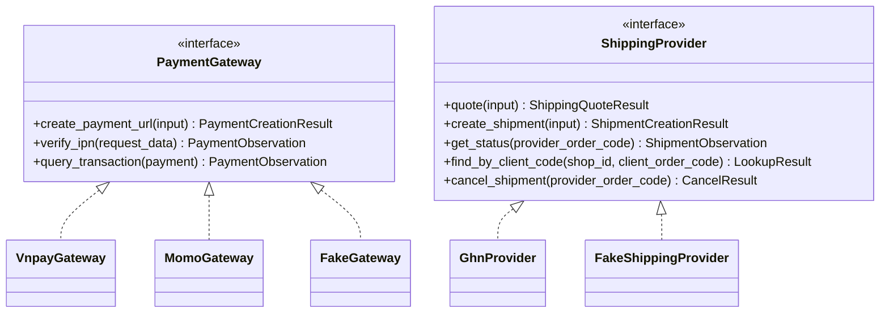

# 06. Tích hợp bên ngoài

> Trạng thái: **Đã chốt cho MVP** ([quy ước](../../README.md#trạng-thái-tài-liệu)). Quyết định nền tảng: [ADR 0005](../adr/0005-provider-adapters-fake-gateways.md).
> Dự án chọn adapter mỏng bằng `httpx` để sở hữu hợp đồng và kiểm thử tích hợp; không phụ thuộc SDK bên thứ ba. Các mục **[Cần xác minh]** là điều kiện nghiệm thu, không phải khả năng đã được kiểm chứng trên sandbox.

## 1. Mô hình adapter



Chọn adapter bằng cấu hình:

| Biến môi trường | Local (mặc định) | Nghiệm thu với sandbox | AWS |
|---|---|---|---|
| `PAYMENT_PROVIDER_VNPAY` | `fake` | `vnpay` (sandbox) | `vnpay` |
| `PAYMENT_PROVIDER_MOMO` | `fake` | `momo` (sandbox) | `momo` |
| `SHIPPING_PROVIDER` | `fake` hoặc `ghn` (sandbox, gọi ra được từ local) | `ghn` (sandbox) | `ghn` |
| `FAKE_PROVIDERS_ENABLED` | `true` | `false` | `false` (staging bật tạm khi test tải) |

`FAKE_PROVIDERS_ENABLED` quyết định có đăng ký trang Fake Gateway và lệnh giả lập GHN hay không. Cờ này bật ở local và trong `settings/test.py` (flow test gọi IPN qua Fake Gateway), không phụ thuộc vào việc đang dùng `settings.local`. Chọn adapter `fake` khi cờ tắt thì Django báo lỗi ngay lúc khởi động. Trên staging, cờ chỉ bật tạm trong lúc test tải bằng k6 ([12-testing-strategy.md](./12-testing-strategy.md) mục 9). `settings/production.py` từ chối khởi động nếu cờ bật khi `APP_ENV = production`.

Mọi adapter thật đều có: timeout (kết nối 3 giây, đọc 10 giây), retry có giới hạn cho lỗi mạng (không retry thao tác tạo giao dịch nếu không chắc là idempotent), log có `request_id`, và che dữ liệu nhạy cảm.

Return URL do backend dựng từ STOREFRONT_ORIGIN cấu hình và path /payment/return; API công khai không nhận URL này. Lưu URL đã dựng trong Payment.creation_input để retry cùng payload ngay cả khi cấu hình domain thay đổi. Adapter vẫn nhận return_url nội bộ tin cậy; callback/IPN URL là cấu hình riêng. Trang return chỉ đọc trạng thái qua BFF, không xác nhận tiền từ query string (05 mục 6).

### 1.1. Hợp đồng kết quả adapter

DTO là Pydantic frozen, cấm field lạ và chỉ dùng kiểu dữ liệu nội bộ dưới đây; không trả ORM model hoặc raw response cho service làm logic nghiệp vụ. Thời gian là UTC, tiền/số lượng là số nguyên; giới hạn string theo 03. Raw payload đã xác thực chỉ được chuyển riêng tới nơi ghi Event, không vào log/DTO public. Các input versioned theo 03 mục 6.1/7.1, không đọc lại cấu hình để thay payload khi retry.

| DTO | Field bắt buộc / giá trị hợp lệ |
|---|---|
| `PaymentCreationResult` | `outcome` = ready/rejected/unknown; `redirect_url` chỉ có và bắt buộc khi ready, đã qua allowlist; `provider_code` string, `retryable` boolean. rejected nghĩa là chắc chắn không tạo được giao dịch; timeout/mất response là unknown |
| `PaymentObservation` | `provider`, `merchant_scope` (ID cấu hình merchant/môi trường, không secret), `reference` (provider_txn_ref), `provider_transaction_id` nullable, `outcome` = pending/authorized/captured/failed/expired/not_found/unknown; `reported_amount` integer ≥ 0 hoặc NULL, `captured_amount` integer > 0 chỉ khi captured và NULL ở các kết quả khác; `currency` = VND; `provider_codes` object có đúng các mã trạng thái được liệt kê ở mục 1.2; `occurred_at` timestamp hoặc NULL; `evidence` = verified_ipn/verified_query. Callback chưa xác thực không tạo DTO nghiệp vụ; query chỉ verified khi đã kiểm tra tính xác thực theo protocol và khớp merchant/reference |
| `ShippingQuoteResult` | `fee` integer ≥ 0, `source` = carrier/fallback, `reason` nullable (bắt buộc khi fallback), `request_fingerprint` string SHA-256; phí Người mua phải trả vẫn do ordering tính |
| `ShipmentCreationResult` | `outcome` = created/rejected/unknown, `provider_order_code` bắt buộc chỉ khi created; `fee` integer ≥ 0 hoặc NULL, `provider_code` string. Service chỉ phát creation-failed cho rejected |
| `ShipmentObservation` | `provider_order_code`, `reference`, `provider_status` string, `occurred_at` timestamp hoặc NULL; `mapped_status` thuộc bảng mục 4.1 hoặc unknown; `evidence` = verified_webhook/verified_query. Mã chưa biết là unknown, giữ trạng thái hiện tại và cảnh báo |
| `LookupResult` | `outcome` = found/not_found/unknown; `shipment` là ShipmentObservation bắt buộc chỉ khi found. not_found không tự cấp phép retry create nếu chưa nghiệm thu tính nhất quán truy vấn |
| `CancelResult` | `outcome` = cancelled/rejected/unknown, `provider_code` string. rejected nghĩa là provider từ chối yêu cầu, không tự biến Vận đơn thành cancelled; timeout là unknown, giữ ý định huỷ để đối soát |

`provider_codes` của VNPay chỉ gồm `response_code`, `transaction_status`; của MoMo chỉ gồm `result_code`; các giá trị là string để giữ nguyên mã gốc. `provider_transaction_id` bắt buộc khi captured. `reference` ở DTO Payment là mã gửi gateway, không phải `Payment.reference` (Mã đơn); adapter resolve đúng Payment trước khi service đọc Mã đơn.

| Lỗi / kết quả | Quyết định của service |
|---|---|
| Chữ ký/merchant/reference/currency không hợp lệ | Không đổi tiền/trạng thái hoặc phát sự kiện; phản hồi theo mục 1.3, cảnh báo metadata không nhạy cảm |
| Timeout, mất response, body không parse/validate được | Unknown; không suy ra failed/not_found, không retry tạo mù |
| 429 hoặc 5xx ở thao tác đọc | Retry hữu hạn, tôn trọng Retry-After hợp lệ; hết ngân sách để job vòng sau xử lý |
| 4xx từ chối nghiệp vụ có ý nghĩa chắc chắn | rejected theo mapping của adapter; 4xx không nhận diện vẫn unknown |
| captured đã xác thực | Áp mục 1.2 dưới khoá Payment; HTTP ACK không đồng nghĩa Order đã PLACED |

Ngân sách mặc định cho query/cancel: tối đa 3 lần HTTP trong một lượt task, chờ 1 giây rồi 3 giây; timeout tổng phải nhỏ hơn lease. Create chỉ một lần mỗi lượt, mọi lần tạo lại phải đi qua query và điều kiện idempotency đã nghiệm thu. Báo giá GHN có deadline tổng 3 giây, không nhân deadline thành nhiều lần retry; hết hạn dùng fallback. Các con số này là cấu hình **[Giả định · kiểm chứng: độ trễ thực tế khi nghiệm thu sandbox, mục 8]**, không thay thế lịch retry handler ở 07.

### 1.2. Xác nhận tiền và chống trùng

Trình tự dùng chung cho IPN và Đối soát: parse giới hạn kích thước → xác thực → đối chiếu merchant/reference/currency → tạo PaymentObservation → transaction khoá Payment → tạo/kiểm tra PaymentEvent → cập nhật tiền/trạng thái và outbox → commit → ACK. Không gọi query/gateway trong transaction. Payload sai chữ ký không được ghi như một sự kiện tin cậy; không coi `reported_amount` là tiền đã nhận.

| Provider / kết quả | Outcome nội bộ / tác động tiền |
|---|---|
| VNPay `vnp_ResponseCode = 00` **và** `vnp_TransactionStatus = 00` | captured; `vnp_Amount` phải chia hết cho 100, đổi về VND rồi đối chiếu. Khớp thì succeeded, ghi paid_at; sai số tiền nhưng thật sự captured thì failed/amount_mismatch, lưu đúng tiền thực nhận để ordering tạo Hoàn tiền |
| VNPay chưa hoàn tất hoặc trạng thái đảo/hoàn/nghi ngờ | Dùng mapping rõ theo phiên bản API; chưa chứng minh đã capture thì pending/unknown, không tăng amount_received hay tự hoàn tiền. Chỉ failed cho mã thất bại cuối đã xác minh |
| MoMo `resultCode = 0` | captured với đúng sản phẩm thanh toán đã nghiệm thu; kiểm tra partnerCode/orderId/requestId/currency/amount trước khi áp cùng quy tắc số tiền |
| MoMo `resultCode = 9000` | authorized, chưa coi là captured; không PLACED hoặc tạo Hoàn tiền chỉ từ thông báo này. MVP không bật sản phẩm auth/capture hai bước nếu chưa đặc tả và nghiệm thu bước capture |
| MoMo thất bại/hủy, pending hoặc mã chưa nhận diện | failed/pending/unknown theo bảng mã của đúng sản phẩm tích hợp, không dùng amount trong thông báo làm amount_received |

Nguồn protocol: [VNPay PAY](https://sandbox.vnpayment.vn/apis/docs/thanh-toan-pay/pay.html), [MoMo notification](https://developers.momo.vn/v3/docs/payment/api/result-handling/notification/). Fixture chữ ký, bảng mã và ACK phải ghi rõ phiên bản/sản phẩm đã nghiệm thu; các mã chưa có mapping không được coi là thành công.

- `amount_received` được **gán** số captured đã xác nhận, không cộng dồn theo số lần callback/query. Sau khi đã xác nhận một khoản capture, pending/failed tới muộn không được xoá tiền hoặc hạ trạng thái succeeded. Một kết quả capture tới muộn cho Payment còn chưa có tiền vẫn được xử lý dù trước đó expired/cancelled/failed; ordering quyết định giữ đơn hay Hoàn tiền theo lifecycle.
- Nếu Payment đã có capture mà nhận kết quả captured khác transaction ID hoặc khác số tiền, lưu observation riêng để điều tra, giữ nguyên khoản đã xác nhận, cảnh báo `PROVIDER_RESULT_CONFLICT`; không tự cộng thêm, thay thế tiền hoặc tạo Hoàn tiền cho khoản chưa xác định. Đây không phải cách biểu diễn nhiều lần thử; lần thử khác phải có Payment khác.
- `provider_event_id = "obs:v1:" + sha256(canonical_json(observation_identity))`. Canonical JSON UTF-8, key sort, separators không khoảng trắng, không float; identity có đúng `provider`, `merchant_scope`, `reference`, `provider_transaction_id` (hoặc NULL), `outcome`, `reported_amount`, `captured_amount`, `currency`, `provider_codes`. Không gồm source IPN/query, thời gian query/response, chữ ký hoặc message. Key ≤ 128; không giả định provider có event ID độc lập.
- Vì identity chứa outcome/mã/số tiền, query pending không che captured về sau; IPN/query cùng nội dung chuẩn hoá trùng key. Observation khác key vẫn phải đi qua khoá và quy tắc tiền phía trên, nên không phát PaymentSucceeded/PaymentFailed(amount_mismatch) lần nữa cho cùng kết quả tiền. UNIQUE chỉ chống trùng quan sát, không thay thế idempotency của tác động nghiệp vụ.

### 1.3. Phản hồi webhook

Webhook là ngoại lệ của error envelope 04. Chỉ ACK kết quả đã commit hoặc duplicate đã commit; DB lỗi/rollback không trả mã xác nhận xử lý thành công. Parse tối thiểu để kiểm chữ ký trước khi tin dữ liệu; giới hạn kích thước, không log query string VNPay hoặc body/header chứa chữ ký/token.

| Trường hợp | VNPay PAY | MoMo | GHN |
|---|---|---|---|
| Đã lưu/apply hoặc đã ghi pending/failed hợp lệ | HTTP 200, RspCode 00; captured sai số tiền dùng 04 sau khi lưu observation và tiền đúng | HTTP 204 sau commit | HTTP 200 sau commit |
| Duplicate đã commit | HTTP 200, RspCode 02 (hoặc 04 cho captured sai tiền đã ghi) | HTTP 204, không xử lý tiền lại | HTTP 200, không đổi terminal/phát lại sự kiện |
| Sai chữ ký/credentials | HTTP 200, RspCode 97 | HTTP 400, không mutation | HTTP 401/403 theo cơ chế credentials đã nghiệm thu, không mutation |
| Merchant/reference không khớp Payment/Shipment | HTTP 200, RspCode 01, không tạo PaymentEvent mồ côi | HTTP 400, không mutation | HTTP 400, không tạo ShipmentEvent mồ côi |
| Parse/schema/currency không hợp lệ | HTTP 400; không gán thành công | HTTP 400 | HTTP 400 |
| DB lỗi hoặc commit chưa thành công | HTTP 500 (không RspCode 00/02); lỗi xử lý dùng RspCode 99 nếu protocol phiên bản đã nghiệm thu yêu cầu HTTP 200 | HTTP 500, không 204 | HTTP 500, không 200 |

Đây là chính sách xử lý của merchant; hành vi retry thực tế của MoMo/GHN và cơ chế xác thực GHN phải nghiệm thu trước production. Không trông chờ provider luôn gửi lại callback; Đối soát vẫn bắt buộc. HTTP ACK của một giao dịch thất bại là xác nhận đã tiếp nhận kết quả, không phải xác nhận đã thu tiền. IPN/Đối soát có cùng pipeline nghiệp vụ; phản hồi HTTP chỉ thuộc adapter webhook.

## 2. VNPay

| Việc | Cách làm |
|---|---|
| Tạo thanh toán | Dựng URL có các tham số `vnp_*`, ký **HMAC-SHA512** bằng `vnp_HashSecret`; `vnp_TxnRef` = `payments_payment.provider_txn_ref` (mỗi lần thử sinh mã mới); `vnp_Amount` = số tiền × 100 theo đặc tả VNPay |
| Hết hạn | `vnp_ExpireDate` = `payments_payment.expires_at` do `ordering` truyền vào: lúc đặt đơn + `PAYMENT_LINK_TTL` (phút thứ 10), giống nhau cho mọi lần thử. Link hết hạn sớm hơn Giữ hàng (phút thứ 15) 5 phút, để IPN đến muộn vẫn kịp T3. Một vòng Đối soát (mỗi 5 phút) có thể kịp trước phút 15 nhưng không bảo đảm ([01](./01-system-context.md) mục 4) |
| IPN | `GET /api/v1/webhooks/vnpay/ipn`: xác thực và resolve Payment, ánh xạ **cả** response code/transaction status theo mục 1.2 trước khi kết luận tiền đã nhận; chống trùng dưới khoá Payment, commit rồi phản hồi theo mục 1.3. Chỉ captured sai tiền mới phát amount_mismatch và tạo nghĩa vụ Hoàn tiền |
| Đối soát | API truy vấn giao dịch (`querydr`) cho Payment `pending` quá 2 phút. Payment đã quá `expires_at` mà cổng báo chưa thanh toán thì chuyển `expired` |
| Hoàn tiền | MVP: Staff thao tác thủ công trên trang quản trị VNPay (BR-REF-03) |

## 3. MoMo

| Việc | Cách làm |
|---|---|
| Tạo thanh toán | Gọi API tạo giao dịch, ký **HMAC-SHA256** bằng `secretKey`, nhận `payUrl` |
| Hết hạn | Đặt hạn link theo cùng `expires_at` (phút thứ 10 kể từ khi đặt đơn) nếu API MoMo cho phép **[Cần xác minh tham số hạn link của MoMo]**. Nếu không, Đối soát chuyển Payment sang `expired` khi quá `expires_at`; tiền về muộn xử lý theo BR-PAY-05 |
| IPN | `POST /api/v1/webhooks/momo/ipn`: xác thực và kiểm partner/order/request ID; ánh xạ resultCode theo mục 1.2, không đồng nhất authorized với captured; commit rồi mới HTTP 204. Các lỗi phản hồi theo mục 1.3, không trả 204 vô điều kiện |
| Đối soát | API truy vấn trạng thái giao dịch, cùng quy tắc `expired` như VNPay |
| Hoàn tiền | MVP: thủ công |

> Tham số chính xác, mã kết quả và định dạng chữ ký phải lấy theo **tài liệu chính thức mới nhất** của VNPay và MoMo khi bắt đầu code. Unit test kiểm tra chữ ký dùng dữ liệu mẫu từ chính tài liệu đó.

### 3.1. Khởi tạo thanh toán có thể khôi phục

Quy trình chung cho endpoint bắt đầu Thanh toán online:

1. Trong transaction ngắn, claim Idempotency-Key theo scope và request_hash, khoá Order để kiểm tra quyền, trạng thái và hạn thanh toán. ordering gọi payments.contracts.prepare_payment để ghi Payment prepared với provider_txn_ref, provider_request_id ổn định trong cùng transaction; gắn resource_id vào key rồi commit trước khi gọi gateway. ordering sở hữu việc kiểm tra Order; payments sở hữu Payment và dữ liệu tạo giao dịch. Cùng key dùng lại Payment cũ; key khác biểu diễn lần thử mới.
2. Sau commit, gọi payments.contracts.start_payment(payment_id, operation_id); claim lease của thao tác tạo trong DB rồi commit. Mọi đường xử lý, kể cả request HTTP và job khôi phục, dùng cùng lease. Gọi gateway ngoài transaction. Với VNPay, ký lại cùng bộ tham số đã lưu; với MoMo, lưu payload chuẩn hoá của thao tác tạo (amount, return_url do backend dựng từ origin/path đã cấu hình, expires_at và các ID ổn định) để retry không thay đổi dữ liệu. Không lưu secret hay chữ ký trong payload này; adapter ký tại lúc gọi. Có thể lưu cấu trúc này trong trường creation_input của Payment; chỉ chứa field được adapter cho phép, không sao chép request thô.
3. Có kết quả tạo link chắc chắn thì khoá Payment/key, kiểm tra lease token và lưu redirect_url, creation_status=ready cùng response idempotency. Kết quả tạo tới sau IPN không được ghi đè status/amount_received đã xác nhận. Bị từ chối chắc chắn thì lưu creation_status=failed và kết quả lỗi cuối; timeout, mất kết nối hoặc crash trước lưu kết quả để lại prepared/unknown, không tạo Payment mới.
4. Gọi lại cùng key khi chưa xong trả 202 PAYMENT_INITIALIZING với Retry-After; client thử lại cùng body/key. Job recover_payment_initializations quét prepared/unknown có lease hết hạn, truy vấn cùng mã giao dịch trước. Chỉ gọi lại thao tác tạo với cùng ID và payload khi adapter xác nhận thao tác đó idempotent theo đặc tả nhà cung cấp. Nếu chưa phân biệt được giao dịch không tồn tại hay kết quả chưa cập nhật, tiếp tục truy vấn và cảnh báo thay vì sinh ID mới.
5. Lease khởi tạo 3 phút, quét mỗi phút **[Giả định · kiểm chứng: độ trễ thực tế khi nghiệm thu sandbox, mục 8]**; ngân sách timeout tổng của một lần gọi phải ngắn hơn lease, không retry HTTP vô hạn. Quá hạn link không tạo/gia hạn link, nhưng vẫn đối soát tiền đã nhận bằng mã cũ. Nếu gateway báo đã trả hoặc đã hết hạn mà không có link để trả, đặt creation_status=closed, vô hiệu lease và lưu kết quả cuối cho key để client xem trạng thái Đơn hàng; response tạo cũ không được mở lại closed. Key in_progress chưa xác định kết quả không bị purge theo mốc 24 giờ.

MoMo mô tả requestId dùng cho idempotency và API query tra theo orderId: [idempotency](https://developers.momo.vn/v3/vi/docs/payment/api/result-handling/idempotency/), [query](https://developers.momo.vn/v3/vi/docs/payment/api/payment-api/query/). Adapter phải xác minh thời hạn giữ key, mã lỗi trùng, cách lấy lại payUrl và khả năng truy vấn cho đúng sản phẩm tích hợp trong sandbox; query biết giao dịch tồn tại không mặc nhiên có nghĩa lấy lại được link. Nếu không có đường lấy lại link an toàn thì trả trạng thái cuối/đang xử lý, không tự hứa khôi phục payUrl bằng mọi giá.

## 4. GHN

| Việc | Cách làm |
|---|---|
| Báo giá | API tính phí theo địa chỉ giao, cân nặng, kích thước mặc định, giá trị hàng. Timeout **3 giây**; lỗi hoặc quá thời gian thì trả Phí ship dự phòng (BR-SHP-02). `quote_fee` luôn trả phí GHN thật (hoặc Phí ship dự phòng); việc miễn phí ship theo ngưỡng do `ordering` áp khi tính tổng đơn |
| Cache báo giá | Cache kết quả GHN thật 10 phút bằng hash request báo giá chuẩn hoá đầy đủ: môi trường/provider, ShopID và nơi gửi, service/service_type, địa chỉ GHN đích sau mapping, cân nặng và kích thước chính xác, giá trị khai báo/bảo hiểm, COD nếu gửi, mọi tham số tác động phí, config_revision và mapping_revision. Bỏ secret/header xác thực khỏi hash; không dùng thông tin liên hệ/địa chỉ đường phố trong cache key. Không gom weight_bucket trừ khi đã chứng minh tương đương phí. Không cache kết quả fallback chung với phí GHN thật; lỗi thì trả fallback có reason/source, lần sau vẫn thử GHN |
| Tạo vận đơn | request_shipment ghi requested cùng snapshot creation_input và reference/client_order_code ổn định, enqueue sau commit. Task claim lease trong DB rồi gọi GHN ngoài transaction. Thành công chắc chắn thì ghi mã GHN và phát ShipmentCreatedV1 một lần; bị từ chối chắc chắn thì failed. Timeout/mất kết nối/crash chưa rõ kết quả không chuyển failed, giữ creation_unknown để query theo mã shop trước retry (mục 4.3) |
| Huỷ vận đơn | Dùng khi Vận đơn được tạo xong cho một đơn đã bị huỷ (cờ `shipment_after_cancel`). `ordering` gọi `shipping.contracts.request_shipment_cancellation`: ghi Vận đơn `cancel_requested` rồi đẩy task lên queue `integrations` sau khi transaction commit. Task gọi `cancel_shipment` của adapter (API huỷ đơn của GHN). Thành công: Vận đơn `cancelled`. Lỗi sau khi hết retry: giữ `cancel_requested`, báo Sentry; Staff xử lý tay theo Cờ cần xử lý đã gắn **[Cần xác minh API huỷ của GHN và trạng thái nào còn huỷ được]** |
| Webhook | `POST /api/v1/webhooks/ghn`: lưu `shipping_shipment_event`, đổi trạng thái GHN sang trạng thái nội bộ, phát sự kiện |
| Đối soát | Mỗi 15 phút truy vấn Vận đơn chưa cuối theo mã GHN, chỉ những Vận đơn không có cập nhật nào (webhook hay Đối soát) trong **6 giờ**, ưu tiên Vận đơn lâu chưa cập nhật nhất. Đơn giao trong 1–4 ngày nên trạng thái chậm vài giờ không ảnh hưởng quyết định nào. Giới hạn mỗi vòng = một phần rate limit GHN × 15 phút **[Cần xác minh rate limit với GHN]**; tạm lấy mặc định **500 Vận đơn mỗi vòng** (khoảng 2.000/giờ). Đa số Vận đơn đã có webhook; quét hết sẽ thành hàng chục nghìn lần gọi mỗi vòng và vượt rate limit của GHN. Khi webhook GHN chết lâu ở tải cao (khoảng 15.000 Vận đơn chưa cuối cần khoảng 2.500 lần hỏi/giờ), Đối soát không theo kịp; chấp nhận tồn đọng và cảnh báo khi số Vận đơn quá 6 giờ chưa Đối soát tăng liên tục ([10](./10-nfr.md)). requested/creation_unknown hết lease phải query bằng mã shop trước khi quyết định tạo lại. cancel_requested vẫn được thử huỷ lại qua cùng mã; không tạo Vận đơn thay thế |

### 4.1. Ánh xạ trạng thái GHN

| Nhóm trạng thái GHN (ví dụ) | Trạng thái `shipping_shipment` | Sự kiện phát ra |
|---|---|---|
| (nội bộ: đã nhận yêu cầu, task chưa gọi GHN xong) | `requested` | — |
| (nội bộ: GHN tạo vận đơn thành công) | `created` | `ShipmentCreatedV1` |
| (nội bộ: timeout/kết quả tạo chưa rõ) | `creation_unknown` | — |
| (nội bộ: GHN từ chối chắc chắn, chưa tạo) | `failed` | `ShipmentCreationFailedV1` |
| (nội bộ: đã nhận yêu cầu huỷ, task chưa gọi GHN xong) | `cancel_requested` | — |
| `ready_to_pick`, `picking` | `picking` | — |
| `delivering`, `transporting` | `in_transit` | — |
| `delivered` | `delivered` | `ShipmentDeliveredV1` |
| `return`, `returning` | `returning` | — |
| `returned` | `returned` | `ShipmentReturnedV1` |
| `cancel`, có `cancellation_requested_at` đã lưu | `cancelled`, kể cả callback lặp khi đã cancelled | — |
| `cancel` không có ý định huỷ đã lưu, `lost`, `damage`, `exception` | `exception` (trừ khi terminal guard bên dưới từ chối) | `ShipmentExceptionV1` (`provider_status` giữ mã gốc của GHN); `ordering` gắn cờ `shipment_exception`, Staff xử lý theo [05](../business/05-order-lifecycle.md) mục 4.7 |

Danh sách mã trạng thái đầy đủ lấy theo tài liệu GHN khi code.

Áp dụng cùng một service dưới khoá Shipment cho response tạo, webhook và query. Ghi `cancellation_requested_at` trong transaction yêu cầu huỷ **trước HTTP**, giữ mốc sau khi thành cancelled; lần gọi lặp không đổi mốc. Không dùng riêng trạng thái cancel_requested để suy ra có yêu cầu huỷ hay không.

| Trạng thái hiện tại | Observation được áp dụng |
|---|---|
| requested/creation_unknown | Khi tìm thấy Vận đơn ngoài GHN, lưu mã và phát ShipmentCreated một lần bằng created_event_id, rồi áp trạng thái provider kể cả đã delivered/returned; không làm mất T10 trước T11/T12 |
| created/picking | Chỉ tiến theo picking → in_transit → delivered hoặc returning → returned; được bỏ qua bước trung gian. Có thể sang exception hoặc cancelled khi đúng ý định huỷ; kết quả created tới muộn không ghi lùi |
| in_transit | delivered, returning, returned hoặc exception; cancel chỉ áp khi có ý định huỷ đã lưu và provider xác nhận, không suy ra từ timeout |
| returning | returned; observation picking/in_transit/delivered tới muộn không ghi lùi, mâu thuẫn thì cảnh báo |
| cancel_requested | cancelled khi provider xác nhận; tiến trình giao/hoàn xác thực vẫn được ghi nếu provider không huỷ được, nhưng giữ cancellation_requested_at và cảnh báo để ordering xử lý; không tự phát thành công huỷ |
| delivered/returned/cancelled | Duplicate cùng kết quả là no-op; observation lùi hoặc mâu thuẫn chỉ ghi Event/metadata và cảnh báo, không đổi terminal hoặc phát sự kiện mới |
| exception | Duplicate cùng mã sự cố không phát lại sự kiện; chỉ phục hồi qua query verified cho thấy picking/in_transit/delivered/returning/returned. Shipping ghi thực tế provider và phát sự kiện, không đọc Order hoặc hỏi ordering. Ordering tự kiểm lifecycle và không hồi sinh Order đã huỷ; mâu thuẫn cần Staff xử lý |
| failed | Chỉ được chuẩn bị tạo lại khi đã xác nhận chưa có Vận đơn ngoài GHN; nếu query bất ngờ thấy mã thì cảnh báo, đi qua nhánh phát ShipmentCreated một lần, không tạo Vận đơn mới |

Không lấy enum số/thứ tự chuỗi làm thứ tự trạng thái. ShipmentEvent vẫn ghi observation xác thực để tra cứu; khoá Shipment + so trạng thái/created_event_id bảo vệ tác động khi webhook bị lặp hoặc tới sai thứ tự. Không chờ nhận đủ mọi bước mới xử lý kết quả cuối.

### 4.2. ⚠️ Rủi ro mở: địa chỉ 2 cấp và 3 cấp

Hệ thống dùng địa chỉ **2 cấp** (tỉnh/thành → phường/xã). [Tài liệu tạo đơn GHN](https://developer.ghn.vn/vi/docs/order/create) hiện mô tả is_new_to_address và bộ danh mục mới 2 cấp; đây là xác minh tài liệu, chưa phải kết quả nghiệm thu sandbox. Adapter phải xác định chế độ địa chỉ, mapping và tham số tương ứng của API báo giá/tạo đơn; đưa chế độ và mapping revision vào cache key. Cách xử lý mapping:

- Bảng `shipping_ghn_location_mapping` ánh xạ `ward_code` của hệ thống sang ID của GHN.
- Dữ liệu ánh xạ được nạp bằng một management command từ API danh mục địa chỉ của GHN.
- Phường/xã chưa có ánh xạ: dùng Phí ship dự phòng và gắn Cờ cần xử lý `ghn_ward_unmapped`. Admin chọn ID tỉnh, quận, phường của GHN cho phường/xã đó trên back-office (`settings/ghn-locations`, US-1004), rồi Staff bàn giao như bình thường và gỡ cờ. Màn này có thể bỏ nếu kiểm tra cho thấy GHN đã dùng địa chỉ 2 cấp.
- **Việc cần làm khi tích hợp GHN**: nghiệm thu sandbox đầy đủ một tuyến địa chỉ 2 cấp qua báo giá, tạo đơn và callback; cập nhật mapping theo kết quả. Không dùng district_id giả để vượt validation.

### 4.3. Khôi phục tạo Vận đơn chưa rõ kết quả

- request_shipment tạo một Shipment và client_order_code=reference duy nhất theo shop, lưu creation_input chính xác cho lần tạo (địa chỉ nhận, hàng, COD, dịch vụ và mapping đã chọn). Payload có PII nên không log/audit/outbox; redaction xoá PII trong cả creation_input khi yêu cầu xoá dữ liệu đủ điều kiện. Retry cùng mã không tự thay payload theo cấu hình hay dữ liệu Đơn hàng mới hơn.
- Mọi task create/recovery dùng cùng lease token trên Shipment, 3 phút **[Giả định · kiểm chứng: độ trễ thực tế khi nghiệm thu sandbox, mục 8]**, với timeout tổng nhỏ hơn lease. Snapshot và lease commit trước HTTP. requested hết lease được xử lý như chưa rõ kết quả dù process chưa kịp ghi creation_unknown. Kết quả cũ chỉ được ghi nếu lease còn khớp; webhook đã đưa trạng thái xa hơn thì không ghi created đè lại, nhưng vẫn cần bảo đảm sự kiện ShipmentCreatedV1 đã được ghi một lần để ordering áp dụng T10.
- Adapter có find_by_client_code(shop_id, client_order_code) trả found/not_found/unknown; timeout hoặc response không hợp lệ là unknown. Found thì gắn đúng mã GHN, không gọi create thêm. Not_found chỉ cho phép create lại với cùng mã và payload khi đã xác minh cơ chế chống trùng và độ nhất quán truy vấn của GHN; query một lần chưa thấy không phải bằng chứng chắc chắn chưa tạo.
- Giữ creation_unknown, next_recovery_at và cảnh báo khi chưa thể xác định; hết retry lỗi mạng không biến thành failed. Staff không được huỷ Đơn hàng hoặc bấm bàn giao lại khi requested/creation_unknown. Chỉ retry failed khi biết chắc chưa có Vận đơn ngoài GHN; không sinh client_order_code mới để né lỗi trùng.
- Tài liệu GHN có [tra theo mã shop](https://developer.ghn.vn/vi/docs/order/info-by-client-code) và mô tả client_order_code duy nhất theo shop trong [API tạo](https://developer.ghn.vn/vi/docs/order/create). Phải nghiệm thu sandbox với đúng ShopID/môi trường: tạo thành công nhưng mất response, query ngay/lặp lại, create trùng và response tới muộn. Chưa xác minh các trường hợp này thì không bật retry tạo tự động sau timeout. FakeShippingProvider cần mô phỏng chúng.

### 4.4. ⚠️ Rủi ro mở: đối chiếu tiền COD

Thanh toán COD được ghi `succeeded` khi GHN báo đã giao (T11), nhưng tiền thật về tài khoản cửa hàng khi GHN chuyển tiền thu hộ, thường vài ngày sau và theo đợt. MVP **không** đối chiếu khoản chuyển này với từng Đơn hàng: kế toán đối chiếu bằng báo cáo của GHN và file `reports/paid-orders.csv`. Đây không phải Đối soát theo nghĩa trong [GLOSSARY.md](../../GLOSSARY.md).

## 5. Google OAuth

- Frontend (NextAuth) lấy `id_token` từ Google rồi server Next.js gửi sang `POST /api/v1/store/auth/google`.
- Django xác minh bằng `google.oauth2.id_token.verify_oauth2_token` (xem [05-auth-security.md](./05-auth-security.md)).
- Liên kết Tài khoản theo email đã xác minh (US-502). Nếu Tài khoản khớp chưa xác thực email thì xoá mật khẩu cũ, tăng `token_version` và thu hồi mọi refresh token ([05-auth-security.md](./05-auth-security.md) mục 3), để chặn việc kẻ gian đăng ký trước bằng email của nạn nhân.
- Ở local dùng redirect URI `http://localhost:3000/…`; Google cho phép `localhost`.

## 6. Email

| Môi trường | Backend gửi | Ghi chú |
|---|---|---|
| Local | SMTP tới **Mailpit**: `mailpit:1025` khi API/worker chạy Compose; `localhost:1025` chỉ khi chạy tiến trình trên host. Giao diện xem mail `http://localhost:8025` | Không email nào ra ngoài |
| Test | `locmem` | Kiểm tra nội dung email trong test |
| AWS | **Amazon SES** | Cần xác minh domain (SPF, DKIM, DMARC) và xin thoát sandbox SES |

EmailLog được tạo trong PostgreSQL cùng transaction với handler. Task nhận ID log, claim bằng lease rồi gửi ngoài transaction; job mỗi phút khôi phục email chờ gửi hoặc lease hết hạn. Retry không cần phát lại sự kiện. Email có thể trùng nếu nhà cung cấp đã nhận nhưng worker chưa ghi `sent`; không bảo đảm gửi ra ngoài đúng một lần. Token xác thực/reset chỉ được cấp lúc gửi, không lưu trong outbox hay EmailLog. Xem [07 mục 4](./07-async-events-jobs.md#4-email-hàng-đợi-bền-vững-trong-postgresql).

## 7. Fake Gateway (local và test)

Chỉ có khi `FAKE_PROVIDERS_ENABLED = true` (mục 1). Đây là ngoại lệ duy nhất mà trình duyệt gọi thẳng Django, và chỉ có ở local, thay cho trang thanh toán của cổng thật.

```
1. Client gọi POST /store/orders/{code}/payments {gateway: "vnpay"}
2. FakeGateway trả redirect_url = http://localhost:8000/dev/fake-gateway/{provider_txn_ref}
3. Trang giả lập hiện: số tiền, mã đơn, các nút
     [Thanh toán thành công] [Thất bại] [Thành công nhưng sai số tiền] [Không gửi IPN]
4. Bấm nút → Fake gọi nội bộ vào đúng luồng xử lý IPN (có chữ ký giả hợp lệ)
5. Chuyển về return_url như cổng thật
```

Nút "Không gửi IPN" dùng để thử job Đối soát: `FakeGateway.query_transaction` trả về kết quả đã chọn.

`FakeShippingProvider` mặc định báo giá cố định theo cân nặng, tạo và huỷ thành công; có lệnh `manage.py fake_shipment_status <code> delivered`. Đây là chế độ mặc định, không phải hành vi duy nhất. Fake có state giao dịch riêng với model nghiệp vụ để phát hiện create trùng, cấu hình kịch bản xác định trong test thay vì sleep/ngẫu nhiên:

- Chắc chắn từ chối trước tạo, timeout trước tạo, tạo xong nhưng mất response; query found/not_found/unknown, kể cả chưa thấy ngay rồi thấy sau.
- Create trùng cùng client code, callback lặp hoặc đảo thứ tự, response tạo tới sau delivered/returned, cancel lặp sau cancelled và cancel không do cửa hàng yêu cầu.
- Huỷ thất bại/unknown, query xác nhận đã huỷ hoặc vẫn đang giao; các bước controlled bằng test hook và time-machine.
- FakeGateway có cùng chế độ lỗi khởi tạo, captured/authorized/failed và số tiền sai; callback và query dùng cùng thuật toán observation key. Test đếm giao dịch ở fake, không chỉ đếm dòng Payment/Shipment.

## 8. Nghiệm thu với sandbox thật (trước khi lên AWS)

Dùng **Cloudflare Tunnel** để VNPay, MoMo, GHN gọi được vào máy local:

1. Tạo tunnel có tên miền cố định, cấu hình ingress chỉ cho path `/api/v1/webhooks/*` đi qua tới `http://localhost:8000`, các path khác trả 404. Không dùng `cloudflared tunnel --url`, vì lệnh này mở cả API local ra internet.
2. Khai báo URL IPN và webhook với sandbox của VNPay, MoMo, GHN.
3. Đổi adapter sang bản thật (mục 1).
4. Chạy kịch bản nghiệm thu: thanh toán thành công, thất bại, link hết hạn sau 10 phút, IPN đến muộn, trả tiền hai lần cho cùng một đơn, tạo Vận đơn, huỷ Vận đơn, giao thành công, Hoàn hàng.
5. Ghi kết quả vào biên bản nghiệm thu.

## 9. Kịch bản kiểm thử

Test đặt ở `modules/<payments|shipping>/tests/test_providers_<tên>.py` và `test_api_webhooks.py`; nguyên tắc chung ở [12-testing-strategy.md](./12-testing-strategy.md).

| Kịch bản | Kỳ vọng |
|---|---|
| Snapshot JSON tích hợp | DTO creation_input từ chối field lạ/secret/PII không được phép, kiểm tra schema_version, dữ liệu khớp Payment/Shipment và giữ nguyên URL/mapping/dịch vụ khi retry. Redaction Shipment không để lại PII và không dùng snapshot đã redaction để tạo lại |
| Tiền yêu cầu không phải tiền thực nhận | Callback có chữ ký đúng nhưng failed/pending/authorized và amount khác không tăng amount_received hoặc tạo Hoàn tiền. VNPay phải có cả response_code/transaction_status thành công; MoMo 9000 không coi là capture; captured sai số tiền mới phát amount_mismatch |
| Observation key IPN/Đối soát | Cùng normalized result từ hai nguồn có cùng obs:v1 hash; responseTime/message thay đổi không sinh tác động tiền. Pending và captured có key khác; succeeded/captured không bị kết quả tới muộn ghi lùi; capture xung đột transaction/số tiền bị cảnh báo, không cộng/hoàn tự động |
| Capture ID bền vững | Lần capture đầu ghi captured_transaction_id cùng amount_received; sau redaction raw_payload vẫn so được capture mới. Online có tiền nhưng thiếu ID hoặc COD có ID bị CHECK chặn; ID không đổi do pending/failed tới muộn |
| GHN huỷ theo yêu cầu nhận callback lặp | cancellation_requested_at ghi trước HTTP và giữ sau cancelled. Cancel đầu chuyển cancelled; webhook cancel lặp không thành exception hoặc phát thêm sự kiện. Cancel không do shop yêu cầu đi nhánh exception; callback lùi sau delivered/returned/cancelled không đổi terminal |
| Timestamp provider bị thiếu | ShipmentObservation thiếu occurred_at vẫn ghi Event với occurred_at=NULL, created_at là lúc nhận; không bịa thời điểm GHN. Query hợp lệ không đổi trạng thái vẫn cập nhật Shipment.updated_at cho lịch Đối soát |

- **ACK webhook**: ép rollback/lỗi commit không trả ACK thành công; callback trùng đã commit trả ACK riêng provider mà không tác động lại. Sai chữ ký/merchant/currency và observation chưa xác minh không tạo tác động tiền. Kiểm response VNPay 00/02/04/97/01 và HTTP 204 MoMo đúng nhánh theo mục 1.3.
- **Phục hồi khởi tạo:** giả lập gateway đã tạo nhưng response timeout/process chết trước lưu; cùng key và job phục hồi phải giữ Payment, provider_txn_ref và provider_request_id. Query trước; chỉ retry create khi adapter có hợp đồng idempotency đã xác minh. Test fake provider đếm giao dịch ngoài DB để phát hiện tạo trùng; không chỉ đếm Payment.
- **Kết quả tới muộn:** IPN succeeded đến trước response tạo link; lưu response không hạ status/amount_received. Lease cũ không ghi đè lease mới. Quá hạn link không tạo/gia hạn link; gateway không cung cấp lại link thì API trả đang xử lý hoặc trạng thái cuối, không bịa redirect_url.
- **HTTP tích hợp ngoài transaction:** spy/mock transport xác nhận không có transaction atomic khi gọi gateway/GHN; lấy lại quote sau PRICE_CHANGED chỉ chạy sau rollback. Time-machine vượt lease rồi chạy job, không sleep trong test.
- **Chữ ký VNPay (HMAC-SHA512) và MoMo (HMAC-SHA256)**: unit test với dữ liệu mẫu lấy từ tài liệu của nhà cung cấp, gồm chữ ký đúng, sai một ký tự, thiếu field. Fake Gateway không kiểm tra chữ ký nên test này là nơi duy nhất bảo vệ phần đó.
- **Gọi HTTP** bằng respx: timeout, lỗi 5xx, response sai định dạng; GHN báo giá lỗi dùng fallback; chỉ phát shipment-creation-failed khi xác nhận bị từ chối/chưa tạo. Timeout tạo là creation_unknown và được đối soát; test cancel_shipment riêng.
- **Tạo Vận đơn mất response:** FakeShippingProvider đếm Vận đơn bên ngoài DB. Query theo shop/client code tìm lại cùng Vận đơn; hai task claim cùng lease không gọi tạo song song; stale result không ghi đè lease mới hoặc trạng thái vận chuyển xa hơn. ShipmentCreatedV1 chỉ ghi một lần kể cả webhook/query phát hiện trước response tạo.
- **Chưa rõ kết quả:** query timeout/not_found chưa chắc chắn giữ unknown, không đổi reference/payload và không tạo lại mù. Staff huỷ/bàn giao lại bị chặn. Sandbox phải kiểm tra trùng client code và độ trễ truy vấn trước khi bật retry tạo tự động; lỗi mạng hết retry không chuyển failed.
- **Cache phí:** cùng request chuẩn hoá thì hit; đổi shop/nơi gửi, service, địa chỉ đã mapping, cân nặng/kích thước, giá trị khai báo/COD hoặc revision thì miss. Hai cân nặng cùng bucket cũ không tự dùng chung phí. Fallback không lấp cache GHN thật; GHN phục hồi thì request sau lấy được phí thật. Không có secret hay PII liên hệ trong cache key/log.
- **IPN và webhook**: gọi trùng, sai chữ ký, sai số tiền, đến muộn sau khi đơn đã bị huỷ.
