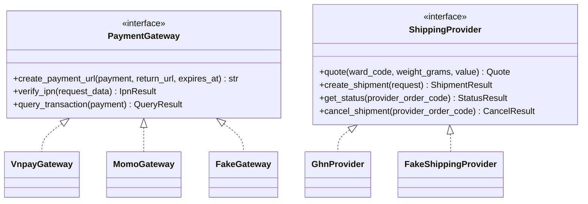

# 06. Tích hợp bên ngoài

> Trạng thái: **Bản nháp chờ review**. Quyết định nền tảng: [ADR 0005](../adr/0005-provider-adapters-fake-gateways.md).
> Không có SDK Python nào được duy trì cho VNPay, MoMo, GHN, nên ta tự viết adapter mỏng bằng `httpx`.

## 1. Mô hình adapter



Chọn adapter bằng cấu hình:

| Biến môi trường | Local (mặc định) | Nghiệm thu với sandbox | AWS |
|---|---|---|---|
| `PAYMENT_PROVIDER_VNPAY` | `fake` | `vnpay` (sandbox) | `vnpay` |
| `PAYMENT_PROVIDER_MOMO` | `fake` | `momo` (sandbox) | `momo` |
| `SHIPPING_PROVIDER` | `fake` hoặc `ghn` (sandbox, gọi ra được từ local) | `ghn` (sandbox) | `ghn` |
| `FAKE_PROVIDERS_ENABLED` | `true` | `false` | `false` (staging bật tạm khi test tải) |

`FAKE_PROVIDERS_ENABLED` quyết định có đăng ký trang Fake Gateway và lệnh giả lập GHN hay không. Cờ này bật ở local và trong `settings/test.py` (flow test gọi IPN qua Fake Gateway), không phụ thuộc vào việc đang dùng `settings.local`. Chọn adapter `fake` khi cờ tắt thì Django báo lỗi ngay lúc khởi động. Trên staging, cờ chỉ bật tạm trong lúc test tải bằng k6 ([12-testing-strategy.md](./12-testing-strategy.md) mục 9). `settings/production.py` từ chối khởi động nếu cờ bật khi `APP_ENV = production`.

Mọi adapter thật đều có: timeout (kết nối 3 giây, đọc 10 giây), retry có giới hạn cho lỗi mạng (không retry thao tác tạo giao dịch nếu không chắc là idempotent), log có `request_id`, và che dữ liệu nhạy cảm.

## 2. VNPay

| Việc | Cách làm |
|---|---|
| Tạo thanh toán | Dựng URL có các tham số `vnp_*`, ký **HMAC-SHA512** bằng `vnp_HashSecret`; `vnp_TxnRef` = `payments_payment.provider_txn_ref` (mỗi lần thử sinh mã mới); `vnp_Amount` = số tiền × 100 theo đặc tả VNPay |
| Hết hạn | `vnp_ExpireDate` = `payments_payment.expires_at` do `ordering` truyền vào: lúc đặt đơn + `PAYMENT_LINK_TTL` (phút thứ 10), giống nhau cho mọi lần thử. Link hết hạn sớm hơn Giữ hàng (phút thứ 15) 5 phút, để IPN đến muộn và một vòng Đối soát vẫn kịp trước khi Giữ hàng hết hạn |
| IPN | `GET /api/v1/webhooks/vnpay/ipn`: kiểm tra chữ ký → tìm Payment → so số tiền → chống trùng → cập nhật → trả `RspCode` theo đặc tả (`00` thành công, `01` không tìm thấy, `02` đã xử lý, `04` sai số tiền, `97` sai chữ ký). Sai số tiền thì Payment `failed` và phát `payments.payment-failed` với `reason = amount_mismatch` và `amount_received` (`ordering` tự tạo Hoàn tiền cho số tiền đã nhận và gắn cờ `payment_amount_mismatch`, BR-PAY-04) |
| Đối soát | API truy vấn giao dịch (`querydr`) cho Payment `pending` quá 2 phút. Payment đã quá `expires_at` mà cổng báo chưa thanh toán thì chuyển `expired` |
| Hoàn tiền | MVP: Staff thao tác thủ công trên trang quản trị VNPay (BR-REF-03) |

## 3. MoMo

| Việc | Cách làm |
|---|---|
| Tạo thanh toán | Gọi API tạo giao dịch, ký **HMAC-SHA256** bằng `secretKey`, nhận `payUrl` |
| Hết hạn | Đặt hạn link theo cùng `expires_at` (phút thứ 10 kể từ khi đặt đơn) nếu API MoMo cho phép **[Cần xác minh tham số hạn link của MoMo]**. Nếu không, Đối soát chuyển Payment sang `expired` khi quá `expires_at`; tiền về muộn xử lý theo BR-PAY-05 |
| IPN | `POST /api/v1/webhooks/momo/ipn`: kiểm tra chữ ký, xử lý như VNPay, trả HTTP 204 |
| Đối soát | API truy vấn trạng thái giao dịch, cùng quy tắc `expired` như VNPay |
| Hoàn tiền | MVP: thủ công |

> Tham số chính xác, mã kết quả và định dạng chữ ký phải lấy theo **tài liệu chính thức mới nhất** của VNPay và MoMo khi bắt đầu code. Unit test kiểm tra chữ ký dùng dữ liệu mẫu từ chính tài liệu đó.

## 4. GHN

| Việc | Cách làm |
|---|---|
| Báo giá | API tính phí theo địa chỉ giao, cân nặng, kích thước mặc định, giá trị hàng. Timeout **3 giây**; lỗi hoặc quá thời gian thì trả Phí ship dự phòng (BR-SHP-02). `quote_fee` luôn trả phí GHN thật (hoặc Phí ship dự phòng); việc miễn phí ship theo ngưỡng do `ordering` áp khi tính tổng đơn |
| Cache báo giá | Cache trong Redis 10 phút theo `(ward_code, weight_bucket, value_bucket)` để giảm số lần gọi khi Người mua sửa giỏ. Hệ thống khai giá trị hàng để GHN bồi thường đúng khi mất hàng, mà giá trị hàng ảnh hưởng phí bảo hiểm, nên phải có trong khoá cache. `value_bucket` làm tròn lên bội số 500.000đ và chính giá trị đã làm tròn này được gửi khi báo giá. Checkout dùng cache này và gọi GHN **trước** khi mở transaction |
| Tạo vận đơn | Chạy nền. Khi Staff bàn giao (T10), `ordering` gọi `shipping.contracts.request_shipment`: tạo Vận đơn `requested` rồi đẩy task lên queue `integrations` sau khi transaction commit. Task gửi GHN thông tin người nhận, các Biến thể, `cod_amount` (đơn COD), và gửi `reference` làm mã đơn phía cửa hàng để GHN không tạo trùng khi task bị đẩy lại **[Cần xác minh GHN có chặn trùng mã đơn phía cửa hàng không]**. Thành công: Vận đơn `created`, phát `shipping.shipment-created`. Lỗi sau khi hết retry: Vận đơn `failed`, phát `shipping.shipment-creation-failed`. Staff bàn giao lại thì `request_shipment` dùng lại chính dòng Vận đơn đó (`failed` → `requested`) rồi đẩy lại task, nên `reference` vẫn `UNIQUE` |
| Huỷ vận đơn | Dùng khi Vận đơn được tạo xong cho một đơn đã bị huỷ (cờ `shipment_after_cancel`). `ordering` gọi `shipping.contracts.request_shipment_cancellation`: ghi Vận đơn `cancel_requested` rồi đẩy task lên queue `integrations` sau khi transaction commit. Task gọi `cancel_shipment` của adapter (API huỷ đơn của GHN). Thành công: Vận đơn `cancelled`. Lỗi sau khi hết retry: giữ `cancel_requested`, báo Sentry; Staff xử lý tay theo Cờ cần xử lý đã gắn **[Cần xác minh API huỷ của GHN và trạng thái nào còn huỷ được]** |
| Webhook | `POST /api/v1/webhooks/ghn`: lưu `shipping_shipment_event`, đổi trạng thái GHN sang trạng thái nội bộ, phát sự kiện |
| Đối soát | Mỗi 15 phút truy vấn các Vận đơn chưa ở trạng thái cuối. Vận đơn kẹt ở `requested` hoặc `cancel_requested` quá 15 phút thì đẩy lại task, vì task đẩy sau commit có thể mất nếu process dừng ngay sau commit |

### 4.1. Ánh xạ trạng thái GHN

| Nhóm trạng thái GHN (ví dụ) | Trạng thái `shipping_shipment` | Sự kiện phát ra |
|---|---|---|
| (nội bộ: đã nhận yêu cầu, task chưa gọi GHN xong) | `requested` | — |
| (nội bộ: GHN tạo vận đơn thành công) | `created` | `ShipmentCreatedV1` |
| (nội bộ: tạo vận đơn lỗi sau khi hết retry) | `failed` | `ShipmentCreationFailedV1` |
| (nội bộ: đã nhận yêu cầu huỷ, task chưa gọi GHN xong) | `cancel_requested` | — |
| `ready_to_pick`, `picking` | `picking` | — |
| `delivering`, `transporting` | `in_transit` | — |
| `delivered` | `delivered` | `ShipmentDeliveredV1` |
| `return`, `returning` | `returning` | — |
| `returned` | `returned` | `ShipmentReturnedV1` |
| `cancel`, khi Vận đơn đang `cancel_requested` | `cancelled` | — |
| `cancel` mà hệ thống không yêu cầu, `lost`, `damage`, `exception` | `exception` | `ShipmentExceptionV1` (`provider_status` giữ mã gốc của GHN); `ordering` gắn cờ `shipment_exception`, Staff xử lý theo [05](../business/05-order-lifecycle.md) mục 4.7 |

Danh sách mã trạng thái đầy đủ lấy theo tài liệu GHN khi code.

### 4.2. ⚠️ Rủi ro mở: địa chỉ 2 cấp và 3 cấp

Hệ thống dùng địa chỉ **2 cấp** (tỉnh/thành → phường/xã) theo đợt sắp xếp hành chính 07/2025. **Chưa xác minh** được API của GHN đã chuyển sang 2 cấp hay vẫn cần `district_id`. Cách xử lý:

- Bảng `shipping_ghn_location_mapping` ánh xạ `ward_code` của hệ thống sang ID của GHN.
- Dữ liệu ánh xạ được nạp bằng một management command từ API danh mục địa chỉ của GHN.
- Phường/xã chưa có ánh xạ: dùng Phí ship dự phòng và gắn Cờ cần xử lý `ghn_ward_unmapped`. Admin chọn ID tỉnh, quận, phường của GHN cho phường/xã đó trên back-office (`settings/ghn-locations`, US-1004), rồi Staff bàn giao như bình thường và gỡ cờ. Màn này có thể bỏ nếu kiểm tra cho thấy GHN đã dùng địa chỉ 2 cấp.
- **Việc cần làm đầu tiên khi bắt đầu tích hợp GHN**: kiểm tra tài liệu GHN hiện hành và cập nhật mục này.

## 5. Google OAuth

- Frontend (NextAuth) lấy `id_token` từ Google rồi server Next.js gửi sang `POST /api/v1/store/auth/google`.
- Django xác minh bằng `google.oauth2.id_token.verify_oauth2_token` (xem [05-auth-security.md](./05-auth-security.md)).
- Liên kết Tài khoản theo email đã xác minh (US-502). Nếu Tài khoản khớp chưa xác thực email thì xoá mật khẩu cũ, tăng `token_version` và thu hồi mọi refresh token ([05-auth-security.md](./05-auth-security.md) mục 3), để chặn việc kẻ gian đăng ký trước bằng email của nạn nhân.
- Ở local dùng redirect URI `http://localhost:3000/…`; Google cho phép `localhost`.

## 6. Email

| Môi trường | Backend gửi | Ghi chú |
|---|---|---|
| Local | SMTP tới **Mailpit** (`localhost:1025`, giao diện xem mail `http://localhost:8025`) | Không email nào ra ngoài |
| Test | `locmem` | Kiểm tra nội dung email trong test |
| AWS | **Amazon SES** | Cần xác minh domain (SPF, DKIM, DMARC) và xin thoát sandbox SES |

## 7. Fake Gateway (local và test)

Chỉ có khi `FAKE_PROVIDERS_ENABLED = true` (mục 1).

```
1. Client gọi POST /store/orders/{code}/payments {gateway: "vnpay"}
2. FakeGateway trả redirect_url = http://localhost:8000/dev/fake-gateway/{provider_txn_ref}
3. Trang giả lập hiện: số tiền, mã đơn, các nút
     [Thanh toán thành công] [Thất bại] [Thành công nhưng sai số tiền] [Không gửi IPN]
4. Bấm nút → Fake gọi nội bộ vào đúng luồng xử lý IPN (có chữ ký giả hợp lệ)
5. Chuyển về return_url như cổng thật
```

Nút "Không gửi IPN" dùng để thử job Đối soát: `FakeGateway.query_transaction` trả về kết quả đã chọn.

`FakeShippingProvider` tương tự: báo giá cố định theo cân nặng, tạo và huỷ Vận đơn luôn thành công, có lệnh `manage.py fake_shipment_status <code> delivered` để giả lập GHN báo trạng thái.

## 8. Nghiệm thu với sandbox thật (trước khi lên AWS)

Dùng **Cloudflare Tunnel** để VNPay, MoMo, GHN gọi được vào máy local:

1. `cloudflared tunnel --url http://localhost:8000` (hoặc tunnel có tên miền cố định).
2. Khai báo URL IPN và webhook với sandbox của VNPay, MoMo, GHN.
3. Đổi adapter sang bản thật (mục 1).
4. Chạy kịch bản nghiệm thu: thanh toán thành công, thất bại, link hết hạn sau 10 phút, IPN đến muộn, trả tiền hai lần cho cùng một đơn, tạo Vận đơn, huỷ Vận đơn, giao thành công, Hoàn hàng.
5. Ghi kết quả vào biên bản nghiệm thu.
