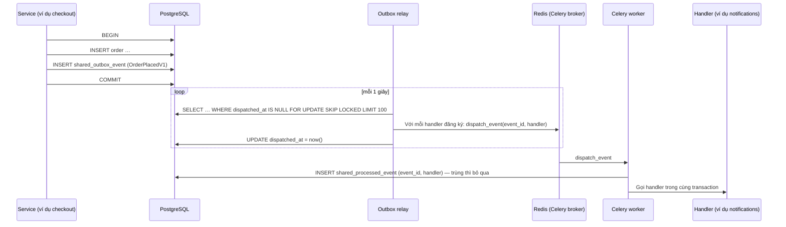

# 07. Sự kiện và job chạy nền

> Trạng thái: **Bản nháp chờ review**. Quyết định nền tảng: [ADR 0007](../adr/0007-events-outbox-celery-no-kafka.md), [ADR 0003](../adr/0003-postgres-redis-celery.md).

## 1. Luồng sự kiện (Transactional Outbox)

### 1.1. Bảo đảm

| Bảo đảm | Có được nhờ |
|---|---|
| Không mất sự kiện | Sự kiện ghi cùng transaction với dữ liệu nghiệp vụ |
| Không xử lý trùng | `shared_processed_event` ghi cùng transaction với tác động của handler |
| Một handler lỗi không ảnh hưởng handler khác | Mỗi cặp (sự kiện, handler) là một Celery task riêng |
| Có thể phát lại | Bảng outbox giữ sự kiện **90 ngày** **[Giả định]**; lệnh `manage.py replay_events --type … --since …` |

### 1.2. Không bảo đảm

**Thứ tự.** Handler phải tự kiểm tra trạng thái hiện tại, và máy trạng thái của Đơn hàng từ chối mọi chuyển trạng thái không hợp lệ ([05-order-lifecycle.md](../business/05-order-lifecycle.md) mục 4.2).

### 1.3. Retry và lỗi

- Handler lỗi: Celery retry tối đa **5 lần**, giãn cách tăng dần (10 giây → khoảng 30 phút).
- Hết số lần retry: ghi trạng thái lỗi, gửi cảnh báo Sentry. Staff kỹ thuật chạy lại bằng `manage.py retry_failed_events`.
- Relay lỗi kết nối Redis: sự kiện vẫn nằm trong outbox, relay tự thử lại.

## 2. Danh mục sự kiện

Tên theo dạng `<module>.<event>`, có `schema_version`. Class nằm trong `events.py` của module phát.

| Sự kiện | Phát bởi | Dữ liệu chính | Handler |
|---|---|---|---|
| `identity.customer-registered` v1 | identity | `user_id`, `language` | notifications: email xác thực |
| `identity.password-reset-requested` v1 | identity | `user_id`, `reset_url` | notifications: email đặt lại mật khẩu |
| `identity.customer-erased` v1 | identity | `user_id` hoặc `phone` | ordering: ẩn danh đơn hàng, xoá giỏ |
| `ordering.order-placed` v1 | ordering | `order_code`, `payment_method`, `total` | notifications: email "Đặt đơn thành công" |
| `ordering.order-paid` v1 | ordering | `order_code` | notifications: email "Thanh toán thành công" |
| `ordering.order-cancelled` v1 | ordering | `order_code`, `reason`, `refund_required` | notifications: email "Đơn đã huỷ" |
| `ordering.order-shipped` v1 | ordering | `order_code`, `tracking_code` | notifications: email "Đang giao" |
| `ordering.order-delivered` v1 | ordering | `order_code` | notifications: email "Đã giao" |
| `payments.payment-succeeded` v1 | payments | `reference`, `amount`, `method` | ordering: T3, hoặc tạo Hoàn tiền nếu đơn đã huỷ (BR-PAY-05) |
| `payments.payment-failed` v1 | payments | `reference`, `reason` | ordering: ghi nhận, cho phép thử lại |
| `payments.refund-recorded` v1 | payments | `reference`, `amount` | notifications: email "Đã hoàn tiền" |
| `shipping.shipment-delivered` v1 | shipping | `reference`, `delivered_at` | ordering: T11 |
| `shipping.shipment-returned` v1 | shipping | `reference` | ordering: T12 |

## 3. Celery

### 3.1. Queue

| Queue | Dùng cho | Worker |
|---|---|---|
| `default` | Job theo lịch | Chung |
| `events` | `dispatch_event` | Chung |
| `emails` | Gửi email | Chung; tách riêng khi tải lớn |
| `integrations` | Gọi API VNPay, MoMo, GHN (đối soát, tạo vận đơn) | Chung; giới hạn số chạy đồng thời để không vượt rate limit của nhà cung cấp |

### 3.2. Lịch job (Celery Beat, lưu bằng `django-celery-beat`)

| Job | Tần suất | Module | Liên quan |
|---|---|---|---|
| `ordering.cancel_expired_pending_orders` | Mỗi phút | ordering | T4 |
| `payments.reconcile_pending_payments` | Mỗi 5 phút | payments | T3, ADR 0005 |
| `shipping.reconcile_shipments` | Mỗi 15 phút | shipping | T11, T12 |
| `ordering.complete_delivered_orders` | Mỗi giờ | ordering | T13 |
| `ordering.purge_expired_guest_carts` | Mỗi ngày 03:00 | ordering | BR-CRT-02 |
| `shared.purge_old_outbox_events` | Mỗi ngày 03:30 | shared | Giữ 90 ngày |
| `identity.purge_expired_tokens` | Mỗi ngày 04:00 | identity | Refresh token, reset token hết hạn |

Mọi job đều **idempotent** và xử lý theo lô (ví dụ 200 đơn mỗi lần) để chạy lại an toàn.

### 3.3. Cấu hình quan trọng

| Thiết lập | Giá trị | Lý do |
|---|---|---|
| `task_acks_late` | `True` | Worker chết giữa chừng thì task được giao lại |
| `task_reject_on_worker_lost` | `True` | Như trên |
| `worker_prefetch_multiplier` | `1` | Không giữ nhiều task trong một worker |
| `task_time_limit` | 120 giây | Chặn task treo |
| `CELERY_TASK_ALWAYS_EAGER` | `True` chỉ trong `settings/test.py` | Test chạy đồng bộ |
| Kết quả task | Không lưu (`task_ignore_result = True`) | Không cần result backend |
