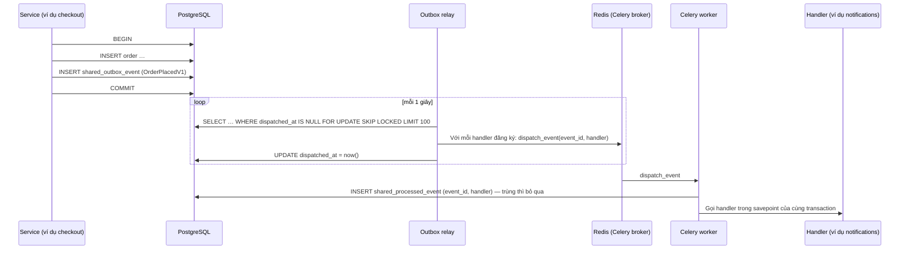

# 07. Sự kiện và job chạy nền

> Trạng thái: **Bản nháp chờ review**. Quyết định nền tảng: [ADR 0007](../adr/0007-events-outbox-celery-no-kafka.md), [ADR 0003](../adr/0003-postgres-redis-celery.md).

## 1. Luồng sự kiện (Transactional Outbox)

### 1.1. Bảo đảm

| Bảo đảm | Có được nhờ |
|---|---|
| Không mất sự kiện | Sự kiện ghi cùng transaction với dữ liệu nghiệp vụ |
| Không xử lý trùng | `shared_processed_event` ghi cùng transaction với tác động của handler |
| Một handler lỗi không ảnh hưởng handler khác | Mỗi cặp (sự kiện, handler) là một Celery task riêng |
| Có thể phát lại | Bảng outbox giữ sự kiện **90 ngày** **[Giả định]**; lệnh `manage.py replay_events --type … --since …` |

Thêm handler mới cho một loại sự kiện đã có: sau deploy chạy `replay_events --type <sự kiện> --since <lúc bắt đầu deploy>`. Lý do: trong lúc deploy, relay bản cũ có thể đã gửi sự kiện mà không biết handler mới. Handler cũ không bị chạy lại nhờ `shared_processed_event`.

### 1.2. Không bảo đảm

**Thứ tự.** Handler không tự kiểm tra thứ tự. Với Đơn hàng, các transition do sự kiện kích hoạt tự đối chiếu trạng thái hiện tại ([02-backend-structure.md](./02-backend-structure.md) mục 7.7, [05-order-lifecycle.md](../business/05-order-lifecycle.md) mục 4.2): sự kiện cho bước đơn đã qua thì không làm gì, sự kiện tới sớm thì báo consumer thử lại sau, sự kiện mâu thuẫn với trạng thái đơn thì bị từ chối.

### 1.3. Retry và lỗi

Handler báo kết quả cho consumer bằng cách kết thúc bình thường hoặc ném exception. Consumer quyết định theo bảng sau, nên tác giả handler không phải tự bắt lỗi:

| Handler kết thúc bằng | Consumer làm gì |
|---|---|
| Chạy xong | Commit tác động của handler cùng dòng `shared_processed_event` |
| `RetryLater`, ví dụ `TransitionNotYetValid` (sự kiện tới trước một sự kiện khác mà nó phụ thuộc) | Rollback, retry theo lịch bên dưới |
| `DomainError` khác, ví dụ `InvalidTransition` | Rollback savepoint của handler nhưng vẫn ghi `shared_processed_event`, không retry. Log `WARNING` `event_rejected` kèm `event_type`, `handler`, `code` |
| Exception khác | Rollback, retry theo lịch bên dưới |

- Lịch retry: Celery retry tối đa **5 lần**, giãn cách tăng dần (10 giây → khoảng 30 phút).
- Hết số lần retry: ghi một dòng vào `shared_failed_event` (`event_id`, `handler`, `error`, `failed_at`), gửi cảnh báo Sentry. Áp dụng cả cho `RetryLater`: chờ hết retry mà vẫn chưa áp dụng được nghĩa là sự kiện đứng trước đã mất hoặc đang lỗi. Staff kỹ thuật chạy lại bằng `manage.py retry_failed_events`: lệnh đọc bảng này, đẩy lại `dispatch_event` cho từng cặp và ghi `retried_at`.
- Relay lỗi kết nối Redis: sự kiện vẫn nằm trong outbox, relay tự thử lại.

## 2. Danh mục sự kiện

Tên theo dạng `<module>.<event>`, có `schema_version`. Class nằm trong `events.py` của module phát.

**Nâng version.** Thêm field tuỳ chọn thì giữ version. Đổi tên, bỏ field hoặc đổi nghĩa một field thì tạo class `V2`, và publisher chỉ phát V2. Handler giữ cả `@handles(..., version=1)` và `version=2` cho tới khi outbox không còn sự kiện V1 (sau 90 ngày), rồi mới bỏ handler V1.

**Payload không chứa secret hay PII.** Payload chỉ mang ID, Mã đơn, số tiền và mã trạng thái. Handler cần dữ liệu nhạy cảm thì hỏi `contracts` của module sở hữu ngay lúc xử lý, ví dụ `identity.contracts.issue_password_reset_link(account_id)`. Lý do: outbox giữ sự kiện 90 ngày, có thể bị phát lại, và nằm trong mọi bản backup; token hay số điện thoại để ở đây sẽ sống lâu hơn và lộ rộng hơn bản gốc.

| Sự kiện | Phát bởi | Dữ liệu chính | Handler |
|---|---|---|---|
| `identity.customer-registered` v1 | identity | `account_id`, `language` | notifications: gọi `identity.contracts.issue_email_verification_link` rồi gửi email xác thực |
| `identity.email-verified` v1 | identity | `account_id` | Phát mỗi khi email chuyển sang đã xác thực, kể cả qua đăng nhập Google. ordering: gắn các Đơn hàng có `contact_email` khớp (không phân biệt hoa thường) và `customer_id` null vào Tài khoản (BR-ORD-08) |
| `identity.password-reset-requested` v1 | identity | `account_id` | notifications: gọi `identity.contracts.issue_password_reset_link` rồi gửi email đặt lại mật khẩu |
| `identity.customer-erased` v1 | identity | `erasure_request_id` | ordering: ẩn danh Đơn hàng, xoá Giỏ hàng, gọi `shipping.contracts.redact_provider_payloads` và `payments.contracts.redact_provider_payloads` theo `reference`; promotions: ẩn danh `phone` trong lượt dùng Voucher; notifications: ẩn danh `to_address`. Mọi handler lấy đối tượng cần ẩn danh qua `identity.contracts.get_erasure_subject` |
| `ordering.order-placed` v1 | ordering | `order_code`, `payment_method`, `total` | Phát khi đơn **vào** `PLACED` (T2, T3). notifications: COD gửi "Đặt đơn thành công", online gửi "Thanh toán thành công" |
| `ordering.order-cancelled` v1 | ordering | `order_code`, `reason`, `refund_required`, `previous_status` | notifications: email "Đơn đã huỷ", trừ khi `previous_status = PENDING_PAYMENT` (T4, T5: BR-NTF-01) |
| `ordering.unexpected-payment-received` v1 | ordering | `order_code`, `amount` | Phát cùng lúc gắn cờ `unexpected_payment` (BR-PAY-05). notifications: email báo tiền sẽ được hoàn; với đơn đã huỷ thì báo thêm đơn đã hết hạn ([05](../business/05-order-lifecycle.md) mục 4.1) |
| `ordering.order-shipped` v1 | ordering | `order_code`, `tracking_code` | notifications: email "Đang giao" |
| `ordering.order-delivered` v1 | ordering | `order_code` | notifications: email "Đã giao" |
| `payments.payment-succeeded` v1 | payments | `reference`, `payment_id`, `amount`, `gateway` | Chỉ phát cho Thanh toán online. ordering: T3. Đơn còn `PENDING_PAYMENT` nhưng đã quá `expires_at` (job chưa kịp huỷ): chạy T4 trước rồi xử lý như đơn đã huỷ. Nếu đơn không còn ở `PENDING_PAYMENT` (đã huỷ, hoặc đã được trả bởi lần khác): gọi `payments.contracts.request_refund`, gắn cờ `unexpected_payment` và phát `ordering.unexpected-payment-received` (BR-PAY-05) |
| `payments.payment-failed` v1 | payments | `reference`, `payment_id`, `reason`, `amount_received` | ordering: ghi nhận, cho phép thử lại; `reason = amount_mismatch` thì gọi `payments.contracts.request_refund` cho `amount_received` và gắn cờ `payment_amount_mismatch` (BR-PAY-04) |
| `payments.refund-recorded` v1 | payments | `reference`, `refund_id`, `amount` | notifications: email "Đã hoàn tiền"; ordering: chuyển Đổi trả có `refund_id` khớp sang `refunded`, không khớp thì bỏ qua |
| `shipping.shipment-created` v1 | shipping | `reference`, `provider_order_code` | ordering: T10, gọi `inventory.contracts.dispatch_stock` để xoá Hàng chờ xuất. Nếu đơn đã `CANCELLED`: gọi `shipping.contracts.request_shipment_cancellation` và gắn cờ `shipment_after_cancel` |
| `shipping.shipment-creation-failed` v1 | shipping | `reference`, `reason` | ordering: gắn cờ `shipment_failed`, đơn giữ `PACKING` |
| `shipping.shipment-delivered` v1 | shipping | `reference`, `delivered_at` | ordering: T11 |
| `shipping.shipment-returned` v1 | shipping | `reference` | ordering: T12 |
| `shipping.shipment-exception` v1 | shipping | `reference`, `provider_status` | ordering: gắn cờ `shipment_exception`, đơn giữ `SHIPPING` cho tới khi Staff xử lý (T14) |

T1 (đơn online vào `PENDING_PAYMENT`) không phát sự kiện nào; Người mua chỉ nhận email khi thanh toán thành công. Không còn sự kiện `ordering.order-paid`: `order-placed` của đơn online đã mang ý nghĩa này.

Thanh toán COD (`start_cod_payment`, `record_cod_collected`, `cancel_cod_payment`) **không** phát sự kiện, vì `ordering` là bên gọi nên đã biết kết quả. Nếu `record_cod_collected` phát `payments.payment-succeeded`, handler của `ordering` sẽ thấy đơn `DELIVERED` không ở `PENDING_PAYMENT` và tạo Hoàn tiền nhầm theo BR-PAY-05.

## 3. Celery

### 3.1. Queue

| Queue | Dùng cho | Worker |
|---|---|---|
| `default` | Job theo lịch | Chung |
| `events` | `dispatch_event` | Chung |
| `emails` | Gửi email | Chung; tách riêng khi tải lớn |
| `integrations` | Gọi API VNPay, MoMo, GHN: Đối soát, tạo và huỷ Vận đơn (tạo và huỷ Vận đơn luôn chạy nền, xem [06-integrations.md](./06-integrations.md) mục 4) | Chung; giới hạn tần suất bằng `rate_limit` của từng task để không vượt rate limit của nhà cung cấp (một worker nghe cả 4 queue nên không giới hạn được theo queue) |

Code nghiệp vụ đẩy task bằng `shared.tasks.enqueue_on_commit`, không gọi `.delay()` trực tiếp ([02-backend-structure.md](./02-backend-structure.md) mục 9.1).

### 3.2. Lịch job (Celery Beat, lưu bằng `django-celery-beat`)

| Job | Tần suất | Module | Liên quan |
|---|---|---|---|
| `ordering.cancel_expired_pending_orders` | Mỗi phút | ordering | T4 |
| `payments.reconcile_pending_payments` | Mỗi 5 phút | payments | T3, ADR 0005; Payment quá hạn link mà chưa thanh toán thì chuyển `expired` |
| `shipping.reconcile_shipments` | Mỗi 15 phút | shipping | T11, T12; đẩy lại task cho Vận đơn kẹt ở `requested` hoặc `cancel_requested` quá 15 phút |
| `ordering.complete_delivered_orders` | Mỗi giờ | ordering | T13 |
| `ordering.compute_best_sellers` | Mỗi ngày 02:00 | ordering | BR-CAT-12; ghi kết quả vào `catalog` qua `catalog.contracts.set_best_seller_counts` |
| `ordering.purge_expired_guest_carts` | Mỗi ngày 03:00 | ordering | BR-CRT-02 |
| `shared.purge_old_outbox_events` | Mỗi ngày 03:30 | shared | Giữ 90 ngày; xoá cả `shared_processed_event` cùng tuổi |
| `shared.purge_idempotency_keys` | Mỗi ngày 03:45 | shared | Xoá `Idempotency-Key` quá 24 giờ |
| `identity.purge_expired_tokens` | Mỗi ngày 04:00 | identity | Refresh token, reset token hết hạn |

Mọi job đều **idempotent** và xử lý theo lô (ví dụ 200 đơn mỗi lần) để chạy lại an toàn.

Job Đối soát (`reconcile_pending_payments`, `reconcile_shipments`) chỉ quét rồi đẩy mỗi Thanh toán hoặc Vận đơn một task con lên queue `integrations`, không tự gọi nhà cung cấp trong task của job. Một lô 200 lần gọi, mỗi lần tới 13 giây (06 mục 1), sẽ vượt `task_time_limit` 120 giây.

### 3.3. Cấu hình quan trọng

| Thiết lập | Giá trị | Lý do |
|---|---|---|
| `task_acks_late` | `True` | Worker chết giữa chừng thì task được giao lại |
| `task_reject_on_worker_lost` | `True` | Như trên |
| `worker_prefetch_multiplier` | `1` | Không giữ nhiều task trong một worker |
| `task_time_limit` | 120 giây | Chặn task treo |
| `CELERY_TASK_ALWAYS_EAGER` | `True` chỉ trong `settings/test.py` | Test chạy đồng bộ |
| Kết quả task | Không lưu (`task_ignore_result = True`) | Không cần result backend |
| Redis `maxmemory-policy` | `noeviction` | Redis vừa là broker vừa là cache; nếu Redis tự đẩy key ra khi đầy thì có thể mất task. Vì vậy mọi key cache phải có TTL |
