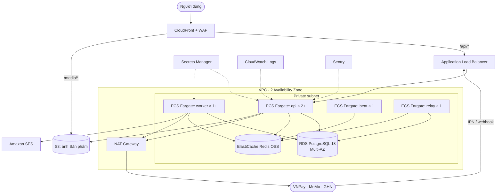

# 09. Kiến trúc triển khai trên AWS (mục tiêu)

> Trạng thái: **Target – chưa triển khai**. Tài liệu này mô tả kiến trúc đích để định hướng; sẽ được chi tiết hoá sau khi hệ thống chạy ổn ở local và nghiệm thu xong với sandbox.
> Region: **ap-southeast-1 (Singapore)**. Lưu ý yêu cầu hồ sơ chuyển dữ liệu ra nước ngoài (CMP-08 trong [06-compliance.md](../business/06-compliance.md)).

## 1. Sơ đồ

## 2. Thành phần

| Thành phần | Dịch vụ AWS | Ghi chú |
|---|---|---|
| API, worker, beat, relay | **ECS Fargate**, cùng một image trên ECR, khác lệnh chạy | API scale theo CPU; beat và relay luôn đúng 1 task |
| Database | **RDS for PostgreSQL 18**, Multi-AZ | Backup tự động 7 ngày, PITR; bật `unaccent`, `pg_trgm`, `btree_gist` **[Cần xác minh RDS đã hỗ trợ bản 18]** |
| Redis | **ElastiCache for Redis OSS** | Dùng Redis 7.2 ở local để khớp **[Cần xác minh phiên bản ElastiCache hiện có]**. Có thể đổi sang ElastiCache Valkey mà không phải sửa code |
| Ảnh | **S3** + **CloudFront** | `django-storages` S3; ảnh public qua CloudFront |
| Email | **Amazon SES** | Xác minh domain, SPF/DKIM/DMARC |
| Bí mật | **Secrets Manager** | Khoá JWT, mật khẩu DB, secret VNPay/MoMo/GHN |
| Log | **CloudWatch Logs** (log JSON từ structlog) | Giữ 30 ngày **[Giả định]** |
| Lỗi, hiệu năng | **Sentry** | |
| Bảo vệ | **WAF** trên CloudFront | Chặn bot, rate limit thô; webhook đi qua allow-list IP nếu nhà cung cấp công bố |
| IP ra ngoài cố định | **NAT Gateway** có Elastic IP | Một số cổng thanh toán yêu cầu khai báo IP server **[Cần xác minh]** |

## 3. Môi trường

| Môi trường | Mục đích | Adapter |
|---|---|---|
| `staging` | Nghiệm thu, dùng sandbox VNPay/MoMo/GHN | Sandbox |
| `production` | Chạy thật | Thật |

## 4. Triển khai

1. CI chạy `make lint` + `make test`.
2. Build image, đẩy lên ECR.
3. Chạy migration bằng một ECS task chạy một lần (`manage.py migrate`) **trước** khi cập nhật service.
4. Cập nhật lần lượt các ECS service (rolling update).
5. Migration phải **tương thích ngược** với code đang chạy (thêm cột trước, xoá cột ở bản phát hành sau).

Công cụ hạ tầng (Terraform hoặc AWS CDK) sẽ chọn khi bắt đầu giai đoạn này.

## 5. Chi phí ước tính

Sẽ tính chi tiết khi bắt đầu giai đoạn AWS. Thành phần đáng kể nhất dự kiến là RDS Multi-AZ, NAT Gateway và ECS Fargate. Không có Kafka/MSK ([ADR 0007](../adr/0007-events-outbox-celery-no-kafka.md)).
