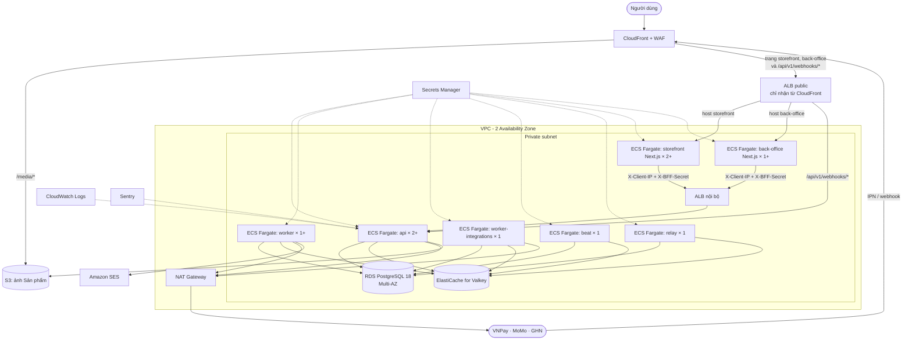

# 09. Kiến trúc triển khai trên AWS (mục tiêu)

> Trạng thái: **Đã duyệt cho MVP** làm kiến trúc đích, **chưa triển khai**. Tài liệu này mô tả kiến trúc đích để định hướng; sẽ được chi tiết hoá sau khi hệ thống chạy ổn ở local và nghiệm thu xong với sandbox.
> Region: **ap-southeast-1 (Singapore)**. Lưu ý yêu cầu hồ sơ chuyển dữ liệu ra nước ngoài (CMP-08 trong [06-compliance.md](../business/06-compliance.md)).
> Quyết định nền tảng: [ADR 0009](../adr/0009-nextjs-bff-django-private.md) (Next.js là BFF, chạy cùng VPC; Django chỉ public webhook).

## 1. Sơ đồ

Mọi task (api, worker, worker-integrations, beat, relay, Next.js) đều gửi log về CloudWatch và lỗi về Sentry; sơ đồ chỉ vẽ cho `api` cho gọn.

Từ internet chỉ vào được Django qua đúng một đường: `/api/v1/webhooks/*`. Mọi API còn lại (`/api/v1/store/`, `/api/v1/backoffice/`) chỉ nhận request từ Next.js qua ALB nội bộ.

## 2. Thành phần

| Thành phần | Dịch vụ AWS | Ghi chú |
|---|---|---|
| Storefront, back-office | **ECS Fargate**, image Next.js build từ repo frontend | Là BFF cho mọi request tới Django ([ADR 0009](../adr/0009-nextjs-bff-django-private.md)). Gửi IP thật của người dùng trong `X-Client-IP` kèm `X-BFF-Secret` |
| API, worker, worker-integrations, beat, relay | **ECS Fargate**, cùng một image Django trên ECR, khác lệnh chạy | API scale theo CPU. `worker` nghe queue `default`, `events`, `emails` và scale theo độ dài queue. `worker-integrations` chỉ nghe queue `integrations` và luôn đúng 1 task, để `rate_limit` là giới hạn chung ([07](./07-async-events-jobs.md) mục 3.1). Beat luôn đúng 1 task; relay chạy 1 task, lúc deploy có thể chồng 2 (mục 4) |
| Load balancer | **ALB public** sau CloudFront; **ALB nội bộ** cho Next.js gọi Django | ALB public chỉ nhận từ dải IP của CloudFront (security group dùng managed prefix list), chia theo host (storefront, back-office) và path (`/api/v1/webhooks/*` → api). ALB nội bộ không có địa chỉ public, dùng HTTP và security group chỉ nhận từ task Next.js ([10-nfr.md](./10-nfr.md) mục 3) |
| Database | **RDS for PostgreSQL 18**, Multi-AZ | Backup tự động 7 ngày, PITR; bật `unaccent`, `pg_trgm`, `btree_gist` **[Cần xác minh RDS đã hỗ trợ bản 18]**. Celery Beat đọc lịch job từ đây (`DatabaseScheduler`) |
| Redis | **ElastiCache for Valkey** | Broker Celery, cache, throttle, cache `token_version`. `maxmemory-policy noeviction`, mọi key cache có TTL. `Idempotency-Key` **không** nằm ở Redis mà ở PostgreSQL. Chọn Valkey thay vì Redis OSS vì ElastiCache for Redis OSS dừng ở 7.1, bản mới chỉ có ở Valkey, và giá rẻ hơn. Ghim **Valkey 8.x** (ElastiCache hỗ trợ 7.2 tới 9.1): Celery, cache và throttle không cần tính năng của bản 9, còn bản 8 đã chạy ổn định lâu hơn. Local chạy image `valkey/valkey:8` |
| Ảnh | **S3** + **CloudFront** | `django-storages` S3; ảnh public qua CloudFront `/media/*` |
| Email | **Amazon SES** | Xác minh domain, SPF/DKIM/DMARC |
| Bí mật | **Secrets Manager** | Khoá JWT, khoá mã hoá RefreshReplay riêng (32 byte + key ID), mật khẩu DB, secret VNPay/MoMo/GHN, `BFF_SHARED_SECRET`. Mỗi task (api, worker, worker-integrations, beat, relay, storefront, back-office) chỉ nhận secret nó cần |
| Log | **CloudWatch Logs** (log JSON từ structlog) | Thời hạn giữ theo [06-compliance.md](../business/06-compliance.md) mục 5 |
| Lỗi, hiệu năng | **Sentry** | Bật data scrubbing; Cron Monitors giám sát relay và job theo lịch ([07](./07-async-events-jobs.md) mục 3.4) |
| Bảo vệ | **WAF** trên CloudFront | Chặn bot, rate limit thô. Host back-office chỉ cho phép IP văn phòng hoặc VPN ([ADR 0004](../adr/0004-custom-nextjs-admin.md)). Webhook đi qua allow-list IP nếu nhà cung cấp công bố |
| IP ra ngoài cố định | **NAT Gateway** có Elastic IP | Một số cổng thanh toán yêu cầu khai báo IP server **[Cần xác minh]** |

STOREFRONT_ORIGIN production là origin HTTPS cấu hình cố định của storefront, không lấy từ request. Khoá RefreshReplay được cấp qua Secrets Manager; khi xoay giữ key cũ qua cửa sổ 10 giây và thời gian rolling deploy, mọi replica đọc cùng key ring. JWT signing key không dùng làm key mã hoá replay.

## 3. Môi trường

| Môi trường | Mục đích | Adapter |
|---|---|---|
| `staging` | Nghiệm thu, dùng sandbox VNPay/MoMo/GHN; có đủ storefront và back-office Next.js | Sandbox; Fake chỉ bật tạm khi test tải ([06](./06-integrations.md) mục 1) |
| `production` | Chạy thật | Thật |

## 4. Triển khai

1. CI chạy `make lint` + `make test`.
2. Build image, đẩy lên ECR.
3. Chạy migration bằng một ECS task chạy một lần (`manage.py migrate` rồi `manage.py sync_beat_schedule`, [07](./07-async-events-jobs.md) mục 3.2) **trước** khi cập nhật service.
4. Cập nhật lần lượt các ECS service (rolling update).
5. Nếu bản phát hành thêm handler cho một loại sự kiện đã có: sau khi mọi service đã cập nhật, chạy `manage.py replay_events --type <sự kiện> --since <lúc bắt đầu deploy>`, vì trong lúc deploy relay bản cũ có thể đã lập danh sách delivery mà không biết handler mới ([07](./07-async-events-jobs.md) mục 1.1.1). PR release ghi rõ lệnh cần chạy.
6. Migration phải **tương thích ngược** với code đang chạy (thêm cột trước, xoá cột ở bản phát hành sau).

Service `beat` và `worker-integrations` dùng cấu hình deploy `minimumHealthyPercent = 0`, `maximumPercent = 100`: task cũ dừng hẳn rồi task mới mới chạy, nên không lúc nào có hai bản cùng chạy: beat chạy trùng sẽ đẩy job hai lần, còn hai `worker-integrations` cùng chạy sẽ gấp đôi tần suất gọi nhà cung cấp. Đổi lại, hai service này ngừng vài chục giây mỗi lần deploy; việc này chấp nhận được vì job theo lịch, Đối soát và tạo Vận đơn chỉ bị trễ, không mất (task nằm chờ trong queue).

Service `relay` dùng rolling update mặc định (`minimumHealthyPercent = 100`, `maximumPercent = 200`): task mới chạy xong rồi task cũ mới dừng, nên relay không ngừng khi deploy. Trong lúc chuyển giao có hai bản relay cùng chạy, và việc này an toàn vì mỗi bản chỉ lấy các dòng outbox chưa bị bản khác khoá (`FOR UPDATE SKIP LOCKED`, xem [07](./07-async-events-jobs.md) mục 1).

Next.js deploy từ repo frontend, độc lập với Django. Thay `BFF_SHARED_SECRET` thì cập nhật Django trước để chấp nhận cả secret cũ lẫn mới, rồi mới cập nhật Next.js.

Công cụ hạ tầng (Terraform hoặc AWS CDK) sẽ chọn khi bắt đầu giai đoạn này.

## 5. Chi phí ước tính

Sẽ tính chi tiết khi bắt đầu giai đoạn AWS. Thành phần đáng kể nhất dự kiến là RDS Multi-AZ, NAT Gateway và ECS Fargate (gồm cả các task Next.js). Không có Kafka/MSK ([ADR 0007](../adr/0007-events-outbox-celery-no-kafka.md)).
