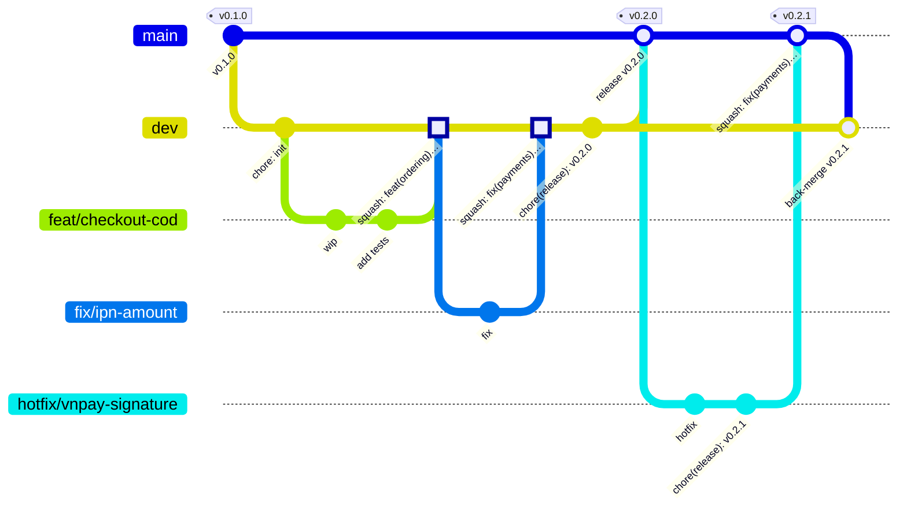

# 11. Quy ước Git

> Trạng thái: **Đang áp dụng**. `main`, `dev`, ruleset của `main`, `.gitignore`, `.gitattributes`, `.editorconfig`, PR template, `CONTRIBUTING.md` và cấu hình IDE dùng chung đã có trong repo.
> Ngôn ngữ: tên nhánh, commit message, tiêu đề PR viết **tiếng Anh**; mô tả PR có thể viết tiếng Việt.

## 1. Mô hình nhánh



> Trong sơ đồ, các merge có nhãn "squash" được vẽ như merge thường vì Mermaid không vẽ được squash. Trên thực tế, squash tạo **một commit mới** trên nhánh đích và không nối với nhánh nguồn.

| Nhánh | Vai trò | Tách từ | Merge vào | Triển khai tới |
|---|---|---|---|---|
| `main` | Code đang chạy production. Mỗi release có một tag | — | — | production |
| `dev` | Nơi gom các tính năng đã xong, chuẩn bị release | `main` (tạo một lần) | `main` | staging |
| `feat/*`, `fix/*`, `refactor/*`, `docs/*`, `chore/*`, `test/*` | Một tính năng, một lỗi hoặc một việc | `dev` | `dev` | — |
| `hotfix/*` | Sửa lỗi gấp trên production | `main` | `main`, sau đó back-merge về `dev` | production |

## 2. Đặt tên nhánh

```
<loại>/<mô-tả-ngắn>
```

- `<loại>`: `feat`, `fix`, `refactor`, `docs`, `chore`, `test`, `hotfix`.
- Tên nhánh không chứa mã ticket. Ticket là file trong `.scratch/` (xem [docs/agents/issue-tracker.md](../agents/issue-tracker.md)); đường dẫn ticket ghi trong mô tả PR và footer `Refs:` của commit.
- `<mô-tả-ngắn>`: tiếng Anh, chữ thường, nối bằng dấu `-`, tối đa khoảng 5 từ.

| ✅ Đúng | ❌ Sai |
|---|---|
| `feat/checkout-cod` | `feature/Checkout_COD` |
| `fix/ipn-amount-mismatch` | `fix-bug` |
| `docs/adr-0008-search` | `thanh/test` |
| `hotfix/vnpay-signature` | `hotfix` |

## 3. Commit message: Conventional Commits

```
<type>(<scope>)<!>: <mô tả ngắn, tiếng Anh, thì hiện tại, không viết hoa chữ đầu, không dấu chấm cuối>

[thân: giải thích VÌ SAO, có thể nhiều dòng]

[footer: BREAKING CHANGE: …, Refs: .scratch/checkout-cod/issues/02-reserve-stock.md]
```

### 3.1. `type`

| `type` | Khi nào | Ảnh hưởng phiên bản |
|---|---|---|
| `feat` | Thêm tính năng | Tăng MINOR |
| `fix` | Sửa lỗi | Tăng PATCH |
| `perf` | Cải thiện hiệu năng | Tăng PATCH |
| `refactor` | Sửa code, không đổi hành vi | — |
| `test` | Thêm hoặc sửa test | — |
| `docs` | Tài liệu, ADR, GLOSSARY | — |
| `build` | Dependency, Dockerfile, `pyproject.toml` | — |
| `ci` | Cấu hình CI | — |
| `chore` | Việc lặt vặt khác | — |
| `revert` | Hoàn tác một commit | Tuỳ commit bị hoàn tác |

Thay đổi làm gãy API hoặc contract sự kiện: thêm `!` sau scope **và** dòng `BREAKING CHANGE:` trong footer.

### 3.2. `scope`

Tên module hoặc khu vực: `identity`, `catalog`, `inventory`, `promotions`, `payments`, `shipping`, `ordering`, `notifications`, `shared`, `config`, `adr`, `glossary`, `ci`, `deps`. Không bắt buộc nhưng **nên có**.

### 3.3. Ví dụ

```
feat(ordering): add COD checkout with immediate stock decrement

fix(payments): reject VNPay IPN when amount mismatches

Previously the IPN handler trusted vnp_Amount. Now it compares against
payments_payment.amount and responds RspCode 04 (BR-PAY-04).

Refs: .scratch/vnpay-ipn/issues/01-check-amount.md

feat(ordering)!: split checkout and payment start into two endpoints

BREAKING CHANGE: POST /store/checkout no longer returns redirect_url;
call POST /store/orders/{code}/payments instead.

docs(adr): add 0007 events via outbox and celery
```

### 3.4. Kiểm tra tự động

- Hook `commit-msg` trong `pre-commit` (dùng `commitizen`) chặn commit sai định dạng ở máy local.
- CI kiểm tra **tiêu đề PR** theo cùng định dạng, vì khi squash thì tiêu đề PR trở thành commit message.

### 3.5. CI trên GitHub Actions

| Workflow | Job (tên status check) | Việc làm |
|---|---|---|
| `.github/workflows/ci.yml` | `secrets` | `gitleaks` quét toàn bộ lịch sử |
| | `pr-title` | Tiêu đề PR đúng Conventional Commits (chỉ chạy trên PR) |
| | `backend` | `ruff`, `mypy`, `lint-imports`, `pytest`, coverage, kiểm tra OpenAPI lệch, `pip-audit` ([12-testing-strategy.md](./12-testing-strategy.md) mục 8). Tự bỏ qua khi chưa có `backend/pyproject.toml` |
| `.github/workflows/codeql.yml` | `codeql (actions)`, `codeql (python)` | CodeQL bộ `security-extended`, chạy trên PR, push lên `main` và mỗi thứ Hai |
| `.github/dependabot.yml` | — | Cập nhật `github-actions`, `uv`, `docker` hằng tuần, chỉ đề xuất bản đã phát hành ít nhất 7 ngày |

Quy tắc cho mọi workflow, vì repo là public:

- Chỉ dùng trigger `pull_request`, **không** dùng `pull_request_target` (trigger này chạy code từ fork với quyền của repo).
- Khai báo `permissions: contents: read` ở cấp workflow; job nào cần thêm quyền thì tự khai báo kèm comment lý do.
- Action bên thứ ba được pin theo commit SHA, kèm comment phiên bản (`@<sha> # v7.0.1`). Dependabot cập nhật cả SHA và comment.
- `actions/checkout` dùng `persist-credentials: false`.

## 4. Pull Request và cách merge

### 4.1. Cách merge theo từng chặng

| Chặng | Cách merge | Lý do |
|---|---|---|
| `feat/*`, `fix/*`… → `dev` | **Squash merge** | Gộp các commit lặt vặt ("wip", "fix typo") thành **một commit** có tiêu đề chuẩn. Lịch sử `dev` sạch, dễ revert và dễ `git bisect` |
| `dev` → `main` (release) | **Merge commit**, **không squash** | Squash sẽ tạo trên `main` một commit mà `dev` không có, khiến hai nhánh **lệch nhau** và sinh conflict ở mọi lần release sau |
| `hotfix/*` → `main` | **Squash merge** | Giống nhánh tính năng |
| `main` → `dev` (back-merge sau hotfix) | **Merge commit** | Đưa bản sửa về `dev` mà không làm lệch lịch sử |

Không dùng **rebase merge** trên GitHub.

### 4.2. Tiêu đề và nội dung PR

- **Tiêu đề** theo Conventional Commits, ví dụ `feat(ordering): add COD checkout`.
- **Nội dung** theo template `.github/pull_request_template.md`:
  - Làm gì, vì sao; đường dẫn ticket trong `.scratch/`, user story (`US-xxx`), quy tắc (`BR-xxx`).
  - Checklist: có test; có migration (nếu đổi model); đã chạy `make lint` và `make test`; đã cập nhật tài liệu, GLOSSARY hoặc ADR nếu cần; không lộ secret.
- PR nên nhỏ: **dưới khoảng 400 dòng thay đổi**, không tính migration và file sinh tự động.

### 4.3. PR release `dev` → `main`

- Tiêu đề: `chore(release): v0.2.0`. Không dùng `release: …` vì `release` không phải `type` hợp lệ (mục 3.1), job `pr-title` sẽ chặn.
- Nội dung: danh sách thay đổi (lấy từ phần mới của `CHANGELOG.md` vừa cập nhật trên `dev`, mục 5.3), migration cần chạy, cấu hình hoặc biến môi trường mới.
- Chỉ mở khi staging đã được kiểm tra.

## 5. Quy trình làm việc hằng ngày

### 5.1. Làm một tính năng

```bash
git switch dev && git pull
git switch -c feat/checkout-cod
# … code, commit …
git fetch origin && git rebase origin/dev    # cập nhật thường xuyên, ít nhất mỗi ngày
git push -u origin feat/checkout-cod  # mở PR vào dev
```

- **Không giới hạn** thời gian sống của nhánh tính năng. Nhánh càng sống lâu thì càng phải cập nhật `dev` vào thường xuyên (như lệnh `rebase` ở trên) để tránh conflict lớn khi merge.
- Trên nhánh tính năng của mình được phép `rebase` và `push --force-with-lease`. **Không bao giờ** force-push lên `dev` hoặc `main`.
- Xoá nhánh sau khi merge (bật tự động xoá trên GitHub).

### 5.2. Push gấp vào `dev`

Được phép push thẳng vào `dev` khi **cả hai** điều kiện sau đều đúng:

1. Thay đổi **nhỏ và gấp**, ví dụ sửa cấu hình làm staging không chạy, hoặc sửa một test hỏng đang chặn người khác.
2. Đã chạy `make lint` và `make test` ở máy local.

Commit vẫn phải đúng Conventional Commits. CI vẫn chạy sau khi push; nếu CI đỏ thì người push phải sửa ngay.

Commit `chore(release): vX.Y.Z` ở mục 5.3 cũng được push thẳng vào `dev`, vì chỉ đổi version và CHANGELOG.

### 5.3. Release

`main` cấm push thẳng, nên version và CHANGELOG được cập nhật trên `dev` **trước** khi mở PR release. Tag chỉ gắn sau khi merge, trên commit merge của `main`.

```bash
# 1. Trên dev: cập nhật version và CHANGELOG, KHÔNG tạo tag
git switch dev && git pull
cd backend
cz bump --files-only     # tính version mới từ commit kể từ tag trước, ghi vào pyproject.toml
cz changelog --incremental --unreleased-version "v$(cz version --project)"
git add pyproject.toml CHANGELOG.md
git commit -m "chore(release): v0.2.0"
git push
# 2. Mở PR dev → main, tiêu đề "chore(release): v0.2.0", merge bằng merge commit
# 3. Gắn tag trên commit merge của main
git switch main && git pull
git tag -a v0.2.0 -m "v0.2.0"
git push origin v0.2.0
```

Cờ của `cz` ở trên cần kiểm tra lại theo phiên bản `commitizen` được pin khi khởi tạo dự án **[Cần xác minh]**.

### 5.4. Hotfix

```bash
git switch main && git pull
git switch -c hotfix/vnpay-signature
# … sửa, commit …
# cập nhật version và CHANGELOG ngay trong nhánh hotfix, như bước 1 của mục 5.3
cd backend
cz bump --files-only
cz changelog --incremental --unreleased-version "v$(cz version --project)"
git add pyproject.toml CHANGELOG.md
git commit -m "chore(release): v0.2.1"
# mở PR vào main, squash merge
git switch main && git pull
git tag -a v0.2.1 -m "v0.2.1" && git push origin v0.2.1
# back-merge về dev
git switch dev && git pull
git merge --no-ff main -m "chore: back-merge v0.2.1 into dev"
git push
```

## 6. Bảo vệ nhánh (GitHub)

| Thiết lập | `main` | `dev` |
|---|---|---|
| Cấm push thẳng, bắt buộc qua PR | ✅ | — (cho phép push gấp, mục 5.2) |
| Cần ít nhất 1 người duyệt | ⏳ Tạm để 0 vì mới có một người làm; nâng lên 1 khi có người thứ hai | — |
| Bắt buộc CI xanh trước khi merge (các check ở mục 3.5) | ✅ | — (CI vẫn chạy sau khi push) |
| Nhánh phải cập nhật với nhánh đích trước khi merge | ✅ | — |
| Chỉ cho phép merge commit (cho PR release) và squash (cho hotfix) | ✅ | Chỉ squash (cho PR thường) |
| Cấm force-push | ✅ | ✅ |
| Cấm xoá nhánh | ✅ | ✅ |

`main` được bảo vệ bằng ruleset tên `main` (Settings → Rules → Rulesets), không ai được bypass. `dev` **chưa** có ruleset.

## 7. Phiên bản và CHANGELOG

- **SemVer** `vMAJOR.MINOR.PATCH`. Giữ `0.x.y` cho tới khi go-live; bản go-live là `v1.0.0`.
- Tag chỉ gắn trên `main`, trên commit merge của PR release (hoặc commit squash của PR hotfix), và chỉ gắn **sau** khi merge.
- `backend/CHANGELOG.md` sinh bằng `commitizen` từ các commit Conventional Commits, cập nhật trên `dev` (release) hoặc trong nhánh `hotfix/*` (hotfix), rồi đi vào `main` qua PR.
- Phiên bản ghi trong `backend/pyproject.toml`, được `commitizen` cập nhật trong commit `chore(release): vX.Y.Z`. `commitizen` cấu hình đọc version từ `[project].version` và dùng tag dạng `v$version`.
- Không chạy `cz bump` ở chế độ mặc định (tự commit và tự gắn tag), vì tag sẽ nằm trên `dev` chứ không phải `main`.

## 8. Những thứ không được commit

| Loại | Ví dụ |
|---|---|
| Secret | `.env`, `.secrets/`, khoá JWT, mật khẩu, secret VNPay/MoMo/GHN |
| File sinh ra khi chạy | `__pycache__/`, `.pytest_cache/`, `.mypy_cache/`, `.ruff_cache/`, `htmlcov/`, `.coverage` |
| Dữ liệu local | `media/`, file dump database |
| Cấu hình cá nhân | `.idea/` (PyCharm), `.vscode/` **trừ** `launch.json` và `extensions.json`, `.DS_Store`, `Thumbs.db` |
| Môi trường ảo | `.venv/` |

Cấu hình IDE **được** commit: `.vscode/launch.json`, `.vscode/extensions.json`, `.run/*.run.xml` (run configuration của PyCharm), `.editorconfig` (xem [08-local-development.md](./08-local-development.md) mục 6).

Repo có `.gitattributes` với `* text=auto eol=lf` để mọi file dùng ký tự xuống dòng LF, tránh lỗi khi người dùng Windows và macOS cùng làm việc.

Hook `pre-commit` (`.pre-commit-config.yaml`) chặn commit nhầm bằng:

- `gitleaks`: secret dạng chuỗi (secret VNPay/MoMo/GHN, API key, token).
- `detect-private-key`: khoá dạng PEM.
- `check-added-large-files`: file lớn.

Repo là public, nên dữ liệu mẫu trong test và fixture phải là giá trị giả rõ ràng (ví dụ `test-hash-secret`), không bao giờ là secret hay dữ liệu khách hàng thật. Không thêm allowlist rộng cho `gitleaks`; nếu bị báo nhầm thì đổi giá trị mẫu.
