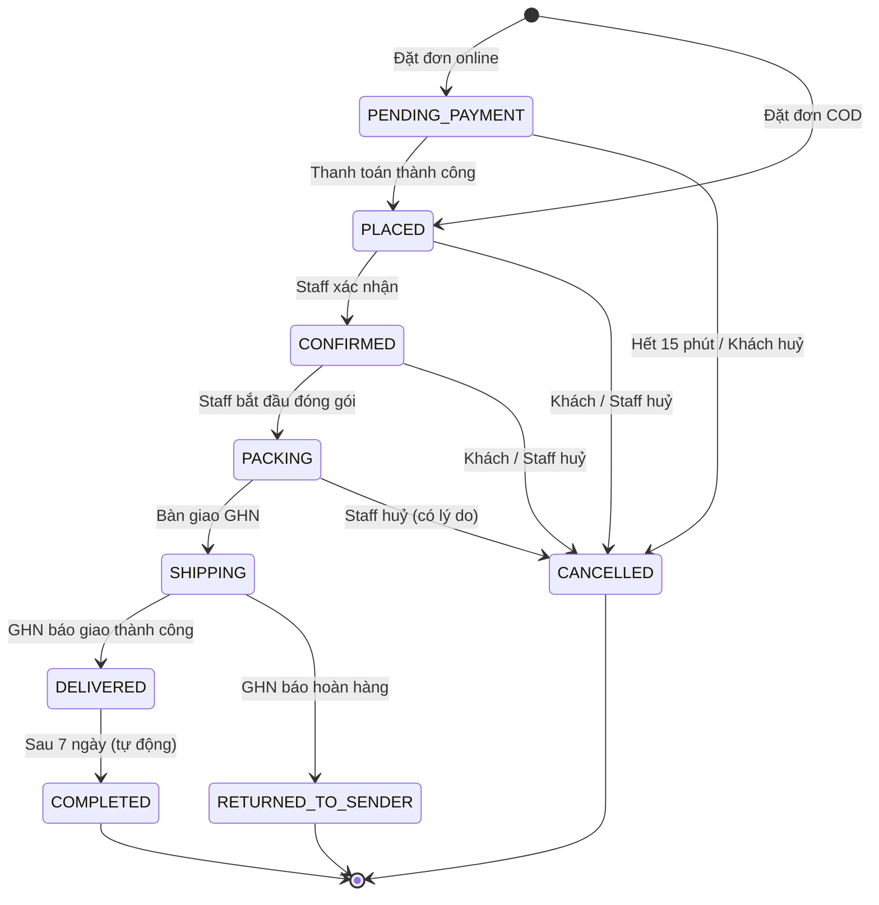

# 05. Vòng đời Đơn hàng

> Trạng thái: **Bản nháp chờ review**. Thuật ngữ dùng theo [GLOSSARY.md](../../GLOSSARY.md), quy tắc tham chiếu [04-business-rules.md](./04-business-rules.md).

## 1. Các trạng thái

| Trạng thái | Mã (code) | Ý nghĩa |
|---|---|---|
| Chờ thanh toán | `PENDING_PAYMENT` | Đơn online đã tạo, đang Giữ hàng 15 phút, chờ tiền về |
| Chờ xác nhận | `PLACED` | Đơn COD vừa đặt, hoặc đơn online đã thanh toán; chờ Staff xác nhận |
| Đã xác nhận | `CONFIRMED` | Staff đã kiểm tra đơn hợp lệ |
| Đang đóng gói | `PACKING` | Kho đang soạn và đóng gói hàng |
| Đang giao | `SHIPPING` | Đã bàn giao cho GHN, có mã vận đơn |
| Đã giao | `DELIVERED` | GHN báo giao thành công; bắt đầu tính 7 ngày Đổi trả |
| Hoàn tất | `COMPLETED` | 7 ngày sau Đã giao; hết quyền Đổi trả, chốt doanh thu |
| Đã huỷ | `CANCELLED` | Đơn bị huỷ (bởi khách, Staff hoặc hệ thống) |
| Hoàn hàng | `RETURNED_TO_SENDER` | Giao thất bại, GHN trả hàng về Kho |

Trạng thái cuối (không chuyển tiếp được nữa): `COMPLETED`, `CANCELLED`, `RETURNED_TO_SENDER`.

## 2. Sơ đồ trạng thái

## 3. Bảng chuyển trạng thái

| # | Từ | Sang | Ai / cái gì kích hoạt | Điều kiện | Tác động kèm theo |
|---|---|---|---|---|---|
| T1 | — | `PENDING_PAYMENT` | Khách đặt đơn online | Đủ hàng (BR-INV-06) | Tạo Giữ hàng 15 phút; tính lượt Voucher |
| T2 | — | `PLACED` | Khách đặt đơn COD | Đủ hàng; tổng tiền ≤ hạn mức COD (BR-PAY-06) | Trừ Tồn kho; tính lượt Voucher; email "Đặt đơn thành công" |
| T3 | `PENDING_PAYMENT` | `PLACED` | Hệ thống, khi nhận IPN hoặc đối soát thành công | Số tiền khớp (BR-PAY-04); Giữ hàng còn hiệu lực | Chuyển Giữ hàng thành trừ Tồn kho; email "Thanh toán thành công" |
| T4 | `PENDING_PAYMENT` | `CANCELLED` | Hệ thống, khi hết 15 phút | Chưa nhận được tiền | Giải phóng Giữ hàng; trả lượt Voucher |
| T5 | `PENDING_PAYMENT` | `CANCELLED` | Khách | — | Như T4 |
| T6 | `PLACED` | `CONFIRMED` | Staff | — | — |
| T7 | `PLACED`, `CONFIRMED` | `CANCELLED` | Khách hoặc Staff | Staff phải nhập lý do | Trả Tồn kho; trả lượt Voucher; tạo Hoàn tiền nếu đã thanh toán online; email "Đơn đã huỷ" |
| T8 | `CONFIRMED` | `PACKING` | Staff | — | Từ đây khách **không** tự huỷ được nữa |
| T9 | `PACKING` | `CANCELLED` | Chỉ Staff | Bắt buộc nhập lý do | Như T7 |
| T10 | `PACKING` | `SHIPPING` | Staff bàn giao | Tạo vận đơn GHN thành công | Lưu mã vận đơn; email "Đơn đang được giao" |
| T11 | `SHIPPING` | `DELIVERED` | Hệ thống, khi GHN báo giao thành công | — | Ghi thời điểm giao; email "Đã giao"; với COD: ghi nhận đã thu tiền |
| T12 | `SHIPPING` | `RETURNED_TO_SENDER` | Hệ thống, khi GHN báo hoàn hàng | — | Chờ Staff xác nhận nhận hàng về Kho để cộng lại Tồn kho (BR-INV-08); tạo Hoàn tiền nếu đã thanh toán online |
| T13 | `DELIVERED` | `COMPLETED` | Hệ thống, job định kỳ | Đã qua 7 ngày kể từ Đã giao và không có yêu cầu Đổi trả đang mở **[Giả định]** | Chốt doanh thu |

Mọi chuyển trạng thái không có trong bảng đều bị **từ chối**.

## 4. Các tình huống đặc biệt

### 4.1. Tiền về sau khi đơn đã bị huỷ

Khách thanh toán ở giây thứ 14:59, nhưng IPN tới sau khi hệ thống đã huỷ đơn (T4):

1. Đơn **giữ nguyên** `CANCELLED`, không "sống lại" vì hàng có thể đã được bán cho người khác.
2. Hệ thống tự tạo **yêu cầu Hoàn tiền** và báo Staff (BR-PAY-05).
3. Gửi email cho khách: đơn đã hết hạn, tiền sẽ được hoàn.

### 4.2. Thông báo tới không theo thứ tự

Các thông báo từ cổng thanh toán và GHN có thể tới trễ hoặc lặp lại. Hệ thống **không dựa vào thứ tự tới**: mỗi thông báo được đối chiếu với trạng thái hiện tại của đơn, và chỉ áp dụng nếu chuyển trạng thái đó hợp lệ theo bảng ở mục 3. Thông báo trùng chỉ được xử lý một lần.

### 4.3. Huỷ khi đơn Đang giao

Đơn đã ở `SHIPPING` thì **không huỷ được** trực tiếp. Nếu khách từ chối nhận hàng, GHN sẽ báo hoàn hàng và đơn chuyển sang `RETURNED_TO_SENDER` (T12) **[Giả định]**.

### 4.4. Đổi trả sau khi Đã giao

Yêu cầu Đổi trả **không** đổi trạng thái của Đơn hàng. Nó được theo dõi như một yêu cầu riêng gắn với đơn, có vòng đời riêng: Đã ghi nhận → Đã nhận hàng → Chấp nhận / Từ chối → Đã hoàn tiền **[Giả định]**. Khi có yêu cầu Đổi trả đang mở, đơn chưa chuyển sang `COMPLETED` (T13).

## 5. Thời gian và job tự động

| Việc | Tần suất | Liên quan |
|---|---|---|
| Huỷ đơn `PENDING_PAYMENT` quá 15 phút | Mỗi phút | T4 |
| Đối soát thanh toán treo với VNPay / MoMo | Mỗi 5 phút | T3 |
| Đối soát trạng thái vận đơn với GHN | Mỗi 15 phút **[Giả định]** | T11, T12 |
| Chuyển `DELIVERED` quá 7 ngày sang `COMPLETED` | Mỗi giờ | T13 |
