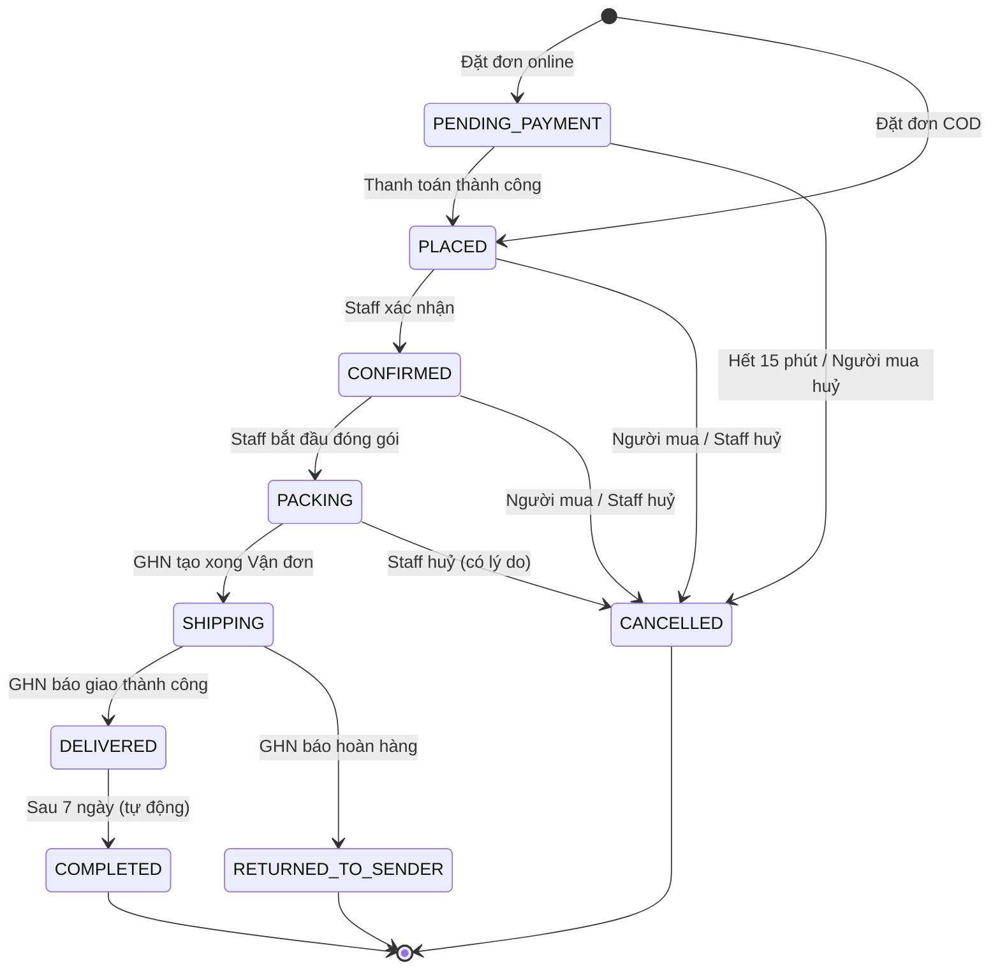

# 05. Vòng đời Đơn hàng

> Trạng thái: **Bản nháp chờ review**. Thuật ngữ dùng theo [GLOSSARY.md](../../GLOSSARY.md), quy tắc tham chiếu [04-business-rules.md](./04-business-rules.md).

## 1. Các trạng thái

| Trạng thái | Mã (code) | Ý nghĩa |
|---|---|---|
| Chờ thanh toán | `PENDING_PAYMENT` | Đơn online đã tạo, đang Giữ hàng 15 phút, chờ tiền về |
| Chờ xác nhận | `PLACED` | Đơn COD vừa đặt, hoặc đơn online đã thanh toán; chờ Staff xác nhận |
| Đã xác nhận | `CONFIRMED` | Staff đã kiểm tra đơn hợp lệ |
| Đang đóng gói | `PACKING` | Kho đang soạn và đóng gói hàng; khi Staff đã bàn giao, đơn vẫn ở đây cho tới khi GHN tạo xong Vận đơn |
| Đang giao | `SHIPPING` | GHN đã tạo Vận đơn, hàng đã bàn giao |
| Đã giao | `DELIVERED` | GHN báo giao thành công; bắt đầu tính 7 ngày Đổi trả |
| Hoàn tất | `COMPLETED` | Đã hết hạn Đổi trả (7 ngày sau Đã giao) và không còn Đổi trả nào đang mở; chốt Doanh thu |
| Đã huỷ | `CANCELLED` | Đơn bị huỷ (bởi Người mua, Staff hoặc hệ thống) |
| Hoàn hàng | `RETURNED_TO_SENDER` | Giao thất bại, GHN trả hàng về Kho |

Trạng thái cuối (không chuyển tiếp được nữa): `COMPLETED`, `CANCELLED`, `RETURNED_TO_SENDER`.

## 2. Sơ đồ trạng thái

## 3. Bảng chuyển trạng thái

| # | Từ | Sang | Ai / cái gì kích hoạt | Điều kiện | Tác động kèm theo |
|---|---|---|---|---|---|
| T1 | — | `PENDING_PAYMENT` | Người mua đặt đơn online | Đủ hàng (BR-INV-06); tổng tiền khớp bước tính thử (BR-ORD-07) | Tạo Giữ hàng 15 phút; tính lượt Voucher. **Không** gửi email |
| T2 | — | `PLACED` | Người mua đặt đơn COD | Đủ hàng; tổng tiền khớp bước tính thử (BR-ORD-07); tổng tiền ≤ hạn mức COD (BR-PAY-06) | Trừ Tồn kho, ghi Hàng chờ xuất; tính lượt Voucher; tạo khoản thu COD chờ thu; email "Đặt đơn thành công" |
| T3 | `PENDING_PAYMENT` | `PLACED` | Hệ thống, khi nhận IPN hoặc Đối soát thành công | Số tiền khớp (BR-PAY-04); Giữ hàng còn hiệu lực. Link thanh toán hết hạn sau 10 phút, sớm hơn Giữ hàng 5 phút (BR-INV-05) | Chuyển Giữ hàng thành trừ Tồn kho và Hàng chờ xuất; email "Thanh toán thành công" |
| T4 | `PENDING_PAYMENT` | `CANCELLED` | Hệ thống, khi hết 15 phút | Đơn vẫn ở `PENDING_PAYMENT` lúc job chạy. Tiền đã về nhưng chưa kịp xử lý T3 không chặn T4 (mục 4.1) | Giải phóng Giữ hàng; trả lượt Voucher. **Không** gửi email (BR-NTF-01) |
| T5 | `PENDING_PAYMENT` | `CANCELLED` | Người mua | — | Như T4 |
| T6 | `PLACED` | `CONFIRMED` | Staff | — | — |
| T7 | `PLACED`, `CONFIRMED` | `CANCELLED` | Người mua hoặc Staff | Staff phải nhập lý do | Trả Hàng chờ xuất về Tồn kho; trả lượt Voucher; tạo Hoàn tiền toàn bộ Tổng tiền đơn nếu đã thanh toán online (BR-REF-05); huỷ khoản thu COD nếu là đơn COD; email "Đơn đã huỷ" |
| T8 | `CONFIRMED` | `PACKING` | Staff | — | Từ đây Người mua **không** tự huỷ được nữa |
| T9 | `PACKING` | `CANCELLED` | Chỉ Staff | Bắt buộc nhập lý do; **không** có Vận đơn đang được tạo (mục 4.5) | Như T7 |
| T10 | `PACKING` | `SHIPPING` | Hệ thống, khi GHN tạo Vận đơn thành công sau khi Staff bàn giao | Staff đã bấm bàn giao; việc tạo Vận đơn chạy nền | Lưu mã Vận đơn; xoá Hàng chờ xuất của đơn (BR-INV-10); email "Đơn đang được giao". Tạo Vận đơn thất bại: đơn giữ `PACKING` và được gắn Cờ cần xử lý; Staff bàn giao lại thì dùng lại Vận đơn đó |
| T11 | `SHIPPING` | `DELIVERED` | Hệ thống, khi GHN báo giao thành công | — | Ghi thời điểm giao; email "Đã giao"; với COD: ghi nhận khoản thu COD đã thu |
| T12 | `SHIPPING` | `RETURNED_TO_SENDER` | Hệ thống, khi GHN báo hoàn hàng | — | Chờ Staff xác nhận nhận hàng về Kho để cộng lại Tồn kho (BR-INV-08); tạo Hoàn tiền toàn bộ Tổng tiền đơn nếu đã thanh toán online (BR-REF-05); huỷ khoản thu COD nếu là đơn COD |
| T13 | `DELIVERED` | `COMPLETED` | Hệ thống, job định kỳ | Đã qua 7 ngày (đủ 7 × 24 giờ) kể từ Đã giao và không có yêu cầu Đổi trả đang mở (mục 4.4) | Chốt Doanh thu (BR-REV-01) |

Mọi chuyển trạng thái không có trong bảng đều bị **từ chối**.

## 4. Các tình huống đặc biệt

### 4.1. Tiền về cho đơn không còn chờ thanh toán

Link thanh toán hết hạn sau 10 phút, còn Giữ hàng hết hạn sau 15 phút, nên thông báo thanh toán đến muộn vài phút vẫn kịp T3. Tiền vẫn có thể về cho một đơn không còn ở `PENDING_PAYMENT` trong hai trường hợp:

- **Đơn đã bị huỷ**: thông báo thanh toán tới quá muộn, sau khi hệ thống đã huỷ đơn (T4), hoặc Người mua đã tự huỷ (T5) trong lúc đang trả tiền. Kể cả khi tiền về trước phút 15, nếu hệ thống chưa kịp xử lý T3 mà job huỷ đơn đã chạy thì đơn vẫn bị huỷ và tiền được hoàn.
- **Đơn đã được thanh toán**: Người mua mở hai tab và trả tiền ở cả hai lần thử; lần thứ hai tới khi đơn đã `PLACED`.

Cách xử lý chung (BR-PAY-05):

1. Đơn **giữ nguyên** trạng thái hiện tại. Đơn đã huỷ không "sống lại" vì hàng có thể đã được bán cho người khác.
2. Hệ thống tự tạo **yêu cầu Hoàn tiền** cho khoản tiền đó và gắn Cờ cần xử lý cho Staff.
3. Gửi email cho Người mua báo tiền sẽ được hoàn, qua sự kiện `ordering.unexpected-payment-received` ([07-async-events-jobs.md](../architecture/07-async-events-jobs.md) mục 2). Với đơn đã huỷ, email báo thêm đơn đã hết hạn.

Hoàn tiền gắn đúng Thanh toán từ thông báo, có định danh thao tác ổn định để xử lý lại không tạo thêm yêu cầu (BR-REF-06). Thông báo lặp của chính Thanh toán đã dùng để đưa đơn vào `PLACED` chỉ bị bỏ qua; không coi là khoản trả thêm.

### 4.2. Thông báo tới không theo thứ tự

Các thông báo từ Cổng thanh toán và GHN có thể tới trễ hoặc lặp lại. Hệ thống **không dựa vào thứ tự tới**: mỗi thông báo được đối chiếu với trạng thái hiện tại của đơn, và chỉ áp dụng nếu chuyển trạng thái đó hợp lệ theo bảng ở mục 3. Cụ thể:

- Thông báo trùng, hoặc báo một bước đơn đã qua: bỏ qua.
- Thông báo tới sớm hơn bước trước nó, ví dụ GHN báo đã giao khi hệ thống chưa ghi nhận Vận đơn tạo xong: hệ thống giữ lại và thử áp dụng lại sau. Thử lại nhiều lần mà vẫn chưa áp dụng được thì báo cho đội kỹ thuật ([07-async-events-jobs.md](../architecture/07-async-events-jobs.md) mục 1.3).
- Thông báo mâu thuẫn với trạng thái đơn, ví dụ GHN báo đã giao khi đơn đã Hoàn hàng: không áp dụng, chỉ ghi log.

### 4.3. Huỷ khi đơn Đang giao

Đơn đã ở `SHIPPING` thì **không huỷ được** trực tiếp. Nếu Người mua từ chối nhận hàng, GHN sẽ báo hoàn hàng và đơn chuyển sang `RETURNED_TO_SENDER` (T12) **[Giả định]**.

### 4.4. Đổi trả sau khi Đã giao

Yêu cầu Đổi trả **không** đổi trạng thái của Đơn hàng. Nó được theo dõi như một yêu cầu riêng gắn với đơn, có vòng đời riêng: Đã ghi nhận → Đã nhận hàng → Chấp nhận / Từ chối → Đã hoàn tiền.

- **Đã nhận hàng**: Staff xác nhận hàng gửi trả đã về Kho. Tồn kho **chưa** được cộng lại ở bước này.
- **Chấp nhận / Từ chối**: Staff quyết định theo từng dòng, nhập số lượng được chấp nhận và chọn nhập lại Tồn kho hay không (BR-RET-08). Chỉ phần được chấp nhận và chọn nhập lại mới cộng lại Tồn kho (BR-INV-08). Không dòng nào được chấp nhận thì yêu cầu bị Từ chối; hàng không được chấp nhận được gửi lại cho Người mua (BR-RET-09).
- **Đã hoàn tiền**: khi Chấp nhận, hệ thống tạo yêu cầu Hoàn tiền theo BR-RET-07 và gắn nó với yêu cầu Đổi trả. Yêu cầu chuyển sang Đã hoàn tiền khi Staff ghi nhận đúng Hoàn tiền đó.

Yêu cầu Đổi trả **đang mở** là yêu cầu chưa bị Từ chối và chưa Đã hoàn tiền. Khi còn yêu cầu đang mở, đơn chưa chuyển sang `COMPLETED` (T13), kể cả khi đã hết hạn Đổi trả.

### 4.5. Staff huỷ đơn khi Vận đơn đang được tạo

Sau khi Staff bàn giao, việc tạo Vận đơn ở GHN chạy nền nên đơn vẫn ở `PACKING` trong lúc chờ. Nếu Staff huỷ đúng lúc này (T9) mà GHN vẫn tạo xong Vận đơn, shipper sẽ tới lấy hàng của một đơn đã huỷ. Vì vậy:

1. T9 bị **từ chối** khi Vận đơn requested hoặc creation_unknown (chưa biết GHN đã tạo hay chưa). Staff chờ đối soát có kết quả chắc chắn rồi mới huỷ hoặc bàn giao lại; timeout không có nghĩa tạo thất bại.
2. Nếu vẫn xảy ra (GHN báo tạo xong Vận đơn khi đơn đã `CANCELLED`), hệ thống tự yêu cầu GHN huỷ Vận đơn đó và gắn Cờ cần xử lý cho Staff kiểm tra.

### 4.6. Tiền về sai số tiền

Số tiền Cổng thanh toán báo về khác Tổng tiền đơn (BR-PAY-04):

1. Thanh toán **không** được xác nhận; đơn giữ `PENDING_PAYMENT`.
2. Hệ thống tự tạo yêu cầu Hoàn tiền đúng số tiền đã nhận và gắn Cờ cần xử lý `payment_amount_mismatch`.
3. Người mua trả lại đúng số tiền được nếu link còn hạn (phút thứ 10). Nếu không, đơn bị huỷ khi Giữ hàng hết hạn (T4).

## 5. Thời gian và job tự động

| Việc | Tần suất | Liên quan |
|---|---|---|
| Huỷ đơn `PENDING_PAYMENT` quá 15 phút | Mỗi phút | T4 |
| Đối soát Thanh toán treo với VNPay / MoMo | Mỗi 5 phút | T3 |
| Đối soát trạng thái Vận đơn với GHN | Mỗi 15 phút **[Giả định]** | T11, T12 |
| Chuyển `DELIVERED` quá 7 ngày sang `COMPLETED` | Mỗi giờ | T13 |
